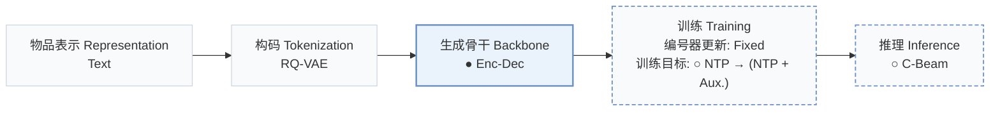
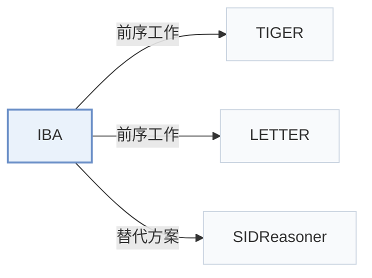

# IBA

[← 问题 × 阶段矩阵](../../../README.zh.md#v--backbone) · [按阶段索引](../index/stages.md) · [按模态找论文](../index/modality.md) · [按领域找论文](../index/domain.md) · [English](../../papers/iba.md) | 中文

| **题目** | *Where Reasoning Matters: Rethinking Latent Reasoning in Semantic ID-based Generative Recommendation* |
| :-- | :-- |
| **作者** | Yang et al. |
| **发表** | arXiv’26 |
| **问题与阶段** | `V. 效率` · `生成骨干（Backbone）` |
| **改动** | ● 生成骨干 · ○ 训练目标 · ○ 推理 |
| **构码输入** | `Text` |
| **领域** | `电商` · `短视频与直播` |
| **应用场景** | `一般物品推荐`；`公开数据` |
| **链接** | [论文](https://arxiv.org/abs/2607.12425) |
| **阅读级别** | 概览（第 1 级） |

**本页目录**：[TL;DR](#tldr) · [3. 实验发现](#3-实验发现) · [5. 相关工作](#5-相关工作)

- `Text`：物品文本元数据（标题、描述、类目或提示词）。
- `RQ-VAE`：残差量化变分自编码器（Residual-Quantized VAE）。
- `Enc-Dec`：编码器-解码器（Encoder-decoder）架构。
- `Fixed`：先独立训练并冻结编号器，生成器训练期间 SID 保持不变。
- `NTP → (NTP + Aux.)`：先进行下一 token 预测预训练，再联合优化下一 token 预测与辅助目标。
- `C-Beam`：受合法物品集合约束的束搜索（Constrained beam search）。

### TL;DR

> [!NOTE]
> IBA 按信息增益在各 SID 位置之间分配隐式推理步数，将更多计算分给信息量更大的前序位置，替代每个位置固定步数的做法。

---

### 3. 实验发现

实验设置

- **数据集**：Amazon Instruments and Beauty; MicroLens. Users with fewer than 5 interactions removed; training histories capped at 20 items.
  - 出处：Section IV-A1: [S4.SS1.SSS1.p1](https://arxiv.org/html/2607.12425v1#S4.SS1.SSS1.p1)
- **切分**：Leave-one-out, one test target per user; exact validation/test allocation not reported.
  - 出处：Sections IV-A1/IV-A3: [S4.SS1.SSS1.p1](https://arxiv.org/html/2607.12425v1#S4.SS1.SSS1.p1) and [S4.SS1.SSS3.p1](https://arxiv.org/html/2607.12425v1#S4.SS1.SSS3.p1)
- **候选集**：not reported
  - 出处：Section IV-A describes metrics and catalog-valid trie decoding, not evaluation negatives: [S4.SS1.SSS3.p1](https://arxiv.org/html/2607.12425v1#S4.SS1.SSS3.p1) and [S4.SS1.SSS4.p2](https://arxiv.org/html/2607.12425v1#S4.SS1.SSS4.p2)
- **可见性**：warm; no unseen-item protocol is defined. Information-gain prior estimated from training interactions only; tokenizer exposure to test items not reported.
  - 出处：Sections IV-A1/III-A define no item holdout: [S4.SS1.SSS1.p1](https://arxiv.org/html/2607.12425v1#S4.SS1.SSS1.p1) and [S3.SS1.p1](https://arxiv.org/html/2607.12425v1#S3.SS1.p1)
- **SID 规格**：RQ-VAE on Sentence-T5 text embeddings: 4 tokens; codebook sizes and collision handling not reported.
  - 出处：Sections II-A and IV-A: [S2.SS1.p2](https://arxiv.org/html/2607.12425v1#S2.SS1.p2) and [S4.SS1.SSS1.p1](https://arxiv.org/html/2607.12425v1#S4.SS1.SSS1.p1) and [S4.SS1.SSS4.p1](https://arxiv.org/html/2607.12425v1#S4.SS1.SSS4.p1)
- **推理预算**：Trie-constrained beam 20, maximum 10 generated tokens; 6 latent refinement steps with prior (3,2,1,0). NVIDIA RTX 4090 24GB; Instruments generation time 24.61 ms/user (TIGER 20.99, uniform 8-step refinement 25.78). Inference batch size not reported.
  - 出处：Sections IV-A4/IV-F and Table V: [S4.SS1.SSS4.p1](https://arxiv.org/html/2607.12425v1#S4.SS1.SSS4.p1) and [S4.SS1.SSS4.p2](https://arxiv.org/html/2607.12425v1#S4.SS1.SSS4.p2) and [S4.T5](https://arxiv.org/html/2607.12425v1#S4.T5)
- **结果来源**：Original Table II: TIGER/LETTER plus IBA and baselines; Tables III/IV: schedules/ablations; Table V: generation efficiency.
  - 出处：Tables II-V: [S4.T2](https://arxiv.org/html/2607.12425v1#S4.T2) and [S4.T3](https://arxiv.org/html/2607.12425v1#S4.T3) and [S4.T4](https://arxiv.org/html/2607.12425v1#S4.T4) and [S4.T5](https://arxiv.org/html/2607.12425v1#S4.T5)

---

### 5. 相关工作

- **前序工作** · [TIGER](tiger.md): IBA adds learned latent refinement allocation to TIGER.
  - 出处：IBA v1, Section IV-A2 and Table II: [S4.SS1.SSS2.p1](https://arxiv.org/html/2607.12425v1#S4.SS1.SSS2.p1); [S4.T2](https://arxiv.org/html/2607.12425v1#S4.T2).
- **前序工作** · [LETTER](letter.md): LETTER is the second tested base model for IBA.
  - 出处：IBA v1, Sections IV-A2/IV-B and Table II: [S4.SS1.SSS2.p1](https://arxiv.org/html/2607.12425v1#S4.SS1.SSS2.p1); [S4.SS2.p2](https://arxiv.org/html/2607.12425v1#S4.SS2.p2); [S4.T2](https://arxiv.org/html/2607.12425v1#S4.T2).
- **替代方案** · [SIDReasoner](sidreasoner.md): SIDReasoner aligns IDs with language; IBA allocates hidden refinement steps.
  - 出处：IBA v1, Section V-B2: [S5.SS2.SSS2.p2](https://arxiv.org/html/2607.12425v1#S5.SS2.SSS2.p2); [S5.SS2.SSS2.p3](https://arxiv.org/html/2607.12425v1#S5.SS2.SSS2.p3).

[查看同格全部论文](../../../README.zh.md#v--backbone)
