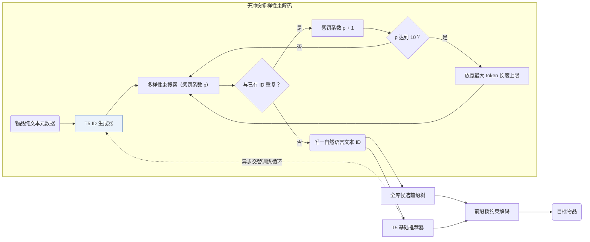
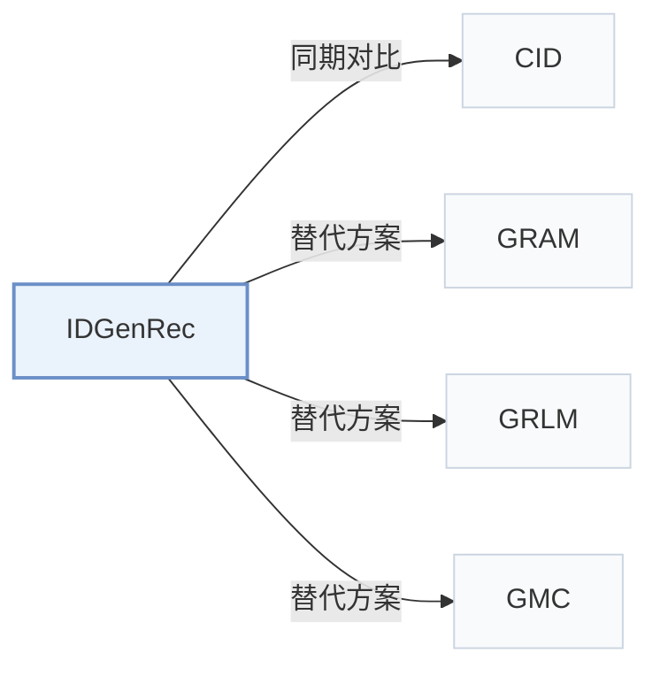

# IDGenRec

[← 问题 × 阶段矩阵](../../../README.zh.md#iii--tokenization) · [按阶段索引](../index/stages.md) · [按模态索引](../index/modality.md) · [English](../../papers/idgenrec.md) | 中文

| **题目** | *Llm-recsys alignment with textual id learning* |
| :-- | :-- |
| **作者** | Tan et al. |
| **发表** | SIGIR’24 |
| **问题与阶段** | `III. SID 与模型对齐` · `编号（Tokenization）` |
| **链接** | [论文](https://arxiv.org/abs/2403.19021) · [代码](https://github.com/agiresearch/IDGenRec) |
| **阅读级别** | 阅读笔记（第 2 级） |

**本页目录**：[TL;DR](#tldr) · [速览](#速览) · [1. 为什么重要](#1-为什么重要) · [2. 方法](#2-方法) · [3. 实验发现](#3-实验发现) · [4. 局限与分析](#4-局限与分析) · [5. 相关工作](#5-相关工作)

- `Text`：物品文本元数据（标题、描述、类目或提示词）。
- `LLM-Vocab`：直接从大语言模型原生词表 token 组合出的物品标识符。
- `Enc-Dec`：编码器-解码器（Encoder-decoder）架构。
- `Altern.`：编号器与生成器在训练过程中交替迭代更新。
- `NTP`：标准下一 token 预测（Next-Token Prediction）交叉熵损失；基于预训练 LLM 的指令微调（SFT）亦归入此类。
- `C-Beam`：受合法物品集合约束的束搜索（Constrained beam search）。

### TL;DR

> [!NOTE]
> IDGenRec 将文本 ID 生成器与 LLM 推荐器协同训练，为每个物品生成由自然语言 token 组成的简短 ID，并测试向未见平台的零样本迁移。

---

### 速览

| 维度 | 摘要 |
| :-- | :-- |
| 研究问题 | III. SID 与模型对齐：生成模型能否理解并推理离散 SID，编号器与生成器的优化目标是否一致？ |
| 核心贡献 | IDGenRec 将文本 ID 生成器与 LLM 推荐器协同训练，为每个物品生成由自然语言 token 组成的简短 ID，并测试向未见平台的零样本迁移。 |
| 主要改动阶段 | 编号（Tokenization） |
| 主要发现 | 在 19 个数据集上联合预训练并直接在跨平台 6 个未见数据集上零样本评测时，IDGenRec 达到或超越域内有监督传统推荐模型，且在标准序列推荐评测中优于对比基线（Abstract，Tables 4 and 7）。 |
| 局限 | 交替更新文本 ID 生成器会改变全库物品的 ID，训练期间需随之重建合法候选前缀树（Sec. 2.4）。 |

---

### 1. 为什么重要

词表外的数值码本会将生成式推荐器绑定在单一物品库上，而直接使用原始标题又冗长嘈杂（Abstract）。IDGenRec 训练一个 T5 ID 生成器，把物品元数据压缩为简短且唯一的自然语言语义 ID（Semantic ID，SID；属 `LLM-Vocab`），使交互历史变成与平台无关的纯文本序列，直接支持跨平台零样本迁移。

> "We propose an alternate training strategy that trains the LLM-based ID generator and the base recommender asynchronously, ensuring that their learned knowledge is well-aligned."（Sec. 1）

---

### 2. 方法

#### ID 生成器

ID 生成器与基础推荐器均以 T5 为骨干（Sec. 2.6）。ID 生成器读入标题、品类、价格、描述、创建时间、热度与地点等纯文本物品信息，在原生词表上生成简短的词片标识（Sec. 2.2）。

#### 生成唯一 ID

生成阶段通过多样性束搜索强制消除冲突：一旦检测到与已有物品重名，束搜索的多样性惩罚每轮加 1；累加到 10 仍冲突时则放宽长度上限，直至每个物品获得唯一 ID（Sec. 2.3，Sec. 3.2）。

> "If a duplicate is detected, the algorithm increases the diversity penalty in the beam search."（Sec. 2.3）

#### 基础推荐器

基础推荐器将用户历史拼接成文本 ID 序列，在存有全库候选 ID 的前缀树约束下解码目标物品，并与 ID 生成器异步交替更新（Sec. 1，Sec. 2.4）。

> "To ensure that the decoded ID corresponds to an actual existing item, we adopt a constrained sequence decoding strategy (De Cao et al., 2020). More specifically, a prefix tree is used to store all generated candidate IDs."（Sec. 2.4）

---

### 3. 实验发现

实验设置

- **数据集**：Standard: Amazon Sports, Beauty, Toys and Yelp, filtering users and items with fewer than 5 interactions (following P5 and Hua et al. 2023). Zero-shot: a Fusion pre-training corpus from 19 other Amazon categories, each downsampled to at most 30,000 users (183,918 users / 233,323 items), tested on Sports, Beauty, Toys, Music, Instruments, and Yelp.
  - 出处：Standard datasets and 5-interaction filter: [S3.SS1.p1](https://arxiv.org/html/2403.19021v2#S3.SS1.p1); zero-shot data rules: [S3.SS1.p3](https://arxiv.org/html/2403.19021v2#S3.SS1.p3) and [S3.SS1.p4](https://arxiv.org/html/2403.19021v2#S3.SS1.p4); statistics: [S3.T3](https://arxiv.org/html/2403.19021v2#S3.T3).
- **切分**：Leave-one-out for testing (validation allocation not restated). Zero-shot: train once on Fusion and test directly on held-out datasets.
  - 出处：Leave-one-out: [S3.SS3.p1](https://arxiv.org/html/2403.19021v2#S3.SS3.p1); zero-shot setting: [S3.SS5.p1](https://arxiv.org/html/2403.19021v2#S3.SS5.p1).
- **候选集**：full catalog (no negative sampling; ranking over all items).
  - 出处：Ranking over all items without negative sampling: [S3.SS3.p1](https://arxiv.org/html/2403.19021v2#S3.SS3.p1).
- **可见性**：Standard: warm; no unseen-item protocol is defined. Zero-shot: users and items of the test datasets are not seen in training; the ID generator is also trained only on the Fusion corpus, so test items are unseen by tokenizer too and receive IDs generated from their text.
  - 出处：Zero-shot: users and items unseen in training: [S3.SS5.p1](https://arxiv.org/html/2403.19021v2#S3.SS5.p1); the ID generator is trained with the recommender on the training data: [S3.SS2.p3](https://arxiv.org/html/2403.19021v2#S3.SS2.p3).
- **SID 规格**：Textual IDs generated from item text by a T5-small ID generator with diverse beam search (k=10 groups, diversity penalty raised from 1 to 10), length initially in [1, 10) tokens and extended to [10, 20) when needed; uniqueness is enforced at generation time by rejecting duplicates. SentencePiece vocabulary of 32,128.
  - 出处：Diverse beam search for unique textual IDs, length ranges: [S2.SS3.p2](https://arxiv.org/html/2403.19021v2#S2.SS3.p2) and [S3.SS2.p2](https://arxiv.org/html/2403.19021v2#S3.SS2.p2); T5-small ID generator: from Section 2.
- **推理预算**：Constrained decoding over a prefix tree of all generated item IDs; beam width, hardware, inference batch size, and latency: not reported. HR and NDCG at 5 and 10.
  - 出处：Constrained decoding with a prefix tree over generated IDs: Section 2 inference; no beam width or hardware found.
- **结果来源**：Table 4 (standard evaluation versus traditional and P5-variant baselines); Table 5 (training strategies); Table 6 (user and item IDs); Table 7 (zero-shot intra- and inter-platform).
  - 出处：Standard: [S3.T4](https://arxiv.org/html/2403.19021v2#S3.T4); training strategies: [S3.T5](https://arxiv.org/html/2403.19021v2#S3.T5); user/item IDs: [S3.T6](https://arxiv.org/html/2403.19021v2#S3.T6); zero-shot: [S3.T7](https://arxiv.org/html/2403.19021v2#S3.T7).

- 标准序列推荐：在域内监督设置下，IDGenRec 优于传统序列推荐模型与 P5 系列基线（Abstract，Table 4）。
- 跨平台零样本迁移：在 19 个数据集上预训练后，直接在来自其他平台的 6 个未见数据集上零样本测试，效果与域内有监督训练的部分传统推荐器相当甚至更好（Abstract，Table 7）。

---

### 4. 局限与分析

**Our analysis.**

- 靠逐步调高多样性惩罚和放宽长度消除冲突时，高密度相似物品簇中后处理的物品容易被迫选用偏离核心语义的词语。
- CID 从 `CF` 共现图构建固定的 `Spectral Clus.` 数值码；IDGenRec 从文本生成 `LLM-Vocab` 自然语言词串并采用交替更新（`Altern.`）。

---

### 5. 相关工作

- **同期对比** · [CID](cid.md): P5-SID, P5-CID, and P5-SemID assign sequential, collaborative, or category IDs; IDGenRec learns a textual ID generator jointly with the recommender.
  - 出处：IDGenRec v2, baselines: [S3.I1.i2.p1](https://arxiv.org/html/2403.19021v2#S3.I1.i2.p1); Table 4: [S3.T4](https://arxiv.org/html/2403.19021v2#S3.T4).
- **替代方案** · [GRAM](gram.md): GRAM later builds hierarchical textual IDs by clustering and reports that IDGenRec's user IDs concatenate validation and test items; it reruns IDGenRec without user IDs.
  - 出处：Evidence is from the later GRAM paper: Table 9 and Appendix E: [A4.T9](https://arxiv.org/html/2506.01673v1#A4.T9) and [A5.p3](https://arxiv.org/html/2506.01673v1#A5.p3); Table 2: [S4.T2](https://arxiv.org/html/2506.01673v1#S4.T2).
- **替代方案** · [GRLM](grlm.md): GRLM later replaces free textual IDs with a fixed number of standardized vocabulary terms to reduce synonym ambiguity.
  - 出处：Evidence is from the later GRLM paper: baselines and Table 2: [S4.I1.i3.p1](https://arxiv.org/html/2601.06798v1#S4.I1.i3.p1) and [S5.T2](https://arxiv.org/html/2601.06798v1#S5.T2); case study: [A3.p1](https://arxiv.org/html/2601.06798v1#A3.p1).
- **替代方案** · [GMC](gmc.md): GMC later compares against IDGenRec in a multi-domain setting with codebook IDs shared across domains.
  - 出处：Evidence is from the later GMC paper: generative baselines and Table 3: [S5.I1.i4.I1.i3.p1](https://arxiv.org/html/2507.12871v3#S5.I1.i4.I1.i3.p1) and [S5.T3](https://arxiv.org/html/2507.12871v3#S5.T3).

[查看同格全部论文](../../../README.zh.md#iii--tokenization)
