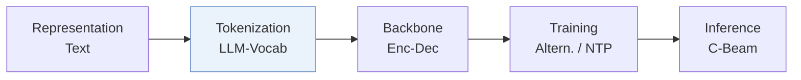
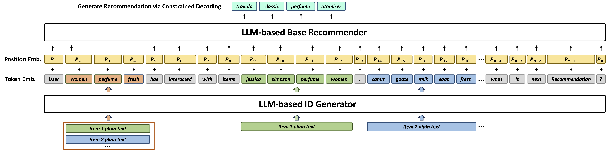
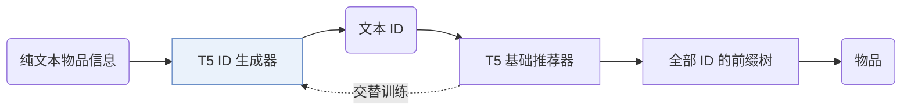
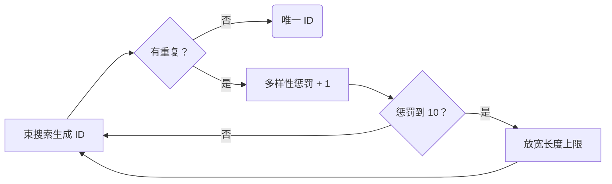
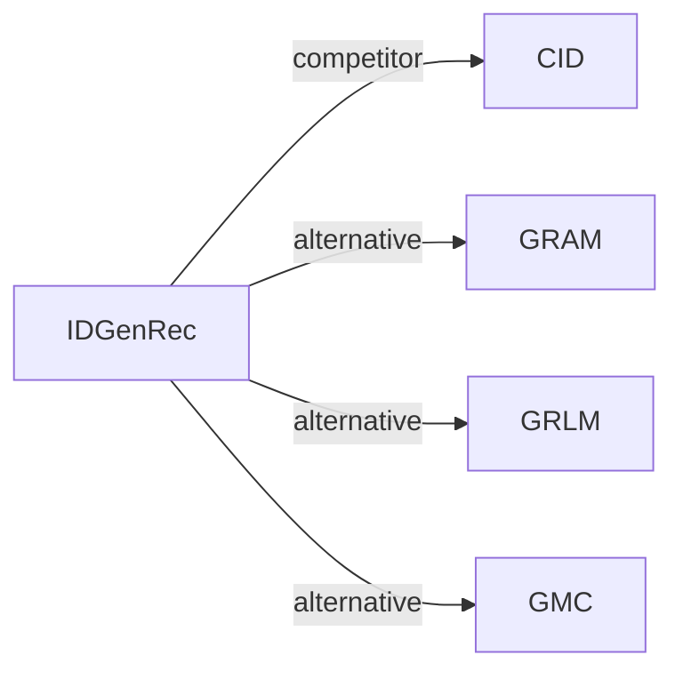

# IDGenRec

| **题目** | *Llm-recsys alignment with textual id learning* |
| :-- | :-- |
| **作者** | Tan et al. |
| **会议** | SIGIR’24 |
| **问题与阶段** | `III. SID 与模型对齐` · `Tokenization` |
| **链接** | [论文](https://arxiv.org/abs/2403.19021) · [代码](https://github.com/agiresearch/IDGenRec) · [矩阵](../../../README.zh.md#iii--tokenization) · [English](../../papers/idgenrec.md) |
| **阅读级别** | 阅读笔记（第 2 级） |

本页目录：[TL;DR](#tldr) · [速览](#速览) · [1. 为什么重要](#1-为什么重要) · [2. 方法](#2-方法) · [3. 实验发现](#3-实验发现) · [4. 局限与分析](#4-局限与分析) · [5. 相关工作](#5-相关工作)

- `Enc-Dec`: Encoder-decoder.
- `Altern.`: Tokenizer and generator are updated in turns.
- `NTP`: Next-token prediction loss only; continuing from a pretrained LLM (SFT) also counts as NTP.
- `C-Beam`: Constrained beam search.

### TL;DR

> [!NOTE]
> IDGenRec 将文本 ID 生成器与 LLM 推荐器协同训练，为每个物品生成由自然语言 token 组成的简短 ID，并测试向未见平台的零样本迁移。

---

### 速览

| 维度 | 摘要 |
| :-- | :-- |
| 研究问题 | III. SID 与模型对齐：Can the generator read, write, and reason over SIDs, and do the tokenizer and generator work toward the same goal? |
| 核心贡献 | IDGenRec 将文本 ID 生成器与 LLM 推荐器协同训练，为每个物品生成由自然语言 token 组成的简短 ID，并测试向未见平台的零样本迁移。 |
| 主要改动阶段 | Tokenization |
| 局限 | ID 生成器一更新，物品 ID 就变，训练中要重建合法 ID 的前缀树（Sec. 2.4）。 |

---

### 1. 为什么重要

作者指出，在文本到文本的框架里，很难给物品编出既简短又有意义的 ID（Abstract）。IDGenRec 的 ID 都是普通词语，用户历史因此成了与平台无关的文本，可以做零样本迁移（Abstract）。

> "We propose an alternate training strategy that trains the LLM-based ID generator and the base recommender asynchronously, ensuring that their learned knowledge is well-aligned."（Sec. 1）（交替训练 ID 生成器和基础推荐器，让两者学到的知识对齐。）

---

### 2. 方法

#### ID 生成器

ID 生成器读入纯文本的物品信息，如标题、品类、价格、描述、创建时间、热度和地点（Sec. 2.2）。两个模型的骨干都是 T5（Sec. 2.6）。

#### 生成唯一 ID

生成器一直生成，直到每个物品都有唯一的 ID（Sec. 2.3）。

> "If a duplicate is detected, the algorithm increases the diversity penalty in the beam search."（Sec. 2.3）（发现重复就加大束搜索的多样性惩罚。）

惩罚每轮加 1；加到 10 仍不唯一，就放宽长度上限（Sec. 3.2）。

#### 基础推荐器

基础推荐器在前缀树约束下解码目标 ID（Sec. 2.4）。

> "To ensure that the decoded ID corresponds to an actual existing item, we adopt a constrained sequence decoding strategy (De Cao et al., 2020). More specifically, a prefix tree is used to store all generated candidate IDs."（Sec. 2.4）（用前缀树存放所有候选 ID，做约束解码，保证解出的 ID 对应真实物品。）

---

### 3. 实验发现

实验设置

- **数据集**：Standard: Amazon Sports, Beauty, Toys and Yelp, filtering users and items with fewer than 5 interactions (following P5 and Hua et al. 2023). Zero-shot: a Fusion pre-training corpus from 19 other Amazon categories, each downsampled to at most 30,000 users (183,918 users / 233,323 items), tested on Sports, Beauty, Toys, Music, Instruments, and Yelp.
  - 出处：Standard datasets and 5-interaction filter: [S3.SS1.p1](https://arxiv.org/html/2403.19021v2#S3.SS1.p1); zero-shot data rules: [S3.SS1.p3](https://arxiv.org/html/2403.19021v2#S3.SS1.p3) and [S3.SS1.p4](https://arxiv.org/html/2403.19021v2#S3.SS1.p4); statistics: [S3.T3](https://arxiv.org/html/2403.19021v2#S3.T3).
- **切分**：Leave-one-out for testing (validation allocation not restated). Zero-shot: train once on Fusion and test directly on held-out datasets.
  - 出处：Leave-one-out: [S3.SS3.p1](https://arxiv.org/html/2403.19021v2#S3.SS3.p1); zero-shot setting: [S3.SS5.p1](https://arxiv.org/html/2403.19021v2#S3.SS5.p1).
- **候选集**：full catalog (no negative sampling; ranking over all items).
  - 出处：Ranking over all items without negative sampling: [S3.SS3.p1](https://arxiv.org/html/2403.19021v2#S3.SS3.p1).
- **可见性**：Standard: warm; no unseen-item protocol is defined. Zero-shot: users and items of the test datasets are not seen in training; the ID generator is also trained only on the Fusion corpus, so test items are unseen by tokenizer too and receive IDs generated from their text.
  - 出处：Zero-shot: users and items unseen in training: [S3.SS5.p1](https://arxiv.org/html/2403.19021v2#S3.SS5.p1); the ID generator is trained with the recommender on the training data: [S3.SS2.p3](https://arxiv.org/html/2403.19021v2#S3.SS2.p3).
- **SID 规格**：Textual IDs generated from item text by a T5-small ID generator with diverse beam search (k=10 groups, diversity penalty raised from 1 to 10), length initially in [1, 10) tokens and extended to [10, 20) when needed; uniqueness is enforced at generation time by rejecting duplicates. SentencePiece vocabulary of 32,128.
  - 出处：Diverse beam search for unique textual IDs, length ranges: [S2.SS3.p2](https://arxiv.org/html/2403.19021v2#S2.SS3.p2) and [S3.SS2.p2](https://arxiv.org/html/2403.19021v2#S3.SS2.p2); T5-small ID generator: from Section 2.
- **推理预算**：Constrained decoding over a prefix tree of all generated item IDs; beam width, hardware, inference batch size, and latency: not reported. HR and NDCG at 5 and 10.
  - 出处：Constrained decoding with a prefix tree over generated IDs: Section 2 inference; no beam width or hardware found.
- **结果来源**：Table 4 (standard evaluation versus traditional and P5-variant baselines); Table 5 (training strategies); Table 6 (user and item IDs); Table 7 (zero-shot intra- and inter-platform).
  - 出处：Standard: [S3.T4](https://arxiv.org/html/2403.19021v2#S3.T4); training strategies: [S3.T5](https://arxiv.org/html/2403.19021v2#S3.T5); user/item IDs: [S3.T6](https://arxiv.org/html/2403.19021v2#S3.T6); zero-shot: [S3.T7](https://arxiv.org/html/2403.19021v2#S3.T7).

- 标准设置：在序列推荐上，IDGenRec 好于已有模型（Abstract）。
- 零样本设置：在 19 个数据集上训练、在其他平台的 6 个未见数据集上测试，效果与部分有监督的传统推荐器相当或更好（Abstract）。

---

### 4. 局限与分析

**Our analysis.**

- 唯一 ID 靠加大多样性惩罚和放宽长度得到。由此推断，相似物品的 ID 可能被随意的词拉开。
- CID 从 `CF` 信号构建 `Spectral Clus.` ID 并保持不变；IDGenRec 从文本构建 `LLM-Vocab` ID，并会更新。

---

### 5. 相关工作

- **同期对比** · [CID](cid.md): P5-SID, P5-CID, and P5-SemID assign sequential, collaborative, or category IDs; IDGenRec learns a textual ID generator jointly with the recommender.
  - 出处：IDGenRec v2, baselines: https://arxiv.org/html/2403.19021v2#S3.I1.i2.p1; Table 4: https://arxiv.org/html/2403.19021v2#S3.T4.
- **替代方案** · [GRAM](gram.md): GRAM later builds hierarchical textual IDs by clustering and reports that IDGenRec's user IDs concatenate validation and test items; it reruns IDGenRec without user IDs.
  - 出处：Evidence is from the later GRAM paper: Table 9 and Appendix E: https://arxiv.org/html/2506.01673v1#A4.T9 and https://arxiv.org/html/2506.01673v1#A5.p3; Table 2: https://arxiv.org/html/2506.01673v1#S4.T2.
- **替代方案** · [GRLM](grlm.md): GRLM later replaces free textual IDs with a fixed number of standardized vocabulary terms to reduce synonym ambiguity.
  - 出处：Evidence is from the later GRLM paper: baselines and Table 2: https://arxiv.org/html/2601.06798v1#S4.I1.i3.p1 and https://arxiv.org/html/2601.06798v1#S5.T2; case study: https://arxiv.org/html/2601.06798v1#A3.p1.
- **替代方案** · [GMC](gmc.md): GMC later compares against IDGenRec in a multi-domain setting with codebook IDs shared across domains.
  - 出处：Evidence is from the later GMC paper: generative baselines and Table 3: https://arxiv.org/html/2507.12871v3#S5.I1.i4.I1.i3.p1 and https://arxiv.org/html/2507.12871v3#S5.T3.

[查看同格全部论文](../../../README.zh.md#iii--tokenization)
