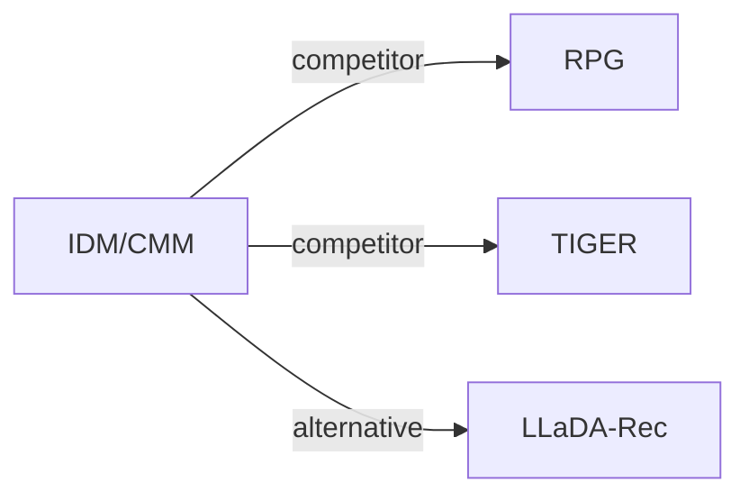

# IDM/CMM

| **题目** | *Knowledge Distillation across Item and Code Spaces for Parallel Generative Recommendation* |
| :-- | :-- |
| **作者** | Xu et al. |
| **会议** | arXiv’26 |
| **问题与阶段** | `IV. 实用目标` · `Training` |
| **链接** | [论文](https://arxiv.org/abs/2610.32943) · [矩阵](../../../README.zh.md#iv--training) · [English](../../papers/idm-cmm.md) |
| **阅读级别** | 概览（第 1 级） |

本页目录：[TL;DR](#tldr) · [速览](#速览) · [3. 实验发现](#3-实验发现) · [5. 相关工作](#5-相关工作)

- `Subspace RQ`: Residual quantization applied separately within embedding subspaces.
- `Non-AR`: Non-autoregressive.
- `Fixed`: SIDs are built first and not changed while the generator trains.
- `MTP + Aux.`: Multi-token prediction jointly optimized with auxiliary objectives.

### TL;DR

> [!NOTE]
> IDM/CMM 通过匹配重构的物品分布或各位置码的边缘分布，将序列推荐教师蒸馏到并行 SID 生成器，而非仅用单物品硬标签训练。

---

### 速览

| 维度 | 摘要 |
| :-- | :-- |
| 研究问题 | IV. 实用目标：Are training and search aimed at what users and the platform value, rather than at token likelihood? |
| 核心贡献 | IDM/CMM 通过匹配重构的物品分布或各位置码的边缘分布，将序列推荐教师蒸馏到并行 SID 生成器，而非仅用单物品硬标签训练。 |
| 主要改动阶段 | Training |

---

### 3. 实验发现

实验设置

- **数据集**：Amazon Reviews 2014 Beauty, Toys and Games, Sports and Outdoors; existing 5-core data verified without further filtering or deduplication.
  - 出处：Section 4.1 and Appendix A.1: [S4.SS1.SSS0.Px1.p1](https://arxiv.org/html/2610.32943v1#S4.SS1.SSS0.Px1.p1) and [A1.SS1.p1](https://arxiv.org/html/2610.32943v1#A1.SS1.p1)
- **切分**：Per-user chronological last/penultimate interactions are test/validation; earlier events train. Histories capped at 50; test histories include validation interaction.
  - 出处：Appendix A.1: [A1.SS1.p1](https://arxiv.org/html/2610.32943v1#A1.SS1.p1) and [A1.SS1.p2](https://arxiv.org/html/2610.32943v1#A1.SS1.p2)
- **候选集**：full catalog; no historical-item masking
  - 出处：Section 4.1: [S4.SS1.SSS0.Px3.p1](https://arxiv.org/html/2610.32943v1#S4.SS1.SSS0.Px3.p1)
- **可见性**：warm; no unseen-item protocol is defined.
  - 出处：Section 4.1 and Appendix A.1 define standard chronological holdouts, without an unseen-item experiment: [S4.SS1.SSS0.Px1.p1](https://arxiv.org/html/2610.32943v1#S4.SS1.SSS0.Px1.p1) and [A1.SS1](https://arxiv.org/html/2610.32943v1#A1.SS1)
- **SID 规格**：16 subspaces x 3 residual levels x 256 codes; 48 fixed heads. Collisions retained with identical scores; each item remains a distinct catalog entry.
  - 出处：Section 4.1 and Appendix A.1: [S4.SS1.SSS0.Px2.p2](https://arxiv.org/html/2610.32943v1#S4.SS1.SSS0.Px2.p2) and [A1.SS1.p3](https://arxiv.org/html/2610.32943v1#A1.SS1.p3)
- **推理预算**：Single parallel student, no teacher; Recall/NDCG@5/10; evaluation batch 32, FP32. Beam n/a; evaluation hardware and latency not reported. RTX 5880 Ada is specified for training.
  - 出处：Figure 1 and Appendix A.2: [S3.F1](https://arxiv.org/html/2610.32943v1#S3.F1) and [A1.SS2.SSS0.Px1.p2](https://arxiv.org/html/2610.32943v1#A1.SS2.SSS0.Px1.p2)
- **结果来源**：Table 2: IDM/CMM, AsymRec and RPG reproduced, averaged over three runs; other baseline scores copied from RPG Table 2.
  - 出处：Table 2: [S4.T2](https://arxiv.org/html/2610.32943v1#S4.T2)

---

### 5. 相关工作

- **同期对比** · [RPG](rpg.md): Reproduced parallel baseline with graph-guided decoding; IDM/CMM add soft teacher supervision.
  - 出处：IDM/CMM v1, Section 4.1 and Table 2: https://arxiv.org/html/2610.32943v1#S4.SS1.SSS0.Px2.p2; https://arxiv.org/html/2610.32943v1#S4.T2.
- **同期对比** · [TIGER](tiger.md): Autoregressive baseline; its comparison scores are taken from RPG.
  - 出处：IDM/CMM v1, Sections 2.2/4.1 and Table 2: https://arxiv.org/html/2610.32943v1#S2.SS2.p2; https://arxiv.org/html/2610.32943v1#S4.SS1.SSS0.Px2.p1; https://arxiv.org/html/2610.32943v1#S4.T2.
- **替代方案** · [LLaDA-Rec](llada-rec.md): Iterative diffusion contrasts with the single-pass parallel predictor.
  - 出处：IDM/CMM v1, Section 2.3: https://arxiv.org/html/2610.32943v1#S2.SS3.p1.

[查看同格全部论文](../../../README.zh.md#iv--training)
