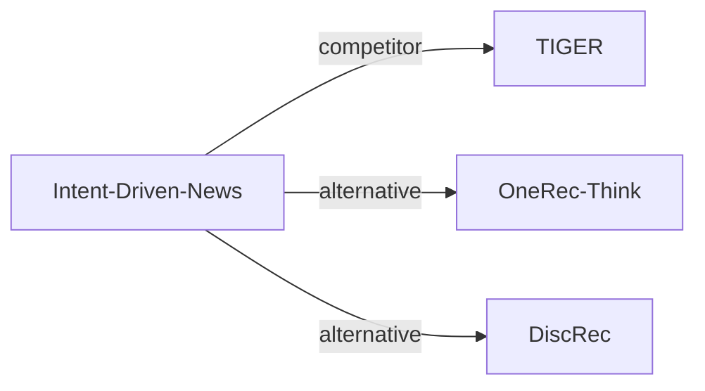

# Intent-Driven-News

| **题目** | *Intent-Driven Semantic ID Generation for Grounded Conversational News Recommendation* |
| :-- | :-- |
| **作者** | Su et al. |
| **会议** | ACL’26 Industry |
| **问题与阶段** | `III. SID 与模型对齐` · `Training` |
| **链接** | [论文](https://arxiv.org/abs/2605.07613) · [矩阵](../../../README.zh.md#iii--training) · [English](../../papers/intent-driven-news.md) |
| **阅读级别** | 概览（第 1 级） |

本页目录：[TL;DR](#tldr) · [速览](#速览) · [3. 实验发现](#3-实验发现) · [5. 相关工作](#5-相关工作)

- `Dec-Only`: Decoder-only.
- `Fixed`: SIDs are built first and not changed while the generator trains.
- `Multi-task NTP`: The same NTP loss over several tasks.
- `CoT+Fuzzy Match`: Reasoning-guided identifier generation followed by fuzzy matching to available items.

### TL;DR

> [!NOTE]
> Intent-Driven-News 训练 LLM 将对话中的隐含意图映射为层级 SID 前缀，再与当前新闻池做模糊匹配，替代先检索文章的流程。

---

### 速览

| 维度 | 摘要 |
| :-- | :-- |
| 研究问题 | III. SID 与模型对齐：Can the generator read, write, and reason over SIDs, and do the tokenizer and generator work toward the same goal? |
| 核心贡献 | Intent-Driven-News 训练 LLM 将对话中的隐含意图映射为层级 SID 前缀，再与当前新闻池做模糊匹配，替代先检索文章的流程。 |
| 主要改动阶段 | Training |

---

### 3. 实验发现

实验设置

- **数据集**：Industrial Chinese news: 163560 articles, 50000 profiles, 9982 test samples across six tasks. Filtering not reported.
  - 出处：Section 4.1 and Table 2: [S4.SS1.SSS0.Px1.p1](https://arxiv.org/html/2605.07613v1#S4.SS1.SSS0.Px1.p1) and [S4.T2](https://arxiv.org/html/2605.07613v1#S4.T2)
- **切分**：Temporal: training articles before cutoff, test articles after; zero item overlap. Matching tolerance selected on 1000 validation samples without test temporal overlap; cutoff date not reported.
  - 出处：Section 4.1 and Appendix A.2: [S4.SS1.SSS0.Px1.p1](https://arxiv.org/html/2605.07613v1#S4.SS1.SSS0.Px1.p1) and [A1.SS2.SSS0.Px1.p1](https://arxiv.org/html/2605.07613v1#A1.SS2.SSS0.Px1.p1)
- **候选集**：Open generation (76%): full 152K SID space, grounded to current news pool. Selection (24%): sampled: 5 including target; Rand has 4 random negatives, Align has 2 same-category + 2 random negatives. Historical-item exclusion not reported.
  - 出处：Section 4.1 and Appendix I: [S4.SS1.SSS0.Px1.p1](https://arxiv.org/html/2605.07613v1#S4.SS1.SSS0.Px1.p1) and [S4.SS1.SSS0.Px3.p1](https://arxiv.org/html/2605.07613v1#S4.SS1.SSS0.Px3.p1) and [A9.p1](https://arxiv.org/html/2605.07613v1#A9.p1)
- **可见性**：Items unseen by generator; whether unseen by tokenizer too: not reported. Cold users have zero recent clicks but may retain pre-cutoff behavioral profile summaries.
  - 出处：Section 4.1 and Appendices L/T: [S4.SS1.SSS0.Px1.p1](https://arxiv.org/html/2605.07613v1#S4.SS1.SSS0.Px1.p1) and [A12.SS0.SSS0.Px1.p1](https://arxiv.org/html/2605.07613v1#A12.SS0.SSS0.Px1.p1) and [A20.p2](https://arxiv.org/html/2605.07613v1#A20.p2)
- **SID 规格**：RQ-VAE codebooks [32,64,128,1024]; generate first 3 layers only. Exact L1/L2, L3 tolerance 5; full-SID collision handling not reported.
  - 出处：Section 3.2 and Appendix A.1: [S3.SS2.SSS0.Px2.p1](https://arxiv.org/html/2605.07613v1#S3.SS2.SSS0.Px2.p1) and [S3.SS2.SSS0.Px3.p1](https://arxiv.org/html/2605.07613v1#S3.SS2.SSS0.Px3.p1) and [A1.SS1.p3](https://arxiv.org/html/2605.07613v1#A1.SS1.p3)
- **推理预算**：Caches 10 SID prefixes; beam width, inference hardware and batch size not reported. Warm cached response: mean 85ms, P95 150ms; cold initial delay 3.7s.
  - 出处：Section 4.3 and Appendix C.4: [S4.SS3.SSS0.Px1.p1](https://arxiv.org/html/2605.07613v1#S4.SS3.SSS0.Px1.p1) and [A3.SS4.p1](https://arxiv.org/html/2605.07613v1#A3.SS4.p1)
- **结果来源**：Original Tables 3/5/6: overall, task/user-cold-start and generative-baseline comparisons; Figure 2: latency.
  - 出处：Tables 3/5/6 and Figure 2: [S4.T3](https://arxiv.org/html/2605.07613v1#S4.T3) and [S4.T5](https://arxiv.org/html/2605.07613v1#S4.T5) and [S4.T6](https://arxiv.org/html/2605.07613v1#S4.T6) and [S4.F2](https://arxiv.org/html/2605.07613v1#S4.F2)

---

### 5. 相关工作

- **同期对比** · [TIGER](tiger.md): Compared on cold-start news users; the proposed method generates conversational SID prefixes.
  - 出处：Intent-Driven News v1, Section 4.5 and Table 6: https://arxiv.org/html/2605.07613v1#S4.SS5.SSS0.Px2.p1; https://arxiv.org/html/2605.07613v1#S4.T6.
- **替代方案** · [OneRec-Think](onerec-think.md): Cited SID reasoning approach; this work targets six conversational intents.
  - 出处：Intent-Driven News v1, Section 2: https://arxiv.org/html/2605.07613v1#S2.SS0.SSS0.Px2.p1.
- **替代方案** · [DiscRec](discrec.md): Disentangles semantic and collaborative signals; this work focuses on conversational intent grounding.
  - 出处：Intent-Driven News v1, Section 2: https://arxiv.org/html/2605.07613v1#S2.SS0.SSS0.Px2.p1.

[查看同格全部论文](../../../README.zh.md#iii--training)
