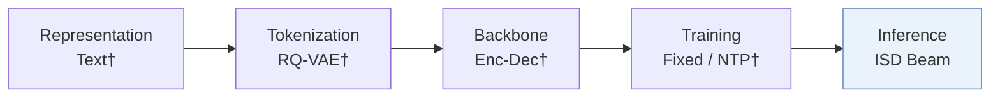
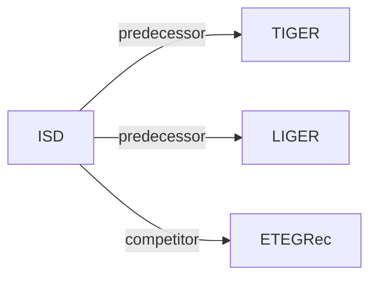

# ISD

*Understanding Semantic IDs: From Item Representation to Item Selection in Generative Recommendation* — Wang et al. · arXiv’26

`IV. 实用目标` · `Inference` · [论文](https://arxiv.org/abs/2607.24995) · [代码](https://anonymous.4open.science/r/ISD-CF7C) · [矩阵](../../../README.zh.md#iv--inference) · [English](../../papers/isd.md)

阅读级别：概览（第 1 级） · 本页目录：[TL;DR](#tldr) · [速览](#速览) · [3. 实验发现](#3-实验发现) · [5. 相关工作](#5-相关工作)

- `Fixed`: SIDs are built first and not changed while the generator trains.
- `ISD Beam`: Item-supported beam search.

### TL;DR

> [!NOTE]
> ISD 在指出 SID 丢失局部物品结构后，于推理阶段无需重训地用用户特定物品排序支撑 SID 前缀，避免它们在束搜索中被过早剪枝。

### 速览

| 维度 | 摘要 |
| :-- | :-- |
| 研究问题 | IV. 实用目标：Are training and search aimed at what users and the platform value, rather than at token likelihood? |
| 核心贡献 | ISD 在指出 SID 丢失局部物品结构后，于推理阶段无需重训地用用户特定物品排序支撑 SID 前缀，避免它们在束搜索中被过早剪枝。 |
| 主要改动阶段 | Inference |

### 3. 实验发现

实验设置

- **数据集**：Amazon Reviews: Baby, Office, Scientific; filtering rules not reported.
  - 出处：[S6.SS1.SSS1.p1](https://arxiv.org/html/2607.24995v1#S6.SS1.SSS1.p1) ; #A1.T6
- **切分**：Per-user chronological leave-one-out: final interaction test, preceding interaction validation, remainder training.
  - 出处：[S6.SS1.SSS1.p1](https://arxiv.org/html/2607.24995v1#S6.SS1.SSS1.p1) ; #A1.SS4.SSS1.p1
- **候选集**：full catalog of eligible items, with the same consumed-item mask for all methods.
  - 出处：[S6.SS1.SSS3.p1](https://arxiv.org/html/2607.24995v1#S6.SS1.SSS3.p1) ; #A1.SS4.SSS1.p1 ; #A1.SS4.SSS2.p1
- **可见性**：warm; no unseen-item protocol is defined. Separate item scorer and transition/co-consumption statistics use training interactions; tokenizer exposure to test items not reported.
  - 出处：[S6.SS1](https://arxiv.org/html/2607.24995v1#S6.SS1) ; #A1.SS2.SSS1.p1 ; #S5.SS1.SSS1.p1
- **SID 规格**：TIGER/LIGER assignments remain fixed: three semantic positions plus a collision-resolution suffix. Codebook sizes and suffix-assignment rule not reported; primary filtering diagnostic uses RQ-VAE.
  - 出处：[S3.SS3.p1](https://arxiv.org/html/2607.24995v1#S3.SS3.p1) ; #A1.SS2.p1 ; #A1.SS3.SSS1.p1 ; #S6.SS4.p1
- **推理预算**：Beam 50; one decoder pass; top-50 item-support ranking constructed once per history; reciprocal-rank fusion kappa=60; at most 50 output items, evaluated at K=10/20. Ranker construction is excluded from decoding complexity. Hardware, inference batch size and latency not reported.
  - 出处：[A1.SS3.SSS1.p1](https://arxiv.org/html/2607.24995v1#A1.SS3.SSS1.p1) ; #S5.SS2.SSS2.p1 ; #S5.SS3.p1 ; #A1.SS4.SSS2.p1
- **结果来源**：Original Table 3: matched recommendation comparisons, means across three seeds; Table 4: SID reassignment; Table 5: filtering/ordering ablations. Tables 1-2: encoder/SID representation diagnostics.
  - 出处：[S5.T3](https://arxiv.org/html/2607.24995v1#S5.T3) ; #S6.T4 ; #S6.T5 ; #A1.SS4.SSS2.p1

### 5. 相关工作

- **前序工作** · [TIGER](tiger.md): ISD augments a frozen TIGER decoder with item-supported prefix selection and final ordering, without changing its SIDs or retraining.
  - 出处：ISD v1, Sections 5.2/6.1.2 and Table 3: https://arxiv.org/html/2607.24995v1#S5.SS2; https://arxiv.org/html/2607.24995v1#S6.SS1.SSS2.p1; https://arxiv.org/html/2607.24995v1#S5.T3.
- **前序工作** · [LIGER](liger.md): ISD also operates inside LIGER before beam reduction; LIGER already combines SID generation with dense retrieval and ranking.
  - 出处：ISD v1, Sections 4/6.1.2 and Table 3: https://arxiv.org/html/2607.24995v1#S4.p3; https://arxiv.org/html/2607.24995v1#S6.SS1.SSS2.p1; https://arxiv.org/html/2607.24995v1#S5.T3.
- **同期对比** · [ETEGRec](etegrec.md): ETEGRec jointly trains the tokenizer and recommender; ISD instead changes inference with the SID assignment and decoder fixed.
  - 出处：ISD v1, Sections 5.2/6.1.2 and Table 3: https://arxiv.org/html/2607.24995v1#S5.SS2; https://arxiv.org/html/2607.24995v1#S6.SS1.SSS2.p1; https://arxiv.org/html/2607.24995v1#S5.T3.

[查看同格全部论文](../../../README.zh.md#iv--inference)
