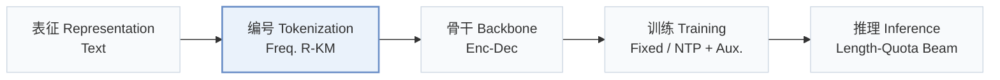
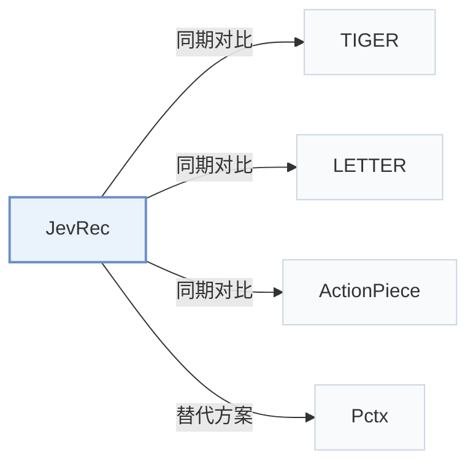

# JevRec

[← 问题 × 阶段矩阵](../../../README.zh.md#v--tokenization) · [按阶段索引](../index/stages.md) · [按模态索引](../index/modality.md) · [English](../../papers/jevrec.md) | 中文

| **题目** | *Linguistic Encoding with Jev-like Decision Modeling for LLM-based Generative Recommendation* |
| :-- | :-- |
| **作者** | Zhong et al. |
| **发表** | arXiv’26 |
| **问题与阶段** | `V. 效率` · `编号（Tokenization）` |
| **链接** | [论文](https://arxiv.org/abs/2610.36937) |
| **阅读级别** | 概览（第 1 级） |

**本页目录**：[TL;DR](#tldr) · [速览](#速览) · [3. 实验发现](#3-实验发现) · [5. 相关工作](#5-相关工作)

- `Text`：物品文本元数据（标题、描述、类目或提示词）。
- `Freq. R-KM`：频率感知的残差 k-means 编号。
- `Enc-Dec`：编码器-解码器（Encoder-decoder）架构。
- `Fixed`：先独立训练并冻结编号器，生成器训练期间 SID 保持不变。
- `NTP + Aux.`：下一 token 预测结合辅助正则或对齐损失。
- `Length-Quota Beam`：按可变 SID 长度分配候选配额的束搜索。

### TL;DR

> [!NOTE]
> JevRec 为高频物品分配较短 SID、为长尾物品分配较长 SID，并用独立预测头分别预测长度与内容，替代固定长度编码。

---

### 速览

| 维度 | 摘要 |
| :-- | :-- |
| 研究问题 | V. 效率：训练与在线服务能否满足实际的延迟、显存与吞吐预算？ |
| 核心贡献 | JevRec 为高频物品分配较短 SID、为长尾物品分配较长 SID，并用独立预测头分别预测长度与内容，替代固定长度编码。 |
| 主要改动阶段 | 编号（Tokenization） |

---

### 3. 实验发现

实验设置

- **数据集**：Amazon Reviews 2023: Musical Instruments, Industrial & Scientific, Video Games; exclude users/items with fewer than five interactions; maximum history 20 items.
  - 出处：[S4.SS1.p1](https://arxiv.org/html/2610.36937v1#S4.SS1.p1)
- **切分**：Per-user chronological leave-one-out: latest interaction test, penultimate validation, earlier interactions training.
  - 出处：[S4.SS1.p2](https://arxiv.org/html/2610.36937v1#S4.SS1.p2)
- **候选集**：full catalog; no negative sampling.
  - 出处：[S4.SS1.p2](https://arxiv.org/html/2610.36937v1#S4.SS1.p2)
- **可见性**：warm; no unseen-item protocol is defined. Frequency-based length assignment uses training interactions only; tokenizer fitting exposure to test items not reported.
  - 出处：[S4.SS1.p1](https://arxiv.org/html/2610.36937v1#S4.SS1.p1) ; #A2.p1 ; #S3.SS3.p2
- **SID 规格**：Shared residual quantizer: 4 x 256; retain 2/3/4 semantic codes by training-frequency group and append one collision token, giving complete SID lengths 3/4/5. Within each group/prefix bucket collision tokens distinguish items; collision vocabulary capacity not reported.
  - 出处：[S3.SS3.p2](https://arxiv.org/html/2610.36937v1#S3.SS3.p2) ; #S3.SS3.p3 ; #S3.SS3.p4 ; #A3.SS1.p1
- **推理预算**：Beam 10 per length branch; total recommendation budget 10, with K=5 from the same ranked list; length-probability quotas and joint-score merging, without a catalog-prefix trie. Baseline beam 50. Figure 4 reports total test-set inference speedups over TIGER of 1.05x/1.16x/1.04x on Instrument/Scientific/Game. Inference hardware, batch size and per-request latency not reported.
  - 出处：[S3.SS6](https://arxiv.org/html/2610.36937v1#S3.SS6) ; #A3.SS1.p1 ; #S4.F4 ; #S4.SS5.p1
- **结果来源**：Table 2: main three-dataset comparison; most baseline results adopted from Zhong et al. (2025a), as stated in Appendix C. Table 3: JevRec ablations; Figure 4: runtime/convergence.
  - 出处：[S4.T2](https://arxiv.org/html/2610.36937v1#S4.T2) ; #S4.T3 ; #S4.F4 ; #A3.p1

---

### 5. 相关工作

- **同期对比** · [TIGER](tiger.md): TIGER uses fixed-length RQ-VAE SIDs; JevRec truncates shared residual-quantizer prefixes by item frequency and explicitly predicts target length.
  - 出处：JevRec v1, Sections 3.3/4.1 and Table 2: [S3.SS3](https://arxiv.org/html/2610.36937v1#S3.SS3); [S4.SS1.p4](https://arxiv.org/html/2610.36937v1#S4.SS1.p4); [S4.T2](https://arxiv.org/html/2610.36937v1#S4.T2).
- **同期对比** · [LETTER](letter.md): LETTER adds collaborative information and diversity constraints to learned tokenization; JevRec allocates SID length by interaction frequency.
  - 出处：JevRec v1, Sections 3.3/4.1 and Table 2: [S3.SS3](https://arxiv.org/html/2610.36937v1#S3.SS3); [S4.SS1.p4](https://arxiv.org/html/2610.36937v1#S4.SS1.p4); [S4.T2](https://arxiv.org/html/2610.36937v1#S4.T2).
- **同期对比** · [ActionPiece](actionpiece.md): ActionPiece merges contextually co-occurring action features; JevRec uses shared semantic codebooks with frequency-dependent prefix lengths.
  - 出处：JevRec v1, Sections 3.3/4.1 and Table 2: [S3.SS3](https://arxiv.org/html/2610.36937v1#S3.SS3); [S4.SS1.p4](https://arxiv.org/html/2610.36937v1#S4.SS1.p4); [S4.T2](https://arxiv.org/html/2610.36937v1#S4.T2).
- **替代方案** · [Pctx](pctx.md): Pctx personalizes tokenization using user history; JevRec assigns context-invariant SID lengths from global training frequencies.
  - 出处：JevRec v1, Sections 2/3.2/3.3: [S2.p1](https://arxiv.org/html/2610.36937v1#S2.p1); [S3.SS2.p1](https://arxiv.org/html/2610.36937v1#S3.SS2.p1); [S3.SS3.p1](https://arxiv.org/html/2610.36937v1#S3.SS3.p1).

[查看同格全部论文](../../../README.zh.md#v--tokenization)
