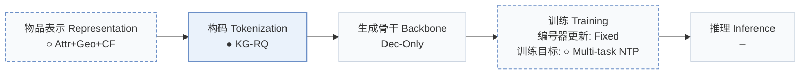
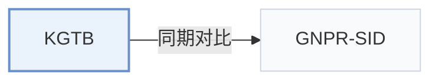

# KGTB

[← 问题 × 阶段矩阵](../../../README.zh.md#i--tokenization) · [按阶段索引](../index/stages.md) · [按模态找论文](../index/modality.md) · [按领域找论文](../index/domain.md) · [English](../../papers/kgtb.md) | 中文

| **题目** | *Knowledge Graph Tokenization for Behavior-Aware Generative Next POI Recommendation* |
| :-- | :-- |
| **作者** | Sun et al. |
| **发表** | arXiv’25 |
| **问题与阶段** | `I. 信息量` · `构码（Tokenization）` · `POI` |
| **改动** | ○ 物品表示 · ● 构码 · ○ 训练目标 |
| **构码输入** | `Attr` + `Geo` + `CF` |
| **领域** | `本地生活与 POI` |
| **特殊设置** | `跨域迁移` |
| **链接** | [论文](https://arxiv.org/abs/2509.12350) |
| **阅读级别** | 概览（第 1 级） |

**本页目录**：[TL;DR](#tldr) · [3. 实验发现](#3-实验发现) · [5. 相关工作](#5-相关工作)

- `Attr+Geo+CF`：类目等结构化属性、地理空间特征与协同过滤信号融合（POI 场景）。
- `KG-RQ`：融合知识图谱结构的残差量化。
- `Dec-Only`：仅解码器（Decoder-only）自回归架构。
- `Fixed`：先独立训练并冻结编号器，生成器训练期间 SID 保持不变。
- `Multi-task NTP`：在多个对齐或推荐子任务上联合优化下一 token 预测损失。

### TL;DR

> [!NOTE]
> KGTB 将 POI 数据组织为知识图谱，在图监督下把节点量化为结构化 ID，并在 POI、类目与区域访问任务上微调 LLM。

---

### 3. 实验发现

实验设置

- **数据集**：Foursquare Boston/Paris; Gowalla Austin/San Francisco. No filtering strategies applied.
  - 出处：Experimental Setup and Main Results: [Sx5.SSx1.SSSx1.p1](https://arxiv.org/html/2509.12350v1#Sx5.SSx1.SSSx1.p1) and [Sx5.SSx2.p3](https://arxiv.org/html/2509.12350v1#Sx5.SSx2.p3)
- **切分**：Per-user chronological 70% training, 10% validation, 20% test.
  - 出处：Experimental Setup, Datasets and Metrics: [Sx5.SSx1.SSSx1.p1](https://arxiv.org/html/2509.12350v1#Sx5.SSx1.SSSx1.p1)
- **候选集**：not reported
  - 出处：Experimental Setup reports ranking metrics without a candidate protocol: [Sx5.SSx1](https://arxiv.org/html/2509.12350v1#Sx5.SSx1)
- **可见性**：warm; no unseen-item protocol is defined. Cold-start means POIs with fewer than five visitors; unseen means unvisited by the user. Cross-city transfer is also tested. Item-level generator/tokenizer holdouts and KG exposure to test interactions: not reported.
  - 出处：Standard split, low-visitor/user-unvisited subsets, and cross-city transfer: [Sx5.SSx1.SSSx1.p1](https://arxiv.org/html/2509.12350v1#Sx5.SSx1.SSSx1.p1) and [Sx5.SSx3.SSSx2.p1](https://arxiv.org/html/2509.12350v1#Sx5.SSx3.SSSx2.p1) and [Sx5.SSx3.SSSx3.p1](https://arxiv.org/html/2509.12350v1#Sx5.SSx3.SSSx3.p1) and [Sx7.SSx3.p1](https://arxiv.org/html/2509.12350v1#Sx7.SSx3.p1)
- **SID 规格**：3-level KG residual quantization. Printed sizes at level l=1/2/3: POI/user 8^{4(l-1)}; region/category 8^{2(l-1)}. Collision handling: not reported.
  - 出处：Implementation Details, formula retained as printed: [Sx5.SSx1.SSSx3.p1](https://arxiv.org/html/2509.12350v1#Sx5.SSx1.SSSx3.p1)
- **推理预算**：HR/NDCG@1/5/10; FB total test time 0.4h. Decoder, beam, inference hardware/batch, per-request latency: not reported; L40 and batch 4 describe fine-tuning.
  - 出处：Implementation Details, ranking metrics, Table 5: [Sx5.SSx1.SSSx3.p1](https://arxiv.org/html/2509.12350v1#Sx5.SSx1.SSSx3.p1) and [Sx5.SSx1.SSSx1.p2](https://arxiv.org/html/2509.12350v1#Sx5.SSx1.SSSx1.p2) and [Sx5.T5](https://arxiv.org/html/2509.12350v1#Sx5.T5)
- **结果来源**：Original Tables 2/3/4/5/6/7: main, ablation, cross-city, compute, backbone, user-unvisited POIs; Figure 4: low-visitor subset.
  - 出处：Tables 2-7 and Figure 4: [Sx5.T2](https://arxiv.org/html/2509.12350v1#Sx5.T2) and [Sx5.T3](https://arxiv.org/html/2509.12350v1#Sx5.T3) and [Sx5.T4](https://arxiv.org/html/2509.12350v1#Sx5.T4) and [Sx5.T5](https://arxiv.org/html/2509.12350v1#Sx5.T5) and [Sx7.T6](https://arxiv.org/html/2509.12350v1#Sx7.T6) and [Sx7.T7](https://arxiv.org/html/2509.12350v1#Sx7.T7) and [Sx5.F4](https://arxiv.org/html/2509.12350v1#Sx5.F4)

---

### 5. 相关工作

- **同期对比** · [GNPR-SID](gnpr-sid.md): GNPR-SID is the closest baseline across accuracy, cold-start, transfer and compute experiments.
  - 出处：KGTB v1, Cold-Start Scenario and Tables 2/4/5: [Sx5.SSx3.SSSx2.p1](https://arxiv.org/html/2509.12350v1#Sx5.SSx3.SSSx2.p1); [Sx5.T2](https://arxiv.org/html/2509.12350v1#Sx5.T2); [Sx5.T4](https://arxiv.org/html/2509.12350v1#Sx5.T4); [Sx5.T5](https://arxiv.org/html/2509.12350v1#Sx5.T5).

[查看同格全部论文](../../../README.zh.md#i--tokenization)
