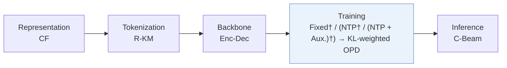

# KL-MOPD

| **题目** | *Discrepancy-Aware Multi-Objective On-Policy Distillation for Generative Recommendation* |
| :-- | :-- |
| **作者** | Yang et al. |
| **会议** | arXiv’26 |
| **问题与阶段** | `IV. 实用目标` · `Training` |
| **链接** | [论文](https://arxiv.org/abs/2610.36973) · [代码](https://github.com/Yandorn/KL-MOPD) · [矩阵](../../../README.zh.md#iv--training) · [English](../../papers/kl-mopd.md) |
| **阅读级别** | 概览（第 1 级） |

本页目录：[TL;DR](#tldr) · [速览](#速览) · [3. 实验发现](#3-实验发现) · [5. 相关工作](#5-相关工作)

- `CF`: Collaborative filtering signal.
- `R-KM`: Residual k-means.
- `Enc-Dec`: Encoder-decoder.
- `(NTP† / (NTP + Aux.)†) → KL-weighted OPD`: Inferred next-token-based initialization variants followed by KL-weighted on-policy distillation.
- `C-Beam`: Constrained beam search.

### TL;DR

> [!NOTE]
> KL-MOPD 按教师与学生的初始 KL 散度加权，将点击与转化教师逐 token 蒸馏到学生生成器，改进标准在线策略蒸馏。

---

### 速览

| 维度 | 摘要 |
| :-- | :-- |
| 研究问题 | IV. 实用目标：Are training and search aimed at what users and the platform value, rather than at token likelihood? |
| 核心贡献 | KL-MOPD 按教师与学生的初始 KL 散度加权，将点击与转化教师逐 token 蒸馏到学生生成器，改进标准在线策略蒸馏。 |
| 主要改动阶段 | Training |

---

### 3. 实验发现

实验设置

- **数据集**：TencentGR (CTR/CVR), YooChoose (CTR/GMV), Taobao (CTR/CVR), industrial advertising (CTR/eCPM). Filtering: not reported.
  - 出处：Section 4.1: [S4.SS1.p1](https://arxiv.org/html/2610.36973v1#S4.SS1.p1)
- **切分**：Public: chronological 70% student pretraining, 20% teacher tuning/student distillation, 10% evaluation. Industry: penultimate day tuning, final day evaluation, >11M requests/day; pretraining allocation not reported. Sliding windows; history caps 100 public/128 Industry.
  - 出处：Section 4.1: [S4.SS1.p1](https://arxiv.org/html/2610.36973v1#S4.SS1.p1) and [S4.SS1.p4](https://arxiv.org/html/2610.36973v1#S4.SS1.p4)
- **候选集**：not reported
  - 出处：Section 4.1 states decoding and cutoffs without specifying candidate sampling: [S4.SS1.p5](https://arxiv.org/html/2610.36973v1#S4.SS1.p5)
- **可见性**：warm; no unseen-item protocol is defined. Two-tower CF embedding exposure to test items: not reported.
  - 出处：Section 4.1 defines no unseen-item evaluation: [S4.SS1.p1](https://arxiv.org/html/2610.36973v1#S4.SS1.p1) and [S4.SS1.p2](https://arxiv.org/html/2610.36973v1#S4.SS1.p2)
- **SID 规格**：RQ-KMeans of two-tower CF embeddings: TencentGR 5x64, YooChoose 5x128, Taobao 8x64, Industry 8x310. Collision handling: not reported.
  - 出处：Section 4.1: [S4.SS1.p2](https://arxiv.org/html/2610.36973v1#S4.SS1.p2)
- **推理预算**：Constrained beam 50, K=10/20 public; beam 200, K=100/200 Industry. Inference hardware, batch size, latency: not reported.
  - 出处：Section 4.1: [S4.SS1.p5](https://arxiv.org/html/2610.36973v1#S4.SS1.p5)
- **结果来源**：This study's adapted/tuned baselines: Table 3 public TIGER/REG4Rec, Table 4 ablations, Table 5 industrial TIGER, Table 6 five-day online A/B (10% control, 10% treatment).
  - 出处：Tables 3-6 and baseline setup: [S2.T3](https://arxiv.org/html/2610.36973v1#S2.T3) and [S4.T4](https://arxiv.org/html/2610.36973v1#S4.T4) and [S4.T5](https://arxiv.org/html/2610.36973v1#S4.T5) and [S4.T6](https://arxiv.org/html/2610.36973v1#S4.T6) and [S4.SS1.p3](https://arxiv.org/html/2610.36973v1#S4.SS1.p3)

---

### 5. 相关工作

- **前序工作** · [TIGER](tiger.md): TIGER is a backbone for token-wise multi-teacher distillation, with CF-derived SIDs in this study.
  - 出处：KL-MOPD v1, Section 4.1 and Table 3: https://arxiv.org/html/2610.36973v1#S4.SS1.p2; https://arxiv.org/html/2610.36973v1#S2.T3.

[查看同格全部论文](../../../README.zh.md#iv--training)
