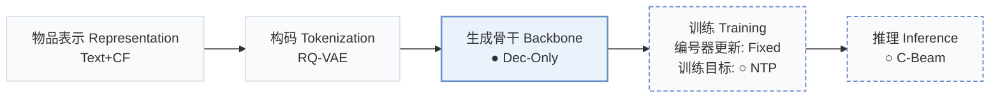
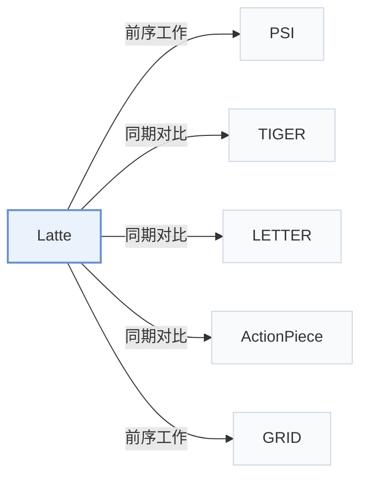

# Latte

[← 问题 × 阶段矩阵](../../../README.zh.md#iii--backbone) · [按阶段索引](../index/stages.md) · [按模态找论文](../index/modality.md) · [按领域找论文](../index/domain.md) · [English](../../papers/latte.md) | 中文

| **题目** | *Expressiveness Limits of Autoregressive Semantic ID Generation in Generative Recommendation* |
| :-- | :-- |
| **作者** | Hou et al. |
| **发表** | arXiv’26 |
| **问题与阶段** | `III. SID 与模型对齐` · `生成骨干（Backbone）` |
| **改动** | ● 生成骨干 · ○ 训练目标 · ○ 推理 |
| **构码输入** | `其他`（沿用 PSID 构码，未写输入） |
| **领域** | `电商` · `音乐` |
| **应用场景** | `一般物品推荐`；`公开数据` |
| **链接** | [论文](https://arxiv.org/abs/2605.06331) · [代码](https://github.com/hyp1231/Latte) |
| **阅读级别** | 概览（第 1 级） |

**本页目录**：[TL;DR](#tldr) · [3. 实验发现](#3-实验发现) · [5. 相关工作](#5-相关工作)

- `Text+CF`：文本表征结合协同过滤信号。
- `RQ-VAE`：残差量化变分自编码器（Residual-Quantized VAE）。
- `Dec-Only`：仅解码器（Decoder-only）自回归架构。
- `Fixed`：先独立训练并冻结编号器，生成器训练期间 SID 保持不变。
- `NTP`：标准下一 token 预测（Next-Token Prediction）交叉熵损失；基于预训练 LLM 的指令微调（SFT）亦归入此类。
- `C-Beam`：受合法物品集合约束的束搜索（Constrained beam search）。

### TL;DR

> [!NOTE]
> Latte 在每个 SID 前插入隐 token，把单棵解码树拆成多棵以隐变量为条件的子树，放松树上相邻物品之间的概率耦合。

---

### 3. 实验发现

实验设置

- **数据集**：Amazon Reviews 2023: Instruments, Scientific, Games (57,439 / 24,587, 50,985 / 25,848, 94,762 / 25,612 users / items; filtering not restated beyond following ETEGRec and Zheng et al. 2025). Separate modality-order study on the Million Playlist Dataset: songs without tags or metadata and playlists with fewer than six songs removed.
  - 出处：Amazon 2023 categories and split: [S5.SS1.SSS0.Px1.p1](https://arxiv.org/html/2605.06331v1#S5.SS1.SSS0.Px1.p1); statistics: [A1.T7](https://arxiv.org/html/2605.06331v1#A1.T7); MPD: [S6.SS2.SSS0.Px1.p1](https://arxiv.org/html/2605.06331v1#S6.SS2.SSS0.Px1.p1).
- **切分**：Amazon: chronological leave-one-out, most recent interaction for test, second most recent for validation, the rest for training. MPD: 8:1:1 split.
  - 出处：Leave-one-out allocation: [S5.SS1.SSS0.Px1.p1](https://arxiv.org/html/2605.06331v1#S5.SS1.SSS0.Px1.p1); MPD 8:1:1: [S6.SS2.SSS0.Px1.p1](https://arxiv.org/html/2605.06331v1#S6.SS2.SSS0.Px1.p1).
- **候选集**：not reported (full catalog versus sampled evaluation candidates); top-K lists from beam search with beam size 500.
  - 出处：Metrics only: [A4.SS0.SSS0.Px2.p1](https://arxiv.org/html/2605.06331v1#A4.SS0.SSS0.Px2.p1).
- **可见性**：warm; no unseen-item protocol is defined.
  - 出处：Standard split with no unseen-item protocol: [S5.SS1.SSS0.Px1.p1](https://arxiv.org/html/2605.06331v1#S5.SS1.SSS0.Px1.p1).
- **SID 规格**：Base PSID semantic IDs from RQ K-Means: 3 positions x 256 tokens, with PSID's ESM algorithm to prevent SID conflicts; Latte prepends one of M' learned latent tokens (2, 4, or 8; best 4 or 8) chosen freely at inference. RQ-VAE and OPQ tokenizers are also tested (Table 3).
  - 出处：RQ K-Means m=3 x 256 with ESM conflict resolution, latent tokens: [A4.SS0.SSS0.Px2.p2](https://arxiv.org/html/2605.06331v1#A4.SS0.SSS0.Px2.p2); tokenizer variants: [S5.T3](https://arxiv.org/html/2605.06331v1#S5.T3).
- **推理预算**：Beam size 500 for PSID and Latte; generation starts with an unconstrained latent token followed by SID tokens, and item scores are aggregated over latent tokens with max. Hardware, inference batch size, and latency: not reported.
  - 出处：Beam size 500: [A3.T8](https://arxiv.org/html/2605.06331v1#A3.T8) and [A3.T9](https://arxiv.org/html/2605.06331v1#A3.T9); aggregation over latent tokens: [S4.SS2.p1](https://arxiv.org/html/2605.06331v1#S4.SS2.p1) and [A4.SS0.SSS0.Px2.p2](https://arxiv.org/html/2605.06331v1#A4.SS0.SSS0.Px2.p2).
- **结果来源**：Table 1 (Instruments, Scientific, Games; most baseline numbers copied from prior work, PSID rerun from its released code); Table 2 (tree-distance correlations); Tables 3-4 and Figure 4 (tokenizers, aggregation, number of latent tokens); Table 5 (MPD modality order).
  - 出处：Main: [S5.T1](https://arxiv.org/html/2605.06331v1#S5.T1); constraint analysis: [S5.T2](https://arxiv.org/html/2605.06331v1#S5.T2); tokenizers: [S5.T3](https://arxiv.org/html/2605.06331v1#S5.T3); aggregation: [S5.T4](https://arxiv.org/html/2605.06331v1#S5.T4); latent count: [S5.F4](https://arxiv.org/html/2605.06331v1#S5.F4); MPD: [S6.T5](https://arxiv.org/html/2605.06331v1#S6.T5); copied baselines: [A4.SS0.SSS0.Px1.p2](https://arxiv.org/html/2605.06331v1#A4.SS0.SSS0.Px1.p2).

---

### 5. 相关工作

- **前序工作** · [PSI](psi.md): PSID is the base model and supplies the ESM conflict resolution; Latte only adds a freely chosen latent token before the semantic ID.
  - 出处：Latte v1, base model and implementation: [S5.SS1.SSS0.Px2.p1](https://arxiv.org/html/2605.06331v1#S5.SS1.SSS0.Px2.p1) and [A4.SS0.SSS0.Px2.p2](https://arxiv.org/html/2605.06331v1#A4.SS0.SSS0.Px2.p2); Table 1: [S5.T1](https://arxiv.org/html/2605.06331v1#S5.T1).
- **同期对比** · [TIGER](tiger.md): TIGER decodes items along one fixed SID tree; Latte relaxes the tree constraint with latent tokens so that close tree nodes need not share preference.
  - 出处：Latte v1, motivation study: [S3.SS2.SSS0.Px2.p1](https://arxiv.org/html/2605.06331v1#S3.SS2.SSS0.Px2.p1); baselines and Table 1: [A4.SS0.SSS0.Px1.p1](https://arxiv.org/html/2605.06331v1#A4.SS0.SSS0.Px1.p1) and [S5.T1](https://arxiv.org/html/2605.06331v1#S5.T1); Table 2: [S5.T2](https://arxiv.org/html/2605.06331v1#S5.T2).
- **同期对比** · [LETTER](letter.md): LETTER improves the tokenizer itself; Latte keeps the tokenizer and changes the decoding path.
  - 出处：Latte v1, baselines: [A4.SS0.SSS0.Px1.p1](https://arxiv.org/html/2605.06331v1#A4.SS0.SSS0.Px1.p1); Table 1: [S5.T1](https://arxiv.org/html/2605.06331v1#S5.T1).
- **同期对比** · [ActionPiece](actionpiece.md): ActionPiece makes tokens context-dependent through merges; Latte adds latent prefix tokens on top of fixed SIDs.
  - 出处：Latte v1, baselines: [A4.SS0.SSS0.Px1.p1](https://arxiv.org/html/2605.06331v1#A4.SS0.SSS0.Px1.p1); Table 1: [S5.T1](https://arxiv.org/html/2605.06331v1#S5.T1).
- **前序工作** · [GRID](grid.md): Latte follows GRID's recommendation to use RQ K-Means as the tokenizer.
  - 出处：Latte v1, Section 5.1 and Appendix D cite Ju et al. (2025): [S5.SS1.SSS0.Px2.p1](https://arxiv.org/html/2605.06331v1#S5.SS1.SSS0.Px2.p1) and [A4.SS0.SSS0.Px2.p2](https://arxiv.org/html/2605.06331v1#A4.SS0.SSS0.Px2.p2).

[查看同格全部论文](../../../README.zh.md#iii--backbone)
