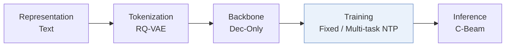
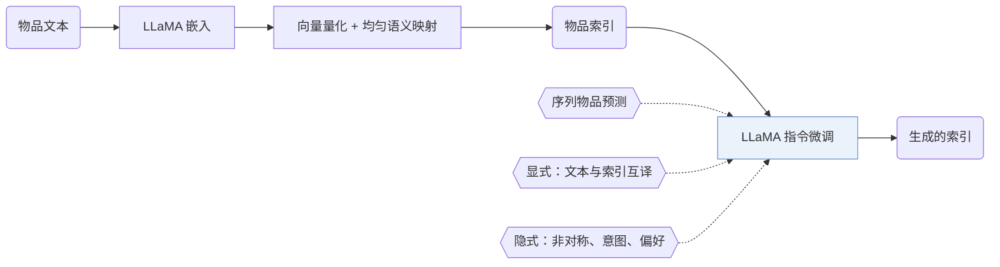
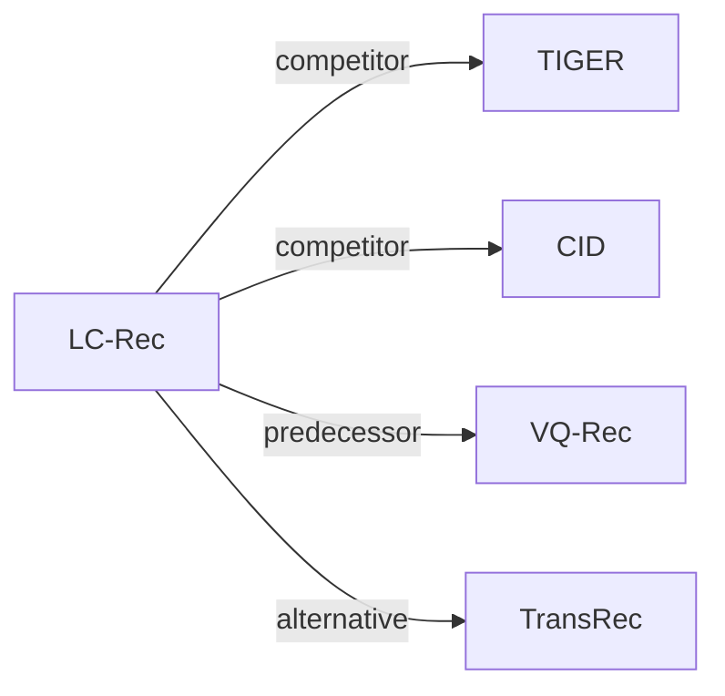

# LC-Rec

| **题目** | *Adapting large language models by integrating collaborative semantics for recommendation* |
| :-- | :-- |
| **作者** | Zheng et al. |
| **会议** | ICDE’24 |
| **问题与阶段** | `III. SID 与模型对齐` · `Training` |
| **链接** | [论文](https://arxiv.org/abs/2311.09049) · [代码](https://github.com/RUCAIBox/LC-Rec/) · [矩阵](../../../README.zh.md#iii--training) · [English](../../papers/lc-rec.md) |
| **阅读级别** | 阅读笔记（第 2 级） |

本页目录：[TL;DR](#tldr) · [速览](#速览) · [1. 为什么重要](#1-为什么重要) · [2. 方法](#2-方法) · [3. 实验发现](#3-实验发现) · [4. 局限与分析](#4-局限与分析) · [5. 相关工作](#5-相关工作)

- `Dec-Only`: Decoder-only.
- `Fixed`: SIDs are built first and not changed while the generator trains.
- `Multi-task NTP`: The same NTP loss over several tasks.
- `C-Beam`: Constrained beam search.

### TL;DR

> [!NOTE]
> LC-Rec 通过带均匀语义映射的向量量化分配无冲突物品索引，并用多类对齐任务微调 LLM，使模型无需候选列表即可从全库生成物品。

---

### 速览

| 维度 | 摘要 |
| :-- | :-- |
| 研究问题 | III. SID 与模型对齐：Can the generator read, write, and reason over SIDs, and do the tokenizer and generator work toward the same goal? |
| 核心贡献 | LC-Rec 通过带均匀语义映射的向量量化分配无冲突物品索引，并用多类对齐任务微调 LLM，使模型无需候选列表即可从全库生成物品。 |
| 主要改动阶段 | Training |
| 局限 | 物品索引只来自文本嵌入，协同语义只能通过调优任务进入模型（Sec. III-B）。 |

---

### 1. 为什么重要

推荐系统里的物品通常用大语言模型（LLM）词表之外的 ID 来索引，两者之间因此有语义鸿沟（Abstract）。

> "In essence, LLMs capture language semantics while recommender systems imply collaborative semantics, making it difficult to sufficiently leverage the model capacity of LLMs for recommendation."（Abstract）（LLM 擅长语言语义，推荐依赖协同语义，LLM 的能力难以充分用到推荐上。）

---

### 2. 方法

#### 物品索引

LC-Rec 用 LLaMA 编码物品文本，再量化嵌入（Sec. III-B）。均匀语义映射重新分配最后一层的码字，让原本会共用索引的物品分开（Sec. III-B2）。

#### 对齐调优

序列物品预测是主目标（Sec. III-C1）。两个显式任务在标题或描述与索引之间互相映射（Sec. III-C2）。隐式任务再加上非对称物品预测、基于意图的预测和偏好推断（Sec. III-C3）。

> "On the one hand, the LLM should be capable of accurately identifying the item indices based on the associated title or description. On the other hand, it is expected that LLM can naturally capture relevant item information from its indices."（Sec. III-C2）（LLM 既要能从标题或描述认出索引，也要能从索引读出物品信息。）

#### 训练

所有任务都写成条件语言生成，用一个指令微调的模型完成（Sec. III-D）。

> "To this end, we employ LLaMA [25] as our backbone model and then optimize it via instruction tuning."（Sec. III-D）（以 LLaMA 为骨干，做指令微调。）

---

### 3. 实验发现

实验设置

- **数据集**：Amazon Reviews (May 1996-October 2018): Musical Instruments, Arts Crafts and Sewing, Video Games; users and items with fewer than 5 interactions are filtered; sequences capped at 20 items. Sizes (users / items / interactions): Instruments 24,773 / 9,923 / 206,153; Arts 45,142 / 20,957 / 390,832; Games 50,547 / 16,860 / 452,989.
  - 出处：Amazon 2018 subsets, 5-interaction filter, length 20: [S4.SS1.SSS1.p1](https://arxiv.org/html/2311.09049v4#S4.SS1.SSS1.p1); statistics: [S4.T2](https://arxiv.org/html/2311.09049v4#S4.T2).
- **切分**：Per-user leave-one-out: most recent item for test, second most recent for validation, the rest for training.
  - 出处：Leave-one-out allocation: [S4.SS1.SSS3.p1](https://arxiv.org/html/2311.09049v4#S4.SS1.SSS3.p1).
- **候选集**：full catalog (full ranking over the entire item set instead of sampled evaluation). Separate analysis (Table 5): choose between the target and one negative that is language-similar, collaborative-similar (by SASRec embeddings), or random; history exclusion for these negatives not reported.
  - 出处：Full ranking over the entire item set: [S4.SS1.SSS3.p1](https://arxiv.org/html/2311.09049v4#S4.SS1.SSS3.p1); separate pairwise test with one negative: [S4.SS4.SSS0.Px3.p1](https://arxiv.org/html/2311.09049v4#S4.SS4.SSS0.Px3.p1).
- **可见性**：warm; no unseen-item protocol is defined.
  - 出处：Standard split with no unseen-item protocol: [S4.SS1.SSS3.p1](https://arxiv.org/html/2311.09049v4#S4.SS1.SSS3.p1).
- **SID 规格**：4-level RQ-VAE x 256 codewords (dimension 32) over mean-pooled LLaMA embeddings of title and description, added to the LLaMA tokenizer as new tokens. Conflicts are resolved without an extra suffix level: the last-level codewords of each conflicting group are redistributed under a uniform-distribution constraint.
  - 出处：4 levels x 256 x 32 over LLaMA text embeddings: [S4.SS1.SSS4.p1](https://arxiv.org/html/2311.09049v4#S4.SS1.SSS4.p1); uniform last-level redistribution for conflicts: [S3.SS2.SSS2.p2](https://arxiv.org/html/2311.09049v4#S3.SS2.SSS2.p2) and [S3.SS2.SSS2.p3](https://arxiv.org/html/2311.09049v4#S3.SS2.SSS2.p3).
- **推理预算**：Beam search with beam size 20 for all generative methods; tokens leading to invalid item indices get zero probability. LLaMA backbone with DeepSpeed; hardware, inference batch size, and latency: not reported. HR and NDCG at 1, 5, 10.
  - 出处：Beam size 20 and invalid-token masking: [S4.SS1.SSS3.p1](https://arxiv.org/html/2311.09049v4#S4.SS1.SSS3.p1) and [S3.SS4.SSS2.p1](https://arxiv.org/html/2311.09049v4#S3.SS4.SSS2.p1).
- **结果来源**：Table 3 (Instruments, Arts, Games; LC-Rec averaged over instruction templates); Table 4 (alignment-task ablation); Table 5 (similar-negative ranking accuracy).
  - 出处：Main: [S4.T3](https://arxiv.org/html/2311.09049v4#S4.T3); ablation: [S4.T4](https://arxiv.org/html/2311.09049v4#S4.T4); negative-item analysis: [S4.T5](https://arxiv.org/html/2311.09049v4#S4.T5).

- 主实验：LC-Rec 好于传统推荐器和已有的基于 LLM 的推荐器（Abstract）。

---

### 4. 局限与分析

**Our analysis.**

- TIGER 用同样的 `RQ-VAE` 码配 `Enc-Dec` 生成器；LC-Rec 用 `Multi-task NTP` 训练的 `Dec-Only` LLM。

---

### 5. 相关工作

- **同期对比** · [TIGER](tiger.md): TIGER resolves leaf conflicts with an extra index level and uses a small seq2seq model; LC-Rec redistributes conflicting last-level codes uniformly and tunes LLaMA with language-collaborative alignment tasks.
  - 出处：LC-Rec v4, conflict discussion: https://arxiv.org/html/2311.09049v4#S3.SS2.SSS2.p1; baselines and Table 3: https://arxiv.org/html/2311.09049v4#S4.I1.i10.p1 and https://arxiv.org/html/2311.09049v4#S4.T3.
- **同期对比** · [CID](cid.md): P5-CID builds collaborative indices and also adds a supplementary index for conflicts; LC-Rec learns semantic RQ indices from LLM text embeddings.
  - 出处：LC-Rec v4, conflict discussion: https://arxiv.org/html/2311.09049v4#S3.SS2.SSS2.p1; baselines and Table 3: https://arxiv.org/html/2311.09049v4#S4.I1.i9.p1 and https://arxiv.org/html/2311.09049v4#S4.T3.
- **前序工作** · [VQ-Rec](vq-rec.md): LC-Rec borrows the idea of learned semantic indices from VQ-Rec and TIGER, then adapts it for LLM tuning.
  - 出处：LC-Rec v4, Section 3.2.1: https://arxiv.org/html/2311.09049v4#S3.SS2.SSS1.p1 and https://arxiv.org/html/2311.09049v4#S3.SS2.SSS1.p4.
- **替代方案** · [TransRec](transrec.md): TransRec also builds LLM-based generative recommendation with multi-facet identifiers; LC-Rec uses learned VQ indices with alignment tuning.
  - 出处：LC-Rec v4, Section 2.2 and Section 3.5 related work: https://arxiv.org/html/2311.09049v4#S2.SS2.p3 and https://arxiv.org/html/2311.09049v4#S3.SS5.p3.

[查看同格全部论文](../../../README.zh.md#iii--training)
