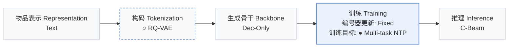
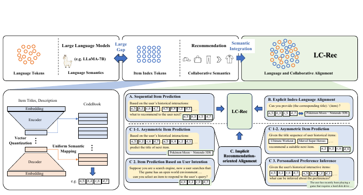
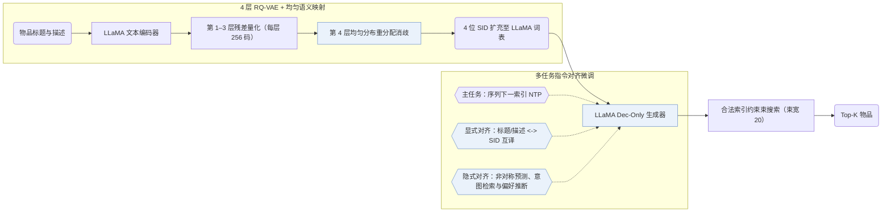
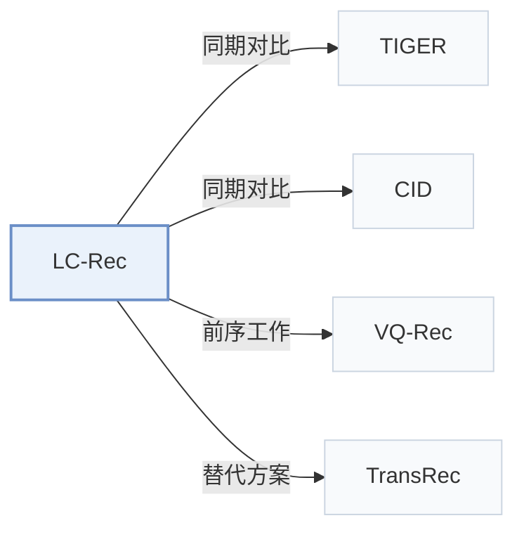

# LC-Rec

[← 问题 × 阶段矩阵](../../../README.zh.md#iii--training) · [按阶段索引](../index/stages.md) · [按模态找论文](../index/modality.md) · [按领域找论文](../index/domain.md) · [English](../../papers/lc-rec.md) | 中文

| **题目** | *Adapting large language models by integrating collaborative semantics for recommendation* |
| :-- | :-- |
| **作者** | Zheng et al. |
| **发表** | ICDE’24 |
| **问题与阶段** | `III. SID 与模型对齐` · `训练（Training）` |
| **改动** | ○ 构码 · ● 训练目标 |
| **构码输入** | `Text` |
| **领域** | `电商` |
| **应用场景** | `一般物品推荐`；`公开数据` |
| **链接** | [论文](https://arxiv.org/abs/2311.09049) · [代码](https://github.com/RUCAIBox/LC-Rec/) |
| **阅读级别** | 阅读笔记（第 2 级） |

**本页目录**：[TL;DR](#tldr) · [速览](#速览) · [1. 为什么重要](#1-为什么重要) · [2. 方法](#2-方法) · [3. 实验发现](#3-实验发现) · [4. 局限与分析](#4-局限与分析) · [5. 相关工作](#5-相关工作)

- `Text`：物品文本元数据（标题、描述、类目或提示词）。
- `RQ-VAE`：残差量化变分自编码器（Residual-Quantized VAE）。
- `Dec-Only`：仅解码器（Decoder-only）自回归架构。
- `Fixed`：先独立训练并冻结编号器，生成器训练期间 SID 保持不变。
- `Multi-task NTP`：在多个对齐或推荐子任务上联合优化下一 token 预测损失。
- `C-Beam`：受合法物品集合约束的束搜索（Constrained beam search）。

### TL;DR

> [!NOTE]
> LC-Rec 通过带均匀语义映射的向量量化分配无冲突物品索引，并用多类对齐任务微调 LLM，使模型无需候选列表即可从全库生成物品。

---

### 速览

| 维度 | 摘要 |
| :-- | :-- |
| 主要发现 | 在 Amazon Instruments、Arts 与 Games 的全库排序评测中，LC-Rec 全面优于传统序列推荐器、TIGER 及此前的 LLM 推荐基线（Abstract，Table 3）。 |
| 局限 | 物品索引仅由 LLaMA 文本嵌入量化生成，协同信号只能在后续指令微调阶段间接注入（Sec. III-B）。 |

---

### 1. 为什么重要

用词表外的离散编码索引物品时，大语言模型（LLM）预训练习得的自然语言语义与推荐系统依赖的协同交互信号之间存在明显断层（Abstract）。LC-Rec 在 RQ-VAE 末层通过均匀语义映射消除冲突，并在指令微调中联合训练显式的“文本-索引互译”与隐式的协同对齐任务。

> "In essence, LLMs capture language semantics while recommender systems imply collaborative semantics, making it difficult to sufficiently leverage the model capacity of LLMs for recommendation."（Abstract）

---

### 2. 方法

#### 物品索引

LC-Rec 用 LLaMA 编码物品标题与描述，经 4 层 × 256 码字的 RQ-VAE 量化（Sec. III-B）。针对落入同一编码的冲突物品，LC-Rec 不额外追加无语义整数后缀，而是在最后一层施加均匀分布约束，按残差距离将冲突物品分散到不同码字上（Sec. III-B2）。

#### 对齐调优

指令微调联合优化三类任务：以序列下一物品索引预测为主任务（Sec. III-C1）；两项显式双向对齐任务在标题/描述与离散语义 ID（Semantic ID，SID）之间互译（Sec. III-C2）；隐式对齐任务涵盖非对称物品预测、基于查询意图的物品预测以及用户偏好总结（Sec. III-C3）。

> "On the one hand, the LLM should be capable of accurately identifying the item indices based on the associated title or description. On the other hand, it is expected that LLM can naturally capture relevant item information from its indices."（Sec. III-C2）

#### 训练

所有对齐与推荐任务统一构造为条件语言生成指令，在同一个 LLaMA 仅解码器骨干上微调，并在推理时通过屏蔽非法前缀做约束束搜索（Sec. III-D）。

> "To this end, we employ LLaMA [25] as our backbone model and then optimize it via instruction tuning."（Sec. III-D）

---

### 3. 实验发现

实验设置

- **数据集**：Amazon Reviews (May 1996-October 2018): Musical Instruments, Arts Crafts and Sewing, Video Games; users and items with fewer than 5 interactions are filtered; sequences capped at 20 items. Sizes (users / items / interactions): Instruments 24,773 / 9,923 / 206,153; Arts 45,142 / 20,957 / 390,832; Games 50,547 / 16,860 / 452,989.
  - 出处：Amazon 2018 subsets, 5-interaction filter, length 20: [S4.SS1.SSS1.p1](https://arxiv.org/html/2311.09049v4#S4.SS1.SSS1.p1); statistics: [S4.T2](https://arxiv.org/html/2311.09049v4#S4.T2).
- **切分**：Per-user leave-one-out: most recent item for test, second most recent for validation, the rest for training.
  - 出处：Leave-one-out allocation: [S4.SS1.SSS3.p1](https://arxiv.org/html/2311.09049v4#S4.SS1.SSS3.p1).
- **候选集**：full catalog (full ranking over the entire item set instead of sampled evaluation). Separate analysis (Table 5): choose between the target and one negative that is language-similar, collaborative-similar (by SASRec embeddings), or random; history exclusion for these negatives not reported.
  - 出处：Full ranking over the entire item set: [S4.SS1.SSS3.p1](https://arxiv.org/html/2311.09049v4#S4.SS1.SSS3.p1); separate pairwise test with one negative: [S4.SS4.SSS0.Px3.p1](https://arxiv.org/html/2311.09049v4#S4.SS4.SSS0.Px3.p1).
- **可见性**：warm; no unseen-item protocol is defined.
  - 出处：Standard split with no unseen-item protocol: [S4.SS1.SSS3.p1](https://arxiv.org/html/2311.09049v4#S4.SS1.SSS3.p1).
- **SID 规格**：4-level RQ-VAE x 256 codewords (dimension 32) over mean-pooled LLaMA embeddings of title and description, added to the LLaMA tokenizer as new tokens. Conflicts are resolved without an extra suffix level: the last-level codewords of each conflicting group are redistributed under a uniform-distribution constraint.
  - 出处：4 levels x 256 x 32 over LLaMA text embeddings: [S4.SS1.SSS4.p1](https://arxiv.org/html/2311.09049v4#S4.SS1.SSS4.p1); uniform last-level redistribution for conflicts: [S3.SS2.SSS2.p2](https://arxiv.org/html/2311.09049v4#S3.SS2.SSS2.p2) and [S3.SS2.SSS2.p3](https://arxiv.org/html/2311.09049v4#S3.SS2.SSS2.p3).
- **推理预算**：Beam search with beam size 20 for all generative methods; tokens leading to invalid item indices get zero probability. LLaMA backbone with DeepSpeed; hardware, inference batch size, and latency: not reported. HR and NDCG at 1, 5, 10.
  - 出处：Beam size 20 and invalid-token masking: [S4.SS1.SSS3.p1](https://arxiv.org/html/2311.09049v4#S4.SS1.SSS3.p1) and [S3.SS4.SSS2.p1](https://arxiv.org/html/2311.09049v4#S3.SS4.SSS2.p1).
- **结果来源**：Table 3 (Instruments, Arts, Games; LC-Rec averaged over instruction templates); Table 4 (alignment-task ablation); Table 5 (similar-negative ranking accuracy).
  - 出处：Main: [S4.T3](https://arxiv.org/html/2311.09049v4#S4.T3); ablation: [S4.T4](https://arxiv.org/html/2311.09049v4#S4.T4); negative-item analysis: [S4.T5](https://arxiv.org/html/2311.09049v4#S4.T5).

- 主结果与消融：在 Amazon Instruments、Arts 与 Games 的全库排序评测中，LC-Rec 优于传统序列推荐模型、TIGER 与既有 LLM 推荐基线；消融实验验证了均匀语义映射与各组显隐式对齐任务各自的收益（Abstract，Tables 3 and 4）。

---

### 4. 局限与分析

**Our analysis.**

- TIGER 将 `RQ-VAE` 码送入从零训练的轻量 `Enc-Dec` Transformer 做单任务 `NTP`；LC-Rec 则把 `RQ-VAE` 码扩充进预训练 `Dec-Only` LLaMA 词表，依靠 `Multi-task NTP` 指令对齐打通语言空间与离散 ID。

---

### 5. 相关工作

- **同期对比** · [TIGER](tiger.md): TIGER resolves leaf conflicts with an extra index level and uses a small seq2seq model; LC-Rec redistributes conflicting last-level codes uniformly and tunes LLaMA with language-collaborative alignment tasks.
  - 出处：LC-Rec v4, conflict discussion: [S3.SS2.SSS2.p1](https://arxiv.org/html/2311.09049v4#S3.SS2.SSS2.p1); baselines and Table 3: [S4.I1.i10.p1](https://arxiv.org/html/2311.09049v4#S4.I1.i10.p1) and [S4.T3](https://arxiv.org/html/2311.09049v4#S4.T3).
- **同期对比** · [CID](cid.md): P5-CID builds collaborative indices and also adds a supplementary index for conflicts; LC-Rec learns semantic RQ indices from LLM text embeddings.
  - 出处：LC-Rec v4, conflict discussion: [S3.SS2.SSS2.p1](https://arxiv.org/html/2311.09049v4#S3.SS2.SSS2.p1); baselines and Table 3: [S4.I1.i9.p1](https://arxiv.org/html/2311.09049v4#S4.I1.i9.p1) and [S4.T3](https://arxiv.org/html/2311.09049v4#S4.T3).
- **前序工作** · [VQ-Rec](vq-rec.md): LC-Rec borrows the idea of learned semantic indices from VQ-Rec and TIGER, then adapts it for LLM tuning.
  - 出处：LC-Rec v4, Section 3.2.1: [S3.SS2.SSS1.p1](https://arxiv.org/html/2311.09049v4#S3.SS2.SSS1.p1) and [S3.SS2.SSS1.p4](https://arxiv.org/html/2311.09049v4#S3.SS2.SSS1.p4).
- **替代方案** · [TransRec](transrec.md): TransRec also builds LLM-based generative recommendation with multi-facet identifiers; LC-Rec uses learned VQ indices with alignment tuning.
  - 出处：LC-Rec v4, Section 2.2 and Section 3.5 related work: [S2.SS2.p3](https://arxiv.org/html/2311.09049v4#S2.SS2.p3) and [S3.SS5.p3](https://arxiv.org/html/2311.09049v4#S3.SS5.p3).

[查看同格全部论文](../../../README.zh.md#iii--training)
