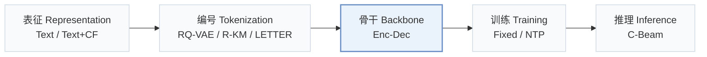
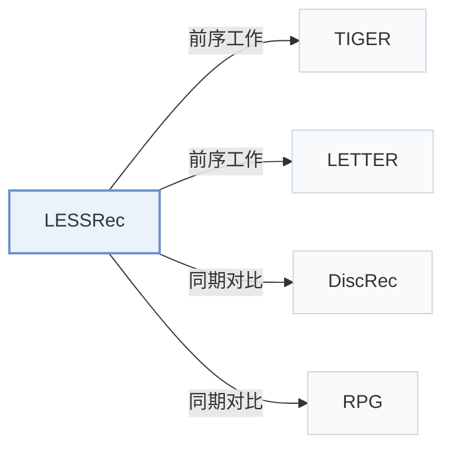

# LESSRec

[← 问题 × 阶段矩阵](../../../README.zh.md#iii--backbone) · [按阶段索引](../index/stages.md) · [按模态索引](../index/modality.md) · [English](../../papers/lessrec.md) | 中文

| **题目** | *Level-Specific History Modeling for Semantic ID-Based Recommendation* |
| :-- | :-- |
| **作者** | Yang et al. |
| **发表** | arXiv’26 |
| **问题与阶段** | `III. SID 与模型对齐` · `骨干（Backbone）` |
| **链接** | [论文](https://arxiv.org/abs/2610.37286) |
| **阅读级别** | 概览（第 1 级） |

**本页目录**：[TL;DR](#tldr) · [速览](#速览) · [3. 实验发现](#3-实验发现) · [5. 相关工作](#5-相关工作)

- `Text / Text+CF`：不同配置下分别采用纯文本表征或文本加协同信号。
- `RQ-VAE / R-KM / LETTER`：评测涵盖 RQ-VAE、残差 k-means 与 LETTER 等多种编号器配置。
- `Enc-Dec`：编码器-解码器（Encoder-decoder）架构。
- `Fixed`：先独立训练并冻结编号器，生成器训练期间 SID 保持不变。
- `NTP`：标准下一 token 预测（Next-Token Prediction）交叉熵损失；基于预训练 LLM 的指令微调（SFT）亦归入此类。
- `C-Beam`：受合法物品集合约束的束搜索（Constrained beam search）。

### TL;DR

> [!NOTE]
> LESSRec 按各 SID 层级分别编码交互历史，将注意力限制在目标 token 所在层级并加入物品级语义序列，替代跨全部层级的全局注意力。

---

### 速览

| 维度 | 摘要 |
| :-- | :-- |
| 研究问题 | III. SID 与模型对齐：生成模型能否理解并推理离散 SID，编号器与生成器的优化目标是否一致？ |
| 核心贡献 | LESSRec 按各 SID 层级分别编码交互历史，将注意力限制在目标 token 所在层级并加入物品级语义序列，替代跨全部层级的全局注意力。 |
| 主要改动阶段 | 骨干（Backbone） |

---

### 3. 实验发现

实验设置

- **数据集**：Amazon Reviews 2023 Games/Software and earlier Amazon Beauty; iterative user/item 5-core filtering; histories capped at 20 items.
  - 出处：Section 4.1.1: [S4.SS1.SSS1.p1](https://arxiv.org/html/2610.37286v1#S4.SS1.SSS1.p1)
- **切分**：Leave-one-out; exact validation/test allocation not reported.
  - 出处：Section 4.1.3: [S4.SS1.SSS3.p1](https://arxiv.org/html/2610.37286v1#S4.SS1.SSS3.p1)
- **候选集**：not reported
  - 出处：Section 4.1.3 specifies a shared candidate index but not full-catalog versus sampled evaluation: [S4.SS1.SSS3.p1](https://arxiv.org/html/2610.37286v1#S4.SS1.SSS3.p1)
- **可见性**：warm; no unseen-item protocol is defined. LETTER uses SASRec collaborative embeddings; its exposure to test items is not reported.
  - 出处：Sections 4.1.3/4.1.4 define no item holdout: [S4.SS1.SSS3.p1](https://arxiv.org/html/2610.37286v1#S4.SS1.SSS3.p1) and [S4.SS1.SSS4.p1](https://arxiv.org/html/2610.37286v1#S4.SS1.SSS4.p1)
- **SID 规格**：RQ-VAE, RQ-Kmeans, or LETTER: 4 levels x 256 codes, fixed offline; Sentence-T5 text embeddings. RQ-Kmeans uses trainable conditional subcodebooks. Collision handling not reported.
  - 出处：Section 4.1.4 and Appendix B.2: [S4.SS1.SSS4.p1](https://arxiv.org/html/2610.37286v1#S4.SS1.SSS4.p1) and [A2.SS2.p2](https://arxiv.org/html/2610.37286v1#A2.SS2.p2)
- **推理预算**：Trie-constrained beam 10; batch 32; single RTX 4090 24GB; K=5/10. End-to-end latency not reported; Figure 6 measures encoder CUDA time per sample.
  - 出处：Sections 4.1.5/4.6 and Figure 6: [S4.SS1.SSS5.p1](https://arxiv.org/html/2610.37286v1#S4.SS1.SSS5.p1) and [S4.F6](https://arxiv.org/html/2610.37286v1#S4.F6)
- **结果来源**：Original Table 2: three-seed comparisons across tokenizers; baselines implemented using official code or RecBole. Table 6 reports training costs, not inference latency.
  - 出处：Section 4.1.5 and Tables 2/6: [S4.SS1.SSS5.p1](https://arxiv.org/html/2610.37286v1#S4.SS1.SSS5.p1) and [S4.T2](https://arxiv.org/html/2610.37286v1#S4.T2) and [S4.T6](https://arxiv.org/html/2610.37286v1#S4.T6)

---

### 5. 相关工作

- **前序工作** · [TIGER](tiger.md): LESSRec reorganizes TIGER's history encoding by semantic level.
  - 出处：LESSRec v1, Section 4.1.2 and Table 2: [S4.SS1.SSS2.p1](https://arxiv.org/html/2610.37286v1#S4.SS1.SSS2.p1); [S4.T2](https://arxiv.org/html/2610.37286v1#S4.T2).
- **前序工作** · [LETTER](letter.md): LETTER supplies one of the three fixed tokenizers tested with LESSRec.
  - 出处：LESSRec v1, Section 4.1.4 and Table 2: [S4.SS1.SSS4.p1](https://arxiv.org/html/2610.37286v1#S4.SS1.SSS4.p1); [S4.T2](https://arxiv.org/html/2610.37286v1#S4.T2).
- **同期对比** · [DiscRec](discrec.md): DiscRec models intra-item structure; LESSRec separates same-level histories across items.
  - 出处：LESSRec v1, Section 5.3 and Table 2: [S5.SS3.p1](https://arxiv.org/html/2610.37286v1#S5.SS3.p1); [S4.T2](https://arxiv.org/html/2610.37286v1#S4.T2).
- **同期对比** · [RPG](rpg.md): RPG predicts long unordered codes in parallel; LESSRec models hierarchical level-specific histories.
  - 出处：LESSRec v1, Section 4.1.2 and Table 2: [S4.SS1.SSS2.p1](https://arxiv.org/html/2610.37286v1#S4.SS1.SSS2.p1); [S4.T2](https://arxiv.org/html/2610.37286v1#S4.T2).

[查看同格全部论文](../../../README.zh.md#iii--backbone)
