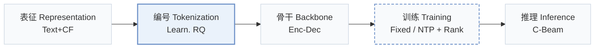
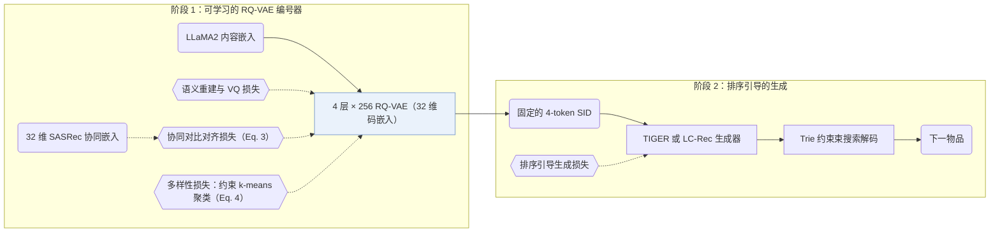
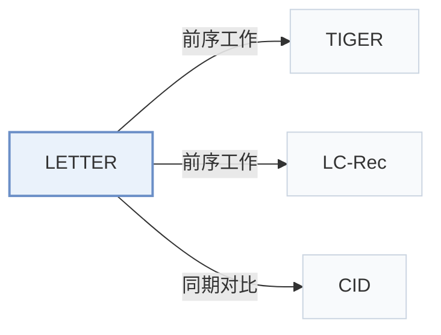

# LETTER

[← 问题 × 阶段矩阵](../../../README.zh.md#i--tokenization) · [按阶段索引](../index/stages.md) · [按模态索引](../index/modality.md) · [English](../../papers/letter.md) | 中文

| **题目** | *Learnable item tokenization for generative recommendation* |
| :-- | :-- |
| **作者** | Wang et al. |
| **发表** | CIKM’24 |
| **问题与阶段** | `I. 信息量` · `编号（Tokenization）` — 补充：`II. 唯一性与合法性` × `编号（Tokenization）`；`训练（Training）` |
| **链接** | [论文](https://arxiv.org/abs/2405.07314) · [代码](https://github.com/HonghuiBao2000/LETTER) |
| **阅读级别** | 阅读笔记（第 2 级） |

**本页目录**：[TL;DR](#tldr) · [速览](#速览) · [1. 为什么重要](#1-为什么重要) · [2. 方法](#2-方法) · [3. 实验发现](#3-实验发现) · [4. 局限与分析](#4-局限与分析) · [5. 相关工作](#5-相关工作)

- `Text+CF`：文本表征结合协同过滤信号。
- `Learn. RQ`：端到端或交替更新的可学习残差量化。
- `Enc-Dec`：编码器-解码器（Encoder-decoder）架构。
- `Fixed`：先独立训练并冻结编号器，生成器训练期间 SID 保持不变。
- `NTP + Rank`：下一 token 预测结合显式排序损失。
- `C-Beam`：受合法物品集合约束的束搜索（Constrained beam search）。

### TL;DR

> [!NOTE]
> LETTER 用协同对齐损失与多样性损失约束 RQ-VAE 编号器，使物品 SID 融入协同信号并减轻早期标识中的码分配偏置。

---

### 速览

| 维度 | 摘要 |
| :-- | :-- |
| 研究问题 | I. 信息量：SID 或读取它的模型是否充分携带了推荐所需的协同、多模态与时空信号？ |
| 核心贡献 | LETTER 用协同对齐损失与多样性损失约束 RQ-VAE 编号器，使物品 SID 融入协同信号并减轻早期标识中的码分配偏置。 |
| 主要改动阶段 | 编号（Tokenization） |
| 主要发现 | 在 Instruments 上，LETTER-TIGER 的 Recall@10 为 0.1122，TIGER 为 0.1058；单独加入任一种正则项也能提升 TIGER（Table 2）。 |
| 局限 | 协同正则依赖一个单独预训练的 CF 模型提供嵌入（Sec. 3.1）。 |

---

### 1. 为什么重要

早期的物品标识（普通 ID、原始文本或未加正则的码本编码）难以同时编码语义信息、融入协同信号并抑制码分配偏置。LETTER 从这三个维度同时约束 RQ-VAE 编号器，并将生成的 4 层语义 ID（Semantic ID，SID）接入 TIGER 和 LC-Rec 两种生成式骨干（Sec. 4.1.3）。

> "LETTER incorporates Residual Quantized VAE for semantic regularization, a contrastive alignment loss for collaborative regularization, and a diversity loss to mitigate code assignment bias."（Abstract）

---

### 2. 方法

#### 语义正则

RQ-VAE 按 4 个残差层级逐层量化物品内容嵌入（每层 256 个 32 维码字），使生成的标识保持由粗到细的语义层级结构（Sec. 3.1，Sec. 4.1.4）。

#### 协同正则

对比对齐损失将每个物品的量化残差嵌入拉向预训练协同过滤（CF）模型给出的嵌入，使交互相似的物品具有相近的码序列（Sec. 3.1，Eq. 3）。论文以 SASRec 和 LightGCN 为例说明 CF 教师模型，并在实验中采用 32 维 SASRec 嵌入（Sec. 3.1，Sec. 4.1.3）。

> "Intuitively, collaborative regularization encourages items with similar collaborative interactions to exhibit similar code sequences."（Sec. 3.1）

#### 多样性正则

多样性损失通过受约束 k-means 对码本嵌入聚类，拉近同簇嵌入并推开不同簇（Sec. 3.1，Eq. 4），从而抑制热门码字聚集过多物品的码分配偏置及下游生成偏置（Sec. 1）。

> "As illustrated in Figure 5(a), a biased code embedding distribution is more likely to cause biased code assignment in the latent space, where some codes are assigned to more items."（Sec. 3.1）

#### 训练与生成

LETTER 先用语义、协同与多样性组合损失训练编号器（Eq. 5），再冻结物品 SID 供生成器训练和推理使用（Sec. 3.2）。生成器训练阶段额外引入排序引导生成损失以拉大困难负例 SID 的相对打分差距（Abstract，Sec. 1），推理阶段通过前缀 Trie 将生成约束在合法标识范围内。

> "To ensure generating valid identifiers, we follow (Hua et al., 2023) to employ constrained generation (De Cao et al., 2020) via Trie"（Sec. 3.2.2）

---

### 3. 实验发现

实验设置

- **数据集**：Amazon Instruments, Amazon Beauty, and Yelp; users and items with fewer than 5 interactions are discarded. Dataset release/date windows and retained corpus sizes are not reported.
  - 出处：Dataset names and explicit filtering of both users and items: [S4.SS1.SSS1.p1](https://arxiv.org/html/2405.07314v1#S4.SS1.SSS1.p1).
- **切分**：Chronological interaction histories with leave-one-out evaluation; training histories contain at most 20 items. The exact validation/test position allocation is not reported beyond the leave-one-out label.
  - 出处：Leave-one-out and the 20-item training-history cap: [S4.SS1.SSS1.p1](https://arxiv.org/html/2405.07314v1#S4.SS1.SSS1.p1); chronological histories: [S3.SS2.SSS1.p1](https://arxiv.org/html/2405.07314v1#S3.SS2.SSS1.p1). Methods/Experiments and Appendix 7 do not spell out the exact validation-versus-test position allocation beyond naming leave-one-out.
- **候选集**：not reported (full catalog versus sampled evaluation candidates); generation is constrained to valid identifier continuations with a trie.
  - 出处：Inference defines trie-constrained generation, but not full-catalog versus sampled-negative evaluation: [S3.SS2.SSS2.p1](https://arxiv.org/html/2405.07314v1#S3.SS2.SSS2.p1); evaluation states only metrics: [S4.SS1.SSS3.p1](https://arxiv.org/html/2405.07314v1#S4.SS1.SSS3.p1); Methods/Experiments and Appendix 7 were checked.
- **可见性**：Standard leave-one-out evaluation; per-target generator/tokenizer training visibility is not reported. The tokenizer uses item content and SASRec collaborative embeddings before generator training, but inclusion of held-out-only items in tokenizer/CF training is not reported. A dedicated cold-start evaluation is not reported.
  - 出处：Tokenizer training precedes generator training: [S3.SS2.p1](https://arxiv.org/html/2405.07314v1#S3.SS2.p1); LLaMA2 content embeddings and SASRec collaborative embeddings: [S4.SS1.SSS4.p1](https://arxiv.org/html/2405.07314v1#S4.SS1.SSS4.p1); leave-one-out: [S4.SS1.SSS1.p1](https://arxiv.org/html/2405.07314v1#S4.SS1.SSS1.p1). Methods/Experiments and Appendix 7 give no item-disjoint cold-start experiment or explicit tokenizer/CF visibility for held-out-only items.
- **SID 规格**：Main configuration: 4 residual-quantization levels x 256 codewords, with 32-dimensional code embeddings; the identifier contains 4 learned codes. Collision handling or an additional collision suffix: not reported.
  - 出处：Four levels, 256 entries each, and 32-dimensional embeddings: [S4.SS1.SSS4.p2](https://arxiv.org/html/2405.07314v1#S4.SS1.SSS4.p2); L is the identifier length: [S3.SS1.p4](https://arxiv.org/html/2405.07314v1#S3.SS1.p4). Methods/Experiments and Appendix 7 do not specify collision resolution or an additional disambiguation suffix; the four learned levels must not be replaced by TIGER's three levels plus suffix.
- **推理预算**：Trie-constrained autoregressive generation; numerical beam width not reported. Recall and NDCG at K=5 and 10. All experiments use 4 NVIDIA RTX A5000 GPUs; allocation specifically for inference is not reported. Inference batch size and measured latency: not reported.
  - 出处：Trie-constrained autoregressive generation: [S3.SS2.SSS2.p1](https://arxiv.org/html/2405.07314v1#S3.SS2.SSS2.p1); metric cutoffs: [S4.SS1.SSS3.p1](https://arxiv.org/html/2405.07314v1#S4.SS1.SSS3.p1); experiment hardware: [S4.SS1.SSS4.p1](https://arxiv.org/html/2405.07314v1#S4.SS1.SSS4.p1). Methods/Experiments and Appendix 7 specify no beam width, inference batch, or measured latency; the 1,024 batch in [S4.SS1.SSS4.p2](https://arxiv.org/html/2405.07314v1#S4.SS1.SSS4.p2) is tokenizer training, not inference.
- **结果来源**：Original paper Table 1, with separate LETTER-TIGER and LETTER-LC-Rec rows on Instruments, Beauty, and Yelp. The authors reimplement TIGER and instantiate LC-Rec with LoRA-tuned LLaMA2-7B; these are this paper's experimental configurations, not the original TIGER paper's results.
  - 出处：Original main table and model instantiations: [S4.T1](https://arxiv.org/html/2405.07314v1#S4.T1) and [S4.SS2.p1](https://arxiv.org/html/2405.07314v1#S4.SS2.p1); TIGER reimplementation and LC-Rec/LoRA setup: [S4.SS1.SSS4.p1](https://arxiv.org/html/2405.07314v1#S4.SS1.SSS4.p1).

- 主结果：将 LETTER 接入 TIGER（LETTER-TIGER）和基于 LoRA 微调 LLaMA2-7B 的 LC-Rec（LETTER-LC-Rec）后，在 Amazon Instruments、Amazon Beauty 和 Yelp 上的 Recall 与 NDCG@5/10 均优于各自的后端基座模型（Sec. 4.2，Table 1）。
- 正则消融：在 TIGER 上单独加入协同正则或多样性正则均可提升性能，两者与排序引导损失结合时取得最优结果（Sec. 4.3.1，Table 2）。
- 码本利用率权衡：加入协同正则会将 TIGER 的活跃码字数从 148 压低到 76，再结合多样性正则可恢复码本覆盖率（Sec. 4.3.2，Fig. 6）。

  > "Although adding collaborative regularization decreases the code utilization of TIGER (from 148 to 76), integrating diversity regularization inversely compensates for the drop in code utilization."（Sec. 4.3.2）

- 协同信号保持度：与未加正则的 RQ-VAE 编码相比，LETTER 的码序列相似度与协同过滤相似度一致性更高（Sec. 4.3.4，Tables 3 and 4）。
- 超参数敏感性：对比不同标识长度 $`L`$、码本大小 $`N`$、损失权重 $`\alpha`$ 与 $`\beta`$、聚类簇数 $`K`$ 及温度 $`\tau`$ 表明，将标识长度 $`L`$ 从 4 增至 8 会因自回归误差累积而降低推荐精度（Sec. 4.3.5）。

  > "Continuously increasing the identifier length from 4 to 8 will inversely degrade the performance. This is reasonable because autoregressive generation suffers from error accumulation (Ren et al., 2024b)."（Sec. 4.3.5）

  盲目扩大码本大小 $`N`$ 也会使模型过拟合内容嵌入中的噪声语义。

  > "However, 2) blindly expanding N might inversely hurt the performance, where larger codebook size might be more susceptible to noise in the item's semantic information, potentially leading to the over-fitting of some meaningless semantics."（Sec. 4.3.5）

---

### 4. 局限与分析

**Stated by the authors.** 结论部分指出三个后续研究方向：融合多类丰富用户行为的物品编号、跨领域物品编号，以及将自然语言指令与编号化交互历史相结合（Sec. 6）。

**Our analysis.**

- 编号器训练完成后即固定（`Fixed`），物品库更新时需重新训练 CF 模型与 RQ-VAE 并重新分配编码。ETEGRec 改为交替更新编号器与生成器（`Altern.`），DIGER 则让生成器损失直接反向传播至编号器（`Joint`）。
- 协同正则要求每个物品预先具备 CF 嵌入，这意味着缺少历史交互的冷启动物品在编号阶段无法获得协同信号。
- 协同对齐会将活跃码字数从 148 压缩至 76，而多样性正则反向扩大码字覆盖面（Sec. 4.3.2），因此损失权重 $`\alpha`$ 与 $`\beta`$ 需要在协同聚类紧凑度与码本均匀分布之间折中。

---

### 5. 相关工作

- **前序工作** · [TIGER](tiger.md): LETTER builds on TIGER's RQ-VAE semantic tokenization by adding collaborative and diversity regularization plus a ranking-guided generation loss.
  - 出处：LETTER, Section 3.1: [S3.SS1.p6](https://arxiv.org/html/2405.07314v1#S3.SS1.p6); Section 4.3.1 defines the progression from TIGER to LETTER-TIGER: [S4.SS3.SSS1.p1](https://arxiv.org/html/2405.07314v1#S4.SS3.SSS1.p1).
- **前序工作** · [LC-Rec](lc-rec.md): LC-Rec supplies an existing code-ID recommender with auxiliary language-alignment tasks; LETTER reuses it as a backend for its learnable tokenizer.
  - 出处：LETTER, Section 4.1.2 describes LC-Rec: [S4.SS1.SSS2.p1](https://arxiv.org/html/2405.07314v1#S4.SS1.SSS2.p1); Section 4.1.4 explicitly instantiates LETTER on LC-Rec: [S4.SS1.SSS4.p1](https://arxiv.org/html/2405.07314v1#S4.SS1.SSS4.p1); Table 1 includes LC-Rec and LETTER-LC-Rec: [S4.T1](https://arxiv.org/html/2405.07314v1#S4.T1).
- **同期对比** · [CID](cid.md): LETTER compares against P5-CID, which builds identifiers by spectral clustering of an item co-appearance graph instead of LETTER's regularized RQ-VAE tokenization.
  - 出处：LETTER, Section 4.1.2 identifies the P5-CID baseline from Hua et al.: [S4.SS1.SSS2.p1](https://arxiv.org/html/2405.07314v1#S4.SS1.SSS2.p1); Table 1 compares P5-CID with LETTER: [S4.T1](https://arxiv.org/html/2405.07314v1#S4.T1); Section 3.1 defines LETTER's RQ-VAE tokenizer: [S3.SS1.p2](https://arxiv.org/html/2405.07314v1#S3.SS1.p2).

[查看同格全部论文](../../../README.zh.md#i--tokenization)
