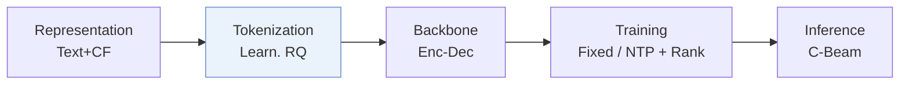
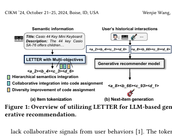
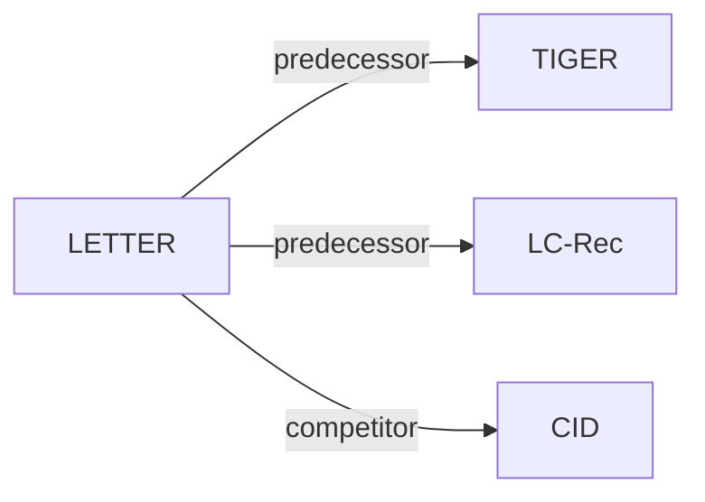

# LETTER

*Learnable item tokenization for generative recommendation* — Wang et al. · CIKM’24

`I. 信息量` · `Tokenization` · [论文](https://arxiv.org/abs/2405.07314) · [代码](https://github.com/HonghuiBao2000/LETTER) · [矩阵](../../../README.zh.md#i--tokenization) · [English](../../papers/letter.md)

阅读级别：阅读笔记（第 2 级） · 本页目录：[TL;DR](#tldr) · [速览](#速览) · [1. 为什么重要](#1-为什么重要) · [2. 方法](#2-方法) · [3. 实验发现](#3-实验发现) · [4. 局限与分析](#4-局限与分析) · [5. 相关工作](#5-相关工作)

- `Enc-Dec`: Encoder-decoder.
- `Fixed`: SIDs are built first and not changed while the generator trains.
- `NTP + Rank`: NTP plus a ranking loss.
- `C-Beam`: Constrained beam search.

### TL;DR

> [!NOTE]
> LETTER 用协同对齐损失与多样性损失约束 RQ-VAE 编号器，使物品 SID 融入协同信号并减轻早期标识中的码分配偏置。

### 速览

| 维度 | 摘要 |
| :-- | :-- |
| 研究问题 | I. 信息量：Do the SIDs, or the model reading them, carry the collaborative and multimodal signals recommendation needs? |
| 核心贡献 | LETTER 用协同对齐损失与多样性损失约束 RQ-VAE 编号器，使物品 SID 融入协同信号并减轻早期标识中的码分配偏置。 |
| 主要改动阶段 | Tokenization |
| 主要发现 | 在 Instruments 上，LETTER-TIGER 的 Recall@10 为 0.1122，TIGER 为 0.1058；只加其中任一种正则也能提升 TIGER（Table 2）。 |
| 局限 | 协同正则需要一个单独训练的 CF 模型提供嵌入（Sec. 3.1）。 |

### 1. 为什么重要

以往的物品标识，无论是普通 ID、文本还是码本编码，都在编码语义、携带协同信号或处理码分配偏差上有欠缺（Abstract）。LETTER 的语义 ID（Semantic ID，SID）可以给 TIGER 和 LC-Rec 两种生成器使用（Sec. 4.1.3）。

> "LETTER incorporates Residual Quantized VAE for semantic regularization, a contrastive alignment loss for collaborative regularization, and a diversity loss to mitigate code assignment bias."（Abstract）（RQ-VAE 做语义正则，对比对齐损失做协同正则，多样性损失缓解码分配偏差。）

### 2. 方法

#### 语义正则

RQ-VAE 逐层量化物品的语义嵌入，标识因此保留由粗到细的语义层级（Sec. 3.1）。

#### 协同正则

对比对齐损失把每个物品的量化嵌入拉向它在一个训练好的协同过滤（CF）模型中的嵌入（Sec. 3.1，Eq. 3）。论文举了 SASRec 和 LightGCN 作为 CF 模型的例子，实验用的是 32 维的 SASRec 嵌入（Sec. 3.1，Sec. 4.1.3）。

> "Intuitively, collaborative regularization encourages items with similar collaborative interactions to exhibit similar code sequences."（Sec. 3.1）（交互相似的物品，码序列也相似。）

#### 多样性正则

多样性损失先用约束 k-means 给码嵌入分组，把同簇的嵌入拉近，把不同簇推开（Sec. 3.1，Eq. 4）。它针对的是码分配偏差（某些码分到的物品更多）和物品生成偏差（Sec. 1）。

> "As illustrated in Figure 5(a), a biased code embedding distribution is more likely to cause biased code assignment in the latent space, where some codes are assigned to more items."（Sec. 3.1）（码嵌入分布有偏，码的分配也容易有偏。）

#### 训练与生成

LETTER 先用组合损失训练编号器（Eq. 5），再用它给物品编号，供生成器训练和推理（Sec. 3.2）。LETTER 还在生成器训练中加了排序引导的生成损失，提高排序能力（Abstract，Sec. 1）。推理时用 trie 把生成限制在合法标识内。

> "To ensure generating valid identifiers, we follow (Hua et al., 2023) to employ constrained generation (De Cao et al., 2020) via Trie"（Sec. 3.2.2）（用 Trie 做约束生成，保证标识合法。）

### 3. 实验发现

实验设置

- **数据集**：Amazon Instruments, Amazon Beauty, and Yelp; users and items with fewer than 5 interactions are discarded. Dataset release/date windows and retained corpus sizes are not reported.
  - 出处：Dataset names and explicit filtering of both users and items: [S4.SS1.SSS1.p1](https://arxiv.org/html/2405.07314v1#S4.SS1.SSS1.p1).
- **切分**：Chronological interaction histories with leave-one-out evaluation; training histories contain at most 20 items. The exact validation/test position allocation is not reported beyond the leave-one-out label.
  - 出处：Leave-one-out and the 20-item training-history cap: [S4.SS1.SSS1.p1](https://arxiv.org/html/2405.07314v1#S4.SS1.SSS1.p1); chronological histories: [S3.SS2.SSS1.p1](https://arxiv.org/html/2405.07314v1#S3.SS2.SSS1.p1). Methods/Experiments and Appendix 7 do not spell out the exact validation-versus-test position allocation beyond naming leave-one-out.
- **候选集**：not reported (full catalog versus sampled evaluation candidates); generation is constrained to valid identifier continuations with a trie.
  - 出处：Inference defines trie-constrained generation, but not full-catalog versus sampled-negative evaluation: [S3.SS2.SSS2.p1](https://arxiv.org/html/2405.07314v1#S3.SS2.SSS2.p1); evaluation states only metrics: [S4.SS1.SSS3.p1](https://arxiv.org/html/2405.07314v1#S4.SS1.SSS3.p1); Methods/Experiments and Appendix 7 were checked.
- **可见性**：Standard leave-one-out evaluation; per-target generator/tokenizer training visibility is not reported. The tokenizer uses item content and SASRec collaborative embeddings before generator training, but inclusion of held-out-only items in tokenizer/CF training is not reported. A dedicated cold-start evaluation is not reported.
  - 出处：Tokenizer training precedes generator training: [S3.SS2.p1](https://arxiv.org/html/2405.07314v1#S3.SS2.p1); LLaMA2 content embeddings and SASRec collaborative embeddings: [S4.SS1.SSS4.p1](https://arxiv.org/html/2405.07314v1#S4.SS1.SSS4.p1); leave-one-out: [S4.SS1.SSS1.p1](https://arxiv.org/html/2405.07314v1#S4.SS1.SSS1.p1). Methods/Experiments and Appendix 7 give no item-disjoint cold-start experiment or explicit tokenizer/CF visibility for held-out-only items.
- **SID 规格**：Main configuration: 4 residual-quantization levels x 256 codewords, with 32-dimensional code embeddings; the identifier contains 4 learned codes. Collision handling or an additional collision suffix: not reported.
  - 出处：Four levels, 256 entries each, and 32-dimensional embeddings: [S4.SS1.SSS4.p2](https://arxiv.org/html/2405.07314v1#S4.SS1.SSS4.p2); L is the identifier length: [S3.SS1.p4](https://arxiv.org/html/2405.07314v1#S3.SS1.p4). Methods/Experiments and Appendix 7 do not specify collision resolution or an additional disambiguation suffix; the four learned levels must not be replaced by TIGER's three levels plus suffix.
- **推理预算**：Trie-constrained autoregressive generation; numerical beam width not reported. Recall and NDCG at K=5 and 10. All experiments use 4 NVIDIA RTX A5000 GPUs; allocation specifically for inference is not reported. Inference batch size and measured latency: not reported.
  - 出处：Trie-constrained autoregressive generation: [S3.SS2.SSS2.p1](https://arxiv.org/html/2405.07314v1#S3.SS2.SSS2.p1); metric cutoffs: [S4.SS1.SSS3.p1](https://arxiv.org/html/2405.07314v1#S4.SS1.SSS3.p1); experiment hardware: [S4.SS1.SSS4.p1](https://arxiv.org/html/2405.07314v1#S4.SS1.SSS4.p1). Methods/Experiments and Appendix 7 specify no beam width, inference batch, or measured latency; the 1,024 batch in [S4.SS1.SSS4.p2](https://arxiv.org/html/2405.07314v1#S4.SS1.SSS4.p2) is tokenizer training, not inference.
- **结果来源**：Original paper Table 1, with separate LETTER-TIGER and LETTER-LC-Rec rows on Instruments, Beauty, and Yelp. The authors reimplement TIGER and instantiate LC-Rec with LoRA-tuned LLaMA2-7B; these are this paper's experimental configurations, not the original TIGER paper's results.
  - 出处：Original main table and model instantiations: [S4.T1](https://arxiv.org/html/2405.07314v1#S4.T1) and [S4.SS2.p1](https://arxiv.org/html/2405.07314v1#S4.SS2.p1); TIGER reimplementation and LC-Rec/LoRA setup: [S4.SS1.SSS4.p1](https://arxiv.org/html/2405.07314v1#S4.SS1.SSS4.p1).

- 主结果：LETTER-TIGER 和 LETTER-LC-Rec 在 Instruments、Beauty 和 Yelp 上都好于各自的原模型（Sec. 4.2，Table 1）。
- 消融：给 TIGER 只加协同正则或只加多样性正则，效果都有提升（Sec. 4.3.1，Table 2）。
- 码的使用：协同正则让 TIGER 用到的码变少，多样性正则又把它拉回来（Sec. 4.3.2，Fig. 6）。

  > "Although adding collaborative regularization decreases the code utilization of TIGER (from 148 to 76), integrating diversity regularization inversely compensates for the drop in code utilization."（Sec. 4.3.2）（协同正则让码利用数从 148 降到 76，多样性正则弥补了这一下降。）

- 协同信号：Tables 3 and 4 分析了标识携带协同信息的程度（Sec. 4.3.4）。
- 超参数：论文改变了标识长度 $`L`$、码本大小 $`N`$、损失权重 $`\alpha`$ 和 $`\beta`$、簇数 $`K`$ 以及温度 $`\tau`$（Sec. 4.3.5）。

  标识超过 4 个 token 后效果下降，作者归因于自回归生成的误差累积。

  > "Continuously increasing the identifier length from 4 to 8 will inversely degrade the performance. This is reasonable because autoregressive generation suffers from error accumulation (Ren et al., 2024b)."（Sec. 4.3.5）（长度从 4 增到 8 反而变差，原因是自回归误差累积。）

  码本过大也有害。

  > "However, 2) blindly expanding N might inversely hurt the performance, where larger codebook size might be more susceptible to noise in the item's semantic information, potentially leading to the over-fitting of some meaningless semantics."（Sec. 4.3.5）（盲目增大 N 会更容易受语义噪声影响，导致过拟合。）

### 4. 局限与分析

**Stated by the authors.** 结论部分给出三个未来方向：结合丰富用户行为的编号、跨领域的物品编号、把自然语言用户指令和编号后的交互历史结合起来（Sec. 6）。

**Our analysis.**

- 编号器训练一次就固定（`Fixed`），物品库一变就要重训编号器、重新编号。ETEGRec 轮流更新编号器和生成器（`Altern.`），DIGER 让生成器损失直接更新编号器（`Joint`）。
- 协同正则要求每个物品都有 CF 嵌入。由此推断，没有交互的物品，其标识里没有协同信号。
- 两种正则对码使用的作用相反（Sec. 4.3.2），由此推断，它们的权重是在两种性质之间取舍。

### 5. 相关工作

- **前序工作** · [TIGER](tiger.md): LETTER builds on TIGER's RQ-VAE semantic tokenization by adding collaborative and diversity regularization plus a ranking-guided generation loss.
  - 出处：LETTER, Section 3.1: https://arxiv.org/html/2405.07314v1#S3.SS1.p6; Section 4.3.1 defines the progression from TIGER to LETTER-TIGER: https://arxiv.org/html/2405.07314v1#S4.SS3.SSS1.p1.
- **前序工作** · [LC-Rec](lc-rec.md): LC-Rec supplies an existing code-ID recommender with auxiliary language-alignment tasks; LETTER reuses it as a backend for its learnable tokenizer.
  - 出处：LETTER, Section 4.1.2 describes LC-Rec: https://arxiv.org/html/2405.07314v1#S4.SS1.SSS2.p1; Section 4.1.4 explicitly instantiates LETTER on LC-Rec: https://arxiv.org/html/2405.07314v1#S4.SS1.SSS4.p1; Table 1 includes LC-Rec and LETTER-LC-Rec: https://arxiv.org/html/2405.07314v1#S4.T1.
- **同期对比** · [CID](cid.md): LETTER compares against P5-CID, which builds identifiers by spectral clustering of an item co-appearance graph instead of LETTER's regularized RQ-VAE tokenization.
  - 出处：LETTER, Section 4.1.2 identifies the P5-CID baseline from Hua et al.: https://arxiv.org/html/2405.07314v1#S4.SS1.SSS2.p1; Table 1 compares P5-CID with LETTER: https://arxiv.org/html/2405.07314v1#S4.T1; Section 3.1 defines LETTER's RQ-VAE tokenizer: https://arxiv.org/html/2405.07314v1#S3.SS1.p2.

[查看同格全部论文](../../../README.zh.md#i--tokenization)
