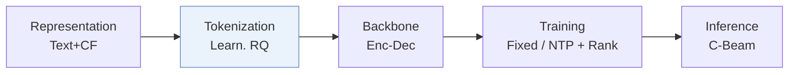
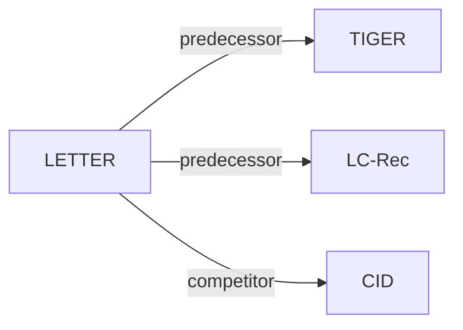

# LETTER

*Learnable item tokenization for generative recommendation* — Wang et al. · CIKM’24

`I. 信息量` · `Tokenization` · [论文](https://arxiv.org/abs/2405.07314) · [代码](https://github.com/HonghuiBao2000/LETTER) · [矩阵](../../../README.zh.md#i--tokenization) · [English](../../papers/letter.md)

阅读级别：概览（第 1 级） · 本页目录：[TL;DR](#tldr) · [速览](#速览) · [2. 方法](#2-方法) · [3. 实验发现](#3-实验发现) · [5. 相关工作](#5-相关工作)

- `Enc-Dec`: Encoder-decoder.
- `Fixed`: SIDs are built first and not changed while the generator trains.
- `NTP + Rank`: NTP plus a ranking loss.
- `C-Beam`: Constrained beam search.

### TL;DR

> [!NOTE]
> LETTER 用协同对齐损失与多样性损失约束 RQ-VAE 编号器，使物品 SID 融入协同信号并减轻早期标识中的码分配偏置。

### 速览

| 维度 | 摘要 |
| :-- | :-- |
| 研究问题 | I. 信息量：Do the SIDs, or the model reading them, carry the collaborative and multimodal signals recommendation needs? |
| 核心贡献 | LETTER 用协同对齐损失与多样性损失约束 RQ-VAE 编号器，使物品 SID 融入协同信号并减轻早期标识中的码分配偏置。 |
| 主要改动阶段 | Tokenization |

### 2. 方法

### 3. 实验发现

实验设置

- **数据集**：Amazon Instruments, Amazon Beauty, and Yelp; users and items with fewer than 5 interactions are discarded. Dataset release/date windows and retained corpus sizes are not reported.
  - 出处：Dataset names and explicit filtering of both users and items: [S4.SS1.SSS1.p1](https://arxiv.org/html/2405.07314v1#S4.SS1.SSS1.p1).
- **切分**：Chronological interaction histories with leave-one-out evaluation; training histories contain at most 20 items. The exact validation/test position allocation is not reported beyond the leave-one-out label.
  - 出处：Leave-one-out and the 20-item training-history cap: [S4.SS1.SSS1.p1](https://arxiv.org/html/2405.07314v1#S4.SS1.SSS1.p1); chronological histories: [S3.SS2.SSS1.p1](https://arxiv.org/html/2405.07314v1#S3.SS2.SSS1.p1). Methods/Experiments and Appendix 7 do not spell out the exact validation-versus-test position allocation beyond naming leave-one-out.
- **候选集**：not reported (full catalog versus sampled evaluation candidates); generation is constrained to valid identifier continuations with a trie.
  - 出处：Inference defines trie-constrained generation, but not full-catalog versus sampled-negative evaluation: [S3.SS2.SSS2.p1](https://arxiv.org/html/2405.07314v1#S3.SS2.SSS2.p1); evaluation states only metrics: [S4.SS1.SSS3.p1](https://arxiv.org/html/2405.07314v1#S4.SS1.SSS3.p1); Methods/Experiments and Appendix 7 were checked.
- **可见性**：Standard leave-one-out evaluation; per-target generator/tokenizer training visibility is not reported. The tokenizer uses item content and SASRec collaborative embeddings before generator training, but inclusion of held-out-only items in tokenizer/CF training is not reported. A dedicated cold-start evaluation is not reported.
  - 出处：Tokenizer training precedes generator training: [S3.SS2.p1](https://arxiv.org/html/2405.07314v1#S3.SS2.p1); LLaMA2 content embeddings and SASRec collaborative embeddings: [S4.SS1.SSS4.p1](https://arxiv.org/html/2405.07314v1#S4.SS1.SSS4.p1); leave-one-out: [S4.SS1.SSS1.p1](https://arxiv.org/html/2405.07314v1#S4.SS1.SSS1.p1). Methods/Experiments and Appendix 7 give no item-disjoint cold-start experiment or explicit tokenizer/CF visibility for held-out-only items.
- **SID 规格**：Main configuration: 4 residual-quantization levels x 256 codewords, with 32-dimensional code embeddings; the identifier contains 4 learned codes. Collision handling or an additional collision suffix: not reported.
  - 出处：Four levels, 256 entries each, and 32-dimensional embeddings: [S4.SS1.SSS4.p2](https://arxiv.org/html/2405.07314v1#S4.SS1.SSS4.p2); L is the identifier length: [S3.SS1.p4](https://arxiv.org/html/2405.07314v1#S3.SS1.p4). Methods/Experiments and Appendix 7 do not specify collision resolution or an additional disambiguation suffix; the four learned levels must not be replaced by TIGER's three levels plus suffix.
- **推理预算**：Trie-constrained autoregressive generation; numerical beam width not reported. Recall and NDCG at K=5 and 10. All experiments use 4 NVIDIA RTX A5000 GPUs; allocation specifically for inference is not reported. Inference batch size and measured latency: not reported.
  - 出处：Trie-constrained autoregressive generation: [S3.SS2.SSS2.p1](https://arxiv.org/html/2405.07314v1#S3.SS2.SSS2.p1); metric cutoffs: [S4.SS1.SSS3.p1](https://arxiv.org/html/2405.07314v1#S4.SS1.SSS3.p1); experiment hardware: [S4.SS1.SSS4.p1](https://arxiv.org/html/2405.07314v1#S4.SS1.SSS4.p1). Methods/Experiments and Appendix 7 specify no beam width, inference batch, or measured latency; the 1,024 batch in [S4.SS1.SSS4.p2](https://arxiv.org/html/2405.07314v1#S4.SS1.SSS4.p2) is tokenizer training, not inference.
- **结果来源**：Original paper Table 1, with separate LETTER-TIGER and LETTER-LC-Rec rows on Instruments, Beauty, and Yelp. The authors reimplement TIGER and instantiate LC-Rec with LoRA-tuned LLaMA2-7B; these are this paper's experimental configurations, not the original TIGER paper's results.
  - 出处：Original main table and model instantiations: [S4.T1](https://arxiv.org/html/2405.07314v1#S4.T1) and [S4.SS2.p1](https://arxiv.org/html/2405.07314v1#S4.SS2.p1); TIGER reimplementation and LC-Rec/LoRA setup: [S4.SS1.SSS4.p1](https://arxiv.org/html/2405.07314v1#S4.SS1.SSS4.p1).

### 5. 相关工作

- **前序工作** · [TIGER](tiger.md): LETTER builds on TIGER's RQ-VAE semantic tokenization by adding collaborative and diversity regularization plus a ranking-guided generation loss.
  - 出处：LETTER, Section 3.1: https://arxiv.org/html/2405.07314v1#S3.SS1.p6; Section 4.3.1 defines the progression from TIGER to LETTER-TIGER: https://arxiv.org/html/2405.07314v1#S4.SS3.SSS1.p1.
- **前序工作** · [LC-Rec](lc-rec.md): LC-Rec supplies an existing code-ID recommender with auxiliary language-alignment tasks; LETTER reuses it as a backend for its learnable tokenizer.
  - 出处：LETTER, Section 4.1.2 describes LC-Rec: https://arxiv.org/html/2405.07314v1#S4.SS1.SSS2.p1; Section 4.1.4 explicitly instantiates LETTER on LC-Rec: https://arxiv.org/html/2405.07314v1#S4.SS1.SSS4.p1; Table 1 includes LC-Rec and LETTER-LC-Rec: https://arxiv.org/html/2405.07314v1#S4.T1.
- **同期对比** · [CID](cid.md): LETTER compares against P5-CID, which builds identifiers by spectral clustering of an item co-appearance graph instead of LETTER's regularized RQ-VAE tokenization.
  - 出处：LETTER, Section 4.1.2 identifies the P5-CID baseline from Hua et al.: https://arxiv.org/html/2405.07314v1#S4.SS1.SSS2.p1; Table 1 compares P5-CID with LETTER: https://arxiv.org/html/2405.07314v1#S4.T1; Section 3.1 defines LETTER's RQ-VAE tokenizer: https://arxiv.org/html/2405.07314v1#S3.SS1.p2.

[查看同格全部论文](../../../README.zh.md#i--tokenization)
