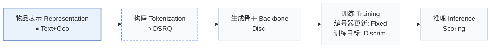
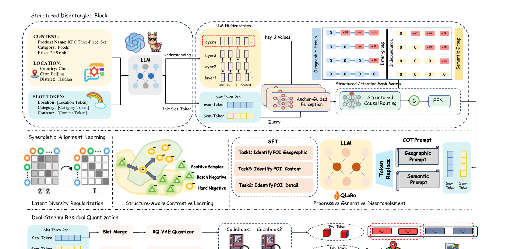
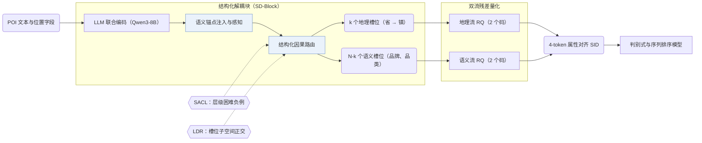
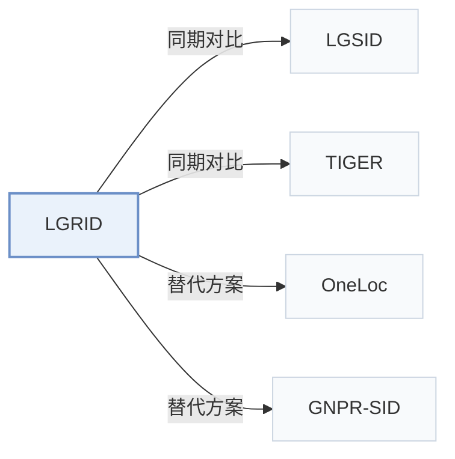

# LGRID

[← 问题 × 阶段矩阵](../../../README.zh.md#i--representation) · [按阶段索引](../index/stages.md) · [按模态找论文](../index/modality.md) · [按领域找论文](../index/domain.md) · [English](../../papers/lgrid.md) | 中文

| **题目** | *Interpretable Representation via LLM-Driven Generative Disentanglement for Local-Life Service Recommendation* |
| :-- | :-- |
| **作者** | Zhang et al. |
| **发表** | arXiv’26 |
| **问题与阶段** | `I. 信息量` · `物品表示（Representation）` · `POI` |
| **改动** | ● 物品表示 · ○ 构码 |
| **构码输入** | `Text` + `Geo` |
| **领域** | `本地生活与 POI` |
| **链接** | [论文](https://arxiv.org/abs/2607.27944) |
| **阅读级别** | 阅读笔记（第 2 级） |

**本页目录**：[TL;DR](#tldr) · [速览](#速览) · [1. 为什么重要](#1-为什么重要) · [2. 方法](#2-方法) · [3. 实验发现](#3-实验发现) · [4. 局限与分析](#4-局限与分析) · [5. 相关工作](#5-相关工作)

- `Text+Geo`：文本表征结合地理空间特征。
- `DSRQ`：双流残差量化（Dual-Stream Residual Quantization）。
- `Disc.`：对候选物品打分的判别式推荐骨干。
- `Fixed`：先独立训练并冻结编号器，生成器训练期间 SID 保持不变。
- `Discrim.`：判别式候选物品打分损失，不直接生成 SID。
- `Scoring`：直接计算候选物品得分，不逐位生成 SID。

### TL;DR

> [!NOTE]
> LGRID 用 LLM 联合编码物品各字段，将隐状态路由到地理与语义槽位并分别量化两路表示，替代对混杂表示做单一量化。

---

### 速览

| 维度 | 摘要 |
| :-- | :-- |
| 主要发现 | 在快手和 Foursquare 上，LGRID 相比语义 ID（Semantic ID，SID）基线的 AUC 相对提升最高达 5.44%，并将完整 SID 冲突率从 LGSID 的 97.0% 降至 39.9%（Abstract）。 |
| 局限 | 地理槽位固定绑定省、市、区、镇四级行政区划层级（Sec. 3.4.1）。 |

---

### 1. 为什么重要

现有 SID 框架通常先将物品各字段压缩成单一向量再做量化，导致地理、品牌与品类信息相互混杂，造成属性丢失、编码冲突且 SID 各位缺乏明确物理含义（Abstract）。LGRID 将 LLM 隐状态路由至专门的地理槽位与语义槽位，并对两路表示分别做残差量化，使 SID 的每一位对应明确的属性。

---

### 2. 方法

#### 结构化解耦块

结构化解耦块（SD-Block）利用 Qwen3-8B 联合编码 POI 的全部字段，并通过语义锚点注入、锚点引导感知与结构化因果路由将隐状态拆分为 $`N`$ 个槽位 token（Sec. 3.4）。其中 $`k`$ 个槽位按省、市、区、镇层级承载地理信息，其余 $`N-k`$ 个槽位承载品牌、品类等语义属性（Sec. 3.4.1）。

#### 协同对齐学习

协同对齐学习约束每个槽位既能解码还原对应属性，又具备跨物品区分度（Abstract，Sec. 3.5）。其中的对比目标（SACL）按行政层级采样共享粗粒度前缀但细粒度不同的层级困难负例（Sec. 3.5.2），潜在多样性正则（LDR）则约束不同槽位的特征子空间相互正交（Sec. 3.5.3）。

> "To prevent inter-slot redundancy, we impose Latent Diversity Regularization (LDR), which encourages subspace orthogonality so that each slot captures non-overlapping features."（Sec. 3.5.3）

#### 双流残差量化

双流残差量化（DSRQ）分别对地理槽位表示和语义槽位表示执行独立的残差量化（2 个地理码 + 2 个语义码），生成与物品属性逐位对齐的 4-token SID（Abstract，Sec. 3.6.2）。

---

### 3. 实验发现

实验设置

- **数据集**：Kuaishou local-life industrial data (10,000,000 interactions, 6,673,350 users, 2,251,418 items, 1,000 categories) and public Foursquare (244,896 interactions, 1,084 users, 38,334 POIs, 401 categories; coarse location text derived from coordinates). SID-construction fine-tuning uses a curated, category-balanced subset of 120,000 training and 5,000 validation POIs with incomplete descriptions excluded. Interaction filtering rules: not reported.
  - 出处：Datasets: [S4.SS1.p1](https://arxiv.org/html/2607.27944v1#S4.SS1.p1) and [A1.SS1.p1](https://arxiv.org/html/2607.27944v1#A1.SS1.p1); statistics: [A1.T8](https://arxiv.org/html/2607.27944v1#A1.T8); curated SID-construction subset: [A1.SS2.p1](https://arxiv.org/html/2607.27944v1#A1.SS2.p1).
- **切分**：All methods share the same train/validation/test split, but the split rule is not reported.
  - 出处：Shared split statement without allocation: [A1.SS3.p1](https://arxiv.org/html/2607.27944v1#A1.SS3.p1).
- **候选集**：Kuaishou: a spatially constrained candidate set within a fixed 15 km offline distance threshold (following LGSID), shared by all methods. Foursquare: full catalog (standard full-ranking protocol).
  - 出处：Kuaishou distance-thresholded candidates and Foursquare full ranking: [A1.SS3.p2](https://arxiv.org/html/2607.27944v1#A1.SS3.p2) and [A1.SS3.p3](https://arxiv.org/html/2607.27944v1#A1.SS3.p3).
- **可见性**：warm; no unseen-item protocol is defined. SID construction uses item text only and no interaction labels.
  - 出处：No unseen-item protocol; SID construction uses no interaction labels: [A1.SS3.p1](https://arxiv.org/html/2607.27944v1#A1.SS3.p1).
- **SID 规格**：4-token SID from dual-stream residual quantization of Qwen3-8B slot representations: 2 geographic codes + 2 semantic codes; per-level codebook size: not reported. For non-SID backbones, the SID embedding is concatenated with the original item-ID embedding; a collision-resolution rule is not reported. Full-SID collision rate is 39.9% on Kuaishou (RQ-VAE 98.0%, LGSID 97.0%).
  - 出处：Dual-stream RQ with D=2 per stream, 4-token SID: [S3.SS6.SSS2.p1](https://arxiv.org/html/2607.27944v1#S3.SS6.SSS2.p1); collision rate: [S4.T5](https://arxiv.org/html/2607.27944v1#S4.T5); SIDs as features beside item IDs: [S3.SS6.SSS3.p1](https://arxiv.org/html/2607.27944v1#S3.SS6.SSS3.p1).
- **推理预算**：n/a for generation (SIDs feed discriminative and sequential rankers that are scored by AUC). Offline SID construction 21.80 ms per item versus 13.97 ms for RQ-VAE; online input preparation 0.50 versus 0.48 ms per request (Table 10); hardware for timing not stated in the main text. SID-construction fine-tuning uses 4 GPUs (effective batch 192); recommender batch 10,240.
  - 出处：Offline SID construction and online lookup cost: [S4.SS5.p1](https://arxiv.org/html/2607.27944v1#S4.SS5.p1) and [A1.SS4.p1](https://arxiv.org/html/2607.27944v1#A1.SS4.p1); training batches: [A1.SS2.p2](https://arxiv.org/html/2607.27944v1#A1.SS2.p2) and [A1.SS2.p3](https://arxiv.org/html/2607.27944v1#A1.SS2.p3).
- **结果来源**：Table 1 (AUC across ten recommendation backbones with SID baselines on Kuaishou and Foursquare); Tables 2-4 (full-corpus POI self-retrieval, attribute decoding, joint versus field-wise encoding); Table 5 (utilization and collision rate); Tables 6-7 (ablations); Section 4.5 and Table 10 (efficiency).
  - 出处：Main: [S3.T1](https://arxiv.org/html/2607.27944v1#S3.T1); retrieval and decoding: [S4.T2](https://arxiv.org/html/2607.27944v1#S4.T2), [S4.T3](https://arxiv.org/html/2607.27944v1#S4.T3), [S4.T4](https://arxiv.org/html/2607.27944v1#S4.T4); collisions: [S4.T5](https://arxiv.org/html/2607.27944v1#S4.T5); ablations: [S4.T6](https://arxiv.org/html/2607.27944v1#S4.T6), [S4.T7](https://arxiv.org/html/2607.27944v1#S4.T7).

- 排序收益与冲突率下降：在快手和 Foursquare 的十种判别式与序列排序模型（含 DIN、DIEN、SIM、HSTU）上，LGRID 相比 SID 基线取得最高 5.44% 的 AUC 相对提升，并将快手上的完整 SID 冲突率降至 39.9%，低于 RQ-VAE 的 98.0% 和 LGSID 的 97.0%（Abstract，Tables 1 and 5）。
- 属性解码与自检索：基于槽位表示解码粗粒度地理字段的准确率超过 99%，且联合编码在全库 POI 自检索上优于逐字段独立编码（Abstract，Tables 2–4）。
- 层级困难负例：在 SACL 消融中，用层级困难负例替代普通随机采样可将细粒度镇级区分准确率从 37.17% 提升至 83.51%（Sec. 4.4，Table 6）。

  > "In the SACL group, vanilla sampling yields limited fine-grained discrimination (Town: 37.17%), whereas hierarchical hard negatives raise it to 83.51%."（Sec. 4.4）

---

### 4. 局限与分析

**Our analysis.**

- 快手数据集上 39.9% 的完整 SID 冲突率意味着仍有大量 POI 共用同一个 4-token SID，这说明 LGRID 更适合作为判别式排序的特征增强（与原始物品 ID 嵌入拼接使用，Sec. 3.6.3），而不适合直接用于自回归生成唯一物品。
- TIGER 用 `RQ-VAE` 量化单一融合表示；LGRID 先解耦地理与语义槽位再做双流量化（`DSRQ`），输出特征供判别式排序模型（`Disc.`）打分。

---

### 5. 相关工作

- **同期对比** · [LGSID](lgsid.md): LGSID injects geography into one fused representation before quantization; LGRID disentangles geographic and semantic slots and quantizes them in two streams, cutting full-SID collisions from 97.0% to 39.9%.
  - 出处：LGRID v1, baselines and Table 1: [S4.SS1.p2](https://arxiv.org/html/2607.27944v1#S4.SS1.p2) and [S3.T1](https://arxiv.org/html/2607.27944v1#S3.T1); collisions in Table 5: [S4.SS3.p4](https://arxiv.org/html/2607.27944v1#S4.SS3.p4) and [S4.T5](https://arxiv.org/html/2607.27944v1#S4.T5); candidate protocol follows LGSID: [A1.SS3.p2](https://arxiv.org/html/2607.27944v1#A1.SS3.p2).
- **同期对比** · [TIGER](tiger.md): TIGER's RQ-VAE on a single representation is the base SID baseline; LGRID keeps residual quantization but applies it per disentangled stream.
  - 出处：LGRID v1, RQVAE baseline attributed to Rajput et al. (2023): [S4.SS1.p2](https://arxiv.org/html/2607.27944v1#S4.SS1.p2); Table 1 and Table 5: [S3.T1](https://arxiv.org/html/2607.27944v1#S3.T1) and [S4.T5](https://arxiv.org/html/2607.27944v1#S4.T5).
- **替代方案** · [OneLoc](oneloc.md): OneLoc adds geographic signals to SID generation through a shared representation; LGRID argues such geo-aware variants still entangle attributes.
  - 出处：LGRID v1, Section 1 and Section 2.1: [S1.p3](https://arxiv.org/html/2607.27944v1#S1.p3) and [S2.SS1.p1](https://arxiv.org/html/2607.27944v1#S2.SS1.p1); not a baseline in Table 1.
- **替代方案** · [GNPR-SID](gnpr-sid.md): GNPR-SID builds POI SIDs from one fused embedding for next-POI generation; LGRID targets ranking features with disentangled geographic codes.
  - 出处：LGRID v1, Section 1 and Section 2.1: [S1.p3](https://arxiv.org/html/2607.27944v1#S1.p3) and [S2.SS1.p1](https://arxiv.org/html/2607.27944v1#S2.SS1.p1); not a baseline in Table 1.

[查看同格全部论文](../../../README.zh.md#i--representation)
