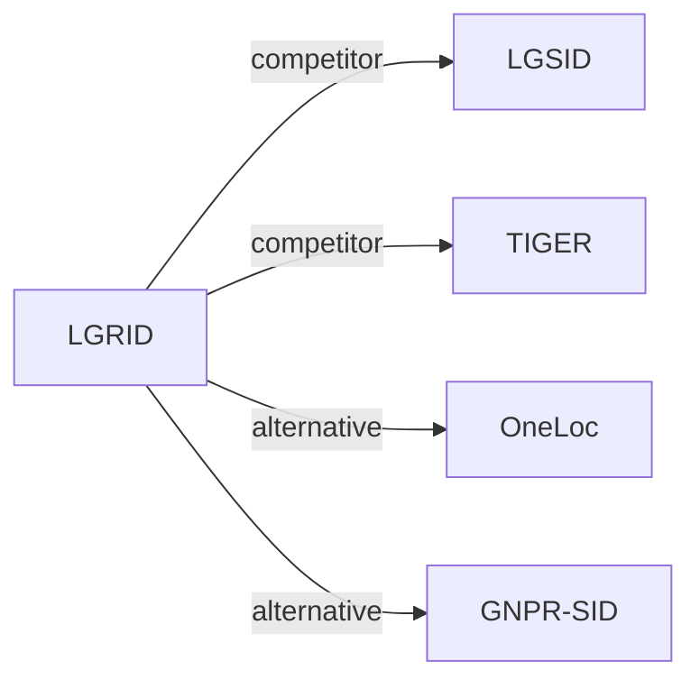

# LGRID

*Interpretable Representation via LLM-Driven Generative Disentanglement for Local-Life Service Recommendation* — Zhang et al. · arXiv’26

`I. 信息量` · `Representation` · `POI` · [论文](https://arxiv.org/abs/2607.27944) · [矩阵](../../../README.zh.md#i--representation) · [English](../../papers/lgrid.md)

阅读级别：概览（第 1 级） · 本页目录：[TL;DR](#tldr) · [速览](#速览) · [2. 方法](#2-方法) · [3. 实验发现](#3-实验发现) · [5. 相关工作](#5-相关工作)

- `DSRQ`: Dual-stream residual quantization.
- `Disc.`: A discriminative recommendation model that scores candidates.
- `Fixed`: SIDs are built first and not changed while the generator trains.
- `Discrim.`: Scores items; does not generate SIDs.

### TL;DR

> [!NOTE]
> LGRID 用 LLM 联合编码物品各字段，将隐状态路由到地理与语义槽位并分别量化两路表示，替代对混杂表示做单一量化。

### 速览

| 维度 | 摘要 |
| :-- | :-- |
| 研究问题 | I. 信息量：Do the SIDs, or the model reading them, carry the collaborative and multimodal signals recommendation needs? |
| 核心贡献 | LGRID 用 LLM 联合编码物品各字段，将隐状态路由到地理与语义槽位并分别量化两路表示，替代对混杂表示做单一量化。 |
| 主要改动阶段 | Representation |

### 2. 方法

### 3. 实验发现

实验设置

- **数据集**：Kuaishou local-life industrial data (10,000,000 interactions, 6,673,350 users, 2,251,418 items, 1,000 categories) and public Foursquare (244,896 interactions, 1,084 users, 38,334 POIs, 401 categories; coarse location text derived from coordinates). SID-construction fine-tuning uses a curated, category-balanced subset of 120,000 training and 5,000 validation POIs with incomplete descriptions excluded. Interaction filtering rules: not reported.
  - 出处：Datasets: [S4.SS1.p1](https://arxiv.org/html/2607.27944v1#S4.SS1.p1) and [A1.SS1.p1](https://arxiv.org/html/2607.27944v1#A1.SS1.p1); statistics: [A1.T8](https://arxiv.org/html/2607.27944v1#A1.T8); curated SID-construction subset: [A1.SS2.p1](https://arxiv.org/html/2607.27944v1#A1.SS2.p1).
- **切分**：All methods share the same train/validation/test split, but the split rule is not reported.
  - 出处：Shared split statement without allocation: [A1.SS3.p1](https://arxiv.org/html/2607.27944v1#A1.SS3.p1).
- **候选集**：Kuaishou: a spatially constrained candidate set within a fixed 15 km offline distance threshold (following LGSID), shared by all methods. Foursquare: full catalog (standard full-ranking protocol).
  - 出处：Kuaishou distance-thresholded candidates and Foursquare full ranking: [A1.SS3.p2](https://arxiv.org/html/2607.27944v1#A1.SS3.p2) and [A1.SS3.p3](https://arxiv.org/html/2607.27944v1#A1.SS3.p3).
- **可见性**：warm; no unseen-item protocol is defined. SID construction uses item text only and no interaction labels.
  - 出处：No unseen-item protocol; SID construction uses no interaction labels: [A1.SS3.p1](https://arxiv.org/html/2607.27944v1#A1.SS3.p1).
- **SID 规格**：4-token SID from dual-stream residual quantization of Qwen3-8B slot representations: 2 geographic codes + 2 semantic codes; per-level codebook size: not reported. For non-SID backbones, the SID embedding is concatenated with the original item-ID embedding; a collision-resolution rule is not reported. Full-SID collision rate is 39.9% on Kuaishou (RQ-VAE 98.0%, LGSID 97.0%).
  - 出处：Dual-stream RQ with D=2 per stream, 4-token SID: [S3.SS6.SSS2.p1](https://arxiv.org/html/2607.27944v1#S3.SS6.SSS2.p1); collision rate: [S4.T5](https://arxiv.org/html/2607.27944v1#S4.T5); SIDs as features beside item IDs: [S3.SS6.SSS3.p1](https://arxiv.org/html/2607.27944v1#S3.SS6.SSS3.p1).
- **推理预算**：n/a for generation (SIDs feed discriminative and sequential rankers that are scored by AUC). Offline SID construction 21.80 ms per item versus 13.97 ms for RQ-VAE; online input preparation 0.50 versus 0.48 ms per request (Table 10); hardware for timing not stated in the main text. SID-construction fine-tuning uses 4 GPUs (effective batch 192); recommender batch 10,240.
  - 出处：Offline SID construction and online lookup cost: [S4.SS5.p1](https://arxiv.org/html/2607.27944v1#S4.SS5.p1) and [A1.SS4.p1](https://arxiv.org/html/2607.27944v1#A1.SS4.p1); training batches: [A1.SS2.p2](https://arxiv.org/html/2607.27944v1#A1.SS2.p2) and [A1.SS2.p3](https://arxiv.org/html/2607.27944v1#A1.SS2.p3).
- **结果来源**：Table 1 (AUC across ten recommendation backbones with SID baselines on Kuaishou and Foursquare); Tables 2-4 (full-corpus POI self-retrieval, attribute decoding, joint versus field-wise encoding); Table 5 (utilization and collision rate); Tables 6-7 (ablations); Section 4.5 and Table 10 (efficiency).
  - 出处：Main: [S3.T1](https://arxiv.org/html/2607.27944v1#S3.T1); retrieval and decoding: [S4.T2](https://arxiv.org/html/2607.27944v1#S4.T2), [S4.T3](https://arxiv.org/html/2607.27944v1#S4.T3), [S4.T4](https://arxiv.org/html/2607.27944v1#S4.T4); collisions: [S4.T5](https://arxiv.org/html/2607.27944v1#S4.T5); ablations: [S4.T6](https://arxiv.org/html/2607.27944v1#S4.T6), [S4.T7](https://arxiv.org/html/2607.27944v1#S4.T7).

### 5. 相关工作

- **同期对比** · [LGSID](lgsid.md): LGSID injects geography into one fused representation before quantization; LGRID disentangles geographic and semantic slots and quantizes them in two streams, cutting full-SID collisions from 97.0% to 39.9%.
  - 出处：LGRID v1, baselines and Table 1: https://arxiv.org/html/2607.27944v1#S4.SS1.p2 and https://arxiv.org/html/2607.27944v1#S3.T1; collisions in Table 5: https://arxiv.org/html/2607.27944v1#S4.SS3.p4 and https://arxiv.org/html/2607.27944v1#S4.T5; candidate protocol follows LGSID: https://arxiv.org/html/2607.27944v1#A1.SS3.p2.
- **同期对比** · [TIGER](tiger.md): TIGER's RQ-VAE on a single representation is the base SID baseline; LGRID keeps residual quantization but applies it per disentangled stream.
  - 出处：LGRID v1, RQVAE baseline attributed to Rajput et al. (2023): https://arxiv.org/html/2607.27944v1#S4.SS1.p2; Table 1 and Table 5: https://arxiv.org/html/2607.27944v1#S3.T1 and https://arxiv.org/html/2607.27944v1#S4.T5.
- **替代方案** · [OneLoc](oneloc.md): OneLoc adds geographic signals to SID generation through a shared representation; LGRID argues such geo-aware variants still entangle attributes.
  - 出处：LGRID v1, Section 1 and Section 2.1: https://arxiv.org/html/2607.27944v1#S1.p3 and https://arxiv.org/html/2607.27944v1#S2.SS1.p1; not a baseline in Table 1.
- **替代方案** · [GNPR-SID](gnpr-sid.md): GNPR-SID builds POI SIDs from one fused embedding for next-POI generation; LGRID targets ranking features with disentangled geographic codes.
  - 出处：LGRID v1, Section 1 and Section 2.1: https://arxiv.org/html/2607.27944v1#S1.p3 and https://arxiv.org/html/2607.27944v1#S2.SS1.p1; not a baseline in Table 1.

[查看同格全部论文](../../../README.zh.md#i--representation)
