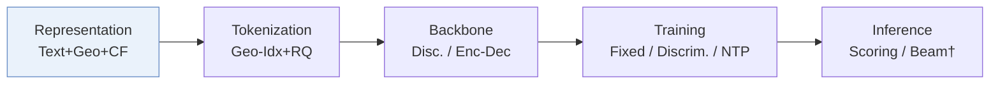
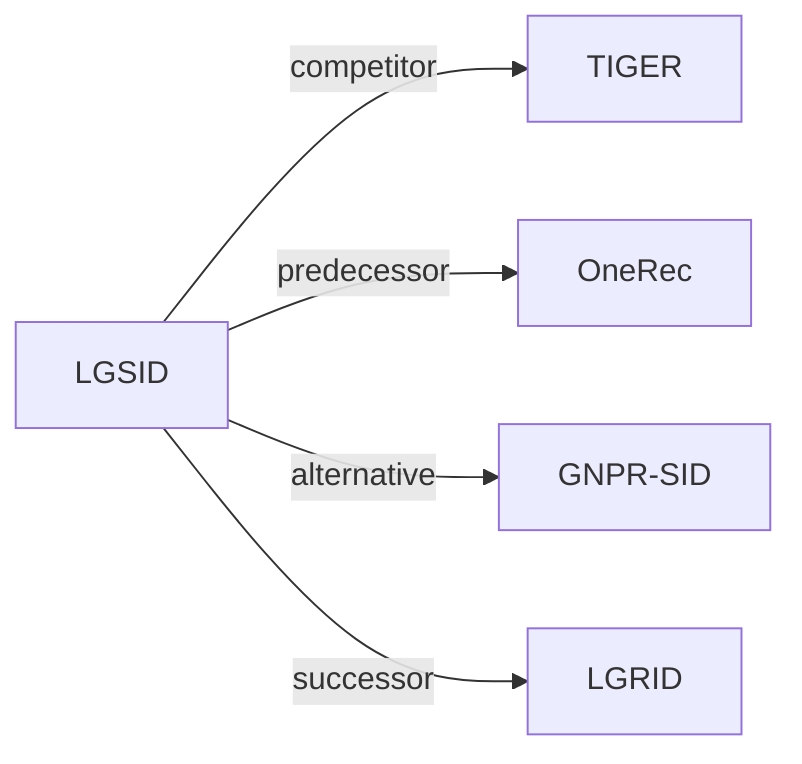

# LGSID

*LLM-Aligned Geographic Item Tokenization for Local-Life Recommendation* — Jiang et al. · AAAI’26

`I. 信息量` · `Representation` · `POI` · [论文](https://arxiv.org/abs/2511.14221) · [代码](https://github.com/JiangHaoPG11/LGSID) · [矩阵](../../../README.zh.md#i--representation) · [English](../../papers/lgsid.md)

阅读级别：概览（第 1 级） · 本页目录：[TL;DR](#tldr) · [速览](#速览) · [2. 方法](#2-方法) · [3. 实验发现](#3-实验发现) · [5. 相关工作](#5-相关工作)

- `Geo-Idx+RQ`: Geographic indexing combined with residual quantization.
- `Disc. / Enc-Dec`: Discriminative scoring and encoder–decoder generation variants.
- `Fixed`: SIDs are built first and not changed while the generator trains.
- `Discrim. / NTP`: Discriminative scoring or next-token prediction in different configurations.
- `Scoring / Beam†`: Discriminative candidate scoring vs. generative beam search.

### TL;DR

> [!NOTE]
> LGSID 用奖励模型与 G-DPO 将 LLM 对齐到空间关系，再由空间与内容属性加上对齐后 LLM 表示的残差 token 构建 SID。

### 速览

| 维度 | 摘要 |
| :-- | :-- |
| 研究问题 | I. 信息量：Do the SIDs, or the model reading them, carry the collaborative and multimodal signals recommendation needs? |
| 核心贡献 | LGSID 用奖励模型与 G-DPO 将 LLM 对齐到空间关系，再由空间与内容属性加上对齐后 LLM 表示的残差 token 构建 SID。 |
| 主要改动阶段 | Representation |

### 2. 方法

### 3. 实验发现

实验设置

- **数据集**：Kuaishou local-life feed data only: 50,000,000 samples, 19,080,888 users, 2,325,266 items, 19,408 brands, 818 categories, with item text and geographic location. For discriminative models, all positives are kept and negatives down-sampled 1:4. Further filtering: not reported.
  - 出处：Industrial-only dataset and preprocessing: [A2.SS0.SSSx1.p1](https://arxiv.org/html/2511.14221v1#A2.SS0.SSSx1.p1); statistics: [A2.T4](https://arxiv.org/html/2511.14221v1#A2.T4).
- **切分**：Generative models: leave-one-out on the down-sampled data (last item for test, second-last for validation, the rest for training). Discriminative models: split rule not reported; settings selected on validation data.
  - 出处：Leave-one-out for generative models on the down-sampled data: [A2.SS0.SSSx1.p1](https://arxiv.org/html/2511.14221v1#A2.SS0.SSSx1.p1); split for discriminative AUC not stated.
- **候选集**：Discriminative AUC: evaluation samples with negatives down-sampled at 1:4 to positives; how negatives are drawn and whether user history is excluded: not reported. Generative Hit and NDCG at 5 and 10: full catalog versus sampled not reported.
  - 出处：Negative down-sampling and metrics: [A2.SS0.SSSx1.p1](https://arxiv.org/html/2511.14221v1#A2.SS0.SSSx1.p1).
- **可见性**：warm; no unseen-item protocol is defined.
  - 出处：Standard split with no unseen-item protocol: [A2.SS0.SSSx1.p1](https://arxiv.org/html/2511.14221v1#A2.SS0.SSSx1.p1).
- **SID 规格**：Hierarchical residual quantizer over G-DPO-aligned BGE embeddings (1,024-dimensional) with a KL regularizer toward uniform cluster usage; number of levels and per-level codebook sizes K_l: not reported. Collision handling: not reported.
  - 出处：Hierarchical quantizer with uniform-usage regularization: [Sx4.SSx3.p4](https://arxiv.org/html/2511.14221v1#Sx4.SSx3.p4) and [Sx4.SSx3.p5](https://arxiv.org/html/2511.14221v1#Sx4.SSx3.p5); BGE embeddings: [A2.SSx1.p1](https://arxiv.org/html/2511.14221v1#A2.SSx1.p1); no codebook sizes or collision rule found.
- **推理预算**：SIDs are used as features in DIN, DIEN, SIM, TWIN, ETA and as targets in TIGER and OneRec generators; decoding method and beam width: not reported. All experiments on two 48GB GPUs; inference batch size and latency: not reported.
  - 出处：Hardware: [A2.SSx2.p1](https://arxiv.org/html/2511.14221v1#A2.SSx2.p1); generative backbones: [A2.SSx3.p1](https://arxiv.org/html/2511.14221v1#A2.SSx3.p1).
- **结果来源**：Table 1 (AUC of five discriminative rankers with different tokenizers); Table 2 (TIGER and OneRec generators with different tokenizers); Table 3 (semantic and geographic coverage after alignment); Table 5 (robustness over runs); Table 6 (similarity weight).
  - 出处：Discriminative: [Sx5.T1](https://arxiv.org/html/2511.14221v1#Sx5.T1); generative: [Sx5.T2](https://arxiv.org/html/2511.14221v1#Sx5.T2); alignment: [Sx5.T3](https://arxiv.org/html/2511.14221v1#Sx5.T3); robustness: [A4.T5](https://arxiv.org/html/2511.14221v1#A4.T5); lambda: [A4.T6](https://arxiv.org/html/2511.14221v1#A4.T6).

### 5. 相关工作

- **同期对比** · [TIGER](tiger.md): TIGER's RQ-VAE is a tokenizer baseline and TIGER is one of two generative backbones; LGSID aligns the LLM embedding with geographic rewards before a hierarchical quantizer.
  - 出处：LGSID v1, baselines: https://arxiv.org/html/2511.14221v1#A2.SSx3.p1; Tables 1 and 2: https://arxiv.org/html/2511.14221v1#Sx5.T1 and https://arxiv.org/html/2511.14221v1#Sx5.T2.
- **前序工作** · [OneRec](onerec.md): OneRec serves as the second generative backbone into which LGSID's SIDs are plugged.
  - 出处：LGSID v1, baselines: https://arxiv.org/html/2511.14221v1#A2.SSx3.p1; Table 2: https://arxiv.org/html/2511.14221v1#Sx5.T2.
- **替代方案** · [GNPR-SID](gnpr-sid.md): GNPR-SID builds POI SIDs for next-POI generation; LGSID targets local-life ranking features and aligns embeddings with geographic distance rewards.
  - 出处：LGSID v1, related work: https://arxiv.org/html/2511.14221v1#Sx2.SSx2.p1 and https://arxiv.org/html/2511.14221v1#Sx4.SSx2.p1.
- **后续工作** · [LGRID](lgrid.md): LGRID later follows LGSID's candidate protocol and replaces its single fused representation with disentangled geographic and semantic streams.
  - 出处：Evidence is from the later LGRID paper: protocol https://arxiv.org/html/2607.27944v1#A1.SS3.p2; baseline and collision comparison https://arxiv.org/html/2607.27944v1#S4.SS1.p2 and https://arxiv.org/html/2607.27944v1#S4.T5.

[查看同格全部论文](../../../README.zh.md#i--representation)
