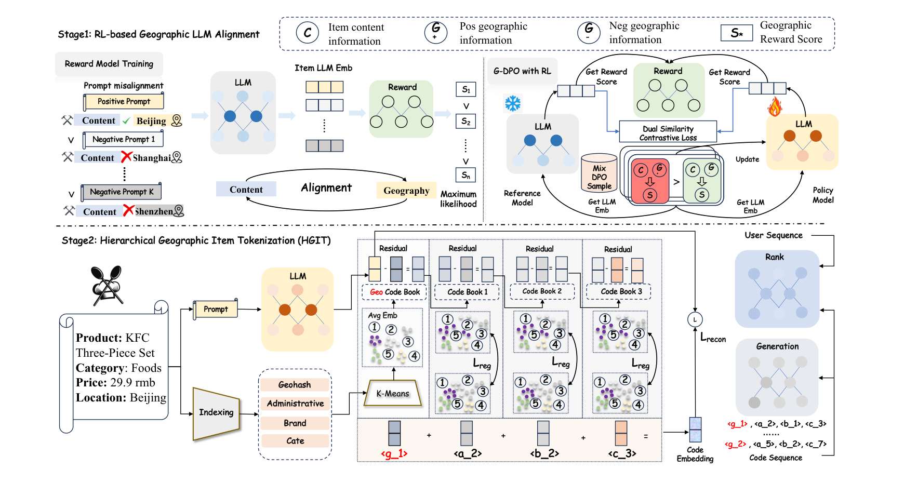
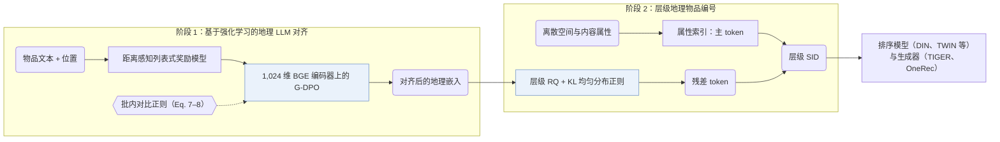
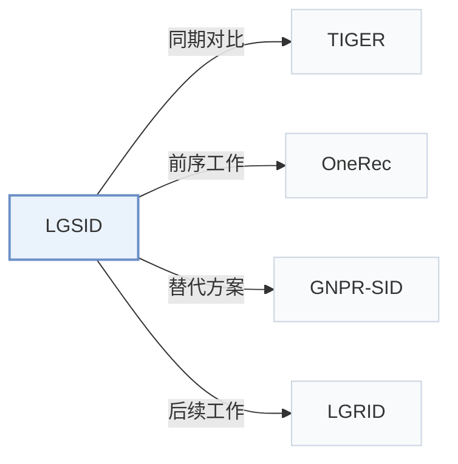

# LGSID

[← 问题 × 阶段矩阵](../../../README.zh.md#i--representation) · [按阶段索引](../index/stages.md) · [按模态找论文](../index/modality.md) · [按领域找论文](../index/domain.md) · [English](../../papers/lgsid.md) | 中文

| **题目** | *LLM-Aligned Geographic Item Tokenization for Local-Life Recommendation* |
| :-- | :-- |
| **作者** | Jiang et al. |
| **发表** | AAAI’26 |
| **问题与阶段** | `I. 信息量` · `物品表示（Representation）` · `POI` |
| **改动** | ● 物品表示 · ○ 构码 |
| **构码输入** | `Text` + `Geo` + `Attr` + `CF` |
| **领域** | `本地生活与 POI` |
| **链接** | [论文](https://arxiv.org/abs/2511.14221) · [代码](https://github.com/JiangHaoPG11/LGSID) |
| **阅读级别** | 阅读笔记（第 2 级） |

**本页目录**：[TL;DR](#tldr) · [速览](#速览) · [1. 为什么重要](#1-为什么重要) · [2. 方法](#2-方法) · [3. 实验发现](#3-实验发现) · [4. 局限与分析](#4-局限与分析) · [5. 相关工作](#5-相关工作)

- `Text+Geo+CF`：文本表征结合地理空间特征与协同信号。
- `Geo-Idx+RQ`：地理空间索引前缀结合残差量化。
- `Disc. / Enc-Dec`：涵盖判别式打分与编码器-解码器生成两种变体。
- `Fixed`：先独立训练并冻结编号器，生成器训练期间 SID 保持不变。
- `Discrim. / NTP`：不同配置下分别采用判别式打分损失或下一 token 预测损失。
- `Scoring / Beam†`：判别式候选打分与生成式束搜索对比。

### TL;DR

> [!NOTE]
> LGSID 用奖励模型与 G-DPO 将 LLM 对齐到空间关系，再由空间与内容属性加上对齐后 LLM 表示的残差 token 构建 SID。

---

### 速览

| 维度 | 摘要 |
| :-- | :-- |
| 主要发现 | 在快手本地生活推荐数据上，LGSID 在五个判别式排序模型（DIN、DIEN、SIM、TWIN、ETA）和两个生成式骨干（TIGER、OneRec）上均优于现有物品编号器（Tables 1–2）。 |
| 局限 | LLM 对齐在执行 G-DPO 前需单独训练列表式奖励模型，且每次重新对齐都会改变残差 token（Abstract）。 |

---

### 1. 为什么重要

基于文本的推荐模型通常用提示编码物品描述，再将嵌入量化为离散的语义 ID（Semantic ID，SID）。在本地生活服务场景中，仅把位置信息拼进提示难以刻画细粒度空间特征与门店间的真实物理距离。LGSID 先通过强化学习将物品编码 LLM 对齐到真实空间距离关系，再执行层级地理编号。

> "However, in domain-specific tasks such as local-life services, simply injecting location information into prompts fails to capture fine-grained spatial characteristics and real-world distance awareness among items."（Abstract）

---

### 2. 方法

#### 奖励模型

列表式奖励模型通过距离感知的列表采样学习本地生活物品之间的真实空间距离关系（Introduction）。

> "The RL-based alignment module first trains reward models using distance-aware list-wise sampling to capture and compress real-world spatial relationships."（Introduction）

#### G-DPO 对齐

地理直接偏好优化（G-DPO）利用训练好的奖励模型将空间距离知识与协同信号注入 1,024 维 BGE 编码器，同时通过批内对比损失约束更新后的物品嵌入不偏离参考模型的语义表示（G-DPO，Eq. 7–8）。

> "To preserve LLMs' semantic representations during G-DPO updates, we introduce an in-batch contrastive loss as a similarity regularizer, as shown in Eq. 7."（G-DPO）

#### 层级地理物品编号

每个物品的 SID 由两部分组成：主 token 直接由离散空间与内容属性索引生成，残差 token 由带 KL 均匀簇使用率正则的层级残差量化器在 G-DPO 对齐后的地理向量上量化得到（Abstract，Hierarchical Geographic Item Tokenization）。

---

### 3. 实验发现

实验设置

- **数据集**：Kuaishou local-life feed data only: 50,000,000 samples, 19,080,888 users, 2,325,266 items, 19,408 brands, 818 categories, with item text and geographic location. For discriminative models, all positives are kept and negatives down-sampled 1:4. Further filtering: not reported.
  - 出处：Industrial-only dataset and preprocessing: [A2.SS0.SSSx1.p1](https://arxiv.org/html/2511.14221v1#A2.SS0.SSSx1.p1); statistics: [A2.T4](https://arxiv.org/html/2511.14221v1#A2.T4).
- **切分**：Generative models: leave-one-out on the down-sampled data (last item for test, second-last for validation, the rest for training). Discriminative models: split rule not reported; settings selected on validation data.
  - 出处：Leave-one-out for generative models on the down-sampled data: [A2.SS0.SSSx1.p1](https://arxiv.org/html/2511.14221v1#A2.SS0.SSSx1.p1); split for discriminative AUC not stated.
- **候选集**：Discriminative AUC: evaluation samples with negatives down-sampled at 1:4 to positives; how negatives are drawn and whether user history is excluded: not reported. Generative Hit and NDCG at 5 and 10: full catalog versus sampled not reported.
  - 出处：Negative down-sampling and metrics: [A2.SS0.SSSx1.p1](https://arxiv.org/html/2511.14221v1#A2.SS0.SSSx1.p1).
- **可见性**：warm; no unseen-item protocol is defined.
  - 出处：Standard split with no unseen-item protocol: [A2.SS0.SSSx1.p1](https://arxiv.org/html/2511.14221v1#A2.SS0.SSSx1.p1).
- **SID 规格**：Hierarchical residual quantizer over G-DPO-aligned BGE embeddings (1,024-dimensional) with a KL regularizer toward uniform cluster usage; number of levels and per-level codebook sizes K_l: not reported. Collision handling: not reported.
  - 出处：Hierarchical quantizer with uniform-usage regularization: [Sx4.SSx3.p4](https://arxiv.org/html/2511.14221v1#Sx4.SSx3.p4) and [Sx4.SSx3.p5](https://arxiv.org/html/2511.14221v1#Sx4.SSx3.p5); BGE embeddings: [A2.SSx1.p1](https://arxiv.org/html/2511.14221v1#A2.SSx1.p1); no codebook sizes or collision rule found.
- **推理预算**：SIDs are used as features in DIN, DIEN, SIM, TWIN, ETA and as targets in TIGER and OneRec generators; decoding method and beam width: not reported. All experiments on two 48GB GPUs; inference batch size and latency: not reported.
  - 出处：Hardware: [A2.SSx2.p1](https://arxiv.org/html/2511.14221v1#A2.SSx2.p1); generative backbones: [A2.SSx3.p1](https://arxiv.org/html/2511.14221v1#A2.SSx3.p1).
- **结果来源**：Table 1 (AUC of five discriminative rankers with different tokenizers); Table 2 (TIGER and OneRec generators with different tokenizers); Table 3 (semantic and geographic coverage after alignment); Table 5 (robustness over runs); Table 6 (similarity weight).
  - 出处：Discriminative: [Sx5.T1](https://arxiv.org/html/2511.14221v1#Sx5.T1); generative: [Sx5.T2](https://arxiv.org/html/2511.14221v1#Sx5.T2); alignment: [Sx5.T3](https://arxiv.org/html/2511.14221v1#Sx5.T3); robustness: [A4.T5](https://arxiv.org/html/2511.14221v1#A4.T5); lambda: [A4.T6](https://arxiv.org/html/2511.14221v1#A4.T6).

- 判别式与生成式骨干：在快手本地生活信息流数据集（50,000,000 条样本、2,325,266 个物品）上，将 LGSID 编码接入五个判别式排序模型（DIN、DIEN、SIM、TWIN、ETA，Table 1）与两个生成式骨干（TIGER、OneRec，Table 2）均优于对比的物品编号基线（Tables 1–2）。
- 对齐覆盖度与稳定性：Table 3 验证了 G-DPO 对齐后的语义与地理覆盖度提升，Tables 5 与 6 给出了多轮运行稳定性及对比相似度权重的敏感性分析（Tables 3, 5, and 6）。

---

### 4. 局限与分析

**Our analysis.**

- 主 token 依赖离散的空间与品类属性，这意味着元数据缺失的 POI 需要额外的兜底编码策略。
- 实验仅在快手私有工业数据集上进行，未报告公开 POI 基准结果、各层码本大小及冲突率；后续工作 LGRID 在快手数据集上测得 LGSID 的完整 SID 冲突率为 97.0%。
- LGRID 的 `DSRQ` 编码仅用于判别式排序（`Disc.`）；LGSID 的 `Geo-Idx+RQ` 编码同时作为判别式排序特征和 `Enc-Dec` 生成器的预测目标（`Disc. / Enc-Dec`）。

---

### 5. 相关工作

- **同期对比** · [TIGER](tiger.md): TIGER's RQ-VAE is a tokenizer baseline and TIGER is one of two generative backbones; LGSID aligns the LLM embedding with geographic rewards before a hierarchical quantizer.
  - 出处：LGSID v1, baselines: [A2.SSx3.p1](https://arxiv.org/html/2511.14221v1#A2.SSx3.p1); Tables 1 and 2: [Sx5.T1](https://arxiv.org/html/2511.14221v1#Sx5.T1) and [Sx5.T2](https://arxiv.org/html/2511.14221v1#Sx5.T2).
- **前序工作** · [OneRec](onerec.md): OneRec serves as the second generative backbone into which LGSID's SIDs are plugged.
  - 出处：LGSID v1, baselines: [A2.SSx3.p1](https://arxiv.org/html/2511.14221v1#A2.SSx3.p1); Table 2: [Sx5.T2](https://arxiv.org/html/2511.14221v1#Sx5.T2).
- **替代方案** · [GNPR-SID](gnpr-sid.md): GNPR-SID builds POI SIDs for next-POI generation; LGSID targets local-life ranking features and aligns embeddings with geographic distance rewards.
  - 出处：LGSID v1, related work: [Sx2.SSx2.p1](https://arxiv.org/html/2511.14221v1#Sx2.SSx2.p1) and [Sx4.SSx2.p1](https://arxiv.org/html/2511.14221v1#Sx4.SSx2.p1).
- **后续工作** · [LGRID](lgrid.md): LGRID later follows LGSID's candidate protocol and replaces its single fused representation with disentangled geographic and semantic streams.
  - 出处：Evidence is from the later LGRID paper: protocol [A1.SS3.p2](https://arxiv.org/html/2607.27944v1#A1.SS3.p2); baseline and collision comparison [S4.SS1.p2](https://arxiv.org/html/2607.27944v1#S4.SS1.p2) and [S4.T5](https://arxiv.org/html/2607.27944v1#S4.T5).

[查看同格全部论文](../../../README.zh.md#i--representation)
