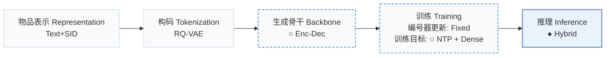
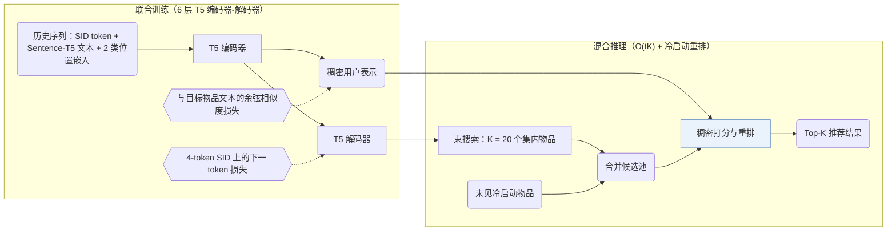
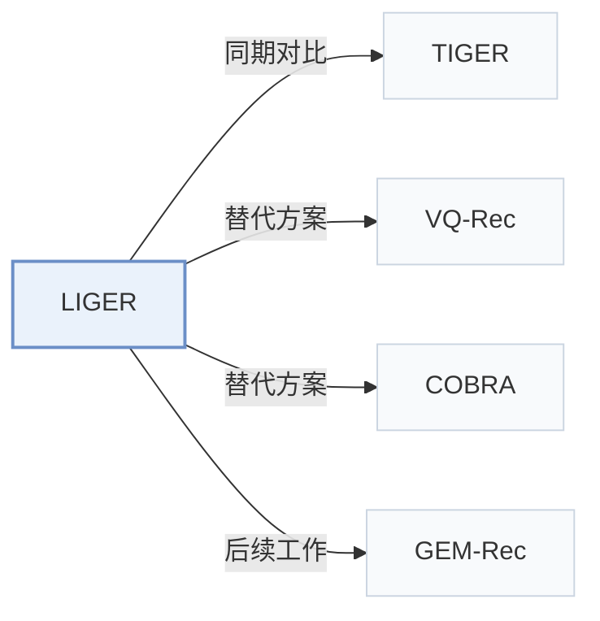

# LIGER

[← 问题 × 阶段矩阵](../../../README.zh.md#vi--inference) · [按阶段索引](../index/stages.md) · [按模态找论文](../index/modality.md) · [按领域找论文](../index/domain.md) · [English](../../papers/liger.md) | 中文

| **题目** | *Unifying generative and dense retrieval for sequential recommendation* |
| :-- | :-- |
| **作者** | Yang et al. |
| **发表** | arXiv’24 |
| **问题与阶段** | `VI. 泛化` · `推理（Inference）` |
| **改动** | ○ 生成骨干 · ○ 训练目标 · ● 推理 |
| **构码输入** | `Text` |
| **领域** | `电商` · `游戏` |
| **特殊设置** | `冷启动（物品）` |
| **应用场景** | `一般物品推荐`；`公开数据` |
| **链接** | [论文](https://arxiv.org/abs/2411.18814) |
| **阅读级别** | 阅读笔记（第 2 级） |

**本页目录**：[TL;DR](#tldr) · [速览](#速览) · [1. 为什么重要](#1-为什么重要) · [2. 方法](#2-方法) · [3. 实验发现](#3-实验发现) · [4. 局限与分析](#4-局限与分析) · [5. 相关工作](#5-相关工作)

- `Text+SID`：稠密文本表征拼接离散语义 ID（稠密与生成式混合检索）。
- `RQ-VAE`：残差量化变分自编码器（Residual-Quantized VAE）。
- `Enc-Dec`：编码器-解码器（Encoder-decoder）架构。
- `Fixed`：先独立训练并冻结编号器，生成器训练期间 SID 保持不变。
- `NTP + Dense`：离散 SID 的下一 token 预测结合稠密向量回归/对比损失。
- `Hybrid`：结合生成式 SID 解码与稠密/共现检索的混合召回。

### TL;DR

> [!NOTE]
> LIGER 在受控对比序列稠密检索与 SID 生成式检索后，将稠密检索融入生成式检索器，缩小二者性能差距并改善冷启动推荐。

---

### 速览

| 维度 | 摘要 |
| :-- | :-- |
| 主要发现 | LIGER 将束搜索召回的 K = 20 个 SID 候选与冷启动物品合并后做稠密重排，在 Amazon Beauty、Sports、Toys 和 Steam 上缩小了与全库稠密检索的差距并提升了冷启动推荐效果（Abstract，Sec. 4.2，Table 2）。 |
| 局限 | 所有冷启动物品都会并入每次推理的候选集，该设计依赖冷启动物品数量较少的前提假设（Sec. 3）。 |

---

### 1. 为什么重要

序列稠密检索需要为每个物品保存连续向量，内存与推理开销随物品库规模线性增长；生成式检索则通过束搜索解码紧凑的语义 ID（Semantic ID，SID）（Abstract，Table 1）。论文在受控对比下发现，生成式检索在热启动物品上仍落后于稠密检索，且学到的条件概率过拟合训练集物品，几乎无法生成未见过的冷启动物品（Sec. 2.4）。LIGER 在同一编码器-解码器上联合训练生成与稠密目标，并在推理时将束搜索候选与冷启动物品合并重排。

> "Our findings indicate that the model's learned conditional probabilities tends to overfit to items seen during training, leading to a significantly reduced capability to generate cold-start items."（Sec. 2.4）

---

### 2. 方法

#### 输入与训练

用户历史中的每个物品由其 SID token 嵌入、冻结的 Sentence-T5-XXL 文本嵌入以及两类位置嵌入（物品位置与 token 位置）相加表示（Sec. 3，Sec. 4.1）。6 层 T5 编码器-解码器同时优化两项损失：在目标物品 4-token SID（3 层 × 256 码字 RQ-VAE 加去重后缀 token）上的下一 token 预测损失，以及将编码器输出对齐到目标物品文本嵌入的余弦相似度损失（Sec. 3，Sec. 4.1）。

#### 混合推理

推理阶段，解码器先通过束搜索召回 $`K`$ 个集内候选物品（主实验取 $`K = 20`$），再并入全部冷启动物品组成紧凑候选池，最后用编码器输出的稠密向量对候选池统一打分排序（Sec. 3，Algorithm 1）。

> "During inference, the decoder retrieves K items by beam search, then supplemented with cold-start items and ranked with the encoder's output embeddings."（Sec. 3）

只要系统定期更新编号器且增量冷启动物品占总物品库的比例较小，直接并入冷启动集合即可避免全库扫描（Sec. 3）。

> "This design choice is based on the hypothesis that cold-start items are relatively sparse compared to in-set items, as recommendation systems periodically update themselves to incorporate newly introduced items."（Sec. 3）

---

### 3. 实验发现

实验设置

- **数据集**：Amazon Beauty, Sports and Outdoors, Toys and Games, and Steam with 5-core filtering of users and items; sequences truncated to the 20 most recent items. Sizes (users / items / cold-start items): Beauty 22,363 / 12,101 / 43; Toys 19,412 / 11,924 / 56; Sports 35,598 / 18,357 / 81; Steam 47,761 / 12,012 / 400.
  - 出处：Datasets, 5-core, truncation: [S4.SS1.p1](https://arxiv.org/html/2411.18814v2#S4.SS1.p1); statistics and cold-start counts: [A2.T3](https://arxiv.org/html/2411.18814v2#A2.T3).
- **切分**：Per-user leave-one-out: last item for test, preceding item for validation, the rest for training; early stopping on in-set NDCG@10; mean and standard deviation over three seeds. Test targets are reported separately for in-set and cold-start items.
  - 出处：Leave-one-out allocation: [S4.SS1.p4](https://arxiv.org/html/2411.18814v2#S4.SS1.p4); three seeds: [S4.SS2.p1](https://arxiv.org/html/2411.18814v2#S4.SS2.p1).
- **候选集**：Hybrid: generative retrieval returns K=20 candidates by beam search, which are ranked together with the cold-start items by dense retrieval (K swept from 20 to 100 and K=N in Table 4). Dense baselines score the full catalog.
  - 出处：Hybrid candidates (K from beam, ranked with cold-start items by dense scores): [S4.SS2.p2](https://arxiv.org/html/2411.18814v2#S4.SS2.p2); K sweep: [A3.T4](https://arxiv.org/html/2411.18814v2#A3.T4).
- **可见性**：In-set targets: warm. Cold-start targets: unseen by tokenizer too; cold-start items are excluded from RQ-VAE training (the paper says to avoid contamination), and the generators fail to produce them. Exact criterion for selecting cold-start items beyond the counts in Table 3: not reported.
  - 出处：Cold-start items excluded from RQ-VAE training: [S4.SS1.p4](https://arxiv.org/html/2411.18814v2#S4.SS1.p4); cold-start definition beyond counts not stated.
- **SID 规格**：3-level RQ-VAE x 256 codewords (dimension 128) over sentence-T5-XXL text embeddings; following TIGER, an extra token is appended to make IDs unique.
  - 出处：3 levels x 256 with dimension 128 and an extra uniqueness token: [S4.SS1.p2](https://arxiv.org/html/2411.18814v2#S4.SS1.p2).
- **推理预算**：Beam search retrieves K candidates (K=20 for the main result) from a T5 encoder-decoder (6 layers each), then a dense head ranks them with cold-start items. Complexity is stated as O(tK) versus O(N) for dense retrieval (Table 1); hardware, inference batch size, and latency: not reported.
  - 出处：Beam retrieval of K candidates and complexity: [S2.SS1.p3](https://arxiv.org/html/2411.18814v2#S2.SS1.p3) and [S3.T1](https://arxiv.org/html/2411.18814v2#S3.T1); model: [S4.SS1.p3](https://arxiv.org/html/2411.18814v2#S4.SS1.p3).
- **结果来源**：Table 2 (Beauty, Sports, Toys, Steam; in-set and cold-start Recall@10 and NDCG@10; three seeds); Table 4 (number of retrieved candidates K); Figures 1, 3, 4 (dense versus generative retrieval and cold-start generation probabilities); Appendix D (ablations).
  - 出处：Main: [S4.T2](https://arxiv.org/html/2411.18814v2#S4.T2); K sweep: [A3.T4](https://arxiv.org/html/2411.18814v2#A3.T4); motivation figures: [S1.F1](https://arxiv.org/html/2411.18814v2#S1.F1), [S2.F3](https://arxiv.org/html/2411.18814v2#S2.F3), [S2.F4](https://arxiv.org/html/2411.18814v2#S2.F4).

- 受控对比与冷启动恢复：将冷启动物品从 RQ-VAE 训练中留出后（Beauty 43 个、Toys 56 个、Sports 81 个、Steam 400 个；Table 3），TIGER 式生成式检索生成冷启动物品的概率接近零；LIGER 在四个数据集（3 个随机种子均值）上兼顾了集内精度与冷启动 Recall@10、NDCG@10（Sec. 2.4，Sec. 4.2，Table 2，Figs. 3–4）。
- 候选数 $`K`$ 扫描：束搜索仅召回 $`K = 20`$ 个候选并与冷启动物品合并重排，即可在远低于全库检索开销下逼近全库（$`K = N`$）稠密排序效果；将 $`K`$ 从 20 增至 100 可进一步缩小差距（Sec. 4.2，Table 4，Fig. 1）。

---

### 4. 局限与分析

**Our analysis.**

- 在 LIGER 的混合推理中，生成的 SID 仅承担粗召回过滤（$`K = 20`$），最终排序顺序以及全部冷启动物品的召回均由稠密内积决定。
- 若流式场景在两次重训编号器之间涌入大量新物品，每次请求都对全部冷启动物品做稠密打分，会削弱 $`O(tK)`$ 相对于全库稠密检索 $`O(N)`$ 的复杂度优势（Table 1）。
- TIGER 仅用 `NTP` 训练并靠 `Beam` 搜索检索；LIGER 用 `NTP + Dense` 联合训练并执行生成加稠密的 `Hybrid` 推理。

---

### 5. 相关工作

- **同期对比** · [TIGER](tiger.md): TIGER retrieves only by beam search over semantic IDs and almost never generates cold-start items; LIGER reranks TIGER-style beam candidates plus cold-start items with a dense head trained jointly.
  - 出处：LIGER v2, faithful TIGER implementation: [S1.p5](https://arxiv.org/html/2411.18814v2#S1.p5); Table 2: [S4.T2](https://arxiv.org/html/2411.18814v2#S4.T2); cold-start analysis of TIGER's epsilon quota: [S2.SS4.p3](https://arxiv.org/html/2411.18814v2#S2.SS4.p3); LIGER builds on TIGER: [S4.SS2.p2](https://arxiv.org/html/2411.18814v2#S4.SS2.p2).
- **替代方案** · [VQ-Rec](vq-rec.md): VQ-Rec uses vector-quantized codes inside a dense retriever; LIGER keeps generative beam search and adds dense ranking only over a small candidate set.
  - 出处：LIGER v2, Appendix A related work: [A1.p2](https://arxiv.org/html/2411.18814v2#A1.p2).
- **替代方案** · [COBRA](cobra.md): COBRA later cascades sparse-ID generation with a generated dense vector inside one decoder and cites LIGER for the fine-grained similarity gap of generative methods.
  - 出处：Evidence is from the later COBRA paper, Section 1: [S1.p3](https://arxiv.org/html/2503.02453v1#S1.p3).
- **后续工作** · [GEM-Rec](gem-rec.md): GEM-Rec later builds on LIGER's reproduction of the TIGER architecture and its 5-core preprocessing.
  - 出处：Evidence is from the later GEM-Rec paper, Section 5.4 and Appendix B.1: [S5.SS4.p1](https://arxiv.org/html/2603.22231v1#S5.SS4.p1) and [A2.SS1.p1](https://arxiv.org/html/2603.22231v1#A2.SS1.p1).

[查看同格全部论文](../../../README.zh.md#vi--inference)
