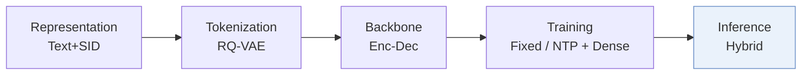
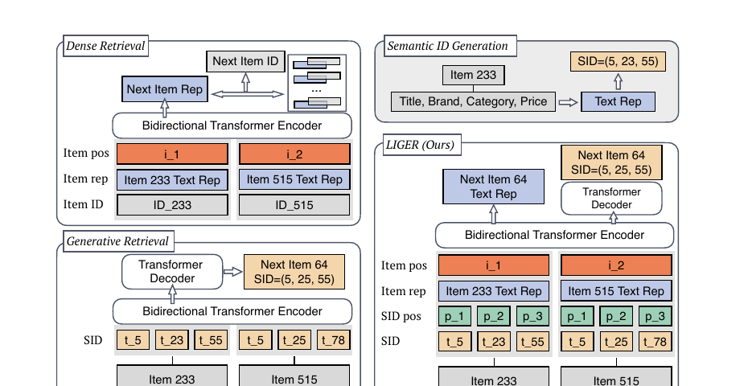
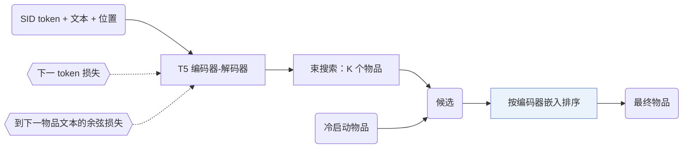
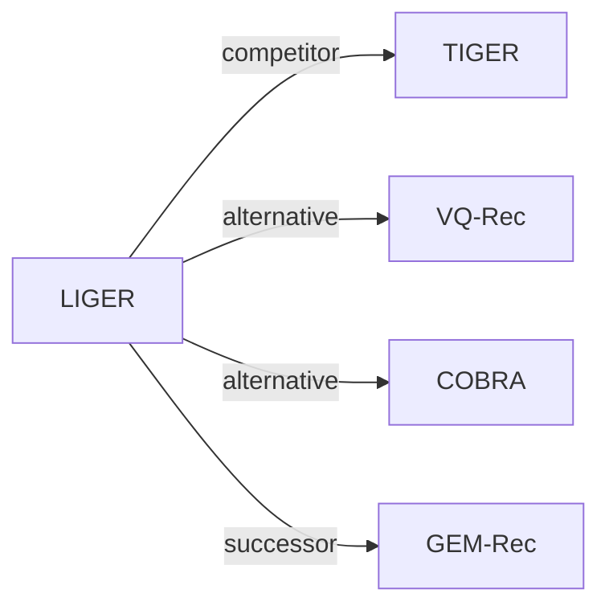

# LIGER

| **题目** | *Unifying generative and dense retrieval for sequential recommendation* |
| :-- | :-- |
| **作者** | Yang et al. |
| **会议** | arXiv’24 |
| **问题与阶段** | `VI. 泛化` · `Inference` |
| **链接** | [论文](https://arxiv.org/abs/2411.18814) · [矩阵](../../../README.zh.md#vi--inference) · [English](../../papers/liger.md) |
| **阅读级别** | 阅读笔记（第 2 级） |

本页目录：[TL;DR](#tldr) · [速览](#速览) · [1. 为什么重要](#1-为什么重要) · [2. 方法](#2-方法) · [3. 实验发现](#3-实验发现) · [4. 局限与分析](#4-局限与分析) · [5. 相关工作](#5-相关工作)

- `Text+SID`: Text representation plus semantic IDs (hybrid dense and generative retrieval).
- `Enc-Dec`: Encoder-decoder.
- `Fixed`: SIDs are built first and not changed while the generator trains.
- `NTP + Dense`: NTP plus dense-vector prediction.

### TL;DR

> [!NOTE]
> LIGER 在受控对比序列稠密检索与 SID 生成式检索后，将稠密检索融入生成式检索器，缩小二者性能差距并改善冷启动推荐。

---

### 速览

| 维度 | 摘要 |
| :-- | :-- |
| 研究问题 | VI. 泛化：Does it still work for new items, new domains, and shifting interests? |
| 核心贡献 | LIGER 在受控对比序列稠密检索与 SID 生成式检索后，将稠密检索融入生成式检索器，缩小二者性能差距并改善冷启动推荐。 |
| 主要改动阶段 | Inference |
| 局限 | 所有冷启动物品都进入候选集，设计前提是冷启动物品不多（Sec. 3）。 |

---

### 1. 为什么重要

序列稠密检索为每个物品存一个表示，内存随物品库增长（Abstract）。生成式检索改为预测语义 ID（Semantic ID，SID），但两者之间缺少公平的比较（Abstract）。

> "Our findings indicate that the model's learned conditional probabilities tends to overfit to items seen during training, leading to a significantly reduced capability to generate cold-start items."（Sec. 2.4）（模型学到的条件概率过拟合训练中见过的物品，很难生成冷启动物品。）

---

### 2. 方法

#### 输入与训练

每个 SID token 的嵌入加上物品的文本表示和两个位置嵌入（Sec. 3）。训练结合两项：向下一物品文本表示靠拢的余弦相似度损失，和在其 SID 上的下一 token 预测（Sec. 3）。

#### 混合推理

解码器给出候选，编码器的输出把这些候选和冷启动物品一起排序（Sec. 3，Algorithm 1）。

> "During inference, the decoder retrieves K items by beam search, then supplemented with cold-start items and ranked with the encoder's output embeddings."（Sec. 3）（解码器用束搜索取 K 个物品，补上冷启动物品，再用编码器输出排序。）

这个设计建立在一个关于冷启动物品的假设上（Sec. 3）。

> "This design choice is based on the hypothesis that cold-start items are relatively sparse compared to in-set items, as recommendation systems periodically update themselves to incorporate newly introduced items."（Sec. 3）（假设冷启动物品相对少，因为系统会定期把新物品纳入。）

---

### 3. 实验发现

实验设置

- **数据集**：Amazon Beauty, Sports and Outdoors, Toys and Games, and Steam with 5-core filtering of users and items; sequences truncated to the 20 most recent items. Sizes (users / items / cold-start items): Beauty 22,363 / 12,101 / 43; Toys 19,412 / 11,924 / 56; Sports 35,598 / 18,357 / 81; Steam 47,761 / 12,012 / 400.
  - 出处：Datasets, 5-core, truncation: [S4.SS1.p1](https://arxiv.org/html/2411.18814v2#S4.SS1.p1); statistics and cold-start counts: [A2.T3](https://arxiv.org/html/2411.18814v2#A2.T3).
- **切分**：Per-user leave-one-out: last item for test, preceding item for validation, the rest for training; early stopping on in-set NDCG@10; mean and standard deviation over three seeds. Test targets are reported separately for in-set and cold-start items.
  - 出处：Leave-one-out allocation: [S4.SS1.p4](https://arxiv.org/html/2411.18814v2#S4.SS1.p4); three seeds: [S4.SS2.p1](https://arxiv.org/html/2411.18814v2#S4.SS2.p1).
- **候选集**：Hybrid: generative retrieval returns K=20 candidates by beam search, which are ranked together with the cold-start items by dense retrieval (K swept from 20 to 100 and K=N in Table 4). Dense baselines score the full catalog.
  - 出处：Hybrid candidates (K from beam, ranked with cold-start items by dense scores): [S4.SS2.p2](https://arxiv.org/html/2411.18814v2#S4.SS2.p2); K sweep: [A3.T4](https://arxiv.org/html/2411.18814v2#A3.T4).
- **可见性**：In-set targets: warm. Cold-start targets: unseen by tokenizer too; cold-start items are excluded from RQ-VAE training (the paper says to avoid contamination), and the generators fail to produce them. Exact criterion for selecting cold-start items beyond the counts in Table 3: not reported.
  - 出处：Cold-start items excluded from RQ-VAE training: [S4.SS1.p4](https://arxiv.org/html/2411.18814v2#S4.SS1.p4); cold-start definition beyond counts not stated.
- **SID 规格**：3-level RQ-VAE x 256 codewords (dimension 128) over sentence-T5-XXL text embeddings; following TIGER, an extra token is appended to make IDs unique.
  - 出处：3 levels x 256 with dimension 128 and an extra uniqueness token: [S4.SS1.p2](https://arxiv.org/html/2411.18814v2#S4.SS1.p2).
- **推理预算**：Beam search retrieves K candidates (K=20 for the main result) from a T5 encoder-decoder (6 layers each), then a dense head ranks them with cold-start items. Complexity is stated as O(tK) versus O(N) for dense retrieval (Table 1); hardware, inference batch size, and latency: not reported.
  - 出处：Beam retrieval of K candidates and complexity: [S2.SS1.p3](https://arxiv.org/html/2411.18814v2#S2.SS1.p3) and [S3.T1](https://arxiv.org/html/2411.18814v2#S3.T1); model: [S4.SS1.p3](https://arxiv.org/html/2411.18814v2#S4.SS1.p3).
- **结果来源**：Table 2 (Beauty, Sports, Toys, Steam; in-set and cold-start Recall@10 and NDCG@10; three seeds); Table 4 (number of retrieved candidates K); Figures 1, 3, 4 (dense versus generative retrieval and cold-start generation probabilities); Appendix D (ablations).
  - 出处：Main: [S4.T2](https://arxiv.org/html/2411.18814v2#S4.T2); K sweep: [A3.T4](https://arxiv.org/html/2411.18814v2#A3.T4); motivation figures: [S1.F1](https://arxiv.org/html/2411.18814v2#S1.F1), [S2.F3](https://arxiv.org/html/2411.18814v2#S2.F3), [S2.F4](https://arxiv.org/html/2411.18814v2#S2.F4).

- 报告设置：生成式检索返回 20 个物品，再和冷启动物品一起排序（Sec. 4.2）。
- 主结果：在所评估的数据集上，LIGER 缩小了和稠密检索的差距，并改善了冷启动推荐（Abstract）。

---

### 4. 局限与分析

**Our analysis.**

- 最终顺序由稠密嵌入决定。生成的 SID 只负责选候选，不决定顺序。
- TIGER 只靠 `Beam` 搜索检索；LIGER 加了稠密损失（`NTP + Dense`）和 `Hybrid` 排序。

---

### 5. 相关工作

- **同期对比** · [TIGER](tiger.md): TIGER retrieves only by beam search over semantic IDs and almost never generates cold-start items; LIGER reranks TIGER-style beam candidates plus cold-start items with a dense head trained jointly.
  - 出处：LIGER v2, faithful TIGER implementation: https://arxiv.org/html/2411.18814v2#S1.p5; Table 2: https://arxiv.org/html/2411.18814v2#S4.T2; cold-start analysis of TIGER's epsilon quota: https://arxiv.org/html/2411.18814v2#S2.SS4.p3; LIGER builds on TIGER: https://arxiv.org/html/2411.18814v2#S4.SS2.p2.
- **替代方案** · [VQ-Rec](vq-rec.md): VQ-Rec uses vector-quantized codes inside a dense retriever; LIGER keeps generative beam search and adds dense ranking only over a small candidate set.
  - 出处：LIGER v2, Appendix A related work: https://arxiv.org/html/2411.18814v2#A1.p2.
- **替代方案** · [COBRA](cobra.md): COBRA later cascades sparse-ID generation with a generated dense vector inside one decoder and cites LIGER for the fine-grained similarity gap of generative methods.
  - 出处：Evidence is from the later COBRA paper, Section 1: https://arxiv.org/html/2503.02453v1#S1.p3.
- **后续工作** · [GEM-Rec](gem-rec.md): GEM-Rec later builds on LIGER's reproduction of the TIGER architecture and its 5-core preprocessing.
  - 出处：Evidence is from the later GEM-Rec paper, Section 5.4 and Appendix B.1: https://arxiv.org/html/2603.22231v1#S5.SS4.p1 and https://arxiv.org/html/2603.22231v1#A2.SS1.p1.

[查看同格全部论文](../../../README.zh.md#vi--inference)
