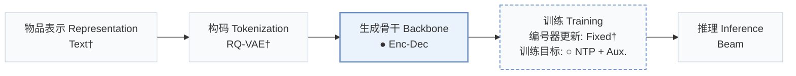

# LION

[← 问题 × 阶段矩阵](../../../README.zh.md#vi--backbone) · [按阶段索引](../index/stages.md) · [按模态找论文](../index/modality.md) · [按领域找论文](../index/domain.md) · [English](../../papers/lion.md) | 中文

| **题目** | *Self-Evolving Memory for Generative Recommendation* |
| :-- | :-- |
| **作者** | Lin et al. |
| **发表** | CIKM’26 |
| **问题与阶段** | `VI. 泛化` · `生成骨干（Backbone）` |
| **改动** | ● 生成骨干 · ○ 训练目标 |
| **构码输入** | `Text` |
| **领域** | `电商` |
| **应用场景** | `一般物品推荐`；`公开数据` |
| **链接** | [论文](https://arxiv.org/abs/2609.15598) · [代码](https://github.com/JazyJiang/Self-Evolving-Memory-for-Generative-Recommendation) |
| **阅读级别** | 概览（第 1 级） |

**本页目录**：[TL;DR](#tldr) · [3. 实验发现](#3-实验发现) · [5. 相关工作](#5-相关工作)

- `Text†`：物品文本表征（由配置推断）。
- `RQ-VAE†`：残差量化变分自编码器（由配置推断）。
- `Enc-Dec`：编码器-解码器（Encoder-decoder）架构。
- `Fixed†`：生成器训练期间冻结编号器（由配置推断）。
- `NTP + Aux.`：下一 token 预测结合辅助正则或对齐损失。
- `Beam`：在 SID token 上执行自回归束搜索（Beam search）。

### TL;DR

> [!NOTE]
> LION 加入稀疏键值记忆层与巩固损失，将不同行为模式的演化隔离开来，避免在流式交互上直接更新全部共享参数。

---

### 3. 实验发现

实验设置

- **数据集**：Amazon Games, CDs, and Toys; next-item samples with at most 10 previous interactions. Filtering rules not reported.
  - 出处：Section 5.1.1: [S5.SS1.SSS1.p1](https://arxiv.org/html/2609.15598v1#S5.SS1.SSS1.p1)
- **切分**：Target timestamps define five equal-count chronological periods P0-P4; adapt through each period and evaluate the next (P1-P4). Current-period validation file used; validation fraction not reported.
  - 出处：Sections 2/5.1.1/5.1.4: [S2.p3](https://arxiv.org/html/2609.15598v1#S2.p3) and [S5.SS1.SSS1.p2](https://arxiv.org/html/2609.15598v1#S5.SS1.SSS1.p2) and [S5.SS1.SSS4.p1](https://arxiv.org/html/2609.15598v1#S5.SS1.SSS4.p1)
- **候选集**：not reported
  - 出处：Section 5.1.2 defines generated-list metrics but no evaluation candidate pool: [S5.SS1.SSS2.p1](https://arxiv.org/html/2609.15598v1#S5.SS1.SSS2.p1)
- **可见性**：warm; no unseen-item protocol is defined. Item/tokenizer exposure across periods not reported.
  - 出处：Section 5.1 defines streaming periods without an unseen-item holdout: [S5.SS1](https://arxiv.org/html/2609.15598v1#S5.SS1)
- **SID 规格**：TIGER instantiation; tokenizer construction, SID length, codebook sizes, and collision handling not reported.
  - 出处：Sections 2/5.1.4 give generic token identifiers and the TIGER implementation: [S2.p1](https://arxiv.org/html/2609.15598v1#S2.p1) and [S5.SS1.SSS4.p1](https://arxiv.org/html/2609.15598v1#S5.SS1.SSS4.p1)
- **推理预算**：Beam 20; K=10/20. Sparse memory defaults: 64 keys per dimension, top-32 activation, decoder layer 5, routing history length 2. Hardware, inference batch size, and latency not reported.
  - 出处：Section 5.1.2 and Appendix A.1: [S5.SS1.SSS2.p1](https://arxiv.org/html/2609.15598v1#S5.SS1.SSS2.p1) and [A1.SS1.p1](https://arxiv.org/html/2609.15598v1#A1.SS1.p1)
- **结果来源**：Original Table 1: sample-weighted micro-average over four periods x five user groups; Table 2: period/group results; Table 3: ablations. Baselines adapted to TIGER in this paper.
  - 出处：Section 5.1.3 and Tables 1-3: [S5.SS1.SSS3.p1](https://arxiv.org/html/2609.15598v1#S5.SS1.SSS3.p1) and [S5.T1](https://arxiv.org/html/2609.15598v1#S5.T1) and [S5.T2](https://arxiv.org/html/2609.15598v1#S5.T2) and [S5.T3](https://arxiv.org/html/2609.15598v1#S5.T3)

---

### 5. 相关工作

- **前序工作** · [TIGER](tiger.md): LION adds sparse evolving memory to TIGER's continual fine-tuning baseline.
  - 出处：LION v1, Sections 5.1.3/5.1.4 and Table 1: [S5.SS1.SSS3.p1](https://arxiv.org/html/2609.15598v1#S5.SS1.SSS3.p1); [S5.SS1.SSS4.p1](https://arxiv.org/html/2609.15598v1#S5.SS1.SSS4.p1); [S5.T1](https://arxiv.org/html/2609.15598v1#S5.T1).

[查看同格全部论文](../../../README.zh.md#vi--backbone)
