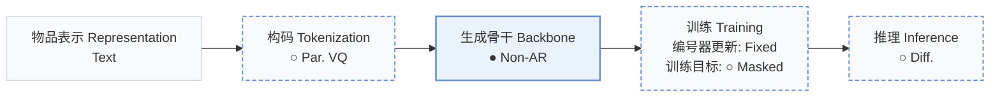
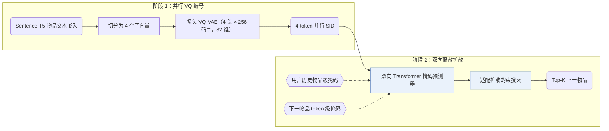
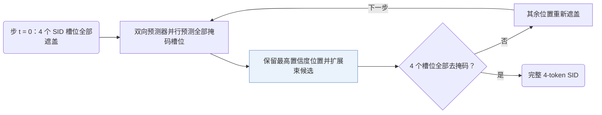
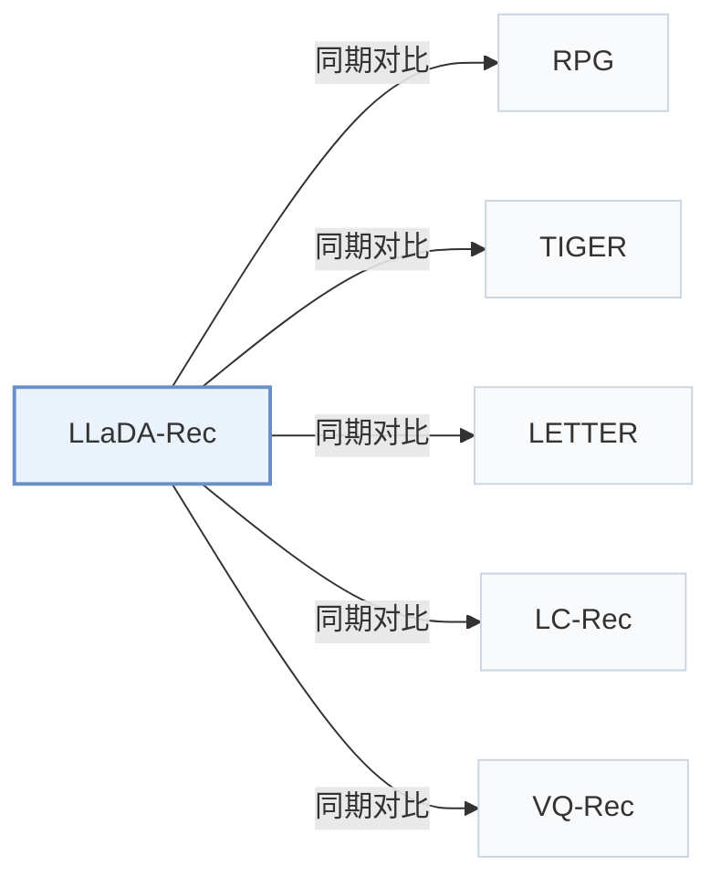

# LLaDA-Rec

[← 问题 × 阶段矩阵](../../../README.zh.md#iii--backbone) · [按阶段索引](../index/stages.md) · [按模态找论文](../index/modality.md) · [按领域找论文](../index/domain.md) · [English](../../papers/llada-rec.md) | 中文

| **题目** | *Discrete Diffusion for Parallel Semantic ID Generation in Generative Recommendation* |
| :-- | :-- |
| **作者** | Shi et al. |
| **发表** | arXiv’25 |
| **问题与阶段** | `III. SID 与模型对齐` · `生成骨干（Backbone）` |
| **改动** | ○ 构码 · ● 生成骨干 · ○ 训练目标 · ○ 推理 |
| **构码输入** | `Text` |
| **领域** | `电商` |
| **应用场景** | `一般物品推荐`；`公开数据` |
| **链接** | [论文](https://arxiv.org/abs/2511.06254) · [代码](https://github.com/TengShi-RUC/LLaDA-Rec) |
| **阅读级别** | 阅读笔记（第 2 级） |

**本页目录**：[TL;DR](#tldr) · [速览](#速览) · [1. 为什么重要](#1-为什么重要) · [2. 方法](#2-方法) · [3. 实验发现](#3-实验发现) · [4. 局限与分析](#4-局限与分析) · [5. 相关工作](#5-相关工作)

- `Text`：物品文本元数据（标题、描述、类目或提示词）。
- `Par. VQ`：无顺序残差依赖的并行多码本向量量化。
- `Non-AR`：非自回归（Non-autoregressive）并行预测架构。
- `Fixed`：先独立训练并冻结编号器，生成器训练期间 SID 保持不变。
- `Masked`：掩码部分码位并重构（含离散掩码扩散目标）。
- `Diff.`：迭代去噪扩散解码。

### TL;DR

> [!NOTE]
> LLaDA-Rec 用带双向注意力、历史级与物品级掩码以及适配束搜索的离散扩散模型并行生成 SID，替代从左到右的自回归解码。

---

### 速览

| 维度 | 摘要 |
| :-- | :-- |
| 主要发现 | 在 Amazon Industrial Scientific、Musical Instruments 和 Video Games 上，LLaDA-Rec 优于基于 ID、扩散与自回归的 SID 基线，且自适应顺序去掩码优于固定的从左到右解码（Table 3，Sec. 5.4.2，Fig. 4）。 |
| 局限 | 减少扩散步数虽能提高生成效率但会降低推荐精度，论文将更优的效率-效果权衡留作开放问题（Sec. 5.4.3，Fig. 5）。 |

---

### 1. 为什么重要

自回归生成式推荐器通过因果注意力逐个 token 解码语义 ID（Semantic ID，SID），不仅限制每个位置只能关注前序 token，还会使早期 token 的预测误差沿固定的从左到右顺序逐层累积。LLaDA-Rec 用基于双向注意力的离散掩码扩散替代因果自回归解码，在所有 SID 槽位上并行生成。

> "To address these issues, we propose LLaDA-Rec, a discrete diffusion framework that reformulates recommendation as parallel semantic ID generation."（Abstract）

---

### 2. 方法

#### 并行编号

由粗到细的残差量化具有强顺序层级，与双向注意力架构不匹配；因此 LLaDA-Rec 采用多头 VQ-VAE 将每个物品的 Sentence-T5 文本嵌入切分为 4 个子向量，并用各自独立的 256 码字（32 维）码本分别量化，每个头对应 SID 的一个并行槽位（Sec. 4.1，Sec. 5.1.4）。

#### 掩码训练

双向 Transformer 掩码预测器（Scientific 与 Instrument 上为 4 层，Game 上为 6 层）结合两类互补的掩码机制训练：用户历史物品级掩码遮盖历史序列中的完整物品以捕捉跨物品序列转移；下一物品 token 级掩码在保持用户历史可见的前提下遮盖目标物品 4 个 SID token 的子集，使预测器学习同一物品内部的 token 共现关系（Sec. 4.2.3）。

#### 自适应顺序解码

推理在 $`t = 0`$ 步从 4 个槽位全部遮盖的 SID 开始，经可控步数迭代填满（Sec. 4.3.4，Sec. 4.4.2）。每一步由预测器并行评估所有掩码槽位的分布，保留置信度最高的位置并将其余位置重新遮盖，留待下一步在已生成上下文中重新预测；同时用适配扩散过程的束搜索在多步去掩码中维护多条候选轨迹（Sec. 4.3.3–4.3.4）。

> "All unselected positions are remasked so that the MASK predictor can re-evaluate them in the context of the partially generated sequence."（Sec. 4.3.4）

---

### 3. 实验发现

实验设置

- **数据集**：Amazon Reviews 2023: Industrial Scientific (50,985 users / 25,848 items), Musical Instruments (57,439 / 24,587), Video Games (94,762 / 25,612). Filtering rules: not reported.
  - 出处：Amazon 2023 categories and ordering: [S5.SS1.SSS1.p1](https://arxiv.org/html/2511.06254v1#S5.SS1.SSS1.p1); statistics: [S4.T2](https://arxiv.org/html/2511.06254v1#S4.T2).
- **切分**：Chronological leave-one-out: last item for test, second-to-last for validation, the rest for training.
  - 出处：Leave-one-out allocation: [S5.SS1.SSS1.p1](https://arxiv.org/html/2511.06254v1#S5.SS1.SSS1.p1).
- **候选集**：not reported (full catalog versus sampled evaluation candidates); top-k lists from the adapted beam search.
  - 出处：Metrics only: [S5.SS1.SSS3.p1](https://arxiv.org/html/2511.06254v1#S5.SS1.SSS3.p1).
- **可见性**：warm; no unseen-item protocol is defined.
  - 出处：Standard split with no unseen-item protocol: [S5.SS1.SSS1.p1](https://arxiv.org/html/2511.06254v1#S5.SS1.SSS1.p1).
- **SID 规格**：Parallel semantic IDs from a Multi-Head VQ-VAE over Sentence-T5 embeddings: the embedding is split into 4 sub-vectors, each quantized by its own codebook of 256 codes (dimension 32). Collision handling: not reported.
  - 出处：M=4 codebooks x 256 x 32 with Multi-Head VQ-VAE: [S5.SS1.SSS4.p1](https://arxiv.org/html/2511.06254v1#S5.SS1.SSS4.p1) and [S4.SS1.p3](https://arxiv.org/html/2511.06254v1#S4.SS1.p3); no collision rule found.
- **推理预算**：Discrete-diffusion decoding with beam search over iteratively selected positions and remasking; beam size B: not reported numerically. Bidirectional Transformer encoder (4 layers; 6 for Game). Hardware, inference batch size, and latency: not reported. Recall at 1, 5, 10 and NDCG at 5, 10.
  - 出处：Beam search adapted to diffusion decoding: [S4.SS3.SSS3.p1](https://arxiv.org/html/2511.06254v1#S4.SS3.SSS3.p1) and [S4.SS3.SSS4.p1](https://arxiv.org/html/2511.06254v1#S4.SS3.SSS4.p1); no numerical beam size or hardware found.
- **结果来源**：Table 3 (Scientific, Instrument, Game versus item-ID, diffusion, and semantic-ID baselines; paired t-tests); Table 4 (ablations including RQ-VAE tokenizer and greedy decoding); Figure 3 (attention mechanisms); Section 5.4 (hyperparameters).
  - 出处：Main: [S4.T3](https://arxiv.org/html/2511.06254v1#S4.T3); ablation: [S5.T4](https://arxiv.org/html/2511.06254v1#S5.T4); attention study: [S5.F3](https://arxiv.org/html/2511.06254v1#S5.F3).

- 主实验对比：在 Amazon Industrial Scientific、Musical Instruments 和 Video Games 三个数据集上，LLaDA-Rec 在 Recall@1/5/10 与 NDCG@5/10 上均优于基于物品 ID、连续扩散及自回归 SID 的基线（含 TIGER、LETTER、LC-Rec、RPG、VQ-Rec），且通过配对 t 检验验证了显著性（Table 3）。
- 编号与注意力消融：将多头 VQ-VAE 替换为层级 RQ-VAE、将适配束搜索替换为贪心解码，或将双向注意力替换为因果注意力，均会导致推荐指标下降（Table 4，Fig. 3）。
- 去掩码顺序：基于置信度的自适应去掩码顺序始终优于随机顺序与固定顺序，而常用的从左到右固定顺序在部分设置下表现最差（Sec. 5.4.2，Fig. 4）。

  > "The adaptive approach consistently delivers superior performance, with left2right occasionally producing the poorest results, highlighting the shortcomings of the commonly used left2right scheme."（Sec. 5.4.2）

---

### 4. 局限与分析

**Our analysis.**

- 多头 VQ-VAE 编号器仅在物品文本嵌入上训练一次并固定（`Fixed`、`Text`），这意味着协同过滤信号只能通过双向扩散生成器学入，而未进入 SID 编码分配阶段。
- RPG 同样用 `Non-AR` 骨干并行预测无序编码；RPG 采用 `Par. OPQ` 编码与单步图约束解码（`Graph`），而 LLaDA-Rec 采用 `Par. VQ` 编码与多步迭代离散扩散去掩码（`Diff.`）。

---

### 5. 相关工作

- **同期对比** · [RPG](rpg.md): RPG predicts long unordered OPQ codes in parallel with multi-token prediction; LLaDA-Rec generates parallel VQ codes by discrete diffusion with an adapted beam search.
  - 出处：LLaDA-Rec v1, Table 1 comparison and semantic-ID baselines: [S4.T1](https://arxiv.org/html/2511.06254v1#S4.T1) and [S5.SS1.SSS2.p2](https://arxiv.org/html/2511.06254v1#S5.SS1.SSS2.p2); Table 3: [S4.T3](https://arxiv.org/html/2511.06254v1#S4.T3).
- **同期对比** · [TIGER](tiger.md): TIGER generates hierarchical RQ-VAE codes left to right with causal attention; LLaDA-Rec uses bidirectional attention and fills code positions in any order.
  - 出处：LLaDA-Rec v1, Table 1 and baselines (TIGER and TIGER-SAS): [S4.T1](https://arxiv.org/html/2511.06254v1#S4.T1) and [S5.SS1.SSS2.p2](https://arxiv.org/html/2511.06254v1#S5.SS1.SSS2.p2); Table 3: [S4.T3](https://arxiv.org/html/2511.06254v1#S4.T3).
- **同期对比** · [LETTER](letter.md): LETTER improves a hierarchical tokenizer for left-to-right generation; LLaDA-Rec replaces the hierarchy with parallel codes suited to diffusion.
  - 出处：LLaDA-Rec v1, baselines: [S5.SS1.SSS2.p2](https://arxiv.org/html/2511.06254v1#S5.SS1.SSS2.p2); Tables 1 and 3: [S4.T1](https://arxiv.org/html/2511.06254v1#S4.T1) and [S4.T3](https://arxiv.org/html/2511.06254v1#S4.T3).
- **同期对比** · [LC-Rec](lc-rec.md): LC-Rec aligns an LLM to semantic IDs with auxiliary tasks and causal decoding; LLaDA-Rec trains a bidirectional masked predictor with history-level and item-level masking.
  - 出处：LLaDA-Rec v1, baselines: [S5.SS1.SSS2.p2](https://arxiv.org/html/2511.06254v1#S5.SS1.SSS2.p2); Tables 1 and 3: [S4.T1](https://arxiv.org/html/2511.06254v1#S4.T1) and [S4.T3](https://arxiv.org/html/2511.06254v1#S4.T3).
- **同期对比** · [VQ-Rec](vq-rec.md): VQ-Rec pools product-quantized codes into an item representation for discriminative ranking; LLaDA-Rec generates parallel codes directly.
  - 出处：LLaDA-Rec v1, baselines: [S5.SS1.SSS2.p2](https://arxiv.org/html/2511.06254v1#S5.SS1.SSS2.p2); Table 3: [S4.T3](https://arxiv.org/html/2511.06254v1#S4.T3).

[查看同格全部论文](../../../README.zh.md#iii--backbone)
