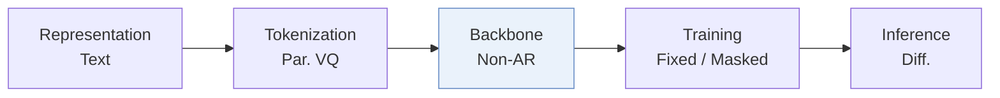
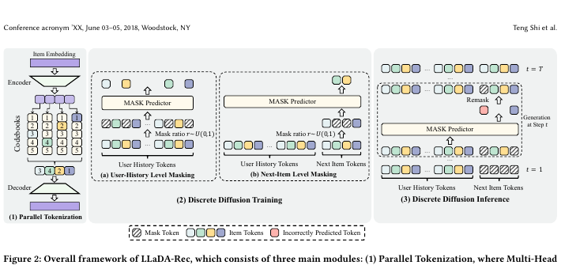
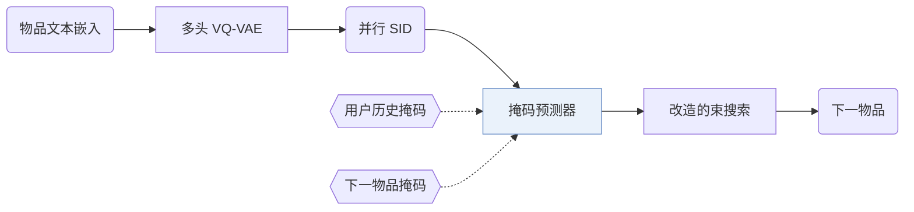
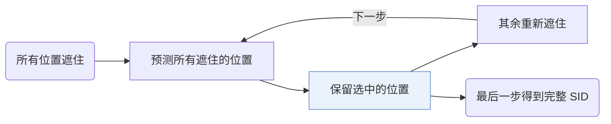
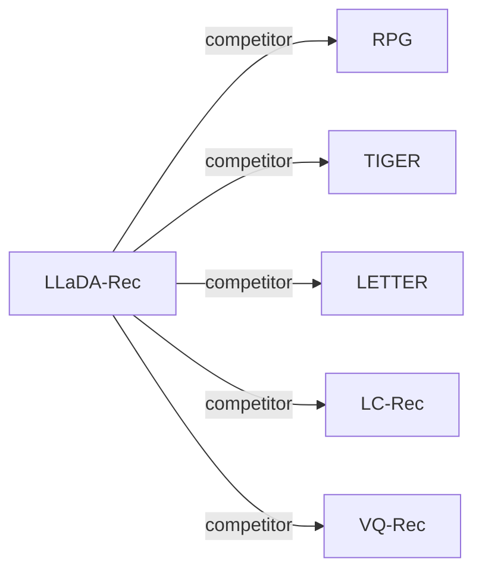

# LLaDA-Rec

| **题目** | *Discrete Diffusion for Parallel Semantic ID Generation in Generative Recommendation* |
| :-- | :-- |
| **作者** | Shi et al. |
| **会议** | arXiv’25 |
| **问题与阶段** | `III. SID 与模型对齐` · `Backbone` |
| **链接** | [论文](https://arxiv.org/abs/2511.06254) · [代码](https://github.com/TengShi-RUC/LLaDA-Rec) · [矩阵](../../../README.zh.md#iii--backbone) · [English](../../papers/llada-rec.md) |
| **阅读级别** | 阅读笔记（第 2 级） |

本页目录：[TL;DR](#tldr) · [速览](#速览) · [1. 为什么重要](#1-为什么重要) · [2. 方法](#2-方法) · [3. 实验发现](#3-实验发现) · [4. 局限与分析](#4-局限与分析) · [5. 相关工作](#5-相关工作)

- `Non-AR`: Non-autoregressive.
- `Fixed`: SIDs are built first and not changed while the generator trains.
- `Masked`: Masks part of the codes and reconstructs them (includes masked diffusion).
- `Diff.`: Diffusion decoding.

### TL;DR

> [!NOTE]
> LLaDA-Rec 用带双向注意力、历史级与物品级掩码以及适配束搜索的离散扩散模型并行生成 SID，替代从左到右的自回归解码。

---

### 速览

| 维度 | 摘要 |
| :-- | :-- |
| 研究问题 | III. SID 与模型对齐：Can the generator read, write, and reason over SIDs, and do the tokenizer and generator work toward the same goal? |
| 核心贡献 | LLaDA-Rec 用带双向注意力、历史级与物品级掩码以及适配束搜索的离散扩散模型并行生成 SID，替代从左到右的自回归解码。 |
| 主要改动阶段 | Backbone |
| 局限 | 扩散步数少，生成快，但推荐效果下降；作者把更好的权衡留作开放问题（Sec. 5.4.3，Fig. 5）。 |

---

### 1. 为什么重要

自回归生成式推荐器用因果注意力逐个 token 解码语义 ID（Semantic ID，SID）。作者指出这种做法的两个局限：每个 token 只能看到它前面的 token；早期 token 的错误会沿固定的从左到右顺序传下去（Abstract）。LLaDA-Rec 改为在 SID 的所有位置上做离散扩散。

> "To address these issues, we propose LLaDA-Rec, a discrete diffusion framework that reformulates recommendation as parallel semantic ID generation."（Abstract）（用离散扩散把推荐改写成并行生成语义 ID。）

---

### 2. 方法

#### 并行编号

多头 VQ-VAE 把物品文本嵌入切成若干子向量，每个子向量单独量化，一个头对应 SID 的一位（Sec. 4.1）。作者这样做，是因为残差量化和双向结构不匹配（Abstract）。

#### 掩码训练

训练用两种掩码机制（Abstract）。用户历史掩码学习物品之间的序列依赖。下一物品掩码遮住目标物品 SID 的部分 token，用户历史保持可见，让预测器学习同一物品内各 token 的关系（Sec. 4.2.3）。

#### 自适应顺序解码

推理从全部遮住的 SID 开始，分几步填满（Sec. 4.3.4）。每一步模型选出要保留的位置，其余位置重新遮住。

> "All unselected positions are remasked so that the MASK predictor can re-evaluate them in the context of the partially generated sequence."（Sec. 4.3.4）（未选中的位置重新遮住，让预测器在已生成部分的基础上重新判断。）

步数可调，每一步可以预测多个 token（Sec. 4.4.2）。标准束搜索不适合扩散式生成，所以论文改造了束搜索，在这个过程中保留多个候选（Abstract）。

---

### 3. 实验发现

实验设置

- **数据集**：Amazon Reviews 2023: Industrial Scientific (50,985 users / 25,848 items), Musical Instruments (57,439 / 24,587), Video Games (94,762 / 25,612). Filtering rules: not reported.
  - 出处：Amazon 2023 categories and ordering: [S5.SS1.SSS1.p1](https://arxiv.org/html/2511.06254v1#S5.SS1.SSS1.p1); statistics: [S4.T2](https://arxiv.org/html/2511.06254v1#S4.T2).
- **切分**：Chronological leave-one-out: last item for test, second-to-last for validation, the rest for training.
  - 出处：Leave-one-out allocation: [S5.SS1.SSS1.p1](https://arxiv.org/html/2511.06254v1#S5.SS1.SSS1.p1).
- **候选集**：not reported (full catalog versus sampled evaluation candidates); top-k lists from the adapted beam search.
  - 出处：Metrics only: [S5.SS1.SSS3.p1](https://arxiv.org/html/2511.06254v1#S5.SS1.SSS3.p1).
- **可见性**：warm; no unseen-item protocol is defined.
  - 出处：Standard split with no unseen-item protocol: [S5.SS1.SSS1.p1](https://arxiv.org/html/2511.06254v1#S5.SS1.SSS1.p1).
- **SID 规格**：Parallel semantic IDs from a Multi-Head VQ-VAE over Sentence-T5 embeddings: the embedding is split into 4 sub-vectors, each quantized by its own codebook of 256 codes (dimension 32). Collision handling: not reported.
  - 出处：M=4 codebooks x 256 x 32 with Multi-Head VQ-VAE: [S5.SS1.SSS4.p1](https://arxiv.org/html/2511.06254v1#S5.SS1.SSS4.p1) and [S4.SS1.p3](https://arxiv.org/html/2511.06254v1#S4.SS1.p3); no collision rule found.
- **推理预算**：Discrete-diffusion decoding with beam search over iteratively selected positions and remasking; beam size B: not reported numerically. Bidirectional Transformer encoder (4 layers; 6 for Game). Hardware, inference batch size, and latency: not reported. Recall at 1, 5, 10 and NDCG at 5, 10.
  - 出处：Beam search adapted to diffusion decoding: [S4.SS3.SSS3.p1](https://arxiv.org/html/2511.06254v1#S4.SS3.SSS3.p1) and [S4.SS3.SSS4.p1](https://arxiv.org/html/2511.06254v1#S4.SS3.SSS4.p1); no numerical beam size or hardware found.
- **结果来源**：Table 3 (Scientific, Instrument, Game versus item-ID, diffusion, and semantic-ID baselines; paired t-tests); Table 4 (ablations including RQ-VAE tokenizer and greedy decoding); Figure 3 (attention mechanisms); Section 5.4 (hyperparameters).
  - 出处：Main: [S4.T3](https://arxiv.org/html/2511.06254v1#S4.T3); ablation: [S5.T4](https://arxiv.org/html/2511.06254v1#S5.T4); attention study: [S5.F3](https://arxiv.org/html/2511.06254v1#S5.F3).

- 主实验：在三个真实数据集上，LLaDA-Rec 好于基于 ID 的推荐器和生成式推荐器（Abstract）。
- 生成顺序：自适应顺序最好，从左到右有时最差（Sec. 5.4.2，Fig. 4）。

  > "The adaptive approach consistently delivers superior performance, with left2right occasionally producing the poorest results, highlighting the shortcomings of the commonly used left2right scheme."（Sec. 5.4.2）（自适应顺序始终最好，常用的从左到右有时最差。）

---

### 4. 局限与分析

**Our analysis.**

- 编号器训练一次就固定（`Fixed`），只编码物品文本（`Text`）。由此推断，协同信号只能通过生成器进入。
- RPG 也用 `Non-AR` 生成器生成并行码；RPG 用 `Par. OPQ` 码和 `Graph` 解码，LLaDA-Rec 用 `Par. VQ` 码和 `Diff.` 解码。

---

### 5. 相关工作

- **同期对比** · [RPG](rpg.md): RPG predicts long unordered OPQ codes in parallel with multi-token prediction; LLaDA-Rec generates parallel VQ codes by discrete diffusion with an adapted beam search.
  - 出处：LLaDA-Rec v1, Table 1 comparison and semantic-ID baselines: https://arxiv.org/html/2511.06254v1#S4.T1 and https://arxiv.org/html/2511.06254v1#S5.SS1.SSS2.p2; Table 3: https://arxiv.org/html/2511.06254v1#S4.T3.
- **同期对比** · [TIGER](tiger.md): TIGER generates hierarchical RQ-VAE codes left to right with causal attention; LLaDA-Rec uses bidirectional attention and fills code positions in any order.
  - 出处：LLaDA-Rec v1, Table 1 and baselines (TIGER and TIGER-SAS): https://arxiv.org/html/2511.06254v1#S4.T1 and https://arxiv.org/html/2511.06254v1#S5.SS1.SSS2.p2; Table 3: https://arxiv.org/html/2511.06254v1#S4.T3.
- **同期对比** · [LETTER](letter.md): LETTER improves a hierarchical tokenizer for left-to-right generation; LLaDA-Rec replaces the hierarchy with parallel codes suited to diffusion.
  - 出处：LLaDA-Rec v1, baselines: https://arxiv.org/html/2511.06254v1#S5.SS1.SSS2.p2; Tables 1 and 3: https://arxiv.org/html/2511.06254v1#S4.T1 and https://arxiv.org/html/2511.06254v1#S4.T3.
- **同期对比** · [LC-Rec](lc-rec.md): LC-Rec aligns an LLM to semantic IDs with auxiliary tasks and causal decoding; LLaDA-Rec trains a bidirectional masked predictor with history-level and item-level masking.
  - 出处：LLaDA-Rec v1, baselines: https://arxiv.org/html/2511.06254v1#S5.SS1.SSS2.p2; Tables 1 and 3: https://arxiv.org/html/2511.06254v1#S4.T1 and https://arxiv.org/html/2511.06254v1#S4.T3.
- **同期对比** · [VQ-Rec](vq-rec.md): VQ-Rec pools product-quantized codes into an item representation for discriminative ranking; LLaDA-Rec generates parallel codes directly.
  - 出处：LLaDA-Rec v1, baselines: https://arxiv.org/html/2511.06254v1#S5.SS1.SSS2.p2; Table 3: https://arxiv.org/html/2511.06254v1#S4.T3.

[查看同格全部论文](../../../README.zh.md#iii--backbone)
