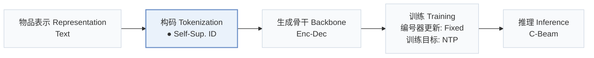
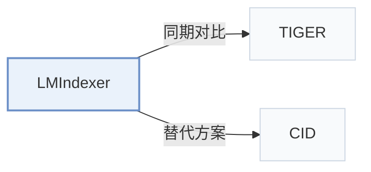

# LMIndexer

[← 问题 × 阶段矩阵](../../../README.zh.md#i--tokenization) · [按阶段索引](../index/stages.md) · [按模态找论文](../index/modality.md) · [按领域找论文](../index/domain.md) · [English](../../papers/lmindexer.md) | 中文

| **题目** | *Language Models As Semantic Indexers* |
| :-- | :-- |
| **作者** | Jin et al. |
| **发表** | ICML’24 |
| **问题与阶段** | `I. 信息量` · `构码（Tokenization）` |
| **改动** | ● 构码 |
| **构码输入** | `Text` |
| **领域** | `电商` · `搜索` |
| **特殊设置** | `冷启动（物品）` |
| **链接** | [论文](https://arxiv.org/abs/2310.07815) · [代码](https://github.com/PeterGriffinJin/LMIndexer) |
| **阅读级别** | 概览（第 1 级） |

**本页目录**：[TL;DR](#tldr) · [3. 实验发现](#3-实验发现) · [5. 相关工作](#5-相关工作)

- `Text`：物品文本元数据（标题、描述、类目或提示词）。
- `Self-Sup. ID`：通过自监督任务直接学习的离散语义标识符。
- `Enc-Dec`：编码器-解码器（Encoder-decoder）架构。
- `Fixed`：先独立训练并冻结编号器，生成器训练期间 SID 保持不变。
- `NTP`：标准下一 token 预测（Next-Token Prediction）交叉熵损失；基于预训练 LLM 的指令微调（SFT）亦归入此类。
- `C-Beam`：受合法物品集合约束的束搜索（Constrained beam search）。

### TL;DR

> [!NOTE]
> LMIndexer 通过渐进式训练、对比学习与自监督重构用生成式语言模型学习序列 SID，替代对现成编码器嵌入做后验量化。

---

### 3. 实验发现

实验设置

- **数据集**：Amazon Beauty/Sports/Toys: recommendation and product search, user/item >=5 interactions. Document retrieval: NQ, MS MARCO-1M, merged TREC-DL 2019/2020 restricted to that corpus.
  - 出处：Sections 5.1-5.3 and Appendix A.1: [S5.SS1.p2](https://arxiv.org/html/2310.07815v3#S5.SS1.p2) and [S5.SS2.p2](https://arxiv.org/html/2310.07815v3#S5.SS2.p2) and [A1.SS1.p3](https://arxiv.org/html/2310.07815v3#A1.SS1.p3)
- **切分**：Recommendation: per-user last/penultimate test/validation. Product search: original train/test, 1/8 training queries validation. NQ keeps original labels; MARCO uses original train/dev labels.
  - 出处：Appendix A.1: [A1.SS1.p1](https://arxiv.org/html/2310.07815v3#A1.SS1.p1) and [A1.SS1.p3](https://arxiv.org/html/2310.07815v3#A1.SS1.p3)
- **候选集**：not reported
  - 出处：Downstream protocols in Sections 5.1-5.3 do not specify negative sampling or complete-catalog enumeration: [S5.SS1](https://arxiv.org/html/2310.07815v3#S5.SS1) and [S5.SS2](https://arxiv.org/html/2310.07815v3#S5.SS2) and [S5.SS3](https://arxiv.org/html/2310.07815v3#S5.SS3)
- **可见性**：Recommendation: warm; no unseen-item protocol is defined. Zero-shot Beauty product search: unseen by tokenizer too, excluded from both SID self-supervision and downstream finetuning; holdout construction not reported.
  - 出处：Sections 4.1/5.1 and Appendix A.10: [S4.SS1.p1](https://arxiv.org/html/2310.07815v3#S4.SS1.p1) and [S5.SS1.p2](https://arxiv.org/html/2310.07815v3#S5.SS1.p2) and [A1.SS10.p1](https://arxiv.org/html/2310.07815v3#A1.SS10.p1)
- **SID 规格**：Reported ID length 3; codebook sizes 512 (Amazon), 5120 (NQ), 51200 (MARCO-1M). A final ID position distinguishes collisions; its assignment rule not reported.
  - 出处：Appendix A.3 Table 9 and Appendix A.5: [A1.T9](https://arxiv.org/html/2310.07815v3#A1.T9) and [A1.SS3.p1](https://arxiv.org/html/2310.07815v3#A1.SS3.p1) and [A1.SS5.p2](https://arxiv.org/html/2310.07815v3#A1.SS5.p2)
- **推理预算**：Prefix-tree constrained beam 20; recommendation Recall/NDCG@5; experiments on 8 A100-40G. Inference batch size not reported. Product-search whole-Beauty-test latency 12.21s, not per request.
  - 出处：Sections 3.3/5.1 and Appendix A.9/Table 14: [S3.SS3.p1](https://arxiv.org/html/2310.07815v3#S3.SS3.p1) and [S5.SS1.p4](https://arxiv.org/html/2310.07815v3#S5.SS1.p4) and [A1.SS9.p1](https://arxiv.org/html/2310.07815v3#A1.SS9.p1) and [A1.T14](https://arxiv.org/html/2310.07815v3#A1.T14)
- **结果来源**：Original Tables 3/4/6: recommendation/product search/document retrieval; Table 15: zero-shot product search. Generative indexer baselines use matched T5-base finetuning.
  - 出处：Original Tables 3/4/6/15: [S5.T3](https://arxiv.org/html/2310.07815v3#S5.T3) and [S5.T4](https://arxiv.org/html/2310.07815v3#S5.T4) and [S5.T6](https://arxiv.org/html/2310.07815v3#S5.T6) and [A1.T15](https://arxiv.org/html/2310.07815v3#A1.T15)

---

### 5. 相关工作

- **同期对比** · [TIGER](tiger.md): Its RQ-VAE indexing approach is adapted as a matched T5-base baseline.
  - 出处：LMIndexer v3, Section 5.1: [S5.SS1.p3](https://arxiv.org/html/2310.07815v3#S5.SS1.p3); [S5.SS1.p4](https://arxiv.org/html/2310.07815v3#S5.SS1.p4).
- **替代方案** · [CID](cid.md): Cited task-informed item indexing; LMIndexer learns IDs by self-supervised text reconstruction.
  - 出处：LMIndexer v3, Section 2, citing Hua et al. (2023): [S2.p2](https://arxiv.org/html/2310.07815v3#S2.p2).

[查看同格全部论文](../../../README.zh.md#i--tokenization)
