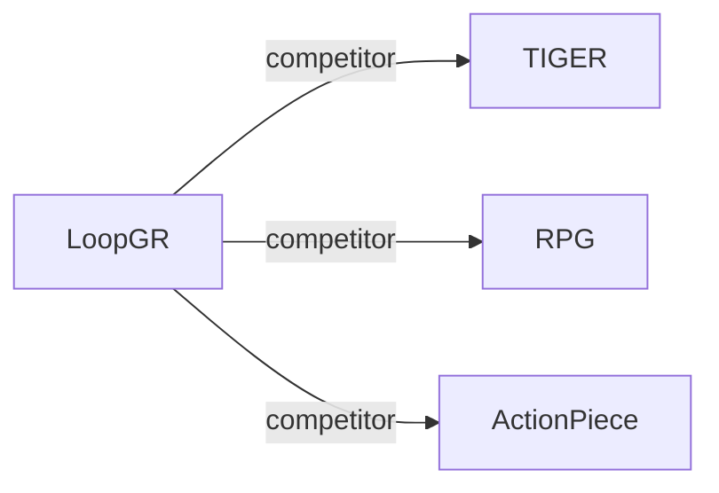

# LoopGR

*Parameter-Efficient Scaling for Generative Recommendation via Recurrent Depth* — Zhang et al. · arXiv’26

`V. 效率` · `Backbone` · [论文](https://arxiv.org/abs/2610.34157) · [矩阵](../../../README.zh.md#v--backbone) · [English](../../papers/loopgr.md)

阅读级别：概览（第 1 级） · 本页目录：[TL;DR](#tldr) · [速览](#速览) · [3. 实验发现](#3-实验发现) · [5. 相关工作](#5-相关工作)

- `Enc-Dec`: Encoder-decoder.
- `Fixed`: SIDs are built first and not changed while the generator trains.
- `NTP / NTP + Aux.`: Next-token prediction alone or jointly optimized with auxiliary objectives.
- `–`: Not reported in the paper.

### TL;DR

> [!NOTE]
> LoopGR 交替运行共享生成解码器与轻量上下文更新器以增加循环深度，并蒸馏出低开销学生模型，在不按比例扩大参数量的前提下扩展计算。

### 速览

| 维度 | 摘要 |
| :-- | :-- |
| 研究问题 | V. 效率：Can it be trained and served within latency and cost budgets? |
| 核心贡献 | LoopGR 交替运行共享生成解码器与轻量上下文更新器以增加循环深度，并蒸馏出低开销学生模型，在不按比例扩大参数量的前提下扩展计算。 |
| 主要改动阶段 | Backbone |

### 3. 实验发现

实验设置

- **数据集**：Amazon Reviews 2014 Beauty, Sports and Outdoors, CDs and Vinyl; Tencent industrial data. Filtering and industrial dataset statistics not reported.
  - 出处：Section 5.1 and Appendix A.1: [S5.SS1.SSS0.Px1.p1](https://arxiv.org/html/2610.34157v1#S5.SS1.SSS0.Px1.p1) and [A1.SS1.p1](https://arxiv.org/html/2610.34157v1#A1.SS1.p1)
- **切分**：Interactions ordered chronologically; sliding-window next-item training. Train/validation/test allocation not reported.
  - 出处：Section 5.1: [S5.SS1.SSS0.Px1.p1](https://arxiv.org/html/2610.34157v1#S5.SS1.SSS0.Px1.p1)
- **候选集**：not reported
  - 出处：Evaluation protocol in Section 5.1 and Appendix A.1 does not specify candidate enumeration or sampling: [S5.SS1](https://arxiv.org/html/2610.34157v1#S5.SS1) and [A1.SS1](https://arxiv.org/html/2610.34157v1#A1.SS1)
- **可见性**：warm; no unseen-item protocol is defined.
  - 出处：Section 5.1 and Appendix A.1 define no item-level cold-start experiment: [S5.SS1](https://arxiv.org/html/2610.34157v1#S5.SS1) and [A1.SS1](https://arxiv.org/html/2610.34157v1#A1.SS1)
- **SID 规格**：Sentence-T5 embeddings; 3 RQ-VAE digits plus fourth anti-collision digit for unique SIDs. Codebook sizes not reported.
  - 出处：Section 5.1: [S5.SS1.SSS0.Px3.p1](https://arxiv.org/html/2610.34157v1#S5.SS1.SSS0.Px3.p1)
- **推理预算**：Experiments on 4 NVIDIA H20 GPUs; beam width not reported. Public Recall/NDCG@5/10; industrial Recall@5/10/20/50/100. Table 6, batch 1: 16/8/4 cycles, 211.08/104.01/49.82ms, 17.408/8.415/3.918 GFLOPs.
  - 出处：Section 5.1, Table 2, and Appendix A.2/Table 6: [S5.SS1.SSS0.Px3.p1](https://arxiv.org/html/2610.34157v1#S5.SS1.SSS0.Px3.p1) and [S5.T2](https://arxiv.org/html/2610.34157v1#S5.T2) and [A1.SS2.p1](https://arxiv.org/html/2610.34157v1#A1.SS2.p1) and [A1.T6](https://arxiv.org/html/2610.34157v1#A1.T6)
- **结果来源**：Tables 1/2: public/industrial comparisons; Table 6: trajectory compression. Industrial baselines adapted by authors; public-baseline reproduction versus copied scores not reported.
  - 出处：Section 5.1 and Tables 1/2/6: [S5.SS1.SSS0.Px2.p1](https://arxiv.org/html/2610.34157v1#S5.SS1.SSS0.Px2.p1) and [S5.T1](https://arxiv.org/html/2610.34157v1#S5.T1) and [S5.T2](https://arxiv.org/html/2610.34157v1#S5.T2) and [A1.T6](https://arxiv.org/html/2610.34157v1#A1.T6)

### 5. 相关工作

- **同期对比** · [TIGER](tiger.md): Encoder-decoder baseline; LoopGR adds shared recurrent context refinement.
  - 出处：LoopGR v1, Section 5.1 and Tables 1/2: https://arxiv.org/html/2610.34157v1#S5.SS1.SSS0.Px2.p1; https://arxiv.org/html/2610.34157v1#S5.T1; https://arxiv.org/html/2610.34157v1#S5.T2.
- **同期对比** · [RPG](rpg.md): Parallel graph-guided decoding contrasts with LoopGR's recurrent RQ-VAE SID generation.
  - 出处：LoopGR v1, Section 5.2 and Table 1: https://arxiv.org/html/2610.34157v1#S5.SS2.p2; https://arxiv.org/html/2610.34157v1#S5.T1.
- **同期对比** · [ActionPiece](actionpiece.md): Context-dependent action tokens contrast with LoopGR's standard RQ-VAE identifiers.
  - 出处：LoopGR v1, Section 5.2 and Table 1: https://arxiv.org/html/2610.34157v1#S5.SS2.p2; https://arxiv.org/html/2610.34157v1#S5.T1.

[查看同格全部论文](../../../README.zh.md#v--backbone)
