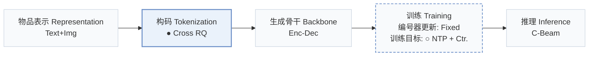
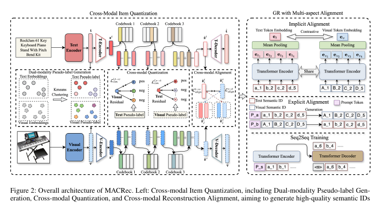
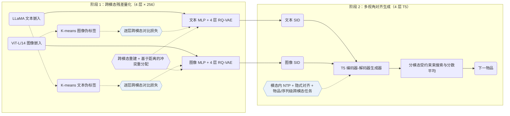
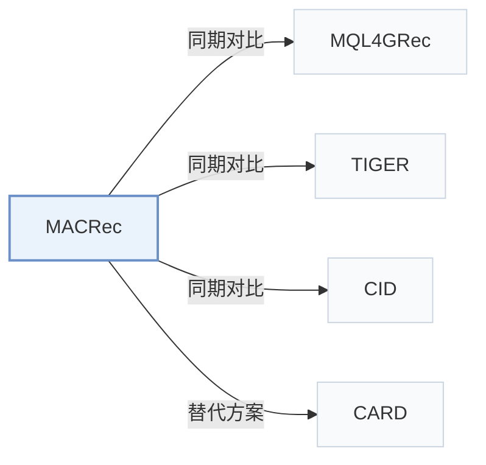

# MACRec

[← 问题 × 阶段矩阵](../../../README.zh.md#i--tokenization) · [按阶段索引](../index/stages.md) · [按模态找论文](../index/modality.md) · [按领域找论文](../index/domain.md) · [English](../../papers/macrec.md) | 中文

| **题目** | *Multi-aspect cross-modal quantization for generative recommendation* |
| :-- | :-- |
| **作者** | Zhang et al. |
| **发表** | AAAI’26 |
| **问题与阶段** | `I. 信息量` · `构码（Tokenization）` |
| **改动** | ● 构码 · ○ 训练目标 |
| **构码输入** | text: `Text` · image: `Img` |
| **领域** | `电商` |
| **链接** | [论文](https://arxiv.org/abs/2511.15122) · [代码](https://github.com/zhangfw123/MACRec) |
| **阅读级别** | 阅读笔记（第 2 级） |

**本页目录**：[TL;DR](#tldr) · [速览](#速览) · [1. 为什么重要](#1-为什么重要) · [2. 方法](#2-方法) · [3. 实验发现](#3-实验发现) · [4. 局限与分析](#4-局限与分析) · [5. 相关工作](#5-相关工作)

- `Text+Img`：文本与视觉图像表征。
- `Cross RQ`：跨模态交互残差量化。
- `Enc-Dec`：编码器-解码器（Encoder-decoder）架构。
- `Fixed`：先独立训练并冻结编号器，生成器训练期间 SID 保持不变。
- `NTP + Ctr.`：下一 token 预测结合对比学习损失。
- `C-Beam`：受合法物品集合约束的束搜索（Constrained beam search）。

### TL;DR

> [!NOTE]
> MACRec 对文本与图像特征做跨模态量化以构建低冲突 SID，并在生成器训练中加入隐式与显式跨模态对齐。

---

### 速览

| 维度 | 摘要 |
| :-- | :-- |
| 主要发现 | MACRec 在三个数据集上的 HR@10、NDCG@5 和 NDCG@10 均领先所有基线；仅在 Games 的 HR@5 上，MISSRec 为 0.0674，MACRec 为 0.0671（Table 2）。 |
| 局限 | MACRec 维护两套独立的 4 层 RQ-VAE 编号器，推理时需在文本和图像两个模态分别运行受约束束搜索再平均得分，且未报告束宽与推理延迟（Methodology，Table 4）。 |

---

### 1. 为什么重要

生成式推荐要求语义 ID（Semantic ID，SID）同时具备层级结构、低冲突率以及良好的可生成性。早期的多模态生成式推荐模型对各个模态独立量化，文本与图像特征在构建码本时互不交互。

> "However, existing multimodal GR models typically encode each modality separately to obtain semantic IDs for different modalities."（Related Work）

MACRec 在两个阶段引入跨模态交互：在残差码本内部加入跨模态对比量化，并在生成器训练中设计多视角跨模态对齐任务（Methodology）。

---

### 2. 方法

#### 双模态伪标签

MACRec 分别在 LLaMA 文本嵌入空间和 ViT-L/14 图像嵌入空间对物品聚类，用所得簇标签定义量化器中跨模态对比学习的正样本对（Dual-modality Pseudo-label Generation）。

#### 跨模态量化

每个模态依次通过各自的 MLP 编码器与 4 层 × 256 码字 RQ-VAE。在每一层残差量化上，跨模态对比损失利用另一模态的聚类伪标签监督当前模态的残差表示（Cross-modal Quantization with Contrastive Learning）。

> "More concretely, we use visual pseudo-labels to enhance the residual representations of the text modality, and conversely, use textual pseudo-labels to optimize those of the visual modality."（Cross-modal Quantization with Contrastive Learning）

跨模态重建损失与量化损失确保离散码字能够还原原始嵌入（Cross-modal Reconstruction Alignment），剩余的 ID 冲突沿用 MQL4GRec 的做法按物品到码本的距离重分配码字。

#### 多视角对齐

4 层 T5 编码器-解码器联合优化模态内下一物品预测、文本与视觉 SID 表示的隐式对比对齐，以及跨模态的物品级互译与序列级预测任务；推理时在两个模态分别执行受约束束搜索，并对两路候选得分取平均（Generative Recommendation with Multi-aspect Alignment）。

> "For sequence-level alignment, we construct a prediction task where a historical sequence of textual semantic IDs is used to predict the visual semantic ID of the next recommended item."（Explicit Alignment with Different Generation Tasks）

---

### 3. 实验发现

实验设置

- **数据集**：Amazon Product Reviews (May 1996-October 2018): Musical Instruments (17,112 users / 6,250 items), Arts Crafts and Sewing (22,171 / 9,416), Video Games (42,259 / 13,839), with text and image features. Filtering rules: not reported.
  - 出处：Datasets and date range: [Sx4.SSx1.p1](https://arxiv.org/html/2511.15122v2#Sx4.SSx1.p1); statistics: [Sx4.T1](https://arxiv.org/html/2511.15122v2#Sx4.T1).
- **切分**：Leave-one-out (following P5 and Hua et al. 2023); the exact validation/test allocation is not reported beyond the label.
  - 出处：Leave-one-out named only: [Sx4.SSx1.p3](https://arxiv.org/html/2511.15122v2#Sx4.SSx1.p3).
- **候选集**：full catalog (full ranking across the entire item collection rather than sampling).
  - 出处：Full ranking across the entire collection: [Sx4.SSx1.p3](https://arxiv.org/html/2511.15122v2#Sx4.SSx1.p3).
- **可见性**：warm; no unseen-item protocol is defined.
  - 出处：Standard split with no unseen-item protocol: [Sx4.SSx1.p3](https://arxiv.org/html/2511.15122v2#Sx4.SSx1.p3).
- **SID 规格**：Separate text (LLaMA) and image (ViT-L/14) semantic IDs from RQ-VAEs with 4 levels x 256 codewords, aligned by layer-wise cross-modal contrastive and alignment losses. Conflicting IDs are resolved as in MQL4GRec by reassigning codewords according to item-codebook distances. Pre-resolution collision rates, e.g. Instruments text 2.38% and image 3.23%.
  - 出处：Per-modality RQ-VAE, 4 levels x 256, conflict reassignment following MQL4GRec: [Sx4.SSx1.p4](https://arxiv.org/html/2511.15122v2#Sx4.SSx1.p4), [Sx3.SSx1.SSSx2.p2](https://arxiv.org/html/2511.15122v2#Sx3.SSx1.SSSx2.p2), [Sx3.SSx1.SSSx3.p5](https://arxiv.org/html/2511.15122v2#Sx3.SSx1.SSSx3.p5); collision rates: [Sx4.T4](https://arxiv.org/html/2511.15122v2#Sx4.T4).
- **推理预算**：Constrained beam search generates candidates in each modality, and the two modalities' scores are averaged; beam width not reported. T5 backbone with 4-layer encoder and decoder. Hardware, inference batch size, and latency: not reported.
  - 出处：Constrained beam search per modality and score averaging: [Sx3.SSx2.SSSx3.p3](https://arxiv.org/html/2511.15122v2#Sx3.SSx2.SSSx3.p3); T5 backbone: [Sx4.SSx1.p4](https://arxiv.org/html/2511.15122v2#Sx4.SSx1.p4).
- **结果来源**：Table 2 (Instruments, Arts, Games; MQL4GRec run without its extra-category pre-training); Table 3 (ablations); Table 4 (item collision rates); Figures 3-4 (hyperparameters and code assignment).
  - 出处：Main: [Sx4.T2](https://arxiv.org/html/2511.15122v2#Sx4.T2); ablation: [Sx4.T3](https://arxiv.org/html/2511.15122v2#Sx4.T3); collisions: [Sx4.T4](https://arxiv.org/html/2511.15122v2#Sx4.T4); code distribution: [Sx4.F4](https://arxiv.org/html/2511.15122v2#Sx4.F4); hyperparameters: [Sx4.F3](https://arxiv.org/html/2511.15122v2#Sx4.F3).

- 全库排序：在 Amazon Musical Instruments、Arts Crafts and Sewing 和 Video Games 三个数据集上，MACRec 在 HR@10、NDCG@5 和 NDCG@10 上均优于序列、多模态与生成式基线（含 TIGER、P5-CID 及未用额外类目预训练的 MQL4GRec），仅在 Games 的 HR@5 上略低于 MISSRec（0.0671 对 0.0674；Table 2）。
- 模块消融：去掉跨模态量化、隐式对齐或显式跨模态生成任务中的任一模块，三个数据集上的 HR@10 均会下降（Table 3，Figs. 3–4）。
- 重分配前冲突率：跨模态对比量化使物品 SID 冲突率低于单模态 RQ-VAE 与 MQL4GRec，例如在 Musical Instruments 上冲突重分配前的文本冲突率为 2.38%、图像冲突率为 3.23%（Table 4）。

---

### 4. 局限与分析

**Our analysis.**

- MQL4GRec 用独立编号器分别量化文本与图像（`Dual RQ`），仅靠生成任务建立跨模态关联；MACRec 在量化阶段将各残差层跨模态耦合（`Cross RQ`），并在生成器目标中加入对比项（`NTP + Ctr.`），同时复用了 MQL4GRec 的距离重分配去重与双模态分数平均。
- MACRec 的输入表示仅使用文本与图像（`Text+Img`），未引入协同交互信号；后续工作 CARD 进一步融合协同邻居信息（`Text+Img+CF`），并用 `NU-RQ` 量化统一的视觉卡片输入。

---

### 5. 相关工作

- **同期对比** · [MQL4GRec](mql4grec.md): MQL4GRec quantizes each modality into its own SIDs with cross-modal translation; MACRec adds layer-wise cross-modal contrastive learning in quantization and implicit and explicit alignment in generation, and reuses MQL4GRec's conflict resolution and ensemble.
  - 出处：MACRec v2, baselines without pre-training: [Sx4.SSx1.p2](https://arxiv.org/html/2511.15122v2#Sx4.SSx1.p2) and [Sx4.SSx1.p4](https://arxiv.org/html/2511.15122v2#Sx4.SSx1.p4); Table 2 and Table 4: [Sx4.T2](https://arxiv.org/html/2511.15122v2#Sx4.T2) and [Sx4.T4](https://arxiv.org/html/2511.15122v2#Sx4.T4); reused conflict resolution: [Sx3.SSx1.SSSx3.p5](https://arxiv.org/html/2511.15122v2#Sx3.SSx1.SSSx3.p5).
- **同期对比** · [TIGER](tiger.md): TIGER quantizes a single text embedding; MACRec quantizes text and image separately and aligns them, while keeping TIGER's T5 backbone and constrained beam search.
  - 出处：MACRec v2, baselines and backbone: [Sx4.SSx1.p2](https://arxiv.org/html/2511.15122v2#Sx4.SSx1.p2) and [Sx4.SSx1.p4](https://arxiv.org/html/2511.15122v2#Sx4.SSx1.p4); Table 2: [Sx4.T2](https://arxiv.org/html/2511.15122v2#Sx4.T2).
- **同期对比** · [CID](cid.md): P5-CID uses collaborative clustering IDs for a P5 model; MACRec builds multimodal semantic IDs.
  - 出处：MACRec v2, Table 2 baseline P5-CID: [Sx4.T2](https://arxiv.org/html/2511.15122v2#Sx4.T2).
- **替代方案** · [CARD](card.md): CARD later renders image, title, and neighbors into one visual card and quantizes it with a non-uniform RQ-VAE, comparing against MACRec.
  - 出处：Evidence is from the later CARD paper: baselines and Table 2: [S4.I1.i9.p1](https://arxiv.org/html/2604.26427v1#S4.I1.i9.p1) and [S4.T2](https://arxiv.org/html/2604.26427v1#S4.T2).

[查看同格全部论文](../../../README.zh.md#i--tokenization)
