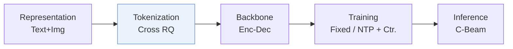
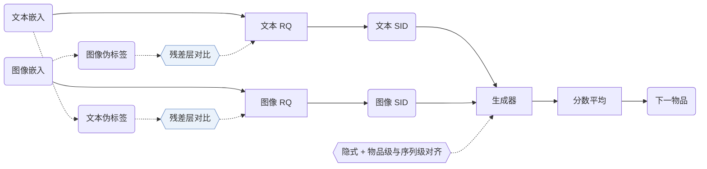
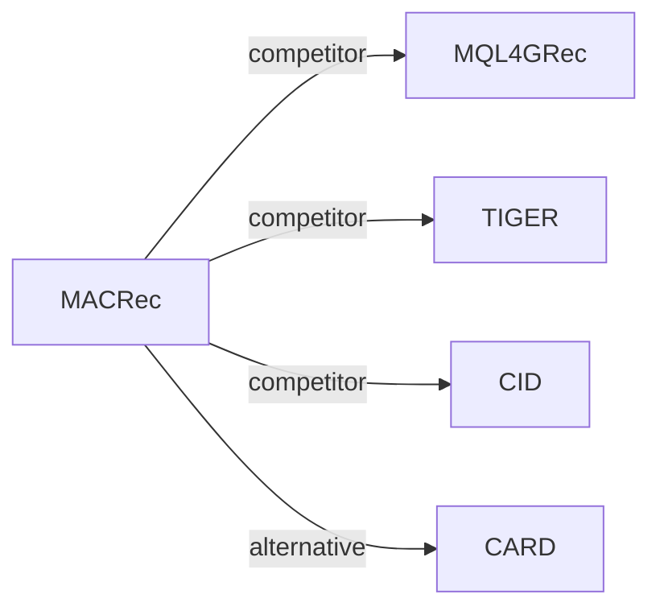

# MACRec

| **题目** | *Multi-aspect cross-modal quantization for generative recommendation* |
| :-- | :-- |
| **作者** | Zhang et al. |
| **会议** | AAAI’26 |
| **问题与阶段** | `I. 信息量` · `Tokenization` |
| **链接** | [论文](https://arxiv.org/abs/2511.15122) · [代码](https://github.com/zhangfw123/MACRec) · [矩阵](../../../README.zh.md#i--tokenization) · [English](../../papers/macrec.md) |
| **阅读级别** | 阅读笔记（第 2 级） |

本页目录：[TL;DR](#tldr) · [速览](#速览) · [1. 为什么重要](#1-为什么重要) · [2. 方法](#2-方法) · [3. 实验发现](#3-实验发现) · [4. 局限与分析](#4-局限与分析) · [5. 相关工作](#5-相关工作)

- `Enc-Dec`: Encoder-decoder.
- `Fixed`: SIDs are built first and not changed while the generator trains.
- `NTP + Ctr.`: NTP plus a contrastive loss.
- `C-Beam`: Constrained beam search.

### TL;DR

> [!NOTE]
> MACRec 对文本与图像特征做跨模态量化以构建低冲突 SID，并在生成器训练中加入隐式与显式跨模态对齐。

---

### 速览

| 维度 | 摘要 |
| :-- | :-- |
| 研究问题 | I. 信息量：Do the SIDs, or the model reading them, carry the collaborative and multimodal signals recommendation needs? |
| 核心贡献 | MACRec 对文本与图像特征做跨模态量化以构建低冲突 SID，并在生成器训练中加入隐式与显式跨模态对齐。 |
| 主要改动阶段 | Tokenization |
| 主要发现 | MACRec 在三个数据集上的 HR@10、NDCG@5 和 NDCG@10 都领先所有基线；在 Games 的 HR@5 上，MISSRec 为 0.0674，MACRec 为 0.0671（Table 2）。 |

---

### 1. 为什么重要

生成式推荐需要的语义 ID（Semantic ID，SID）要有层级、冲突少，还要便于训练生成器（Abstract）。早期的多模态生成式推荐对每个模态单独量化，文本和图像的 ID 互不参照。

> "However, existing multimodal GR models typically encode each modality separately to obtain semantic IDs for different modalities."（Related Work）（现有多模态 GR 模型通常对每个模态单独编码得到语义 ID。）

MACRec 在两处加入跨模态交互：量化器内部和生成器的训练任务（Methodology）。

---

### 2. 方法

#### 双模态伪标签

MACRec 分别按文本嵌入和图像嵌入给物品聚类。簇标签用来定义量化器中对比学习的正例对（Dual-modality Pseudo-label Generation）。

#### 跨模态量化

每个模态经过一个 MLP 和一个残差量化器。各残差层上的对比损失用的是另一个模态的标签（Cross-modal Quantization with Contrastive Learning）。

> "More concretely, we use visual pseudo-labels to enhance the residual representations of the text modality, and conversely, use textual pseudo-labels to optimize those of the visual modality."（Cross-modal Quantization with Contrastive Learning）（用视觉伪标签增强文本的残差表示，反过来用文本伪标签优化视觉的残差表示。）

重建损失和量化损失保证码能还原原始嵌入（Cross-modal Reconstruction Alignment）。

#### 多方面对齐

生成器的训练包括：各模态内的下一物品预测、两种 SID 表示的隐式对齐，以及跨模态的物品级和序列级显式任务（Generative Recommendation with Multi-aspect Alignment）。

> "For sequence-level alignment, we construct a prediction task where a historical sequence of textual semantic IDs is used to predict the visual semantic ID of the next recommended item."（Explicit Alignment with Different Generation Tasks）（序列级对齐：用历史的文本语义 ID 预测下一物品的视觉语义 ID。）

---

### 3. 实验发现

实验设置

- **数据集**：Amazon Product Reviews (May 1996-October 2018): Musical Instruments (17,112 users / 6,250 items), Arts Crafts and Sewing (22,171 / 9,416), Video Games (42,259 / 13,839), with text and image features. Filtering rules: not reported.
  - 出处：Datasets and date range: [Sx4.SSx1.p1](https://arxiv.org/html/2511.15122v2#Sx4.SSx1.p1); statistics: [Sx4.T1](https://arxiv.org/html/2511.15122v2#Sx4.T1).
- **切分**：Leave-one-out (following P5 and Hua et al. 2023); the exact validation/test allocation is not reported beyond the label.
  - 出处：Leave-one-out named only: [Sx4.SSx1.p3](https://arxiv.org/html/2511.15122v2#Sx4.SSx1.p3).
- **候选集**：full catalog (full ranking across the entire item collection rather than sampling).
  - 出处：Full ranking across the entire collection: [Sx4.SSx1.p3](https://arxiv.org/html/2511.15122v2#Sx4.SSx1.p3).
- **可见性**：warm; no unseen-item protocol is defined.
  - 出处：Standard split with no unseen-item protocol: [Sx4.SSx1.p3](https://arxiv.org/html/2511.15122v2#Sx4.SSx1.p3).
- **SID 规格**：Separate text (LLaMA) and image (ViT-L/14) semantic IDs from RQ-VAEs with 4 levels x 256 codewords, aligned by layer-wise cross-modal contrastive and alignment losses. Conflicting IDs are resolved as in MQL4GRec by reassigning codewords according to item-codebook distances. Pre-resolution collision rates, e.g. Instruments text 2.38% and image 3.23%.
  - 出处：Per-modality RQ-VAE, 4 levels x 256, conflict reassignment following MQL4GRec: [Sx4.SSx1.p4](https://arxiv.org/html/2511.15122v2#Sx4.SSx1.p4), [Sx3.SSx1.SSSx2.p2](https://arxiv.org/html/2511.15122v2#Sx3.SSx1.SSSx2.p2), [Sx3.SSx1.SSSx3.p5](https://arxiv.org/html/2511.15122v2#Sx3.SSx1.SSSx3.p5); collision rates: [Sx4.T4](https://arxiv.org/html/2511.15122v2#Sx4.T4).
- **推理预算**：Constrained beam search generates candidates in each modality, and the two modalities' scores are averaged; beam width not reported. T5 backbone with 4-layer encoder and decoder. Hardware, inference batch size, and latency: not reported.
  - 出处：Constrained beam search per modality and score averaging: [Sx3.SSx2.SSSx3.p3](https://arxiv.org/html/2511.15122v2#Sx3.SSx2.SSSx3.p3); T5 backbone: [Sx4.SSx1.p4](https://arxiv.org/html/2511.15122v2#Sx4.SSx1.p4).
- **结果来源**：Table 2 (Instruments, Arts, Games; MQL4GRec run without its extra-category pre-training); Table 3 (ablations); Table 4 (item collision rates); Figures 3-4 (hyperparameters and code assignment).
  - 出处：Main: [Sx4.T2](https://arxiv.org/html/2511.15122v2#Sx4.T2); ablation: [Sx4.T3](https://arxiv.org/html/2511.15122v2#Sx4.T3); collisions: [Sx4.T4](https://arxiv.org/html/2511.15122v2#Sx4.T4); code distribution: [Sx4.F4](https://arxiv.org/html/2511.15122v2#Sx4.F4); hyperparameters: [Sx4.F3](https://arxiv.org/html/2511.15122v2#Sx4.F3).

- 消融：去掉任何一个模块，三个数据集上的 HR@10 都下降（Table 3）。
- 冲突：MACRec 的物品 ID 冲突率低于 MQL4GRec（Table 4）。

---

### 4. 局限与分析

**Our analysis.**

- MQL4GRec 也分别构建文本 SID 和图像 SID（`Dual RQ`）；MACRec 改为 `Cross RQ`，并在生成器目标里加了对比项（`NTP + Ctr.`）。
- 表示只用文本和图像（`Text+Img`）。CARD 加入协同信号（`Text+Img+CF`），用 `NU-RQ` 量化合并后的单一输入。

---

### 5. 相关工作

- **同期对比** · [MQL4GRec](mql4grec.md): MQL4GRec quantizes each modality into its own SIDs with cross-modal translation; MACRec adds layer-wise cross-modal contrastive learning in quantization and implicit and explicit alignment in generation, and reuses MQL4GRec's conflict resolution and ensemble.
  - 出处：MACRec v2, baselines without pre-training: https://arxiv.org/html/2511.15122v2#Sx4.SSx1.p2 and https://arxiv.org/html/2511.15122v2#Sx4.SSx1.p4; Table 2 and Table 4: https://arxiv.org/html/2511.15122v2#Sx4.T2 and https://arxiv.org/html/2511.15122v2#Sx4.T4; reused conflict resolution: https://arxiv.org/html/2511.15122v2#Sx3.SSx1.SSSx3.p5.
- **同期对比** · [TIGER](tiger.md): TIGER quantizes a single text embedding; MACRec quantizes text and image separately and aligns them, while keeping TIGER's T5 backbone and constrained beam search.
  - 出处：MACRec v2, baselines and backbone: https://arxiv.org/html/2511.15122v2#Sx4.SSx1.p2 and https://arxiv.org/html/2511.15122v2#Sx4.SSx1.p4; Table 2: https://arxiv.org/html/2511.15122v2#Sx4.T2.
- **同期对比** · [CID](cid.md): P5-CID uses collaborative clustering IDs for a P5 model; MACRec builds multimodal semantic IDs.
  - 出处：MACRec v2, Table 2 baseline P5-CID: https://arxiv.org/html/2511.15122v2#Sx4.T2.
- **替代方案** · [CARD](card.md): CARD later renders image, title, and neighbors into one visual card and quantizes it with a non-uniform RQ-VAE, comparing against MACRec.
  - 出处：Evidence is from the later CARD paper: baselines and Table 2: https://arxiv.org/html/2604.26427v1#S4.I1.i9.p1 and https://arxiv.org/html/2604.26427v1#S4.T2.

[查看同格全部论文](../../../README.zh.md#i--tokenization)
