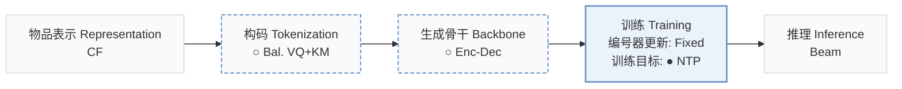
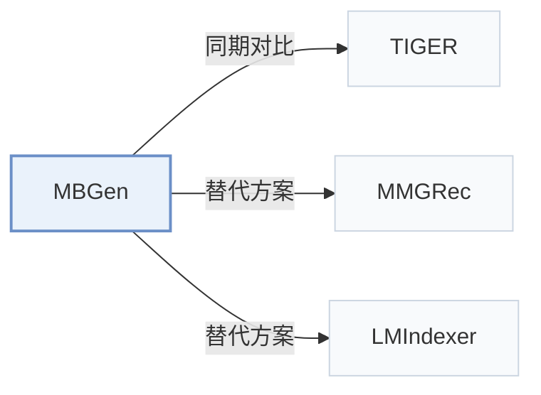

# MBGen

[← 问题 × 阶段矩阵](../../../README.zh.md#i--training) · [按阶段索引](../index/stages.md) · [按模态找论文](../index/modality.md) · [按领域找论文](../index/domain.md) · [English](../../papers/mbgen.md) | 中文

| **题目** | *Multi-Behavior Generative Recommendation* |
| :-- | :-- |
| **作者** | Liu et al. |
| **发表** | CIKM’24 |
| **问题与阶段** | `I. 信息量` · `训练（Training）` |
| **改动** | ○ 构码 · ○ 生成骨干 · ● 训练目标 |
| **构码输入** | `CF` |
| **领域** | `电商` |
| **应用场景** | `一般物品推荐`；`公开数据` |
| **链接** | [论文](https://arxiv.org/abs/2405.16871) · [代码](https://github.com/anananan116/MBGen) |
| **阅读级别** | 概览（第 1 级） |

**本页目录**：[TL;DR](#tldr) · [3. 实验发现](#3-实验发现) · [5. 相关工作](#5-相关工作)

- `CF`：纯协同过滤交互信号。
- `Bal. VQ+KM`：结合向量量化与均衡 k-means 聚类的编号方法。
- `Enc-Dec`：编码器-解码器（Encoder-decoder）架构。
- `Fixed`：先独立训练并冻结编号器，生成器训练期间 SID 保持不变。
- `NTP`：标准下一 token 预测（Next-Token Prediction）交叉熵损失；基于预训练 LLM 的指令微调（SFT）亦归入此类。
- `Beam`：在 SID token 上执行自回归束搜索（Beam search）。

### TL;DR

> [!NOTE]
> MBGen 在同一序列中交错排列行为 token 与物品 token，先预测下一行为类型再预测下一物品，并用按位置路由的稀疏架构扩展规模。

---

### 3. 实验发现

实验设置

- **数据集**：Retail (Taobao/Tmall) and IJCAI; purchase/cart/favorite/click behaviors, with purchase as target. Remove items occurring fewer than five times in training sequences; maximum history 50 items.
  - 出处：[S4.SS1.SSS1.p2](https://arxiv.org/html/2405.16871v1#S4.SS1.SSS1.p2) ; #S4.SS1.SSS1.p3 ; #S4.SS1.SSS1.p4 ; #S4.SS1.SSS3.p1
- **切分**：Per-user leave-one-out: latest interaction test, penultimate validation; remaining interactions training.
  - 出处：[S4.SS1.SSS3.p1](https://arxiv.org/html/2405.16871v1#S4.SS1.SSS3.p1)
- **候选集**：full catalog; target ranked against all other items rather than sampled negatives.
  - 出处：[S4.SS1.SSS3.p1](https://arxiv.org/html/2405.16871v1#S4.SS1.SSS3.p1)
- **可见性**：warm; retained items have at least five training occurrences. SID features come from pretrained MB-STR embeddings; pretraining exposure to test interactions not reported.
  - 出处：[S4.SS1.SSS1.p4](https://arxiv.org/html/2405.16871v1#S4.SS1.SSS1.p4) ; #S4.SS1.SSS4.p2
- **SID 规格**：Three item tokens with per-position size K=64 Retail/96 IJCAI. Balanced SID: K-entry VQ codebook, K-cluster residual K-means per first-token bucket, then random collision-disambiguation token. Balanced CID: random item-number remapping and base-K digits, without features. Behavior token precedes each item.
  - 出处：[S3.SS2.p3](https://arxiv.org/html/2405.16871v1#S3.SS2.p3) ; #S3.SS2.p4 ; #S3.SS2.p5 ; #S4.SS1.SSS4.p2
- **推理预算**：Beam 50; top-10 outputs; Recall/NDCG@5/10. Hardware, inference batch size and latency not reported.
  - 出处：[S4.SS1.SSS3.p1](https://arxiv.org/html/2405.16871v1#S4.SS1.SSS3.p1) ; #S4.SS1.SSS4
- **结果来源**：Original Tables 3/4/5: target-behavior, behavior-specific, joint behavior-item prediction. Most baselines reproduced in RecBole; MB-GMN excepted, with result provenance not specified. Table 6: ablations; Table 7: token distribution.
  - 出处：[S4.T3](https://arxiv.org/html/2405.16871v1#S4.T3) ; #S4.T4 ; #S4.T5 ; #S4.T6 ; #S4.T7 ; #S4.SS1.SSS4.p1

---

### 5. 相关工作

- **同期对比** · [TIGER](tiger.md): TIGER is a reproduced generative baseline; MBGen balances item tokens and jointly predicts behavior types and items.
  - 出处：MBGen v1, Sections 3.2/4.1.2 and Table 3: [S3.SS2.p1](https://arxiv.org/html/2405.16871v1#S3.SS2.p1); [S4.SS1.SSS2.p2](https://arxiv.org/html/2405.16871v1#S4.SS1.SSS2.p2); [S4.T3](https://arxiv.org/html/2405.16871v1#S4.T3).
- **替代方案** · [MMGRec](mmgrec.md): MBGen cites MMGRec among RQ-VAE tokenizers whose code imbalance motivates its bucket-specific residual quantization.
  - 出处：MBGen v1, Section 3.2, citing Liu et al. (2024): [S3.SS2.p1](https://arxiv.org/html/2405.16871v1#S3.SS2.p1); [S3.SS2.p2](https://arxiv.org/html/2405.16871v1#S3.SS2.p2).
- **替代方案** · [LMIndexer](lmindexer.md): LMIndexer learns language-model semantic indices; MBGen instead uses pretrained collaborative embeddings for balanced item tokens.
  - 出处：MBGen v1, Sections 2/4.1.4, citing Jin et al. (2023): [S2.p2](https://arxiv.org/html/2405.16871v1#S2.p2); [S4.SS1.SSS4.p2](https://arxiv.org/html/2405.16871v1#S4.SS1.SSS4.p2).

[查看同格全部论文](../../../README.zh.md#i--training)
