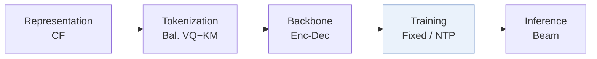
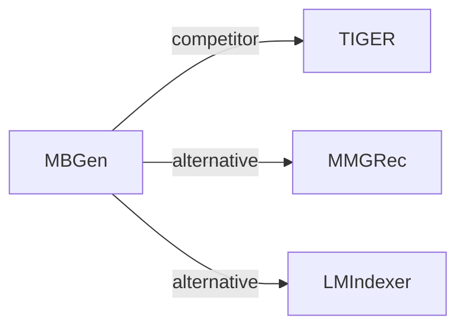

# MBGen

*Multi-Behavior Generative Recommendation* — Liu et al. · CIKM’24

`I. 信息量` · `Training` · [论文](https://arxiv.org/abs/2405.16871) · [代码](https://github.com/anananan116/MBGen) · [矩阵](../../../README.zh.md#i--training) · [English](../../papers/mbgen.md)

阅读级别：概览（第 1 级） · 本页目录：[TL;DR](#tldr) · [速览](#速览) · [3. 实验发现](#3-实验发现) · [5. 相关工作](#5-相关工作)

- `CF`: Collaborative filtering signal.
- `Bal. VQ+KM`: Balanced tokenization combining vector quantization and k-means clustering.
- `Enc-Dec`: Encoder-decoder.
- `Fixed`: SIDs are built first and not changed while the generator trains.
- `NTP`: Next-token prediction loss only; continuing from a pretrained LLM (SFT) also counts as NTP.

### TL;DR

> [!NOTE]
> MBGen 在同一序列中交错排列行为 token 与物品 token，先预测下一行为类型再预测下一物品，并用按位置路由的稀疏架构扩展规模。

### 速览

| 维度 | 摘要 |
| :-- | :-- |
| 研究问题 | I. 信息量：Do the SIDs, or the model reading them, carry the collaborative and multimodal signals recommendation needs? |
| 核心贡献 | MBGen 在同一序列中交错排列行为 token 与物品 token，先预测下一行为类型再预测下一物品，并用按位置路由的稀疏架构扩展规模。 |
| 主要改动阶段 | Training |

### 3. 实验发现

实验设置

- **数据集**：Retail (Taobao/Tmall) and IJCAI; purchase/cart/favorite/click behaviors, with purchase as target. Remove items occurring fewer than five times in training sequences; maximum history 50 items.
  - 出处：[S4.SS1.SSS1.p2](https://arxiv.org/html/2405.16871v1#S4.SS1.SSS1.p2) ; #S4.SS1.SSS1.p3 ; #S4.SS1.SSS1.p4 ; #S4.SS1.SSS3.p1
- **切分**：Per-user leave-one-out: latest interaction test, penultimate validation; remaining interactions training.
  - 出处：[S4.SS1.SSS3.p1](https://arxiv.org/html/2405.16871v1#S4.SS1.SSS3.p1)
- **候选集**：full catalog; target ranked against all other items rather than sampled negatives.
  - 出处：[S4.SS1.SSS3.p1](https://arxiv.org/html/2405.16871v1#S4.SS1.SSS3.p1)
- **可见性**：warm; retained items have at least five training occurrences. SID features come from pretrained MB-STR embeddings; pretraining exposure to test interactions not reported.
  - 出处：[S4.SS1.SSS1.p4](https://arxiv.org/html/2405.16871v1#S4.SS1.SSS1.p4) ; #S4.SS1.SSS4.p2
- **SID 规格**：Three item tokens with per-position size K=64 Retail/96 IJCAI. Balanced SID: K-entry VQ codebook, K-cluster residual K-means per first-token bucket, then random collision-disambiguation token. Balanced CID: random item-number remapping and base-K digits, without features. Behavior token precedes each item.
  - 出处：[S3.SS2.p3](https://arxiv.org/html/2405.16871v1#S3.SS2.p3) ; #S3.SS2.p4 ; #S3.SS2.p5 ; #S4.SS1.SSS4.p2
- **推理预算**：Beam 50; top-10 outputs; Recall/NDCG@5/10. Hardware, inference batch size and latency not reported.
  - 出处：[S4.SS1.SSS3.p1](https://arxiv.org/html/2405.16871v1#S4.SS1.SSS3.p1) ; #S4.SS1.SSS4
- **结果来源**：Original Tables 3/4/5: target-behavior, behavior-specific, joint behavior-item prediction. Most baselines reproduced in RecBole; MB-GMN excepted, with result provenance not specified. Table 6: ablations; Table 7: token distribution.
  - 出处：[S4.T3](https://arxiv.org/html/2405.16871v1#S4.T3) ; #S4.T4 ; #S4.T5 ; #S4.T6 ; #S4.T7 ; #S4.SS1.SSS4.p1

### 5. 相关工作

- **同期对比** · [TIGER](tiger.md): TIGER is a reproduced generative baseline; MBGen balances item tokens and jointly predicts behavior types and items.
  - 出处：MBGen v1, Sections 3.2/4.1.2 and Table 3: https://arxiv.org/html/2405.16871v1#S3.SS2.p1; https://arxiv.org/html/2405.16871v1#S4.SS1.SSS2.p2; https://arxiv.org/html/2405.16871v1#S4.T3.
- **替代方案** · [MMGRec](mmgrec.md): MBGen cites MMGRec among RQ-VAE tokenizers whose code imbalance motivates its bucket-specific residual quantization.
  - 出处：MBGen v1, Section 3.2, citing Liu et al. (2024): https://arxiv.org/html/2405.16871v1#S3.SS2.p1; https://arxiv.org/html/2405.16871v1#S3.SS2.p2.
- **替代方案** · [LMIndexer](lmindexer.md): LMIndexer learns language-model semantic indices; MBGen instead uses pretrained collaborative embeddings for balanced item tokens.
  - 出处：MBGen v1, Sections 2/4.1.4, citing Jin et al. (2023): https://arxiv.org/html/2405.16871v1#S2.p2; https://arxiv.org/html/2405.16871v1#S4.SS1.SSS4.p2.

[查看同格全部论文](../../../README.zh.md#i--training)
