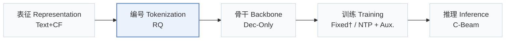
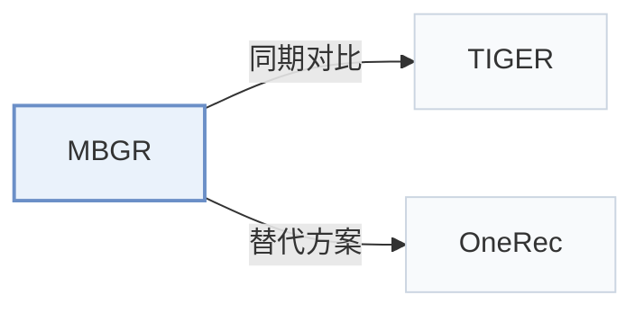

# MBGR

[← 问题 × 阶段矩阵](../../../README.zh.md#vi--tokenization) · [按阶段索引](../index/stages.md) · [按模态索引](../index/modality.md) · [English](../../papers/mbgr.md) | 中文

| **题目** | *Multi-Business Prediction for Generative Recommendation at Meituan* |
| :-- | :-- |
| **作者** | Li et al. |
| **发表** | arXiv’26 |
| **问题与阶段** | `VI. 泛化` · `编号（Tokenization）` |
| **链接** | [论文](https://arxiv.org/abs/2604.02684) |
| **阅读级别** | 概览（第 1 级） |

**本页目录**：[TL;DR](#tldr) · [速览](#速览) · [3. 实验发现](#3-实验发现) · [5. 相关工作](#5-相关工作)

- `Text+CF`：文本表征结合协同过滤信号。
- `RQ`：残差向量量化（Residual Quantization）。
- `Dec-Only`：仅解码器（Decoder-only）自回归架构。
- `Fixed†`：生成器训练期间冻结编号器（由配置推断）。
- `NTP + Aux.`：下一 token 预测结合辅助正则或对齐损失。
- `C-Beam`：受合法物品集合约束的束搜索（Constrained beam search）。

### TL;DR

> [!NOTE]
> MBGR 在生成式推荐中加入业务感知 SID、业务特定预测与动态标签路由，避免共享同一 ID 空间的多个业务之间出现跷跷板效应。

---

### 速览

| 维度 | 摘要 |
| :-- | :-- |
| 研究问题 | VI. 泛化：面对冷启动新物品、跨领域迁移与动态兴趣漂移时能否保持泛化？ |
| 核心贡献 | MBGR 在生成式推荐中加入业务感知 SID、业务特定预测与动态标签路由，避免共享同一 ID 空间的多个业务之间出现跷跷板效应。 |
| 主要改动阶段 | 编号（Tokenization） |

---

### 3. 实验发现

实验设置

- **数据集**：Meituan only. Generative training data: one year of click sequences from 38,258,649 users over 54,875,570 merchants in four businesses (A 61.47%, B 9.56%, C 12.31%, D 16.66%). Downstream data: 37,349,276 users and 783,946,360 interactions over a rolling 30-day window. Filtering rules: not reported.
  - 出处：Datasets: [S6.SS1.SSS1.p2](https://arxiv.org/html/2604.02684v1#S6.SS1.SSS1.p2), [S6.I1.i1.p1](https://arxiv.org/html/2604.02684v1#S6.I1.i1.p1), [S6.I1.i2.p1](https://arxiv.org/html/2604.02684v1#S6.I1.i2.p1), [S6.I2.i1.p1](https://arxiv.org/html/2604.02684v1#S6.I2.i1.p1), [S6.I2.i2.p1](https://arxiv.org/html/2604.02684v1#S6.I2.i2.p1).
- **切分**：Offline: not reported (the paper mentions a validation set for hyperparameter search but not how train, validation, and test are formed). Online: one-week A/B test with 30% of Meituan production traffic against the baseline without MBP; CTCVR +3.98%.
  - 出处：No offline split rule stated; validation used for grid search: [S6.SS1.SSS4.p1](https://arxiv.org/html/2604.02684v1#S6.SS1.SSS4.p1); online test: [S6.SS6.p4](https://arxiv.org/html/2604.02684v1#S6.SS6.p4) and [S1.I1.i3.p1](https://arxiv.org/html/2604.02684v1#S1.I1.i3.p1).
- **候选集**：not reported (full catalog versus sampled candidates for HR@10); downstream ranking uses business-wise GAUC.
  - 出处：Metrics only: [S6.SS1.SSS3.p2](https://arxiv.org/html/2604.02684v1#S6.SS1.SSS3.p2) and [S6.SS1.SSS3.p3](https://arxiv.org/html/2604.02684v1#S6.SS1.SSS3.p3).
- **可见性**：warm; no unseen-item protocol is defined.
  - 出处：No unseen-item protocol: [S6.SS1.SSS1.p1](https://arxiv.org/html/2604.02684v1#S6.SS1.SSS1.p1).
- **SID 规格**：Business-aware semantic IDs: each item's K token embeddings are re-encoded with its business type through a gated encoder and decoded per business; number of SID levels, codebook sizes, and collision handling: not reported.
  - 出处：Business-aware encoder/decoder over K input tokens: [S4.SS1.p3](https://arxiv.org/html/2604.02684v1#S4.SS1.p3) and [S4.SS1.p6](https://arxiv.org/html/2604.02684v1#S4.SS1.p6); no codebook settings found.
- **推理预算**：Decoding method and beam width: not reported. 16-layer Transformer (8 heads, 128-dimensional embeddings), sequences up to 1,500 items; trained and deployed on NVIDIA A100-80GB GPUs; inference batch size and latency: not reported.
  - 出处：Hardware and architecture: [S6.SS1.SSS4.p1](https://arxiv.org/html/2604.02684v1#S6.SS1.SSS4.p1) and [S6.SS1.SSS4.p2](https://arxiv.org/html/2604.02684v1#S6.SS1.SSS4.p2).
- **结果来源**：Table 1 (HR@10 per business versus SASRec, TIGER, HSTU); Table 2 (downstream CTCVR GAUC); Table 3 (ablations); Tables 4-7 (time decay, business weights, expert count).
  - 出处：Generative: [S6.T1](https://arxiv.org/html/2604.02684v1#S6.T1); downstream: [S6.T2](https://arxiv.org/html/2604.02684v1#S6.T2); ablation: [S6.T3](https://arxiv.org/html/2604.02684v1#S6.T3); hyperparameters: [S6.T4](https://arxiv.org/html/2604.02684v1#S6.T4), [S6.T6](https://arxiv.org/html/2604.02684v1#S6.T6), [S6.T7](https://arxiv.org/html/2604.02684v1#S6.T7).

---

### 5. 相关工作

- **同期对比** · [TIGER](tiger.md): TIGER generates one shared semantic ID space for all items; MBGR makes SIDs business-aware and predicts the next item for each business in parallel.
  - 出处：MBGR v1, Table 1 baseline Tiger: [S6.T1](https://arxiv.org/html/2604.02684v1#S6.T1); related work: [S2.SS1.p1](https://arxiv.org/html/2604.02684v1#S2.SS1.p1).
- **替代方案** · [OneRec](onerec.md): OneRec unifies the whole pipeline in one end-to-end model; MBGR keeps the industrial cascade and adds multi-business generation for recall.
  - 出处：MBGR v1, Section 6.6 contrasts with OneRec: [S6.SS6.p2](https://arxiv.org/html/2604.02684v1#S6.SS6.p2); related work: [S2.SS1.p1](https://arxiv.org/html/2604.02684v1#S2.SS1.p1).

[查看同格全部论文](../../../README.zh.md#vi--tokenization)
