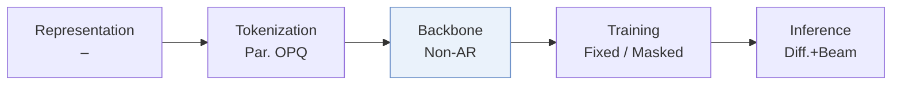
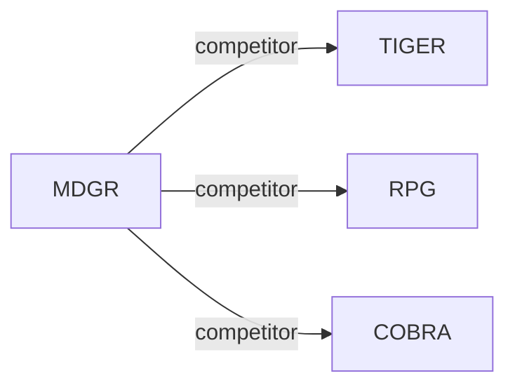

# MDGR

| **题目** | *Masked Diffusion Generative Recommendation* |
| :-- | :-- |
| **作者** | Mu et al. |
| **会议** | arXiv’26 |
| **问题与阶段** | `III. SID 与模型对齐` · `Backbone` |
| **链接** | [论文](https://arxiv.org/abs/2601.19501) · [矩阵](../../../README.zh.md#iii--backbone) · [English](../../papers/mdgr.md) |
| **阅读级别** | 概览（第 1 级） |

本页目录：[TL;DR](#tldr) · [速览](#速览) · [3. 实验发现](#3-实验发现) · [5. 相关工作](#5-相关工作)

- `–`: Not reported in the paper.
- `Non-AR`: Non-autoregressive.
- `Fixed`: SIDs are built first and not changed while the generator trains.
- `Masked`: Masks part of the codes and reconstructs them (includes masked diffusion).
- `Diff.+Beam`: Diffusion-based decoding combined with beam search.

### TL;DR

> [!NOTE]
> MDGR 采用并行码本、沿时间步与样本自适应的掩码策略以及预热两阶段并行解码做掩码扩散推荐，替代固定顺序的自回归 SID 解码。

---

### 速览

| 维度 | 摘要 |
| :-- | :-- |
| 研究问题 | III. SID 与模型对齐：Can the generator read, write, and reason over SIDs, and do the tokenizer and generator work toward the same goal? |
| 核心贡献 | MDGR 采用并行码本、沿时间步与样本自适应的掩码策略以及预热两阶段并行解码做掩码扩散推荐，替代固定顺序的自回归 SID 解码。 |
| 主要改动阶段 | Backbone |

---

### 3. 实验发现

实验设置

- **数据集**：Amazon Electronics/Books: remove users with fewer than five interactions, maximum history 20. Industrial Southeast Asian e-commerce logs: May-December 2025, >1B interactions, 18M users, 25M items, mean history 128; industrial filtering not reported.
  - 出处：[S5.SS1.SSS1.p1](https://arxiv.org/html/2601.19501v1#S5.SS1.SSS1.p1)
- **切分**：Sliding-window next-item training; chronological leave-one-out: latest interaction test, penultimate validation, remainder training. Online A/B: January 5-12, 2026, control/treatment each 20% uniformly sampled users.
  - 出处：[S5.SS1.SSS1.p1](https://arxiv.org/html/2601.19501v1#S5.SS1.SSS1.p1) ; #S5.SS6.p1
- **候选集**：not reported
  - 出处：Section 5.1 gives metrics but no evaluation universe or negative-sampling protocol: [S5.SS1](https://arxiv.org/html/2601.19501v1#S5.SS1)
- **可见性**：warm; no unseen-item protocol is defined. Tokenizer fitting exposure to test items not reported.
  - 出处：[S5.SS1.SSS1.p1](https://arxiv.org/html/2601.19501v1#S5.SS1.SSS1.p1) ; #S5.SS1.SSS3.p1
- **SID 规格**：OPQ-based parallel codebooks: 8 x 300, 256-dimensional code vectors, using Qwen3-8B content embeddings. Complete SIDs map to item sets through an offline index; collision disambiguation not reported.
  - 出处：[S4.SS2](https://arxiv.org/html/2601.19501v1#S4.SS2) ; #S5.SS1.SSS3.p1
- **推理预算**：Beam 50; four single-position warm-up steps, then two positions/step. Table 3 reports six total steps and 2.527 QPS versus 2.212 for eight serial steps; implementation text inconsistently says four subsequent parallel steps. Recall/NDCG@5/10; inference-specific hardware, batch size and latency not reported.
  - 出处：[S5.SS1.SSS3.p1](https://arxiv.org/html/2601.19501v1#S5.SS1.SSS3.p1) ; #S5.T3 ; #S5.SS3.SSS2.p2
- **结果来源**：Original Table 2: offline three-dataset comparison; baseline-result reuse not stated. Table 3: industrial efficiency; Table 4: industrial ablations; Section 5.6: online A/B against production TIGER.
  - 出处：[S4.T2](https://arxiv.org/html/2601.19501v1#S4.T2) ; #S5.T3 ; #S5.T4 ; #S5.SS6.p1

---

### 5. 相关工作

- **同期对比** · [TIGER](tiger.md): TIGER generates residual-quantized IDs autoregressively; MDGR denoises parallel-codebook IDs and is also tested against production TIGER online.
  - 出处：MDGR v1, Sections 5.1.2/5.6 and Table 2: https://arxiv.org/html/2601.19501v1#S5.SS1.SSS2.p1; https://arxiv.org/html/2601.19501v1#S5.SS6.p1; https://arxiv.org/html/2601.19501v1#S4.T2.
- **同期对比** · [RPG](rpg.md): RPG uses multi-token prediction and graph-constrained parallel decoding; MDGR uses masked denoising with confidence-guided position scheduling.
  - 出处：MDGR v1, Sections 4.4/5.1.2 and Table 2: https://arxiv.org/html/2601.19501v1#S4.SS4; https://arxiv.org/html/2601.19501v1#S5.SS1.SSS2.p1; https://arxiv.org/html/2601.19501v1#S4.T2.
- **同期对比** · [COBRA](cobra.md): COBRA supplements sparse IDs with dense vectors; MDGR instead changes discrete-ID supervision and decoding through masked diffusion.
  - 出处：MDGR v1, Sections 2.1/5.1.2 and Table 2: https://arxiv.org/html/2601.19501v1#S2.SS1.p1; https://arxiv.org/html/2601.19501v1#S5.SS1.SSS2.p1; https://arxiv.org/html/2601.19501v1#S4.T2.

[查看同格全部论文](../../../README.zh.md#iii--backbone)
