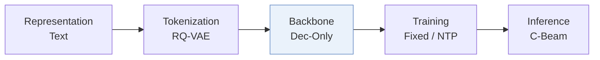
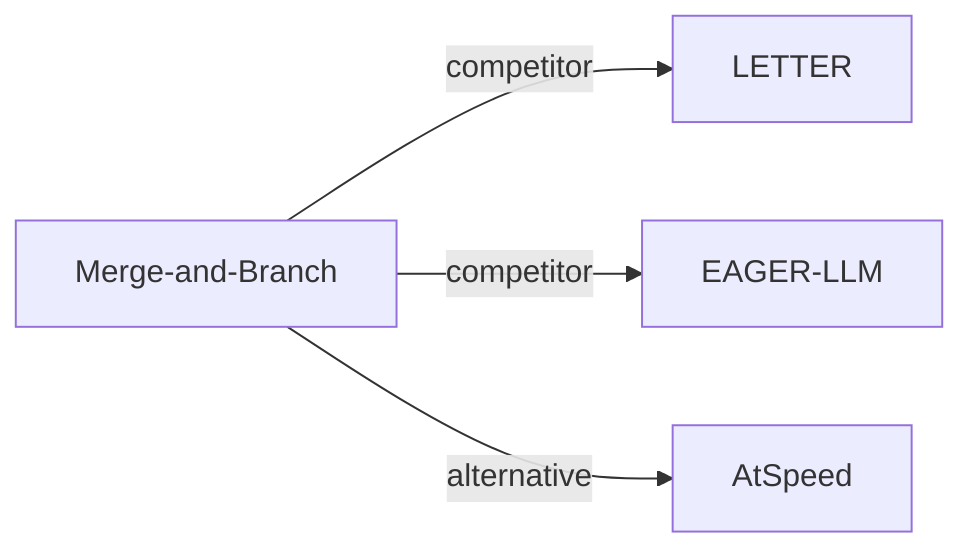

# Merge-and-Branch

| **题目** | *Merge and Branch: Efficient Tree-Structured Supervised Fine-Tuning of LLMs for Recommendation* |
| :-- | :-- |
| **作者** | Zhu et al. |
| **会议** | arXiv’26 |
| **问题与阶段** | `V. 效率` · `Backbone` |
| **链接** | [论文](https://arxiv.org/abs/2610.37973) · [矩阵](../../../README.zh.md#v--backbone) · [English](../../papers/merge-and-branch.md) |
| **阅读级别** | 概览（第 1 级） |

本页目录：[TL;DR](#tldr) · [速览](#速览) · [3. 实验发现](#3-实验发现) · [5. 相关工作](#5-相关工作)

- `Dec-Only`: Decoder-only.
- `Fixed`: SIDs are built first and not changed while the generator trains.
- `NTP`: Next-token prediction loss only; continuing from a pretrained LLM (SFT) also counts as NTP.
- `C-Beam`: Constrained beam search.

### TL;DR

> [!NOTE]
> Merge-and-Branch 将每个历史物品的 SID 与文本压缩为少量可学习 token，并以树状布局从共享历史同时预测多个目标 ID，降低微调开销。

---

### 速览

| 维度 | 摘要 |
| :-- | :-- |
| 研究问题 | V. 效率：Can it be trained and served within latency and cost budgets? |
| 核心贡献 | Merge-and-Branch 将每个历史物品的 SID 与文本压缩为少量可学习 token，并以树状布局从共享历史同时预测多个目标 ID，降低微调开销。 |
| 主要改动阶段 | Backbone |

---

### 3. 实验发现

实验设置

- **数据集**：Amazon 2014 5-core Beauty, Sports and Outdoors, Toys and Games.
  - 出处：Section 4.1 Datasets: [S4.SS1.SSS0.Px1.p1](https://arxiv.org/html/2610.37973v1#S4.SS1.SSS0.Px1.p1)
- **切分**：Per-user chronological last/penultimate interactions test/validation; earlier interactions training. Main M&B result selects the best of five seeds by validation NDCG@10.
  - 出处：Section 4.1 Metrics and protocol: [S4.SS1.SSS0.Px2.p1](https://arxiv.org/html/2610.37973v1#S4.SS1.SSS0.Px2.p1)
- **候选集**：full catalog; invalid or unresolved predictions count as misses.
  - 出处：Section 4.1 Metrics and protocol: [S4.SS1.SSS0.Px2.p1](https://arxiv.org/html/2610.37973v1#S4.SS1.SSS0.Px2.p1)
- **可见性**：warm; no unseen-item protocol is defined. Held-out items do not fill missing future branches; tokenizer/CF-teacher item exposure: not reported.
  - 出处：Section 4.4 and Appendix B.2: [S4.SS4.SSS0.Px1.p3](https://arxiv.org/html/2610.37973v1#S4.SS4.SSS0.Px1.p3) and [A2.SS2.p1](https://arxiv.org/html/2610.37973v1#A2.SS2.p1)
- **SID 规格**：Sentence-T5-XXL plus 3-level RQ-VAE, 256 codes/level, deterministic collision suffix: four-token SID.
  - 出处：Appendix B.2: [A2.SS2.p1](https://arxiv.org/html/2610.37973v1#A2.SS2.p1)
- **推理预算**：Main: beam 50, Recall/NDCG@5/10; inference batch/hardware not reported. Efficiency: H200, batch 1, beam 100, synthetic contexts 64-2048, four merged tokens/item; Tree latency 76.33-83.85 ms/request including prefill/search.
  - 出处：Section 4.1, Appendix B.3 and Table 4: [S4.SS1.SSS0.Px3.p1](https://arxiv.org/html/2610.37973v1#S4.SS1.SSS0.Px3.p1) and [A2.SS3.p2](https://arxiv.org/html/2610.37973v1#A2.SS3.p2) and [S4.T4](https://arxiv.org/html/2610.37973v1#S4.T4)
- **结果来源**：Table 3 mixes authors' runs with original-paper scores (TIGER, LETTER-Beauty, EAGER, EAGER-LLM-Beauty/Sports, GRAM) and GRAM reproductions (P5-CID, LC-Rec). M&B and Table 4 decoding measurements are this paper's experiments.
  - 出处：Table 3, Table 4 and Appendix B.1: [S4.T3](https://arxiv.org/html/2610.37973v1#S4.T3) and [S4.T4](https://arxiv.org/html/2610.37973v1#S4.T4) and [A2.SS1.p1](https://arxiv.org/html/2610.37973v1#A2.SS1.p1)

---

### 5. 相关工作

- **同期对比** · [LETTER](letter.md): LETTER-TIGER is reproduced on Sports/Toys; its Beauty score comes from the original paper.
  - 出处：M&B v1, Appendix B.1: https://arxiv.org/html/2610.37973v1#A2.SS1.p1; https://arxiv.org/html/2610.37973v1#A2.SS1.p2.
- **同期对比** · [EAGER-LLM](eager-llm.md): EAGER-LLM is rerun on Toys; Beauty/Sports scores come from its original paper.
  - 出处：M&B v1, Appendix B.1: https://arxiv.org/html/2610.37973v1#A2.SS1.p1.
- **替代方案** · [AtSpeed](atspeed.md): AtSpeed uses tree masks for speculative beam verification; M&B shares history during training and decoding.
  - 出处：M&B v1, Section 2 and Table 1: https://arxiv.org/html/2610.37973v1#S2.SS0.SSS0.Px3.p1; https://arxiv.org/html/2610.37973v1#S2.T1.

[查看同格全部论文](../../../README.zh.md#v--backbone)
