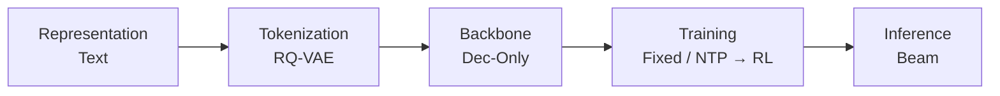
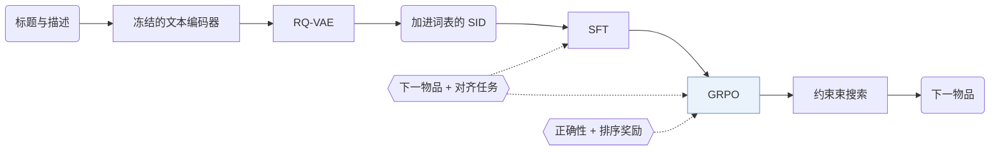
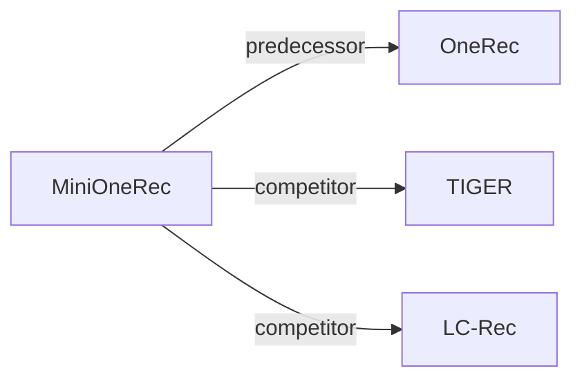

# MiniOneRec

| **题目** | *An Open-Source Framework for Scaling Generative Recommendation* |
| :-- | :-- |
| **作者** | Kong et al. |
| **会议** | arXiv’25 |
| **问题与阶段** | `范式、系统与基准` · `无单一阶段` |
| **链接** | [论文](https://arxiv.org/abs/2510.24431) · [代码](https://github.com/AkaliKong/MiniOneRec) · [矩阵](../../../README.zh.md#范式系统与基准) · [English](../../papers/minionerec.md) |
| **阅读级别** | 阅读笔记（第 2 级） |

本页目录：[TL;DR](#tldr) · [速览](#速览) · [1. 为什么重要](#1-为什么重要) · [2. 方法](#2-方法) · [3. 实验发现](#3-实验发现) · [4. 局限与分析](#4-局限与分析) · [5. 相关工作](#5-相关工作)

- `Dec-Only`: Decoder-only.
- `Fixed`: SIDs are built first and not changed while the generator trains.
- `NTP → RL`: NTP, then reinforcement learning (GRPO, GBPO, etc.).

### TL;DR

> [!NOTE]
> MiniOneRec 是覆盖 RQ-VAE SID 构建、Qwen 骨干监督微调与受约束解码强化学习的开源框架，用于在公开基准上检验生成式扩展规律。

---

### 速览

| 维度 | 摘要 |
| :-- | :-- |
| 研究问题 | 范式、系统与基准：Baseline (TIGER), end-to-end multi-stage paradigms, open-source frameworks, benchmarks, and diagnostic resources. |
| 核心贡献 | MiniOneRec 是覆盖 RQ-VAE SID 构建、Qwen 骨干监督微调与受约束解码强化学习的开源框架，用于在公开基准上检验生成式扩展规律。 |
| 主要改动阶段 | 无单一阶段 |
| 局限 | 扩展性实验只测了模型变大时的训练损失和评估损失，没有测排序指标（Sec. 5.2，Fig. 1）。 |

---

### 1. 为什么重要

用语义 ID（Semantic ID，SID）序列替代嵌入表的工业生成式推荐器大多不公开（Abstract）。作者想知道两件事：扩展定律在公开基准上是否成立；要达到有竞争力的效果，最少需要怎样的后训练流程。

> "Yet most industrial deployments remain proprietary, leaving two fundamental questions open: (1) Do the expected scaling laws hold on public benchmarks? (2) What is the minimal post-training recipe that enables competitive performance?"（Abstract）（工业部署大多不公开，留下两个问题：扩展定律在公开基准上是否成立；最小的后训练配方是什么。）

MiniOneRec 的回答是一个开源框架，覆盖 SID 构建、监督微调（SFT）和强化学习（RL），并公开代码、训练流程和检查点（Sec. 1）。

---

### 2. 方法

#### 物品编号

冻结的文本编码器嵌入物品标题和描述，RQ-VAE 把嵌入量化成层级 SID（Sec. 3.2）。

> "The codebooks, the encoder and the decoder are trained jointly, while the text encoder remains frozen."（Sec. 3.2）（码本、编码器、解码器联合训练，文本编码器冻结。）

#### 全流程 SID 对齐

SID token 加进 LLM 的词表。下一物品预测和辅助对齐任务（如标题与 SID 互相映射）在 SFT 和 RL 两个阶段都一起优化（Sec. 3.3，Sec. 6）。

#### 强化偏好优化

RL 阶段用 GRPO，以约束束搜索作采样器，生成的物品都合法（Sec. 3.4.1）。默认奖励把二元的正确性规则和惩罚困难负例的排序项结合起来（Sec. 3.4.2）。

> "The mixed reward discussed combines binary correctness with a soft ranking term, helping the LLM tell hard negatives apart."（Sec. 3.4.2）（混合奖励结合二元正确性和软排序项，帮 LLM 区分困难负例。）

---

### 3. 实验发现

实验设置

- **数据集**：Amazon Reviews 2023: Industrial and Scientific, Office Products. Trimming follows Bao et al. (2024): users and items with fewer than 5 interactions removed; events limited to October 1996-November 2018 for Industrial; histories truncated to at most 10 items. Retained sizes: in Appendix B (not restated here).
  - 出处：Datasets and trimming: [S5.SS1.p1](https://arxiv.org/html/2510.24431v1#S5.SS1.p1) and [A2.p1](https://arxiv.org/html/2510.24431v1#A2.p1).
- **切分**：Chronological 8:1:1 split into training, validation, and test. OOD study: train only on Industrial and evaluate on Office without tuning.
  - 出处：Chronological 8:1:1: [A2.p1](https://arxiv.org/html/2510.24431v1#A2.p1); OOD transfer: [S5.SS4.p1](https://arxiv.org/html/2510.24431v1#S5.SS4.p1).
- **候选集**：not reported explicitly (the policy predicts among all catalog candidates and returns the top-k beams; whether metrics are full-catalog is not stated).
  - 出处：Ranking among all catalog items via beam search: [S3.SS1.p2](https://arxiv.org/html/2510.24431v1#S3.SS1.p2).
- **可见性**：In-domain: warm; no unseen-item protocol is defined. OOD: Office items are unseen by the generator (trained only on Industrial); whether the RQ-VAE was fit on Office items: not reported.
  - 出处：In-domain chronological split; OOD on a never-seen domain: [S5.SS4.p1](https://arxiv.org/html/2510.24431v1#S5.SS4.p1) and [S5.SS4.p2](https://arxiv.org/html/2510.24431v1#S5.SS4.p2).
- **SID 规格**：3-level RQ-VAE x 256 codewords over Qwen3-Embedding-4B text embeddings; the three layers of 256 SID tokens are appended to the Qwen2.5-Instruct tokenizer vocabulary. Collision handling: not reported.
  - 出处：L=3 x K=256 RQ-VAE over Qwen3-Embedding-4B, SID tokens added to vocabulary: [S3.I1.i3.p1](https://arxiv.org/html/2510.24431v1#S3.I1.i3.p1), [S4.p1](https://arxiv.org/html/2510.24431v1#S4.p1), [A1.SS1.p2](https://arxiv.org/html/2510.24431v1#A1.SS1.p2); no collision rule found.
- **推理预算**：Constrained beam search returns the top-k list; the numerical width at evaluation is not reported (RL rollouts use beam width 16). SFT on 8 NVIDIA H100 GPUs; inference batch size and latency: not reported.
  - 出处：Beam search for recommendation lists and RL rollouts (width 16): [S3.SS1.p2](https://arxiv.org/html/2510.24431v1#S3.SS1.p2), [S3.SS4.SSS1.p4](https://arxiv.org/html/2510.24431v1#S3.SS4.SSS1.p4), [S5.SS5.SSS2.p1](https://arxiv.org/html/2510.24431v1#S5.SS5.SSS2.p1); hardware: [S4.p1](https://arxiv.org/html/2510.24431v1#S4.p1).
- **结果来源**：Table 1 (Industrial and Office versus traditional, generative, and LLM-based baselines); Table 2 (unseen Office domain); Table 3 (pre-trained versus random initialization); Figures 1 and 4 (scaling and rollout strategies).
  - 出处：Main: [S5.T1](https://arxiv.org/html/2510.24431v1#S5.T1); OOD: [S5.T2](https://arxiv.org/html/2510.24431v1#S5.T2); pre-training effect: [S5.T3](https://arxiv.org/html/2510.24431v1#S5.T3); rollout strategies: [S5.SS5.SSS2.p2](https://arxiv.org/html/2510.24431v1#S5.SS5.SSS2.p2).

- 扩展性：Qwen 骨干从 0.5B 增到 7B 参数，训练损失和评估损失都下降（Abstract，Sec. 5.2）。
- 对齐：在各对齐变体中，全流程保持 SID 对齐的变体在每个指标上都最高（Sec. 5.5.1，Fig. 4a）。
- 跨域：只在 Industrial 上训练的模型，不再调优，直接用到没见过的 Office 领域（Sec. 5.4，Table 2）。
- 世界知识：论文比较了预训练骨干和随机初始化骨干（Sec. 5.6，Table 3）。

---

### 4. 局限与分析

**Our analysis.**

- LC-Rec 也用辅助任务把 `Dec-Only` LLM 对齐到 `RQ-VAE` SID（`Multi-task NTP`）；MiniOneRec 在后面的 RL 阶段继续保留这些任务（`NTP → RL`）。
- OneRec 用 `R-KM` 从多模态和协同信号（`MM+CF`）构建 SID；MiniOneRec 只用文本（`Text`）和 `RQ-VAE`。

---

### 5. 相关工作

- **前序工作** · [OneRec](onerec.md): MiniOneRec is an open-source reproduction of the OneRec-style pipeline: SID construction, SFT, and RL with constrained beam rollouts on public data.
  - 出处：MiniOneRec v1, Section 1 positions it against OneRec: https://arxiv.org/html/2510.24431v1#S1.p1 and https://arxiv.org/html/2510.24431v1#S1.p3; Section 3.3: https://arxiv.org/html/2510.24431v1#S3.SS3.p1.
- **同期对比** · [TIGER](tiger.md): TIGER trains a small generator with next-token prediction only; MiniOneRec uses an LLM with SID alignment tasks and GRPO.
  - 出处：MiniOneRec v1, Table 1 generative baselines: https://arxiv.org/html/2510.24431v1#S5.T1.
- **同期对比** · [LC-Rec](lc-rec.md): LC-Rec aligns an LLM to SIDs with SFT tasks; MiniOneRec keeps such alignment throughout SFT and RL and adds reinforced preference optimization.
  - 出处：MiniOneRec v1, Table 1 generative baselines (LCRec): https://arxiv.org/html/2510.24431v1#S5.T1; related work: https://arxiv.org/html/2510.24431v1#S2.SS1.p2.

[查看同格全部论文](../../../README.zh.md#范式系统与基准)
