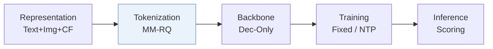
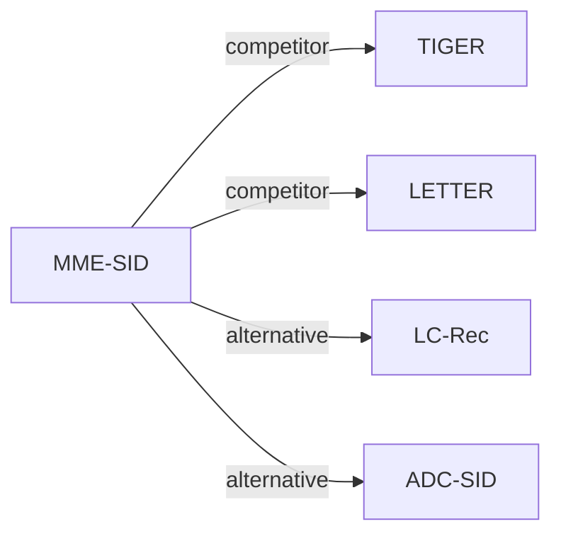

# MME-SID

*Empowering large language model for sequential recommendation via multimodal embeddings and semantic ids* — Wang et al. · CIKM’25

`I. 信息量` · `Tokenization` · [论文](https://arxiv.org/abs/2509.02017) · [代码](https://github.com/Applied-Machine-Learning-Lab/MME-SID) · [矩阵](../../../README.zh.md#i--tokenization) · [English](../../papers/mme-sid.md)

阅读级别：概览（第 1 级） · 本页目录：[TL;DR](#tldr) · [速览](#速览) · [3. 实验发现](#3-实验发现) · [5. 相关工作](#5-相关工作)

- `Dec-Only`: Decoder-only.
- `Fixed`: SIDs are built first and not changed while the generator trains.
- `NTP`: Next-token prediction loss only; continuing from a pretrained LLM (SFT) also counts as NTP.

### TL;DR

> [!NOTE]
> MME-SID 将多模态嵌入与经最大均值差异和对比对齐训练的 MM-RQ-VAE SID 嵌入一同输入 LLM，缓解嵌入坍缩与灾难性遗忘。

### 速览

| 维度 | 摘要 |
| :-- | :-- |
| 研究问题 | I. 信息量：Do the SIDs, or the model reading them, carry the collaborative and multimodal signals recommendation needs? |
| 核心贡献 | MME-SID 将多模态嵌入与经最大均值差异和对比对齐训练的 MM-RQ-VAE SID 嵌入一同输入 LLM，缓解嵌入坍缩与灾难性遗忘。 |
| 主要改动阶段 | Tokenization |

### 3. 实验发现

实验设置

- **数据集**：Amazon 2014 5-core: Beauty (22,332 users / 12,086 items), Toys and Games (19,121 / 11,757), Sports and Outdoors (35,092 / 18,090); items lacking a title or image are removed. Positives are ratings above 3.
  - 出处：5-core Amazon 2014 and item removal: [S5.SS1.SSS1.p1](https://arxiv.org/html/2509.02017v1#S5.SS1.SSS1.p1) and [A2.p1](https://arxiv.org/html/2509.02017v1#A2.p1); statistics: [S5.T1](https://arxiv.org/html/2509.02017v1#S5.T1).
- **切分**：Per user, the N-th (last) item is the test target and the (N-1)-th item the training target; a validation split is not reported. Results averaged over 3 runs.
  - 出处：Last and second-last item as test and training targets: [S5.SS1.SSS1.p1](https://arxiv.org/html/2509.02017v1#S5.SS1.SSS1.p1); three runs: [S5.SS1.SSS4.p1](https://arxiv.org/html/2509.02017v1#S5.SS1.SSS4.p1).
- **候选集**：not reported (full catalog versus sampled); items are scored by dot products between the LLM output and multimodal item embeddings, with HR and nDCG at 5, 10, 20.
  - 出处：Scores over target item embeddings: [S4.SS3.p3](https://arxiv.org/html/2509.02017v1#S4.SS3.p3) and [S6.SS2.p1](https://arxiv.org/html/2509.02017v1#S6.SS2.p1); metrics: [S5.SS1.SSS2.p1](https://arxiv.org/html/2509.02017v1#S5.SS1.SSS2.p1).
- **可见性**：warm; no unseen-item protocol is defined. A frequency-aware fusion module reweights modalities by each item's training-set frequency.
  - 出处：Standard split; frequency-aware fusion for cold versus warm items without an unseen-item protocol: [S5.SS1.SSS1.p1](https://arxiv.org/html/2509.02017v1#S5.SS1.SSS1.p1) and [S4.SS3.p3](https://arxiv.org/html/2509.02017v1#S4.SS3.p3).
- **SID 规格**：Separate collaborative, textual, and visual SIDs from RQ-VAEs with 4 levels x 256 codes (300 for Sports), used as LLM input embeddings alongside projected modality embeddings. The paper states that MME-SID does not need to tackle collisions because multimodal data discriminate between items; no resolution rule is described.
  - 出处：4 levels x 256 (300 for Sports) per modality: [A1.T4](https://arxiv.org/html/2509.02017v1#A1.T4); no collision handling needed by design: [S4.I1.i2.p1](https://arxiv.org/html/2509.02017v1#S4.I1.i2.p1).
- **推理预算**：No autoregressive decoding: one forward pass of Llama3-8B-instruct, then scoring against item embeddings. All experiments on A100 GPUs; inference batch size and latency: not reported.
  - 出处：Scoring instead of autoregressive decoding: [S6.SS2.p1](https://arxiv.org/html/2509.02017v1#S6.SS2.p1); hardware: [S5.SS1.SSS4.p1](https://arxiv.org/html/2509.02017v1#S5.SS1.SSS4.p1).
- **结果来源**：Table 3 (Beauty, Toys, Sports versus ID, multimodal, and SID-based baselines; t-tests); Figure 3 (embedding collapse and SR performance); Appendix Table 4 (hyperparameters).
  - 出处：Main: [S5.T3](https://arxiv.org/html/2509.02017v1#S5.T3); collapse analysis: [S5.SS3.p1](https://arxiv.org/html/2509.02017v1#S5.SS3.p1).

### 5. 相关工作

- **同期对比** · [TIGER](tiger.md): TIGER-MM generates per-modality RQ-VAE semantic IDs autoregressively and must resolve collisions; MME-SID feeds multimodal SIDs and embeddings to an LLM and scores items directly.
  - 出处：MME-SID v1, baseline TIGER-MM: https://arxiv.org/html/2509.02017v1#S5.I2.i7.p1; collision contrast: https://arxiv.org/html/2509.02017v1#S4.I1.i2.p1; Table 3: https://arxiv.org/html/2509.02017v1#S5.T3.
- **同期对比** · [LETTER](letter.md): LETTER regularizes the tokenizer for generative retrieval on a TIGER backbone; MME-SID avoids generation and aligns modalities with an MMD loss.
  - 出处：MME-SID v1, baseline LETTER implemented on TIGER: https://arxiv.org/html/2509.02017v1#S5.I2.i9.p1; Table 3: https://arxiv.org/html/2509.02017v1#S5.T3.
- **替代方案** · [LC-Rec](lc-rec.md): LC-Rec aligns an LLM to item indices but decodes autoregressively; MME-SID scores items from the LLM output for lower latency.
  - 出处：MME-SID v1, Section 6.2: https://arxiv.org/html/2509.02017v1#S6.SS2.p1.
- **替代方案** · [ADC-SID](adc-sid.md): ADC-SID later compares against MM-RQ-VAE (MME-SID's tokenizer) and adds adaptive behavior-content alignment.
  - 出处：Evidence is from the later ADC-SID paper: MM-RQ-VAE baseline and Table 2: https://arxiv.org/html/2510.25622v3#S4.I3.i6.p1 and https://arxiv.org/html/2510.25622v3#S4.T2.

[查看同格全部论文](../../../README.zh.md#i--tokenization)
