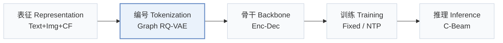
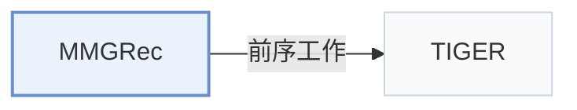

# MMGRec

[← 问题 × 阶段矩阵](../../../README.zh.md#i--tokenization) · [按阶段索引](../index/stages.md) · [按模态索引](../index/modality.md) · [English](../../papers/mmgrec.md) | 中文

| **题目** | *Multimodal Generative Recommendation with Transformer Model* |
| :-- | :-- |
| **作者** | Liu et al. |
| **发表** | TOMM’26 |
| **问题与阶段** | `I. 信息量` · `编号（Tokenization）` |
| **链接** | [论文](https://arxiv.org/abs/2404.16555) · [代码](https://github.com/hanliu95/MMGRec) |
| **阅读级别** | 概览（第 1 级） |

**本页目录**：[TL;DR](#tldr) · [速览](#速览) · [3. 实验发现](#3-实验发现) · [5. 相关工作](#5-相关工作)

- `Text+Img+CF`：文本、图像表征结合协同过滤信号。
- `Graph RQ-VAE`：融合图结构传播的残差量化变分自编码器。
- `Enc-Dec`：编码器-解码器（Encoder-decoder）架构。
- `Fixed`：先独立训练并冻结编号器，生成器训练期间 SID 保持不变。
- `NTP`：标准下一 token 预测（Next-Token Prediction）交叉熵损失；基于预训练 LLM 的指令微调（SFT）亦归入此类。
- `C-Beam`：受合法物品集合约束的束搜索（Constrained beam search）。

### TL;DR

> [!NOTE]
> MMGRec 在多模态与协同特征上用 Graph RQ-VAE 为每个物品分配 Rec-ID，并训练带关系感知自注意力的 Transformer 生成该 ID，替代嵌入检索。

---

### 速览

| 维度 | 摘要 |
| :-- | :-- |
| 研究问题 | I. 信息量：SID 或读取它的模型是否充分携带了推荐所需的协同、多模态与时空信号？ |
| 核心贡献 | MMGRec 在多模态与协同特征上用 Graph RQ-VAE 为每个物品分配 Rec-ID，并训练带关系感知自注意力的 Transformer 生成该 ID，替代嵌入检索。 |
| 主要改动阶段 | 编号（Tokenization） |

---

### 3. 实验发现

实验设置

- **数据集**：MovieLens, TikTok, Kwai multimodal recommendation benchmarks; filtering: not reported.
  - 出处：Section 5.1: [S5.SS1.p1](https://arxiv.org/html/2404.16555v4#S5.SS1.p1) and [S5.SS1.p2](https://arxiv.org/html/2404.16555v4#S5.SS1.p2)
- **切分**：Per-user random interaction split: 80% training, 10% validation, 10% test; non-sequential CF, without temporal labels.
  - 出处：Sections 5.1-5.2: [S5.SS1.p3](https://arxiv.org/html/2404.16555v4#S5.SS1.p3) and [S5.SS2.p2](https://arxiv.org/html/2404.16555v4#S5.SS2.p2)
- **候选集**：not reported
  - 出处：Sections 4.4 and 5.1 specify generated top-K lists but no full-catalog/sampled evaluation declaration: [S4.SS4.p1](https://arxiv.org/html/2404.16555v4#S4.SS4.p1) and [S5.SS1.p3](https://arxiv.org/html/2404.16555v4#S5.SS1.p3)
- **可见性**：warm; no unseen-item protocol is defined. Graph RQ-VAE uses user-item interactions; test-interaction exposure in graph construction: not reported.
  - 出处：Sections 4.2.1 and 5.1 define no unseen-item evaluation: [S4.SS2.SSS1.p1](https://arxiv.org/html/2404.16555v4#S4.SS2.SSS1.p1) and [S5.SS1.p3](https://arxiv.org/html/2404.16555v4#S5.SS1.p3)
- **SID 规格**：Graph RQ-VAE: 3 semantic tokens plus popularity-rank collision suffix. Codebooks tuned over 64/128/256; Kwai analysis favors 128; selected per-dataset sizes not reported.
  - 出处：Sections 4.2.2, 5.3 and 6.5: [S4.SS2.SSS2.p1](https://arxiv.org/html/2404.16555v4#S4.SS2.SSS2.p1) and [S5.SS3.p1](https://arxiv.org/html/2404.16555v4#S5.SS3.p1) and [S6.SS5.p4](https://arxiv.org/html/2404.16555v4#S6.SS5.p4)
- **推理预算**：Constrained beam width K, default K=10. Figure 5 plots approximately 60-125 ms/user across 1/16-to-full Kwai. Hardware, inference batch size and timing scope: not reported.
  - 出处：Sections 4.4-4.5, Section 6.4 and Figure 5: [S4.SS4.p1](https://arxiv.org/html/2404.16555v4#S4.SS4.p1) and [S4.SS5.p1](https://arxiv.org/html/2404.16555v4#S4.SS5.p1) and [S5.SS1.p3](https://arxiv.org/html/2404.16555v4#S5.SS1.p3) and [S6.SS4.p1](https://arxiv.org/html/2404.16555v4#S6.SS4.p1) and [S6.F5](https://arxiv.org/html/2404.16555v4#S6.F5)
- **结果来源**：This paper's experiments using public baseline implementations: Table 2 main; Tables 3-5 ablations; Figures 4-6 hyperparameters, inference efficiency, Rec-ID design. TIGER is explicitly excluded from the benchmark.
  - 出处：Tables 2-5, Figures 4-6 and baseline implementation statement: [S6.T2](https://arxiv.org/html/2404.16555v4#S6.T2) and [S6.T3](https://arxiv.org/html/2404.16555v4#S6.T3) and [S6.T4](https://arxiv.org/html/2404.16555v4#S6.T4) and [S6.T5](https://arxiv.org/html/2404.16555v4#S6.T5) and [S6.F4](https://arxiv.org/html/2404.16555v4#S6.F4) and [S6.F6](https://arxiv.org/html/2404.16555v4#S6.F6) and [S6.F5](https://arxiv.org/html/2404.16555v4#S6.F5) and [S5.SS2.p2](https://arxiv.org/html/2404.16555v4#S5.SS2.p2)

---

### 5. 相关工作

- **前序工作** · [TIGER](tiger.md): MMGRec extends TIGER's RQ-VAE idea with multimodal/CF inputs and popularity-based collision suffixes; TIGER is not evaluated.
  - 出处：MMGRec v4, Sections 1, 3 and 5.2: [S1.p4](https://arxiv.org/html/2404.16555v4#S1.p4); [S3.p1](https://arxiv.org/html/2404.16555v4#S3.p1); [S5.SS2.p2](https://arxiv.org/html/2404.16555v4#S5.SS2.p2).

[查看同格全部论文](../../../README.zh.md#i--tokenization)
