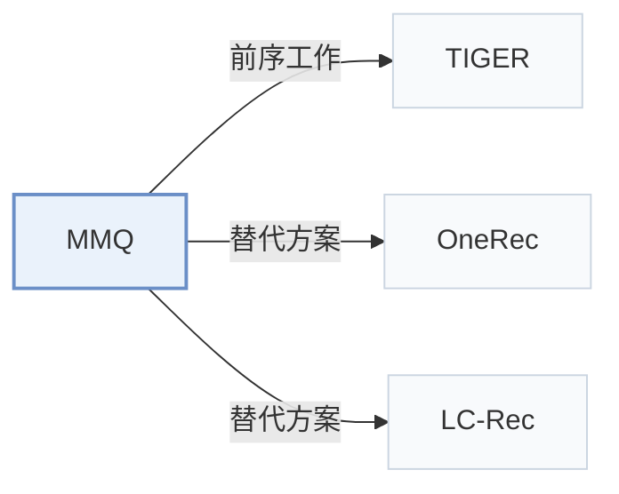

# MMQ

[← 问题 × 阶段矩阵](../../../README.zh.md#i--tokenization) · [按阶段索引](../index/stages.md) · [按模态索引](../index/modality.md) · [English](../../papers/mmq.md) | 中文

| **题目** | *Multimodal Mixture-of-Quantization Tokenization for Semantic ID Generation and User Behavioral Adaptation* |
| :-- | :-- |
| **作者** | Xu et al. |
| **发表** | WSDM’26 |
| **问题与阶段** | `I. 信息量` · `编号（Tokenization）` |
| **链接** | [论文](https://arxiv.org/abs/2508.15281) |
| **阅读级别** | 概览（第 1 级） |

**本页目录**：[TL;DR](#tldr) · [速览](#速览) · [3. 实验发现](#3-实验发现) · [5. 相关工作](#5-相关工作)

- `Text+Img`：文本与视觉图像表征。
- `MoE-VQ`：混合专家向量量化（Mixture-of-Experts VQ）。
- `HeterRec`：论文命名的异构推荐骨干网络 HeterRec。
- `Joint`：推荐生成损失通过可微路径直接反传更新编号器。
- `MTP`：多 token 并行预测损失（Multi-Token Prediction），一次前向同时预测多个码位。

### TL;DR

> [!NOTE]
> MMQ 在正交正则下训练含模态共享与模态特定专家的多模态编号器，再结合多模态重构损失在行为目标上微调 SID。

---

### 速览

| 维度 | 摘要 |
| :-- | :-- |
| 研究问题 | I. 信息量：SID 或读取它的模型是否充分携带了推荐所需的协同、多模态与时空信号？ |
| 核心贡献 | MMQ 在正交正则下训练含模态共享与模态特定专家的多模态编号器，再结合多模态重构损失在行为目标上微调 SID。 |
| 主要改动阶段 | 编号（Tokenization） |

---

### 3. 实验发现

实验设置

- **数据集**：Amazon Beauty; retrieval uses user/item 5-core filtering and histories capped at 20. Southeast Asian advertising logs, October 2024-May 2025 (30M users, 40M ads); industrial filters not reported.
  - 出处：Section 4.1.1: [S4.SS1.SSS1.p2](https://arxiv.org/html/2508.15281v1#S4.SS1.SSS1.p2) and [S4.SS1.SSS1.p3](https://arxiv.org/html/2508.15281v1#S4.SS1.SSS1.p3)
- **切分**：Beauty ranking: chronological 90% train/10% test; ratings >3 positive, <=3 negative. Retrieval and industrial offline splits not reported. Online A/B: July 6-August 6, 2025; treatment 10% random user traffic.
  - 出处：Sections 4.1.1 and 5: [S4.SS1.SSS1.p3](https://arxiv.org/html/2508.15281v1#S4.SS1.SSS1.p3) and [S5.p1](https://arxiv.org/html/2508.15281v1#S5.p1)
- **候选集**：Retrieval: not reported; ranking evaluates labeled ratings, candidate retrieval n/a.
  - 出处：Section 4.1.1/4.1.2 gives labels and metrics, not retrieval candidates: [S4.SS1.SSS1.p3](https://arxiv.org/html/2508.15281v1#S4.SS1.SSS1.p3) and [S4.SS1.SSS2.p3](https://arxiv.org/html/2508.15281v1#S4.SS1.SSS2.p3)
- **可见性**：warm; no unseen-item protocol is defined.
  - 出处：Section 4.1 defines no item holdout: [S4.SS1](https://arxiv.org/html/2508.15281v1#S4.SS1)
- **SID 规格**：6 positions: 2 shared, 2 text-specific, 2 visual-specific; codebook size 100 (Beauty), 3000 (industrial). Collision handling not reported.
  - 出处：Section 4.1.4: [S4.SS1.SSS4.p2](https://arxiv.org/html/2508.15281v1#S4.SS1.SSS4.p2)
- **推理预算**：Retrieval K=5/10 using HeterRec; ranking uses PPNet. Decoding budget, hardware, inference batch size, and latency not reported.
  - 出处：Sections 4.1.2/4.1.4: [S4.SS1.SSS2.p3](https://arxiv.org/html/2508.15281v1#S4.SS1.SSS2.p3) and [S4.SS1.SSS4.p1](https://arxiv.org/html/2508.15281v1#S4.SS1.SSS4.p1)
- **结果来源**：Original Table 1: tokenizer comparisons under HeterRec retrieval/PPNet ranking; Section 5: online A/B versus deployed ItemID system.
  - 出处：Table 1 and Section 5: [S4.T1](https://arxiv.org/html/2508.15281v1#S4.T1) and [S5.p1](https://arxiv.org/html/2508.15281v1#S5.p1)

---

### 5. 相关工作

- **前序工作** · [TIGER](tiger.md): MMQ replaces TIGER's separated tokenizer training with behavior-aware joint adaptation.
  - 出处：MMQ v1, Section 3.3: [S3.SS3.p1](https://arxiv.org/html/2508.15281v1#S3.SS3.p1).
- **替代方案** · [OneRec](onerec.md): OneRec aligns modalities before quantization; MMQ separates shared and specific experts.
  - 出处：MMQ v1, Section 2: [S2.p3](https://arxiv.org/html/2508.15281v1#S2.p3).
- **替代方案** · [LC-Rec](lc-rec.md): LC-Rec aligns indices through multitask fine-tuning; MMQ adapts multimodal tokenization directly.
  - 出处：MMQ v1, Sections 2 and 3.3: [S2.p2](https://arxiv.org/html/2508.15281v1#S2.p2); [S3.SS3.p1](https://arxiv.org/html/2508.15281v1#S3.SS3.p1).

[查看同格全部论文](../../../README.zh.md#i--tokenization)
