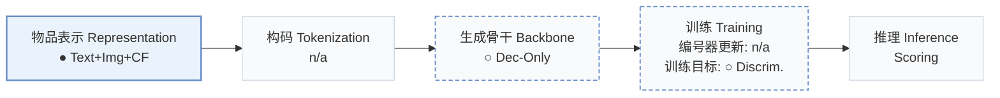

# Molar

[← 问题 × 阶段矩阵](../../../README.zh.md#i--representation) · [按阶段索引](../index/stages.md) · [按模态找论文](../index/modality.md) · [按领域找论文](../index/domain.md) · [English](../../papers/molar.md) | 中文

| **题目** | *Multimodal llms with collaborative filtering alignment for enhanced sequential recommendation* |
| :-- | :-- |
| **作者** | Luo et al. |
| **发表** | arXiv’24 |
| **问题与阶段** | `I. 信息量` · `物品表示（Representation）` |
| **改动** | ● 物品表示 · ○ 生成骨干 · ○ 训练目标 |
| **构码输入** | `n/a` |
| **领域** | `电商` · `电影` · `短视频与直播` |
| **应用场景** | `一般物品推荐`；`公开数据` |
| **链接** | [论文](https://arxiv.org/abs/2412.18176) · [代码](https://anonymous.4open.science/r/Molar-8B06/) |
| **阅读级别** | 概览（第 1 级） |

**本页目录**：[TL;DR](#tldr) · [3. 实验发现](#3-实验发现) · [5. 相关工作](#5-相关工作)

- `Text+Img+CF`：文本、图像表征结合协同过滤信号。
- `Dec-Only`：仅解码器（Decoder-only）自回归架构。
- `Discrim.`：判别式候选物品打分损失，不直接生成 SID。
- `Scoring`：直接计算候选物品得分，不逐位生成 SID。

### TL;DR

> [!NOTE]
> Molar 用多模态 LLM 从文本与图像构建物品表示，并将用户表示与基于 ID 的协同过滤模型对齐，补足 LLM 推荐器缺失的协同信号。

---

### 3. 实验发现

实验设置

- **数据集**：Amazon clothing (993,087 users / 301,312 items / 8,813,442 interactions), PixelRec (50,000 / 82,864 / 989,476), MovieLens (6,040 / 3,706 / 1,000,209). Filtering rules: not reported.
  - 出处：Datasets: [S4.I2.i1.p1](https://arxiv.org/html/2412.18176v2#S4.I2.i1.p1), [S4.I2.i2.p1](https://arxiv.org/html/2412.18176v2#S4.I2.i2.p1), [S4.I2.i3.p1](https://arxiv.org/html/2412.18176v2#S4.I2.i3.p1); statistics: [S4.T1](https://arxiv.org/html/2412.18176v2#S4.T1); filtering not stated.
- **切分**：Sequential leave-one-out into training, validation, and test; the exact position allocation is not reported beyond the label.
  - 出处：Leave-one-out: [S4.SS1.SSS1.p2](https://arxiv.org/html/2412.18176v2#S4.SS1.SSS1.p2).
- **候选集**：full catalog (the paper states metrics are evaluated on the full amount of data); training uses 1:1 negative sampling with BCE.
  - 出处：Evaluated on the full amount of data: [S4.SS1.SSS1.p2](https://arxiv.org/html/2412.18176v2#S4.SS1.SSS1.p2); 1:1 negatives are a training choice: [A2.p1](https://arxiv.org/html/2412.18176v2#A2.p1).
- **可见性**：warm; no unseen-item protocol is defined.
  - 出处：Standard split with no unseen-item protocol: [S4.SS1.SSS1.p2](https://arxiv.org/html/2412.18176v2#S4.SS1.SSS1.p2).
- **SID 规格**：n/a (items are represented by continuous embeddings from a fine-tuned multimodal LLM; no discrete SIDs are built).
  - 出处：Continuous item embeddings from the MLLM, no discrete IDs: [S4.SS1.SSS2.p1](https://arxiv.org/html/2412.18176v2#S4.SS1.SSS2.p1); Table 1 judgment in facts/dash.yaml.
- **推理预算**：Scoring with item embeddings from Qwen2-VL-2B (MIRM) and a user model (DUEG); hardware, inference batch size, and latency: not reported.
  - 出处：Backbone and training: [S4.SS1.SSS2.p1](https://arxiv.org/html/2412.18176v2#S4.SS1.SSS2.p1) and [S4.SS1.SSS2.p2](https://arxiv.org/html/2412.18176v2#S4.SS1.SSS2.p2); no inference settings found.
- **结果来源**：Table 2 (Amazon, PixelRec, MovieLens versus traditional, content, and LLM-based baselines); Tables 3-5 (modalities, post-alignment model, ablations); Appendix Table 6 (MLLM backbones).
  - 出处：Main: [S4.T2](https://arxiv.org/html/2412.18176v2#S4.T2); modalities: [S4.T3](https://arxiv.org/html/2412.18176v2#S4.T3); post-alignment: [S4.T4](https://arxiv.org/html/2412.18176v2#S4.T4); ablation: [S4.T5](https://arxiv.org/html/2412.18176v2#S4.T5); backbones: [A1.T6](https://arxiv.org/html/2412.18176v2#A1.T6).

---

### 5. 相关工作

[查看同格全部论文](../../../README.zh.md#i--representation)
