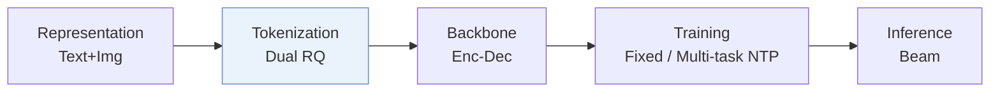
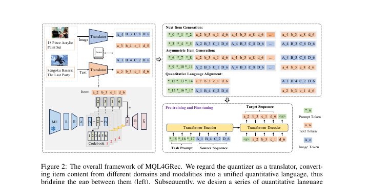
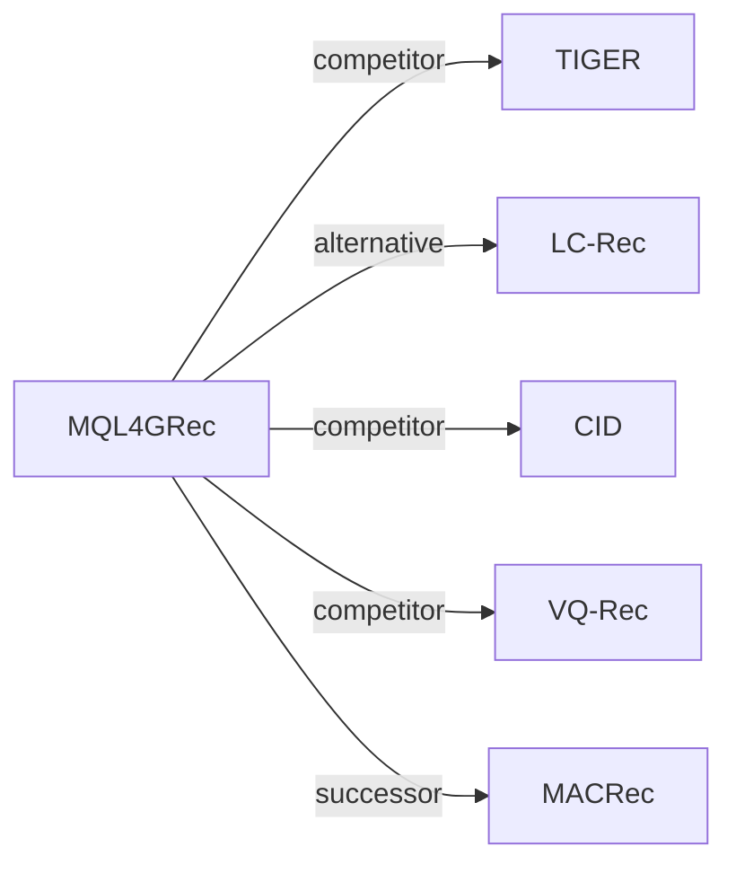

# MQL4GRec

*MULTIMODAL QUANTITATIVE LANGUAGE FOR GEN-ERATIVE RECOMMENDATION* — Zhai et al. · ICLR’25

`I. 信息量` · `Tokenization` · [论文](https://arxiv.org/abs/2504.05314) · [代码](https://github.com/zhaijianyang/MQL4GRec) · [矩阵](../../../README.zh.md#i--tokenization) · [English](../../papers/mql4grec.md)

阅读级别：概览（第 1 级） · 本页目录：[TL;DR](#tldr) · [速览](#速览) · [2. 方法](#2-方法) · [3. 实验发现](#3-实验发现) · [5. 相关工作](#5-相关工作)

- `Enc-Dec`: Encoder-decoder.
- `Fixed`: SIDs are built first and not changed while the generator trains.
- `Multi-task NTP`: The same NTP loss over several tasks.

### TL;DR

> [!NOTE]
> MQL4GRec 将多个域的物品文本与图像转化为共享量化语言并在其上预训练多类生成任务，跨领域和模态迁移推荐知识。

### 速览

| 维度 | 摘要 |
| :-- | :-- |
| 研究问题 | I. 信息量：Do the SIDs, or the model reading them, carry the collaborative and multimodal signals recommendation needs? |
| 核心贡献 | MQL4GRec 将多个域的物品文本与图像转化为共享量化语言并在其上预训练多类生成任务，跨领域和模态迁移推荐知识。 |
| 主要改动阶段 | Tokenization |

### 2. 方法

### 3. 实验发现

实验设置

- **数据集**：Amazon Reviews 2018 (May 1996-October 2018). Pre-training on six categories (Pet, Cell, Automotive, Tools, Toys, Sports); target tasks on Instruments (17,112 users / 6,250 items), Arts (22,171 / 9,416), Games (42,259 / 13,839). Users and items with fewer than 5 interactions are filtered; sequences capped at 20 items.
  - 出处：Pre-training and target categories: [S4.SS1.SSS0.Px1.p1](https://arxiv.org/html/2504.05314v1#S4.SS1.SSS0.Px1.p1) and [A1.p1](https://arxiv.org/html/2504.05314v1#A1.p1); filtering and length: [A1.p2](https://arxiv.org/html/2504.05314v1#A1.p2); statistics: [A1.T6](https://arxiv.org/html/2504.05314v1#A1.T6).
- **切分**：Leave-one-out (allocation not restated beyond the label). Separate zero-shot study: models pre-trained on source categories are tested on the targets without fine-tuning.
  - 出处：Leave-one-out named only: [S4.SS1.SSS0.Px2.p1](https://arxiv.org/html/2504.05314v1#S4.SS1.SSS0.Px2.p1); zero-shot study: [S4.SS5.p1](https://arxiv.org/html/2504.05314v1#S4.SS5.p1).
- **候选集**：full catalog (full ranking over the entire item set instead of sample-based evaluation).
  - 出处：Full ranking over the entire item set: [S4.SS1.SSS0.Px2.p1](https://arxiv.org/html/2504.05314v1#S4.SS1.SSS0.Px2.p1).
- **可见性**：Main: warm; no unseen-item protocol is defined. Zero-shot: target-domain items are unseen by the pre-trained generator; whether the RQ-VAE translators saw them: not reported.
  - 出处：Standard split; zero-shot uses target-domain items absent from pre-training: [S4.SS5.p1](https://arxiv.org/html/2504.05314v1#S4.SS5.p1).
- **SID 规格**：Separate text (LLaMA) and image (ViT-L/14) quantitative languages from RQ-VAEs with 4 levels x 256 codewords (dimension 32). Colliding items have tokens reassigned by the distances between their residuals and code vectors, instead of an appended identifier.
  - 出处：4 levels x 256 x 32 per modality: [A3.p1](https://arxiv.org/html/2504.05314v1#A3.p1); distance-based reassignment for collisions: [S3.SS1.SSS0.Px2.p2](https://arxiv.org/html/2504.05314v1#S3.SS1.SSS0.Px2.p2).
- **推理预算**：Beam search with beam size 20 in each modality; the two recommendation lists are re-ranked so items in both rank higher. T5 encoder-decoder with 4 layers each. Hardware, inference batch size, and latency: not reported.
  - 出处：Beam size 20 and dual-list re-ranking: [S4.SS1.SSS0.Px2.p1](https://arxiv.org/html/2504.05314v1#S4.SS1.SSS0.Px2.p1) and [S3.SS3.SSS0.Px2.p1](https://arxiv.org/html/2504.05314v1#S3.SS3.SSS0.Px2.p1); T5 backbone: [A3.p2](https://arxiv.org/html/2504.05314v1#A3.p2).
- **结果来源**：Table 1 (Instruments, Arts, Games versus sequential, multimodal, and generative baselines); Table 2 (collision handling versus TIGER's appended index); Tables 3-4 (generation tasks and pre-training); Figures 3-4 (pre-training data and epochs); Table 5 (zero-shot).
  - 出处：Main: [S4.T1](https://arxiv.org/html/2504.05314v1#S4.T1); collisions: [S4.T2](https://arxiv.org/html/2504.05314v1#S4.T2); tasks and pre-training: [S4.T3](https://arxiv.org/html/2504.05314v1#S4.T3), [S4.T4](https://arxiv.org/html/2504.05314v1#S4.T4); zero-shot: [S4.T5](https://arxiv.org/html/2504.05314v1#S4.T5).

### 5. 相关工作

- **同期对比** · [TIGER](tiger.md): TIGER uses one text modality and an appended index for collisions; MQL4GRec translates text and images into separate quantitative languages and reassigns colliding tokens by distance.
  - 出处：MQL4GRec v1, Table 1 baseline TIGER: https://arxiv.org/html/2504.05314v1#S4.T1; collision comparison in Table 2: https://arxiv.org/html/2504.05314v1#S4.SS3.SSS0.Px1.p1 and https://arxiv.org/html/2504.05314v1#S4.T2.
- **替代方案** · [LC-Rec](lc-rec.md): LC-Rec spreads items across the last level with a uniform constraint, which MQL4GRec says does not fully remove collisions.
  - 出处：MQL4GRec v1, Section 3.1 Handling Collisions cites Zheng et al. (2023): https://arxiv.org/html/2504.05314v1#S3.SS1.SSS0.Px2.p1.
- **同期对比** · [CID](cid.md): P5-CID uses collaborative indexing for a T5 model; MQL4GRec uses multimodal content codes with cross-modal generation tasks.
  - 出处：MQL4GRec v1, baseline P5-CID: https://arxiv.org/html/2504.05314v1#A2.I1.i8.p1; Table 1: https://arxiv.org/html/2504.05314v1#S4.T1.
- **同期对比** · [VQ-Rec](vq-rec.md): VQ-Rec uses product-quantized text codes in a discriminative transferable model; MQL4GRec generates multimodal codes with pre-training across categories.
  - 出处：MQL4GRec v1, Table 1 baseline VQ-Rec: https://arxiv.org/html/2504.05314v1#S4.T1.
- **后续工作** · [MACRec](macrec.md): MACRec later reuses MQL4GRec's collision reassignment and dual-modality ensemble and adds cross-modal contrastive alignment during quantization.
  - 出处：Evidence is from the later MACRec paper: https://arxiv.org/html/2511.15122v2#Sx3.SSx1.SSSx3.p5 and https://arxiv.org/html/2511.15122v2#Sx3.SSx2.SSSx3.p3; MQL4GRec is its main baseline in Table 2: https://arxiv.org/html/2511.15122v2#Sx4.T2.

[查看同格全部论文](../../../README.zh.md#i--tokenization)
