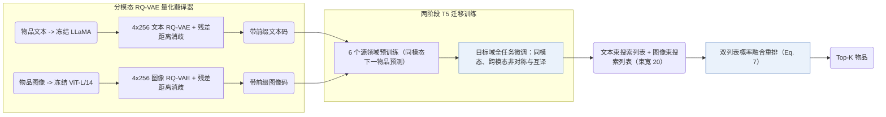
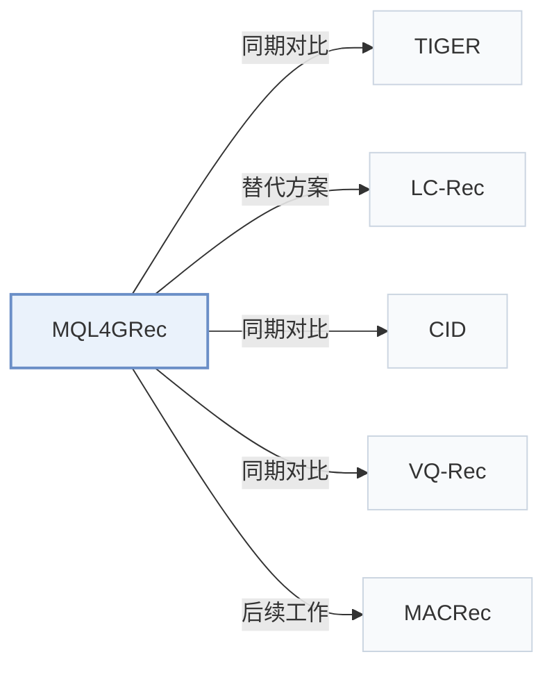

# MQL4GRec

[← 问题 × 阶段矩阵](../../../README.zh.md#i--tokenization) · [按阶段索引](../index/stages.md) · [按模态索引](../index/modality.md) · [English](../../papers/mql4grec.md) | 中文

| **题目** | *MULTIMODAL QUANTITATIVE LANGUAGE FOR GEN-ERATIVE RECOMMENDATION* |
| :-- | :-- |
| **作者** | Zhai et al. |
| **发表** | ICLR’25 |
| **问题与阶段** | `I. 信息量` · `编号（Tokenization）` |
| **链接** | [论文](https://arxiv.org/abs/2504.05314) · [代码](https://github.com/zhaijianyang/MQL4GRec) |
| **阅读级别** | 阅读笔记（第 2 级） |

**本页目录**：[TL;DR](#tldr) · [速览](#速览) · [1. 为什么重要](#1-为什么重要) · [2. 方法](#2-方法) · [3. 实验发现](#3-实验发现) · [4. 局限与分析](#4-局限与分析) · [5. 相关工作](#5-相关工作)

- `Text+Img`：文本与视觉图像表征。
- `Dual RQ`：面向双表征流或双侧实体的双路残差量化。
- `Enc-Dec`：编码器-解码器（Encoder-decoder）架构。
- `Fixed`：先独立训练并冻结编号器，生成器训练期间 SID 保持不变。
- `Multi-task NTP`：在多个对齐或推荐子任务上联合优化下一 token 预测损失。
- `Beam`：在 SID token 上执行自回归束搜索（Beam search）。

### TL;DR

> [!NOTE]
> MQL4GRec 将多个域的物品文本与图像转化为共享量化语言并在其上预训练多类生成任务，跨领域和模态迁移推荐知识。

---

### 速览

| 维度 | 摘要 |
| :-- | :-- |
| 研究问题 | I. 信息量：SID 或读取它的模型是否充分携带了推荐所需的协同、多模态与时空信号？ |
| 核心贡献 | MQL4GRec 将多个域的物品文本与图像转化为共享量化语言并在其上预训练多类生成任务，跨领域和模态迁移推荐知识。 |
| 主要改动阶段 | 编号（Tokenization） |
| 主要发现 | 在 Amazon Instruments、Arts 与 Games 的全库排序评测中，MQL4GRec 整体表现最优（NDCG 优势尤为突出），且双模态下的多源域预训练显著提升了 Instruments 与 Arts 的精度（Sec. 4.2，Sec. 4.3，Table 1）。 |
| 局限 | 双模态预训练在 Games 数据集上未带来增益，且未经微调的跨领域零样本迁移能力仍较弱（Sec. 4.3，Sec. 4.5）。 |

---

### 1. 为什么重要

预训练语言模型自带的通用语言先验与协同交互规律并不一致，且既有生成式模型很少在同一离散词表内融合文本与图像互补信息（Abstract）。MQL4GRec 将多领域、多模态物品内容翻译为带模态前缀的统一量化词表（`Dual RQ`），打通源域预训练迁移与双模态生成融合。

> "Our key idea is to transform items from different domains and modalities into a unified language, which can serve as a bridge for transferring recommendation knowledge."（Abstract）

---

### 2. 方法

#### 量化翻译器

MQL4GRec 用冻结的 LLaMA 与 ViT 分别提取文本和图像表征，各用一套独立的 4 层 × 256 码字 RQ-VAE 量化为离散语义 ID（Semantic ID，SID），按残差到码字的距离重分配冲突物品，再为两套码本加上不同前缀合并成统一词典（Sec. 3.1）。

> "We train a quantitative translator for each modality, then add prefixes to the codewords from each of the two codebooks to form a dictionary."（Sec. 3.1）

#### 生成任务

三类生成任务将两路模态码连接起来：同模态下一物品生成在文本或图像单模态内预测目标；非对称物品生成从文本历史预测下一物品的图像码或反向预测；量化语言对齐任务在同一物品的文本码与图像码之间双向互译（Sec. 3.2）。

#### 预训练与微调

在六个源领域预训练时仅启用两项同模态下一物品预测任务；迁移到目标领域微调时联合启用全部任务（Sec. 3.3）。推理阶段分别在文本与图像空间做束搜索，再按融合得分重排合并两个候选列表（Sec. 3.3，Eq. 7）。

---

### 3. 实验发现

实验设置

- **数据集**：Amazon Reviews 2018 (May 1996-October 2018). Pre-training on six categories (Pet, Cell, Automotive, Tools, Toys, Sports); target tasks on Instruments (17,112 users / 6,250 items), Arts (22,171 / 9,416), Games (42,259 / 13,839). Users and items with fewer than 5 interactions are filtered; sequences capped at 20 items.
  - 出处：Pre-training and target categories: [S4.SS1.SSS0.Px1.p1](https://arxiv.org/html/2504.05314v1#S4.SS1.SSS0.Px1.p1) and [A1.p1](https://arxiv.org/html/2504.05314v1#A1.p1); filtering and length: [A1.p2](https://arxiv.org/html/2504.05314v1#A1.p2); statistics: [A1.T6](https://arxiv.org/html/2504.05314v1#A1.T6).
- **切分**：Leave-one-out (allocation not restated beyond the label). Separate zero-shot study: models pre-trained on source categories are tested on the targets without fine-tuning.
  - 出处：Leave-one-out named only: [S4.SS1.SSS0.Px2.p1](https://arxiv.org/html/2504.05314v1#S4.SS1.SSS0.Px2.p1); zero-shot study: [S4.SS5.p1](https://arxiv.org/html/2504.05314v1#S4.SS5.p1).
- **候选集**：full catalog (full ranking over the entire item set instead of sample-based evaluation).
  - 出处：Full ranking over the entire item set: [S4.SS1.SSS0.Px2.p1](https://arxiv.org/html/2504.05314v1#S4.SS1.SSS0.Px2.p1).
- **可见性**：Main: warm; no unseen-item protocol is defined. Zero-shot: target-domain items are unseen by the pre-trained generator; whether the RQ-VAE translators saw them: not reported.
  - 出处：Standard split; zero-shot uses target-domain items absent from pre-training: [S4.SS5.p1](https://arxiv.org/html/2504.05314v1#S4.SS5.p1).
- **SID 规格**：Separate text (LLaMA) and image (ViT-L/14) quantitative languages from RQ-VAEs with 4 levels x 256 codewords (dimension 32). Colliding items have tokens reassigned by the distances between their residuals and code vectors, instead of an appended identifier.
  - 出处：4 levels x 256 x 32 per modality: [A3.p1](https://arxiv.org/html/2504.05314v1#A3.p1); distance-based reassignment for collisions: [S3.SS1.SSS0.Px2.p2](https://arxiv.org/html/2504.05314v1#S3.SS1.SSS0.Px2.p2).
- **推理预算**：Beam search with beam size 20 in each modality; the two recommendation lists are re-ranked so items in both rank higher. T5 encoder-decoder with 4 layers each. Hardware, inference batch size, and latency: not reported.
  - 出处：Beam size 20 and dual-list re-ranking: [S4.SS1.SSS0.Px2.p1](https://arxiv.org/html/2504.05314v1#S4.SS1.SSS0.Px2.p1) and [S3.SS3.SSS0.Px2.p1](https://arxiv.org/html/2504.05314v1#S3.SS3.SSS0.Px2.p1); T5 backbone: [A3.p2](https://arxiv.org/html/2504.05314v1#A3.p2).
- **结果来源**：Table 1 (Instruments, Arts, Games versus sequential, multimodal, and generative baselines); Table 2 (collision handling versus TIGER's appended index); Tables 3-4 (generation tasks and pre-training); Figures 3-4 (pre-training data and epochs); Table 5 (zero-shot).
  - 出处：Main: [S4.T1](https://arxiv.org/html/2504.05314v1#S4.T1); collisions: [S4.T2](https://arxiv.org/html/2504.05314v1#S4.T2); tasks and pre-training: [S4.T3](https://arxiv.org/html/2504.05314v1#S4.T3), [S4.T4](https://arxiv.org/html/2504.05314v1#S4.T4); zero-shot: [S4.T5](https://arxiv.org/html/2504.05314v1#S4.T5).

- 主结果：在 Instruments、Arts 和 Games 三个目标域上，MQL4GRec 在绝大多数指标（尤其是 NDCG）上优于序列推荐、多模态与生成式基线（Sec. 4.2，Table 1）。
- 多源域预训练：双模态设置下，源域预训练显著提升了 Instruments 与 Arts，但在 Games 上未见增益（Sec. 4.3）。

  > "Under dual modalities, pre-training significantly improves performance on the Instruments and Arts datasets; however, it does not yield a notable improvement for the Games dataset, potentially due to overfitting."（Sec. 4.3）

- 零样本迁移：不做目标域微调直接评测时，预训练模型在 Instruments 与 Arts 上呈现初步但偏弱的零样本能力，在 Games 上则无零样本效果（Sec. 4.5，Table 5）。

---

### 4. 局限与分析

**Our analysis.**

- MQL4GRec 的文本与图像编号器彼此独立训练（`Dual RQ`），模态关联完全留给下游生成任务学习；MACRec 则在量化阶段内部引入跨模态对比交互（`Cross RQ`）。
- TIGER 仅量化单路文本（`Text`）并做单路 `Beam` 解码；MQL4GRec 量化 `Text+Img` 双流并在解码端执行双分支融合重排（`Dual Beam`）。

---

### 5. 相关工作

- **同期对比** · [TIGER](tiger.md): TIGER uses one text modality and an appended index for collisions; MQL4GRec translates text and images into separate quantitative languages and reassigns colliding tokens by distance.
  - 出处：MQL4GRec v1, Table 1 baseline TIGER: [S4.T1](https://arxiv.org/html/2504.05314v1#S4.T1); collision comparison in Table 2: [S4.SS3.SSS0.Px1.p1](https://arxiv.org/html/2504.05314v1#S4.SS3.SSS0.Px1.p1) and [S4.T2](https://arxiv.org/html/2504.05314v1#S4.T2).
- **替代方案** · [LC-Rec](lc-rec.md): LC-Rec spreads items across the last level with a uniform constraint, which MQL4GRec says does not fully remove collisions.
  - 出处：MQL4GRec v1, Section 3.1 Handling Collisions cites Zheng et al. (2023): [S3.SS1.SSS0.Px2.p1](https://arxiv.org/html/2504.05314v1#S3.SS1.SSS0.Px2.p1).
- **同期对比** · [CID](cid.md): P5-CID uses collaborative indexing for a T5 model; MQL4GRec uses multimodal content codes with cross-modal generation tasks.
  - 出处：MQL4GRec v1, baseline P5-CID: [A2.I1.i8.p1](https://arxiv.org/html/2504.05314v1#A2.I1.i8.p1); Table 1: [S4.T1](https://arxiv.org/html/2504.05314v1#S4.T1).
- **同期对比** · [VQ-Rec](vq-rec.md): VQ-Rec uses product-quantized text codes in a discriminative transferable model; MQL4GRec generates multimodal codes with pre-training across categories.
  - 出处：MQL4GRec v1, Table 1 baseline VQ-Rec: [S4.T1](https://arxiv.org/html/2504.05314v1#S4.T1).
- **后续工作** · [MACRec](macrec.md): MACRec later reuses MQL4GRec's collision reassignment and dual-modality ensemble and adds cross-modal contrastive alignment during quantization.
  - 出处：Evidence is from the later MACRec paper: [Sx3.SSx1.SSSx3.p5](https://arxiv.org/html/2511.15122v2#Sx3.SSx1.SSSx3.p5) and [Sx3.SSx2.SSSx3.p3](https://arxiv.org/html/2511.15122v2#Sx3.SSx2.SSSx3.p3); MQL4GRec is its main baseline in Table 2: [Sx4.T2](https://arxiv.org/html/2511.15122v2#Sx4.T2).

[查看同格全部论文](../../../README.zh.md#i--tokenization)
