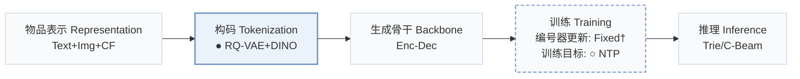
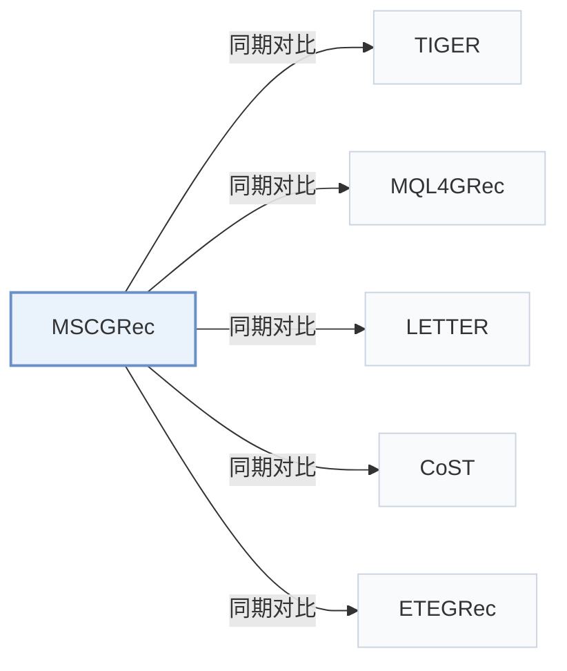

# MSCGRec

[← 问题 × 阶段矩阵](../../../README.zh.md#i--tokenization) · [按阶段索引](../index/stages.md) · [按模态找论文](../index/modality.md) · [按领域找论文](../index/domain.md) · [English](../../papers/mscgrec.md) | 中文

| **题目** | *Multimodal Generative Recommendation for Fusing Semantic and Collaborative Signals* |
| :-- | :-- |
| **作者** | Vandenhirtz et al. |
| **发表** | arXiv’26 |
| **问题与阶段** | `I. 信息量` · `构码（Tokenization）` |
| **改动** | ● 构码 · ○ 训练目标 |
| **构码输入** | image: `Img` · text: `Text` · collaborative: `CF` |
| **领域** | `电商` · `短视频与直播` |
| **链接** | [论文](https://arxiv.org/abs/2602.03713) |
| **阅读级别** | 概览（第 1 级） |

**本页目录**：[TL;DR](#tldr) · [3. 实验发现](#3-实验发现) · [5. 相关工作](#5-相关工作)

- `Text+Img+CF`：文本、图像表征结合协同过滤信号。
- `RQ-VAE+DINO`：RQ-VAE 结合自监督 DINO 视觉特征量化。
- `Enc-Dec`：编码器-解码器（Encoder-decoder）架构。
- `Fixed†`：生成器训练期间冻结编号器（由配置推断）。
- `NTP`：标准下一 token 预测（Next-Token Prediction）交叉熵损失；基于预训练 LLM 的指令微调（SFT）亦归入此类。
- `Trie/C-Beam`：基于前缀树（Trie）约束的束搜索，仅允许解码真实存在的物品前缀。

### TL;DR

> [!NOTE]
> MSCGRec 用基于 DINO 的自监督学习量化图像，把协同特征作为独立模态引入，并将训练输出限制在合法 token 集合内，以扩展到大物品库。

---

### 3. 实验发现

实验设置

- **数据集**：Amazon 2023 Beauty and Personal Care (724,796 users / 203,843 items), Sports and Outdoors (408,287 / 151,632), and PixelRec (8,886,078 / 407,082). 5-core filtering of users and items; for Amazon, samples with empty or placeholder images are removed and items with identical images are merged into one ID; sequences capped at 20 items.
  - 出处：Datasets and preprocessing: [S4.SS1.SSS0.Px1.p1](https://arxiv.org/html/2602.03713v1#S4.SS1.SSS0.Px1.p1); statistics: [S4.T1](https://arxiv.org/html/2602.03713v1#S4.T1).
- **切分**：Chronological leave-one-out into training, validation, and test; for Amazon every item in a training sequence is a separate target, for PixelRec only the last item.
  - 出处：Chronological leave-one-out and target construction: [S4.SS1.SSS0.Px1.p1](https://arxiv.org/html/2602.03713v1#S4.SS1.SSS0.Px1.p1).
- **候选集**：not reported (full catalog versus sampled evaluation candidates); top-K lists from constrained beam search.
  - 出处：Metrics only: [S4.SS1.SSS0.Px1.p1](https://arxiv.org/html/2602.03713v1#S4.SS1.SSS0.Px1.p1).
- **可见性**：warm; no unseen-item protocol is defined. The collaborative modality uses SASRec item embeddings trained on the interaction data.
  - 出处：Standard split with no unseen-item protocol; SASRec embeddings as the collaborative modality: [S4.SS1.SSS0.Px1.p1](https://arxiv.org/html/2602.03713v1#S4.SS1.SSS0.Px1.p1) and [S4.SS1.SSS0.Px3.p1](https://arxiv.org/html/2602.03713v1#S4.SS1.SSS0.Px3.p1).
- **SID 规格**：Per-modality residual quantizers (image via DINO self-supervised quantization, LLAMA text, SASRec collaborative) with 3 levels x 256 entries each, applied directly in embedding space; an extra collision level per modality makes each item's code unique (TIGER style). The collaborative codes serve as generation targets.
  - 出处：3 levels x 256 per modality plus a collision level: [S4.SS1.SSS0.Px3.p2](https://arxiv.org/html/2602.03713v1#S4.SS1.SSS0.Px3.p2) and [S3.SS1.p2](https://arxiv.org/html/2602.03713v1#S3.SS1.p2); DINO-based image quantization: [S3.SS2.p2](https://arxiv.org/html/2602.03713v1#S3.SS2.p2).
- **推理预算**：Constrained beam search with 20 beams; T5 encoder-decoder; training and evaluation on four NVIDIA A100 GPUs. Inference batch size and latency: not reported.
  - 出处：Constrained beam search with 20 beams and hardware: [S4.SS1.SSS0.Px3.p3](https://arxiv.org/html/2602.03713v1#S4.SS1.SSS0.Px3.p3); constrained training softmax: [S3.SS3.p2](https://arxiv.org/html/2602.03713v1#S3.SS3.p2).
- **结果来源**：Table 2 (Beauty, Sports, PixelRec versus sequential and generative baselines); Table 3 (component ablations, modality Shapley values, image-only).
  - 出处：Main: [S4.T2](https://arxiv.org/html/2602.03713v1#S4.T2); ablations and Shapley values: [S4.T3](https://arxiv.org/html/2602.03713v1#S4.T3).

---

### 5. 相关工作

- **同期对比** · [TIGER](tiger.md): TIGER quantizes one modality; MSCGRec concatenates codes from image, text, and collaborative modalities and trains with a softmax restricted to permissible next codes, keeping TIGER's collision level.
  - 出处：MSCGRec v1, baselines TIGER_i and TIGER_t: [S4.SS1.SSS0.Px2.p1](https://arxiv.org/html/2602.03713v1#S4.SS1.SSS0.Px2.p1); Table 2: [S4.T2](https://arxiv.org/html/2602.03713v1#S4.T2); collision level follows TIGER: [S4.SS1.SSS0.Px3.p2](https://arxiv.org/html/2602.03713v1#S4.SS1.SSS0.Px3.p2).
- **同期对比** · [MQL4GRec](mql4grec.md): MQL4GRec uses separate text and image quantitative languages with collision reassignment; MSCGRec adds a collaborative modality, DINO-based image codes, and constrained training, and found MQL4GRec's reassignment gave no gain under constrained training.
  - 出处：MSCGRec v1, follows MQL4GRec's text embeddings and tests its reassignment: [S4.SS1.SSS0.Px3.p1](https://arxiv.org/html/2602.03713v1#S4.SS1.SSS0.Px3.p1) and [S4.SS1.SSS0.Px3.p2](https://arxiv.org/html/2602.03713v1#S4.SS1.SSS0.Px3.p2); Table 2: [S4.T2](https://arxiv.org/html/2602.03713v1#S4.T2).
- **同期对比** · [LETTER](letter.md): LETTER aligns quantized codes with a sequential recommender inside one tokenizer; MSCGRec keeps collaborative information as its own code modality.
  - 出处：MSCGRec v1, LETTER-TIGER baseline: [S4.SS1.SSS0.Px2.p1](https://arxiv.org/html/2602.03713v1#S4.SS1.SSS0.Px2.p1); Table 2: [S4.T2](https://arxiv.org/html/2602.03713v1#S4.T2).
- **同期对比** · [CoST](cost.md): CoST aligns embeddings before and after quantization contrastively; MSCGRec changes the modalities and the training softmax instead.
  - 出处：MSCGRec v1, baselines: [S4.SS1.SSS0.Px2.p1](https://arxiv.org/html/2602.03713v1#S4.SS1.SSS0.Px2.p1); Table 2: [S4.T2](https://arxiv.org/html/2602.03713v1#S4.T2).
- **同期对比** · [ETEGRec](etegrec.md): ETEGRec trains tokenizer and generator end to end; MSCGRec quantizes frozen pretrained embeddings per modality.
  - 出处：MSCGRec v1, baselines: [S4.SS1.SSS0.Px2.p1](https://arxiv.org/html/2602.03713v1#S4.SS1.SSS0.Px2.p1); Table 2: [S4.T2](https://arxiv.org/html/2602.03713v1#S4.T2).

[查看同格全部论文](../../../README.zh.md#i--tokenization)
