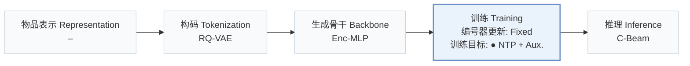
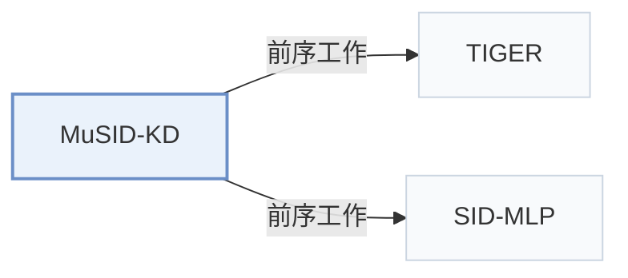

# MuSID-KD

[← 问题 × 阶段矩阵](../../../README.zh.md#iv--training) · [按阶段索引](../index/stages.md) · [按模态找论文](../index/modality.md) · [按领域找论文](../index/domain.md) · [English](../../papers/musid-kd.md) | 中文

| **题目** | *Multigranularity Knowledge Distillation for Generative Recommendation with Semantic IDs* |
| :-- | :-- |
| **作者** | Zhang et al. |
| **发表** | arXiv’26 |
| **问题与阶段** | `IV. 实用目标` · `训练（Training）` |
| **改动** | ● 训练目标 |
| **构码输入** | `其他`（TIGER编号，输入未写） |
| **领域** | `电商` · `游戏` |
| **链接** | [论文](https://arxiv.org/abs/2610.35218) · [代码](https://anonymous.4open.science/r/m7k2-review-83f9/) |
| **阅读级别** | 概览（第 1 级） |

**本页目录**：[TL;DR](#tldr) · [3. 实验发现](#3-实验发现) · [5. 相关工作](#5-相关工作)

- `RQ-VAE`：残差量化变分自编码器（Residual-Quantized VAE）。
- `Enc-MLP`：序列历史编码器后接多层感知机（MLP）预测头。
- `Fixed`：先独立训练并冻结编号器，生成器训练期间 SID 保持不变。
- `NTP + Aux.`：下一 token 预测结合辅助正则或对齐损失。
- `C-Beam`：受合法物品集合约束的束搜索（Constrained beam search）。

### TL;DR

> [!NOTE]
> MuSID-KD 在逐层 SID 前缀上对齐候选分布，并按排序影响为监督信号加权，将生成式教师蒸馏到轻量学生模型，替代均匀对齐蒸馏。

---

### 3. 实验发现

实验设置

- **数据集**：Amazon Reviews 2014 Beauty/Toys, Amazon Reviews 2023 Video Games, and Steam-100K; histories capped at 20. Filtering rules not reported.
  - 出处：Section 6.1: [S6.SS1.p1](https://arxiv.org/html/2610.35218v1#S6.SS1.p1)
- **切分**：Chronological leave-one-out; exact validation/test allocation not reported. Checkpoints selected by validation NDCG@10.
  - 出处：Section 6.1 and Appendix B.1: [S6.SS1.p1](https://arxiv.org/html/2610.35218v1#S6.SS1.p1) and [A2.SS1.p1](https://arxiv.org/html/2610.35218v1#A2.SS1.p1) and [S6.SS1.p3](https://arxiv.org/html/2610.35218v1#S6.SS1.p3)
- **候选集**：Evaluation: not reported. The 64 teacher candidates per request are training support, not sampled evaluation negatives.
  - 出处：Section 6.1 separates evaluation from training candidates: [S6.SS1.p1](https://arxiv.org/html/2610.35218v1#S6.SS1.p1) and [S6.SS1.p3](https://arxiv.org/html/2610.35218v1#S6.SS1.p3)
- **可见性**：warm; no unseen-item protocol is defined. Frozen teacher encoder/token embeddings/mapping shared with students; additional distillation caches use training requests only. Teacher/tokenizer exposure to test items not reported.
  - 出处：Sections 6.1/B.1 define no item holdout: [S6.SS1.p2](https://arxiv.org/html/2610.35218v1#S6.SS1.p2) and [A2.SS1.p3](https://arxiv.org/html/2610.35218v1#A2.SS1.p3)
- **SID 规格**：Main RQ-VAE: 4 positions x 256 codes; frozen and shared teacher/student mapping. R-KMeans additionally tested. Unique SIDs assumed; collision handling not reported.
  - 出处：Sections 6.1/6.2 and Appendix B.1: [S6.SS1.p2](https://arxiv.org/html/2610.35218v1#S6.SS1.p2) and [S6.SS2.p2](https://arxiv.org/html/2610.35218v1#S6.SS2.p2) and [A2.SS1.p4](https://arxiv.org/html/2610.35218v1#A2.SS1.p4) and [S3.SS1.p1](https://arxiv.org/html/2610.35218v1#S3.SS1.p1)
- **推理预算**：Constrained beam 50; K=5/10; student batch 32 (teacher throughput batch 64). MuSID-KD MLP/GRU/CNN: 3036/3423/3024 requests/s; GRU/CNN serving totals 0.292/0.331 ms/request. Hardware not reported.
  - 出处：Section 6.1/6.5 and Appendix B.3/Table B1: [S6.SS1.p2](https://arxiv.org/html/2610.35218v1#S6.SS1.p2) and [S6.SS5.p1](https://arxiv.org/html/2610.35218v1#S6.SS5.p1) and [A2.SS3.p1](https://arxiv.org/html/2610.35218v1#A2.SS3.p1) and [A2.T6](https://arxiv.org/html/2610.35218v1#A2.T6)
- **结果来源**：Original Table 1: Amazon, mean over seeds 42-44; Table S1: Steam; Figure 6: R-KMeans. KD baselines adapted to shared teacher/students/decoding; TIGER is a teacher reference, excluded from student comparisons.
  - 出处：Table 1, Figure 6 and Appendix A.1: [S6.T1](https://arxiv.org/html/2610.35218v1#S6.T1) and [S6.F6](https://arxiv.org/html/2610.35218v1#S6.F6) and [A1.T3](https://arxiv.org/html/2610.35218v1#A1.T3)

---

### 5. 相关工作

- **前序工作** · [TIGER](tiger.md): MuSID-KD uses TIGER as its frozen teacher and shares its history encoder.
  - 出处：MuSID-KD v1, Section 6.1: [S6.SS1.p2](https://arxiv.org/html/2610.35218v1#S6.SS1.p2).
- **前序工作** · [SID-MLP](sid-mlp.md): SID-MLP supplies the Base KD objective and lightweight student design.
  - 出处：MuSID-KD v1, Sections 2.3/6.1: [S2.SS3.p1](https://arxiv.org/html/2610.35218v1#S2.SS3.p1); [S6.SS1.p2](https://arxiv.org/html/2610.35218v1#S6.SS1.p2).

[查看同格全部论文](../../../README.zh.md#iv--training)
