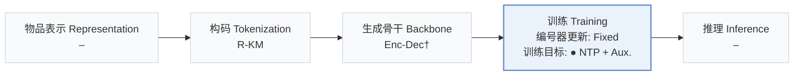
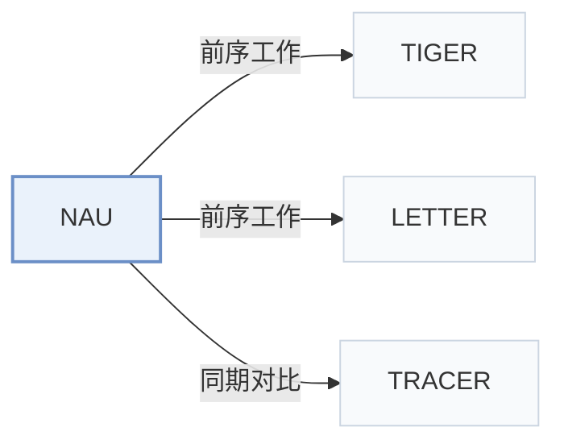

# NAU

[← 问题 × 阶段矩阵](../../../README.zh.md#iv--training) · [按阶段索引](../index/stages.md) · [按模态找论文](../index/modality.md) · [按领域找论文](../index/domain.md) · [English](../../papers/nau.md) | 中文

| **题目** | *Neighborhood-Aware Unlearning for Generative Recommendation* |
| :-- | :-- |
| **作者** | Lubitzsch et al. |
| **发表** | arXiv’26 |
| **问题与阶段** | `IV. 实用目标` · `训练（Training）` |
| **改动** | ● 训练目标 |
| **构码输入** | `其他`（量化前物品向量，来源未写） |
| **领域** | `电商` |
| **应用场景** | `一般物品推荐`；`公开数据` |
| **链接** | [论文](https://arxiv.org/abs/2610.27232) · [代码](https://github.com/pierre-lubitzsch/neighborhood-aware-unlearning) |
| **阅读级别** | 概览（第 1 级） |

**本页目录**：[TL;DR](#tldr) · [3. 实验发现](#3-实验发现) · [5. 相关工作](#5-相关工作)

- `R-KM`：残差 k-means 量化（Residual k-means）。
- `Enc-Dec†`：编码器-解码器架构（由配置推断）。
- `Fixed`：先独立训练并冻结编号器，生成器训练期间 SID 保持不变。
- `NTP + Aux.`：下一 token 预测结合辅助正则或对齐损失。

### TL;DR

> [!NOTE]
> NAU 针对共享 token 导致遗忘操作波及邻近物品的问题，在交互级机器遗忘中显式控制被遗忘物品 SID 邻域上的概率质量。

---

### 3. 实验发现

实验设置

- **数据集**：Amazon Beauty, Sports, Toys using released five-core preprocessing. Table 24 additionally lists Food k5 SID diagnostics; its source and preprocessing details not reported.
  - 出处：Section 4 and Appendix H Table 24: [S4.p2](https://arxiv.org/html/2610.27232v1#S4.p2) and [A8.T24](https://arxiv.org/html/2610.27232v1#A8.T24)
- **切分**：Chronological train/validation/test; allocation sizes not reported. Training histories capped at 20 items; all unlearning methods start from the same original model.
  - 出处：Appendix A: [A1.p1](https://arxiv.org/html/2610.27232v1#A1.p1)
- **候选集**：not reported; no items are filtered from generated candidates during unlearning evaluation.
  - 出处：Section 4 and Appendix A: [S4.p6](https://arxiv.org/html/2610.27232v1#S4.p6) and [A1.p1](https://arxiv.org/html/2610.27232v1#A1.p1)
- **可见性**：warm; no unseen-item protocol is defined. Users, items and SIDs remain fixed during NAU.
  - 出处：Sections 2/4 study interaction deletion with existing items, without an unseen-item protocol: [S2](https://arxiv.org/html/2610.27232v1#S2) and [S4](https://arxiv.org/html/2610.27232v1#S4)
- **SID 规格**：RQ-KMeans/RQ-VAE diagnostics: 3 semantic levels plus fourth deduplication level. Codebook sizes not reported; Table 24 shows 256 occupied first-level RQ-KMeans codes. LETTER and TRACER-compatible tokenizers also evaluated; their sizes not reported.
  - 出处：Section 4 and Appendix H Table 24: [S4.p2](https://arxiv.org/html/2610.27232v1#S4.p2) and [A8.T24](https://arxiv.org/html/2610.27232v1#A8.T24)
- **推理预算**：Top-10 utility/exposure metrics; beam width, inference hardware, inference batch size and recommendation latency not reported. One H200 and NAU's 3.9s measure unlearning per request, not recommendation inference.
  - 出处：Section 4 and Appendix D Table 9: [S4.p6](https://arxiv.org/html/2610.27232v1#S4.p6) and [A4.T9](https://arxiv.org/html/2610.27232v1#A4.T9)
- **结果来源**：Original Tables 1/3/4: spam/unwanted-item removal; Appendices D/F: extended results. Five data seeds. RQ-KMeans selection uses validation; other-tokenizer operating-point selection uses test results.
  - 出处：Section 5 and Appendix D: [S5.p1](https://arxiv.org/html/2610.27232v1#S5.p1) and [S5.p8](https://arxiv.org/html/2610.27232v1#S5.p8) and [S5.p9](https://arxiv.org/html/2610.27232v1#S5.p9) and [A4.p1](https://arxiv.org/html/2610.27232v1#A4.p1)

---

### 5. 相关工作

- **前序工作** · [TIGER](tiger.md): Supplies the generative backbone for the interaction-unlearning experiments.
  - 出处：NAU v1, Section 4: [S4.p2](https://arxiv.org/html/2610.27232v1#S4.p2).
- **前序工作** · [LETTER](letter.md): Its collaboratively regularized tokenizer is used to test NAU across SID constructions.
  - 出处：NAU v1, Section 4 and Appendix D: [S4.p2](https://arxiv.org/html/2610.27232v1#S4.p2); [A4.p5](https://arxiv.org/html/2610.27232v1#A4.p5).
- **同期对比** · [TRACER](tracer.md): Reassigns concept-item SIDs; NAU deletes interactions while preserving the identifiers.
  - 出处：NAU v1, Sections 4/6: [S4.p4](https://arxiv.org/html/2610.27232v1#S4.p4); [S6.p2](https://arxiv.org/html/2610.27232v1#S6.p2).

[查看同格全部论文](../../../README.zh.md#iv--training)
