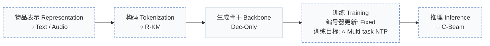
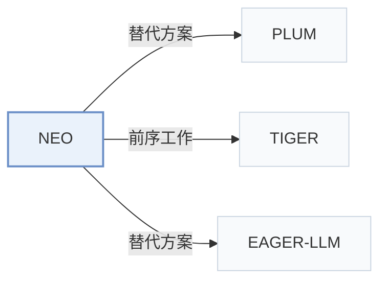

# NEO

[← 问题 × 阶段矩阵](../../../README.zh.md#范式系统与基准) · [按阶段索引](../index/stages.md) · [按模态找论文](../index/modality.md) · [按领域找论文](../index/domain.md) · [English](../../papers/neo.md) | 中文

| **题目** | *A Unified Language Model for Large Scale Search, Recommendation, and Reasoning* |
| :-- | :-- |
| **作者** | De Nadai et al. |
| **发表** | arXiv’26 |
| **问题与阶段** | `范式、系统与基准` · `无单一阶段` |
| **改动** | ○ 物品表示 · ○ 构码 · ○ 训练目标 · ○ 推理 |
| **构码输入** | A: `Text` · B: `Audio` |
| **领域** | `音乐` · `播客` · `图书与有声书` · `搜索` |
| **特殊设置** | `冷启动（用户）` |
| **应用场景** | `一般物品推荐` · `查询驱动检索`；`工业数据离线` |
| **链接** | [论文](https://arxiv.org/abs/2603.17533) |
| **阅读级别** | 概览（第 1 级） |

**本页目录**：[TL;DR](#tldr) · [3. 实验发现](#3-实验发现) · [5. 相关工作](#5-相关工作)

- `Text / Audio`：不同分支或评测设置下分别采用文本或音频表征。
- `R-KM`：残差 k-means 量化（Residual k-means）。
- `Dec-Only`：仅解码器（Decoder-only）自回归架构。
- `Fixed`：先独立训练并冻结编号器，生成器训练期间 SID 保持不变。
- `Multi-task NTP`：在多个对齐或推荐子任务上联合优化下一 token 预测损失。
- `C-Beam`：受合法物品集合约束的束搜索（Constrained beam search）。

### TL;DR

> [!NOTE]
> NEO 改造仅解码器 LLM，使自然语言与带类型的物品 SID 在同一序列中交错生成，配合受约束解码在不调用外部工具的情况下统一搜索、推荐与推理。

---

### 3. 实验发现

实验设置

- **数据集**：Industrial media logs: >10M episodes, shows, audiobooks and artists; about 15M users; 5M grounding examples, 10M instruction-training examples, 100K test examples. Filtering not reported.
  - 出处：Section 4.1: [S4.SS1.p1](https://arxiv.org/html/2603.17533v1#S4.SS1.p1)
- **切分**：Global temporal protocol: context through t, labels at t+k, evaluation at t+2k; k=1 day for episodes/shows, 7 days for audiobooks. Baselines share train/test windows; dates and validation allocation not reported.
  - 出处：Section 4.1.5: [S4.SS1.SSS5.p1](https://arxiv.org/html/2603.17533v1#S4.SS1.SSS5.p1)
- **候选集**：not reported; NEO and baselines use the same candidate universe.
  - 出处：Section 4.1.5 specifies a common candidate universe but not full-catalog versus sampled evaluation: [S4.SS1.SSS5.p1](https://arxiv.org/html/2603.17533v1#S4.SS1.SSS5.p1)
- **可见性**：warm; no unseen-item protocol is defined. User cold-start simulated by removing listening history and retaining user metadata.
  - 出处：Section 4.1.5 and its cold-user experiment: [S4.SS1.SSS5.p1](https://arxiv.org/html/2603.17533v1#S4.SS1.SSS5.p1) and [S4.SS1.SSS5.Px1.p1](https://arxiv.org/html/2603.17533v1#S4.SS1.SSS5.Px1.p1)
- **SID 规格**：Separate residual K-Means vocabularies by type: 4 x 256 for audiobooks/episodes/shows, 4 x 1024 for artists. Each collision bucket resolves to one popularity-selected item.
  - 出处：Section 4.1.2: [S4.SS1.SSS2.p2](https://arxiv.org/html/2603.17533v1#S4.SS1.SSS2.p2)
- **推理预算**：Trie-constrained beam 30; HR/NDCG@10/30. Top-p alternative: temperature 0.6, top-k 20, top-p 0.95. Inference hardware, batch size and absolute latency not reported; Table 3 latency@10 decreases 2.92% without constraints and 7.91% with sampling.
  - 出处：Section 4.2.1 and Table 3: [S4.SS2.SSS1.Px5.p2](https://arxiv.org/html/2603.17533v1#S4.SS2.SSS1.Px5.p2) and [S4.T3](https://arxiv.org/html/2603.17533v1#S4.T3)
- **结果来源**：Original Tables 5/8/9: production-baseline comparisons, cold/warm users and search breakdowns. Recommendation baseline is GNN/two-tower; search baseline dense retrieval. NEO uses about half the production baseline's historical logs.
  - 出处：Original Tables 5/8/9 and Sections 4.1.1/4.2.3: [S4.T5](https://arxiv.org/html/2603.17533v1#S4.T5) and [A2.T8](https://arxiv.org/html/2603.17533v1#A2.T8) and [A2.T9](https://arxiv.org/html/2603.17533v1#A2.T9) and [S4.SS1.SSS1](https://arxiv.org/html/2603.17533v1#S4.SS1.SSS1) and [S4.SS2.SSS3.Px1.p1](https://arxiv.org/html/2603.17533v1#S4.SS2.SSS3.Px1.p1)

---

### 5. 相关工作

- **替代方案** · [PLUM](plum.md): Concurrent SID-LLM adaptation; NEO emphasizes mixed text-ID outputs and multiple item types.
  - 出处：NEO v1, Section 2 and Table 1: [S2.SS0.SSS0.Px3.p2](https://arxiv.org/html/2603.17533v1#S2.SS0.SSS0.Px3.p2); [S2.T1](https://arxiv.org/html/2603.17533v1#S2.T1).
- **前序工作** · [TIGER](tiger.md): Prior SID-based generative retrieval informs NEO's catalog-grounded item representation.
  - 出处：NEO v1, Introduction and Section 2, citing Rajput et al. (2024): [S1.p4](https://arxiv.org/html/2603.17533v1#S1.p4); [S2.SS0.SSS0.Px3.p1](https://arxiv.org/html/2603.17533v1#S2.SS0.SSS0.Px3.p1).
- **替代方案** · [EAGER-LLM](eager-llm.md): Motivates testing collaborative SID signals; NEO favors content-derived SIDs in its experiments.
  - 出处：NEO v1, Section 4.2.1, citing Hong et al. (2025): [S4.SS2.SSS1.Px4.p1](https://arxiv.org/html/2603.17533v1#S4.SS2.SSS1.Px4.p1).

[查看同格全部论文](../../../README.zh.md#范式系统与基准)
