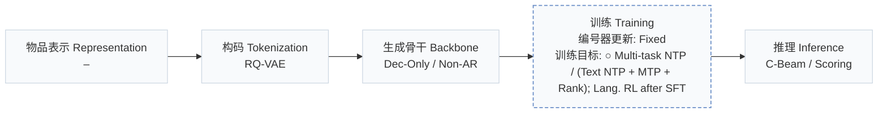
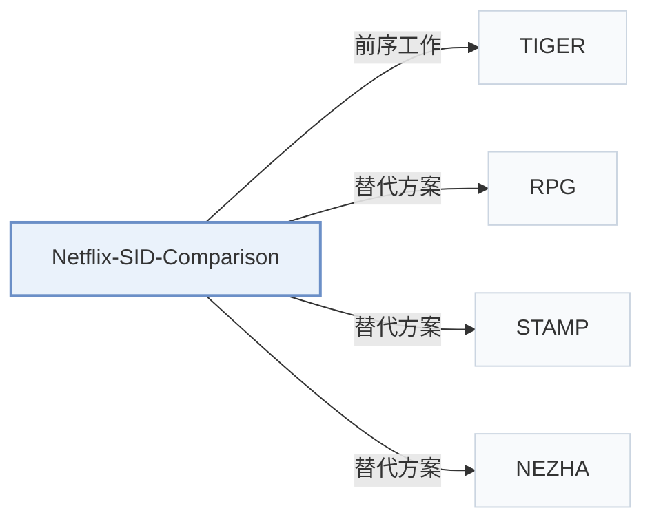

# Netflix-SID-Comparison

[← 问题 × 阶段矩阵](../../../README.zh.md#范式系统与基准) · [按阶段索引](../index/stages.md) · [按模态找论文](../index/modality.md) · [按领域找论文](../index/domain.md) · [English](../../papers/netflix-sid-comparison.md) | 中文

| **题目** | *Personalized LLM Recommendation with Semantic IDs: Autoregressive Beam Search vs. Multi-Token Prediction* |
| :-- | :-- |
| **作者** | Oh et al. |
| **发表** | NeurIPS’26 PALM Workshop |
| **问题与阶段** | `范式、系统与基准` · `无单一阶段` |
| **改动** | ○ 训练目标 |
| **构码输入** | `其他`（内容向量，组成模态未写） |
| **领域** | `长视频` |
| **特殊设置** | `冷启动（物品）` |
| **链接** | [论文](https://arxiv.org/abs/2610.15864) |
| **阅读级别** | 概览（第 1 级） |

**本页目录**：[TL;DR](#tldr) · [3. 实验发现](#3-实验发现) · [5. 相关工作](#5-相关工作)

- `RQ-VAE`：残差量化变分自编码器（Residual-Quantized VAE）。
- `Dec-Only / Non-AR`：涵盖仅解码器自回归与非自回归并行预测两种变体。
- `Fixed`：先独立训练并冻结编号器，生成器训练期间 SID 保持不变。
- `Multi-task NTP / (Text NTP + MTP + Rank); Lang. RL after SFT`：多任务下一 token 预测，或文本 NTP 加多 token 预测与排序损失；SFT 后接语言任务强化学习。
- `C-Beam / Scoring`：依配置采用约束束搜索或直接候选打分。

### TL;DR

> [!NOTE]
> Netflix-SID-Comparison 在流媒体工业场景中对比 LLM 生成 SID 时的单头自回归束搜索与多 token 预测在推荐质量与推理成本上的权衡。

---

### 3. 实验发现

实验设置

- **数据集**：Proprietary streaming-media member histories, synthetic content QA, and open instruction-following data; >=10M examples/task. Catalog size, exact corpus sizes and filtering not reported.
  - 出处：[S4.SS1.SSS0.Px1.p1](https://arxiv.org/html/2610.15864v1#S4.SS1.SSS0.Px1.p1) ; #S4.SS1.SSS0.Px3.p1
- **切分**：Histories snapshotted at a fixed date-hour; internal ranking test averages future-interaction offsets +1 through +7 days. Exact cutoff and train/validation/test sizes not reported; content QA uses a stratified test set.
  - 出处：[S4.SS1.SSS0.Px1.p1](https://arxiv.org/html/2610.15864v1#S4.SS1.SSS0.Px1.p1) ; #S4.SS1.SSS0.Px4.p1
- **候选集**：not reported; trie/request-eligible catalog constraints define serving validity, but the ranking test universe and evaluation negative sampling are not specified.
  - 出处：[S3.SS3.SSS1.p1](https://arxiv.org/html/2610.15864v1#S3.SS3.SSS1.p1) ; #S3.SS3.SSS2.p1 ; #S4.SS1.SSS0.Px4.p1
- **可见性**：Cold-start cohort: titles launched after training cutoff, without training engagement. Generator exposure through content QA and tokenizer fitting exposure not reported; unseen by generator only versus unseen by tokenizer too is not established.
  - 出处：[S4.SS1.SSS0.Px4.p1](https://arxiv.org/html/2610.15864v1#S4.SS1.SSS0.Px4.p1) ; #S4.SS3.SSS0.Px1.p1 ; #S4.SS1.SSS0.Px3.p1
- **SID 规格**：Frozen snapshot of RQ-VAE identifiers: 4 x 1024. For collisions (<=1% example rate), return the first entity in the SID bucket.
  - 出处：[S3.SS1.p1](https://arxiv.org/html/2610.15864v1#S3.SS1.p1) ; #S4.SS1.SSS0.Px1.p1
- **推理预算**：Single-head: vLLM constrained beam search with prefix caching; MTP: one-pass per-code distributions and eligible-entity scoring. Beam width, output K, inference batch size and latency not reported. Shared training/inference pool: up to 256 H200/A100-80GB GPUs; inference allocation not reported. MTP throughput is 75% higher on 8B.
  - 出处：[S3.SS3](https://arxiv.org/html/2610.15864v1#S3.SS3) ; #S4.SS1.SSS0.Px2.p1 ; #S4.T2 ; #S4.SS2.SSS0.Px2.p1
- **结果来源**：Original Tables 1-2: controlled single-head versus MTP quality/system comparison. Tables 3-4: SID recipe versus previous non-SID auxiliary-head baseline; Tables 5-7: ablations. Proprietary scores/costs reported relatively; no imported baseline result table identified.
  - 出处：[S4.T1](https://arxiv.org/html/2610.15864v1#S4.T1) ; #S4.T2 ; #S4.T3 ; #S4.T4 ; #S4.SS2.p1

---

### 5. 相关工作

- **前序工作** · [TIGER](tiger.md): The single-head arm follows TIGER-style autoregressive SID generation with constrained beam search in a multitask streaming-media LLM.
  - 出处：Netflix comparison v1, Introduction and Section 3.2.1: [S1.p3](https://arxiv.org/html/2610.15864v1#S1.p3); [S3.SS2.SSS1.p1](https://arxiv.org/html/2610.15864v1#S3.SS2.SSS1.p1).
- **替代方案** · [RPG](rpg.md): RPG pairs parallel SID prediction with graph-constrained decoding; this study strengthens its MTP arm with an auxiliary item-ranking loss and tests moderate four-token SIDs.
  - 出处：Netflix comparison v1, Sections 2/3.2.2/4.2: [S2.SS0.SSS0.Px2.p1](https://arxiv.org/html/2610.15864v1#S2.SS0.SSS0.Px2.p1); [S3.SS2.SSS2.Px1.p1](https://arxiv.org/html/2610.15864v1#S3.SS2.SSS2.Px1.p1); [S4.SS2.SSS0.Px3.p1](https://arxiv.org/html/2610.15864v1#S4.SS2.SSS0.Px3.p1).
- **替代方案** · [STAMP](stamp.md): STAMP uses auxiliary multi-token prediction to densify training supervision; this study compares MTP and autoregressive decoding as generation paradigms.
  - 出处：Netflix comparison v1, Section 2: [S2.SS0.SSS0.Px2.p1](https://arxiv.org/html/2610.15864v1#S2.SS0.SSS0.Px2.p1).
- **替代方案** · [NEZHA](nezha.md): NEZHA accelerates SID beam search using self-drafting and hash-set verification; this study addresses generation quality and cost rather than only decoding acceleration.
  - 出处：Netflix comparison v1, Section 2: [S2.SS0.SSS0.Px3.p1](https://arxiv.org/html/2610.15864v1#S2.SS0.SSS0.Px3.p1).

[查看同格全部论文](../../../README.zh.md#范式系统与基准)
