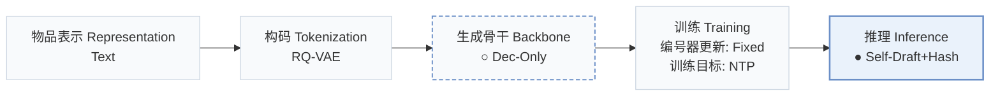
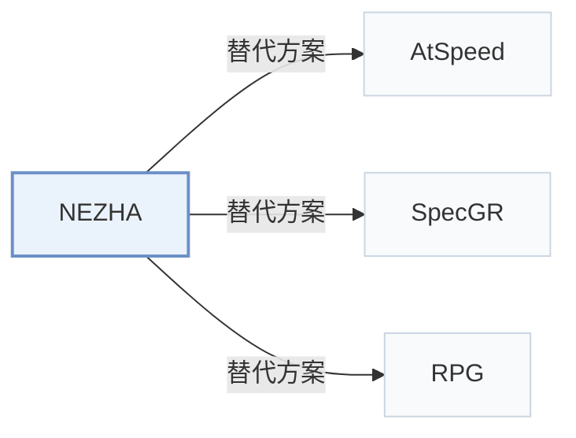

# NEZHA

[← 问题 × 阶段矩阵](../../../README.zh.md#v--inference) · [按阶段索引](../index/stages.md) · [按模态找论文](../index/modality.md) · [按领域找论文](../index/domain.md) · [English](../../papers/nezha.md) | 中文

| **题目** | *A Zero-sacrifice and Hyperspeed Decoding Architecture for Generative Recommendations* |
| :-- | :-- |
| **作者** | Wang et al. |
| **发表** | WWW’26 Industry |
| **问题与阶段** | `V. 效率` · `推理（Inference）` |
| **改动** | ○ 生成骨干 · ● 推理 |
| **构码输入** | `Text` |
| **领域** | `电商` · `本地生活与 POI` · `广告` · `搜索` |
| **应用场景** | `一般物品推荐`；`线上实验或部署` |
| **链接** | [论文](https://arxiv.org/abs/2511.18793) |
| **阅读级别** | 概览（第 1 级） |

**本页目录**：[TL;DR](#tldr) · [3. 实验发现](#3-实验发现) · [5. 相关工作](#5-相关工作)

- `Text`：物品文本元数据（标题、描述、类目或提示词）。
- `RQ-VAE`：残差量化变分自编码器（Residual-Quantized VAE）。
- `Dec-Only`：仅解码器（Decoder-only）自回归架构。
- `Fixed`：先独立训练并冻结编号器，生成器训练期间 SID 保持不变。
- `NTP`：标准下一 token 预测（Next-Token Prediction）交叉熵损失；基于预训练 LLM 的指令微调（SFT）亦归入此类。
- `Self-Draft+Hash`：自草稿投机生成配合哈希集合合法性校验。

### TL;DR

> [!NOTE]
> NEZHA 在主模型内部加入自回归草稿头实现自起草，并用合法 ID 哈希集合验证草稿，省去独立草稿模型和基于模型的验证器。

---

### 3. 实验发现

实验设置

- **数据集**：Yelp, Amazon Beauty, Amazon Games; filtering rules not reported. Deployment uses Taobao Search Advertising production data; size, dates and filtering not reported.
  - 出处：[S4.SS1.p1](https://arxiv.org/html/2511.18793v1#S4.SS1.p1) ; #S5.p1
- **切分**：Public per-user leave-one-out: last interaction test, penultimate validation, remainder training. Production offline split not reported; online A/B lasts seven days, traffic allocation not reported.
  - 出处：[S4.SS1.p1](https://arxiv.org/html/2511.18793v1#S4.SS1.p1) ; #S5.p3
- **候选集**：not reported
  - 出处：Section 4.1 specifies metrics and beam size, not an evaluation universe: [S4.SS1](https://arxiv.org/html/2511.18793v1#S4.SS1)
- **可见性**：warm; no unseen-item protocol is defined. Tokenizer fitting exposure to test items not reported.
  - 出处：[S4.SS1.p1](https://arxiv.org/html/2511.18793v1#S4.SS1.p1) ; #S4.SS1.p4
- **SID 规格**：Public RQ-VAE: 3 x 512, using embeddings of textual item attributes. Production uses three levels with different, unreported codebook sizes. Collision handling not reported; hash-set verification filters invalid generated SIDs.
  - 出处：[S4.SS1.p4](https://arxiv.org/html/2511.18793v1#S4.SS1.p4) ; #S3.SS3.p6
- **推理预算**：Public beam 10, HR/NDCG@5/10; mean prefill+decode latency on Beauty/Games/Yelp: Llama 7.00/7.52/7.41 ms, Qwen 4.41/4.80/4.46 ms. Production benchmark beam 512; 2.6x algorithm speedup, deployed total latency <30 ms including queue savings. GPU model/count and inference batch size not reported.
  - 出处：[S4.SS1.p4](https://arxiv.org/html/2511.18793v1#S4.SS1.p4) ; #S3.T3 ; #S1.T1 ; #S1.p3 ; #S5.p2
- **结果来源**：Original Table 3: public beam/MTP/NEZHA comparison, means over seeds 42/43/44; Table 4: Yelp ablations. Section 5: production offline hit-rate gains and seven-day online revenue test. No imported baseline results identified.
  - 出处：[S3.T3](https://arxiv.org/html/2511.18793v1#S3.T3) ; #S4.T4 ; #S4.SS1.p4 ; #S5.p3

---

### 5. 相关工作

- **替代方案** · [AtSpeed](atspeed.md): AtSpeed uses a separate draft model and target-model verification; NEZHA uses an internal autoregressive draft head and hash-set validation. AtSpeed is omitted from public comparisons.
  - 出处：NEZHA v1, Sections 2.2/4.1: [S2.SS2.p2](https://arxiv.org/html/2511.18793v1#S2.SS2.p2); [S4.SS1.p2](https://arxiv.org/html/2511.18793v1#S4.SS1.p2).
- **替代方案** · [SpecGR](specgr.md): SpecGR supports out-of-vocabulary recommendation with speculative inference; NEZHA removes separate drafting and costly target-model verification for fast catalog-valid generation.
  - 出处：NEZHA v1, Sections 1/6, citing Ding et al. (2024): [S1.p4](https://arxiv.org/html/2511.18793v1#S1.p4); [S6.p2](https://arxiv.org/html/2511.18793v1#S6.p2); [S6.p6](https://arxiv.org/html/2511.18793v1#S6.p6).
- **替代方案** · [RPG](rpg.md): RPG uses long semantic IDs and graph-based parallel decoding; NEZHA retains sequential dependencies through a lightweight autoregressive draft head.
  - 出处：NEZHA v1, Sections 3.2/6: [S3.SS2.p7](https://arxiv.org/html/2511.18793v1#S3.SS2.p7); [S6.p2](https://arxiv.org/html/2511.18793v1#S6.p2).

[查看同格全部论文](../../../README.zh.md#v--inference)
