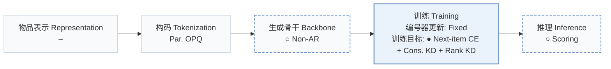
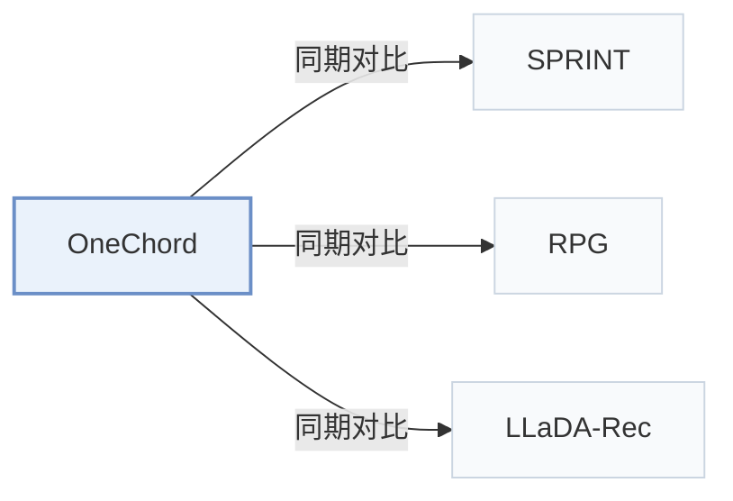

# OneChord

[← 问题 × 阶段矩阵](../../../README.zh.md#iv--training) · [按阶段索引](../index/stages.md) · [按模态找论文](../index/modality.md) · [按领域找论文](../index/domain.md) · [English](../../papers/onechord.md) | 中文

| **题目** | *Distill What You Rank, Recommend in One Pass* |
| :-- | :-- |
| **作者** | Li et al. |
| **发表** | arXiv’26 |
| **问题与阶段** | `IV. 实用目标` · `训练（Training）` |
| **改动** | ○ 生成骨干 · ● 训练目标 · ○ 推理 |
| **构码输入** | `其他`（固定OPQ，输入未写） |
| **领域** | `电商` |
| **链接** | [论文](https://arxiv.org/abs/2610.25805) · [代码](https://anonymous.4open.science/r/OneChord-D1A2/) |
| **阅读级别** | 概览（第 1 级） |

**本页目录**：[TL;DR](#tldr) · [3. 实验发现](#3-实验发现) · [5. 相关工作](#5-相关工作)

- `Par. OPQ`：并行优化乘积量化，生成无序多子空间码。
- `Non-AR`：非自回归（Non-autoregressive）并行预测架构。
- `Fixed`：先独立训练并冻结编号器，生成器训练期间 SID 保持不变。
- `Next-item CE + Cons. KD + Rank KD`：下一物品交叉熵联合一致性知识蒸馏与排序蒸馏。
- `Scoring`：直接计算候选物品得分，不逐位生成 SID。

### TL;DR

> [!NOTE]
> OneChord 在并行解码器中用经全库归一化的 SID 证据与物品匹配分数融合形式统一监督、蒸馏与推理，使训练目标与线上排序一致。

---

### 3. 实验发现

实验设置

- **数据集**：Amazon 2014 5-core Sports/Beauty/Toys; Amazon 2023 5core/last_out_w_his Scientific/Instruments/Games, reconstructing each user's longest chronological sequence.
  - 出处：Section 4.1 and Appendix B.1: [S4.SS1.SSS0.Px1.p1](https://arxiv.org/html/2610.25805v1#S4.SS1.SSS0.Px1.p1) and [A2.SS1.p1](https://arxiv.org/html/2610.25805v1#A2.SS1.p1)
- **切分**：Last two interactions validation/test; sliding training windows over earlier interactions, history cap 20; one validation/test target per user.
  - 出处：Appendix B.1: [A2.SS1.p1](https://arxiv.org/html/2610.25805v1#A2.SS1.p1)
- **候选集**：full catalog of distinct legal SIDs; identical SIDs share one entry; exact four-code match determines hits.
  - 出处：Appendix B.1: [A2.SS1.p2](https://arxiv.org/html/2610.25805v1#A2.SS1.p2)
- **可见性**：warm; no unseen-item protocol is defined. Fixed OPQ mapping covers every processed item.
  - 出处：Appendix B.1: [A2.SS1.p1](https://arxiv.org/html/2610.25805v1#A2.SS1.p1) and [A2.SS1.p2](https://arxiv.org/html/2610.25805v1#A2.SS1.p2)
- **SID 规格**：Four-code OPQ, 256 codes/position; collisions remain merged as one catalog entry.
  - 出处：Appendix A.5: [A1.SS5.SSS0.Px1.p1](https://arxiv.org/html/2610.25805v1#A1.SS5.SSS0.Px1.p1)
- **推理预算**：One encoder/parallel-decoder pass plus catalog scoring; no beam. Recall/NDCG@5; full-test Top-10 generation 0.23-1.24 s; test batch 256. Hardware and per-request latency: not reported.
  - 出处：Section 3.6, Section 4.2 and Appendix B.3: [S3.SS6.SSS0.Px3.p1](https://arxiv.org/html/2610.25805v1#S3.SS6.SSS0.Px3.p1) and [S4.SS2.SSS0.Px1.p1](https://arxiv.org/html/2610.25805v1#S4.SS2.SSS0.Px1.p1) and [A2.SS3.SSS0.Px2.p1](https://arxiv.org/html/2610.25805v1#A2.SS3.SSS0.Px2.p1)
- **结果来源**：Reported Tables 1/2/3/4: accuracy, full-test cost, ablations, sparsity groups. OneChord accuracy is five-run mean/SD; baselines use common splits, but borrowed-versus-rerun provenance is not reported.
  - 出处：Tables 1-4 and Appendix B.2-B.3: [S3.T1](https://arxiv.org/html/2610.25805v1#S3.T1) and [S3.T2](https://arxiv.org/html/2610.25805v1#S3.T2) and [S4.T3](https://arxiv.org/html/2610.25805v1#S4.T3) and [S4.T4](https://arxiv.org/html/2610.25805v1#S4.T4) and [A2.SS2.p1](https://arxiv.org/html/2610.25805v1#A2.SS2.p1) and [A2.SS3.SSS0.Px3.p1](https://arxiv.org/html/2610.25805v1#A2.SS3.SSS0.Px3.p1)

---

### 5. 相关工作

- **同期对比** · [SPRINT](sprint.md): SPRINT adds normalized SID/item evidence; OneChord learns and distills the fusion.
  - 出处：OneChord v1, Section 2 and Table 1: [S2.SS0.SSS0.Px2.p1](https://arxiv.org/html/2610.25805v1#S2.SS0.SSS0.Px2.p1); [S3.T1](https://arxiv.org/html/2610.25805v1#S3.T1).
- **同期对比** · [RPG](rpg.md): RPG is compared for full-catalog accuracy and complete-test generation cost.
  - 出处：OneChord v1, Tables 1-2: [S3.T1](https://arxiv.org/html/2610.25805v1#S3.T1); [S3.T2](https://arxiv.org/html/2610.25805v1#S3.T2).
- **同期对比** · [LLaDA-Rec](llada-rec.md): LLaDA-Rec is a diffusion-based baseline in the accuracy/cost comparison.
  - 出处：OneChord v1, Tables 1-2: [S3.T1](https://arxiv.org/html/2610.25805v1#S3.T1); [S3.T2](https://arxiv.org/html/2610.25805v1#S3.T2).

[查看同格全部论文](../../../README.zh.md#iv--training)
