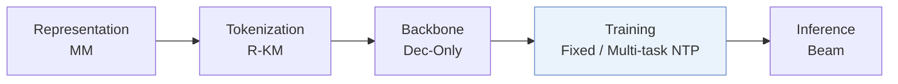
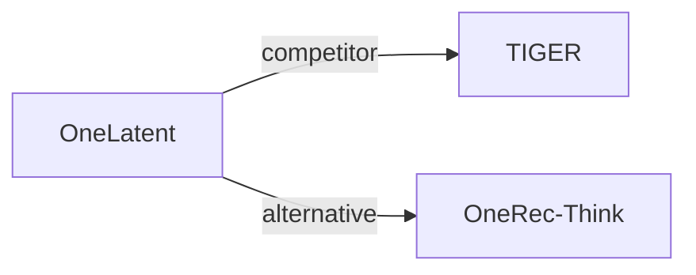

# OneLatent

*Latent Reasoning for Efficient Foundation Recommendation Models* — Jiang et al. · arXiv’26

`V. 效率` · `Training` · [论文](https://arxiv.org/abs/2610.30675) · [矩阵](../../../README.zh.md#v--training) · [English](../../papers/onelatent.md)

阅读级别：概览（第 1 级） · 本页目录：[TL;DR](#tldr) · [速览](#速览) · [3. 实验发现](#3-实验发现) · [5. 相关工作](#5-相关工作)

- `MM`: Multimodal item representations.
- `R-KM`: Residual k-means.
- `Dec-Only`: Decoder-only.
- `Fixed`: SIDs are built first and not changed while the generator trains.
- `Multi-task NTP`: The same NTP loss over several tasks.

### TL;DR

> [!NOTE]
> OneLatent 通过多视图教师轨迹、分阶段对齐与课程式后训练，将显式思维链压缩为可学习隐 token，避免在推理时生成长推理文本。

### 速览

| 维度 | 摘要 |
| :-- | :-- |
| 研究问题 | V. 效率：Can it be trained and served within latency and cost budgets? |
| 核心贡献 | OneLatent 通过多视图教师轨迹、分阶段对齐与课程式后训练，将显式思维链压缩为可学习隐 token，避免在推理时生成长推理文本。 |
| 主要改动阶段 | Training |

### 3. 实验发现

实验设置

- **数据集**：Kuaishou LLM-Rec advertising and seven-day industrial local-services logs. Deduplicate user-item interactions by strongest feedback; remove samples lacking profile/target SID and history items lacking SIDs.
  - 出处：Section 4.1.1 and Appendix A.2: [S4.SS1.SSS1.p1](https://arxiv.org/html/2610.30675v1#S4.SS1.SSS1.p1) and [A1.SS2.p2](https://arxiv.org/html/2610.30675v1#A1.SS2.p2) and [A1.SS2.p4](https://arxiv.org/html/2610.30675v1#A1.SS2.p4)
- **切分**：Allocation rule: not reported. SFT/CoT/test counts: industrial 100063/59113/20393; public 60000/30000/10000. Conversion targets use at most 50 preceding interactions.
  - 出处：Table 1 and Appendix A.2: [S4.T1](https://arxiv.org/html/2610.30675v1#S4.T1) and [A1.SS2.p3](https://arxiv.org/html/2610.30675v1#A1.SS2.p3)
- **候选集**：not reported
  - 出处：Section 4.1.3 gives generation metrics without a full-catalog/sampled candidate protocol: [S4.SS1.SSS3.p1](https://arxiv.org/html/2610.30675v1#S4.SS1.SSS3.p1)
- **可见性**：warm; no unseen-item protocol is defined.
  - 出处：Sections 4.1.1 and Appendix A.2 define no unseen-item evaluation: [S4.SS1.SSS1.p1](https://arxiv.org/html/2610.30675v1#S4.SS1.SSS1.p1) and [A1.SS2](https://arxiv.org/html/2610.30675v1#A1.SS2)
- **SID 规格**：Multimodal Res-Kmeans, 3 levels x 1024 codes; collision handling: not reported.
  - 出处：Section 3.3.1 and Table 10: [S3.SS3.SSS1.p1](https://arxiv.org/html/2610.30675v1#S3.SS3.SSS1.p1) and [A1.T10](https://arxiv.org/html/2610.30675v1#A1.T10)
- **推理预算**：vLLM beam search; SID/ID Hit@1/16/32/64; three fixed latent tokens, no rationale decoding. 872-instance test: total 3.17 s, 274.29 QPS. Beam width, hardware, inference batch size: not reported.
  - 出处：Sections 3.4.3, 4.1.3, 4.4.2 and Table 7: [S3.SS4.SSS3.p1](https://arxiv.org/html/2610.30675v1#S3.SS4.SSS3.p1) and [S4.SS1.SSS3.p1](https://arxiv.org/html/2610.30675v1#S4.SS1.SSS3.p1) and [S4.SS4.SSS2.p1](https://arxiv.org/html/2610.30675v1#S4.SS4.SSS2.p1) and [S4.T7](https://arxiv.org/html/2610.30675v1#S4.T7)
- **结果来源**：Reported Tables 2/3/7/9: main, matched-size scaling, efficiency, online A/B. Table 2's final gains compare matched Think-OR, not strongest baseline; baseline borrowed/rerun provenance not reported.
  - 出处：Tables 2/3/7/9 and Section 4.2: [S4.T2](https://arxiv.org/html/2610.30675v1#S4.T2) and [S4.T3](https://arxiv.org/html/2610.30675v1#S4.T3) and [S4.T7](https://arxiv.org/html/2610.30675v1#S4.T7) and [S4.T9](https://arxiv.org/html/2610.30675v1#S4.T9) and [S4.SS2.SSS0.Px1.p1](https://arxiv.org/html/2610.30675v1#S4.SS2.SSS0.Px1.p1)

### 5. 相关工作

- **同期对比** · [TIGER](tiger.md): TIGER is a SID-based generative baseline in the reported comparison.
  - 出处：OneLatent v1, Section 4.1.2 and Table 2: https://arxiv.org/html/2610.30675v1#S4.SS1.SSS2.p1; https://arxiv.org/html/2610.30675v1#S4.T2.
- **替代方案** · [OneRec-Think](onerec-think.md): OneRec-Think uses explicit CoT plus RL; OneLatent trains a compact latent interface.
  - 出处：OneLatent v1, Section 2.2: https://arxiv.org/html/2610.30675v1#S2.SS2.p1.

[查看同格全部论文](../../../README.zh.md#v--training)
