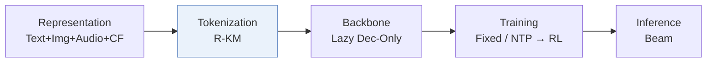
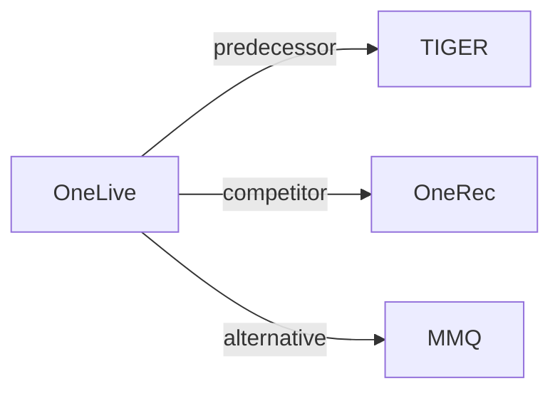

# OneLive

*Dynamically Unified Generative Framework for Live-Streaming Recommendation* — Wang et al. · KDD’26 ADS

`VI. 泛化` · `Tokenization` · [论文](https://arxiv.org/abs/2602.08612) · [矩阵](../../../README.zh.md#vi--tokenization) · [English](../../papers/onelive.md)

阅读级别：概览（第 1 级） · 本页目录：[TL;DR](#tldr) · [速览](#速览) · [3. 实验发现](#3-实验发现) · [5. 相关工作](#5-相关工作)

- `Text+Img+Audio+CF`: Text, visual, and audio content combined with collaborative signals.
- `R-KM`: Residual k-means.
- `Lazy Dec-Only`: A lazy decoder-only architecture that concentrates decoder computation on target generation.
- `Fixed`: SIDs are built first and not changed while the generator trains.
- `NTP → RL`: NTP, then reinforcement learning (GRPO, GBPO, etc.).

### TL;DR

> [!NOTE]
> OneLive 结合动态残差量化编号器、时间感知门控注意力、带序列式多 token 预测的仅解码器生成器与多目标对齐，将生成式推荐用于直播场景。

### 速览

| 维度 | 摘要 |
| :-- | :-- |
| 研究问题 | VI. 泛化：Does it still work for new items, new domains, and shifting interests? |
| 核心贡献 | OneLive 结合动态残差量化编号器、时间感知门控注意力、带序列式多 token 预测的仅解码器生成器与多目标对齐，将生成式推荐用于直播场景。 |
| 主要改动阶段 | Tokenization |

### 3. 实验发现

实验设置

- **数据集**：Kuaishou live-streaming logs over nearly two months: 400M users, 3M authors, billions of long-view/click interactions. Filtering rules not reported.
  - 出处：Appendix B.1.1: [A2.SS1.SSS1.p1](https://arxiv.org/html/2602.08612v1#A2.SS1.SSS1.p1)
- **切分**：Last day test, earlier dates training; validation allocation not reported. Online A/B observed nearly one month on Kuaishou/Kuaishou Lite; traffic allocation not reported.
  - 出处：Appendix B.1.1 and Section 3.2: [A2.SS1.SSS1.p1](https://arxiv.org/html/2602.08612v1#A2.SS1.SSS1.p1) and [S3.SS2.p1](https://arxiv.org/html/2602.08612v1#S3.SS2.p1)
- **候选集**：not reported; only ongoing live streams are eligible.
  - 出处：Introduction and Appendix C.2 specify live eligibility/generated-list metrics, not a sampled-negative protocol: [S1.p5](https://arxiv.org/html/2602.08612v1#S1.p5) and [A3.SS2.p1](https://arxiv.org/html/2602.08612v1#A3.SS2.p1)
- **可见性**：warm; no unseen-item protocol is defined. Collaborative post-alignment and author SID updates use real-time signals; test-author exposure in tokenizer training not reported.
  - 出处：Appendix B.1 defines no item holdout: [A2.SS1](https://arxiv.org/html/2602.08612v1#A2.SS1) and [S2.SS1.SSS1.p3](https://arxiv.org/html/2602.08612v1#S2.SS1.SSS1.p3)
- **SID 规格**：Res-Kmeans: 3 levels x 8192 codes. Collision rates measured; collision disambiguation not reported.
  - 出处：Section 2.1.2: [S2.SS1.SSS2.p2](https://arxiv.org/html/2602.08612v1#S2.SS1.SSS2.p2)
- **推理预算**：HR/MRR@64/128; RL beam-top settings 64/256. L20 profiling: MTP graph latency mean/P99 2.25/3.62 ms (3 layers), 2.97/5.04 ms (6 layers); QPS gains 31.8%/62.0%. Main beam width and inference batch size not reported.
  - 出处：Section 3.1.2 and Tables 4/5: [S3.SS1.SSS2.p1](https://arxiv.org/html/2602.08612v1#S3.SS1.SSS2.p1) and [S3.T4](https://arxiv.org/html/2602.08612v1#S3.T4) and [S3.T5](https://arxiv.org/html/2602.08612v1#S3.T5)
- **结果来源**：Original Table 2: offline long-view/click comparisons on shared industrial logs; Tables 3-5: ablations/serving; Table 6: online A/B.
  - 出处：Table 2 and Sections 3.1/3.2: [S2.T2](https://arxiv.org/html/2602.08612v1#S2.T2) and [S3.p1](https://arxiv.org/html/2602.08612v1#S3.p1) and [S3.SS2.p1](https://arxiv.org/html/2602.08612v1#S3.SS2.p1)

### 5. 相关工作

- **前序工作** · [TIGER](tiger.md): OneLive extends SID generation to dynamic live-streaming content.
  - 出处：OneLive v1, Appendix A.2 and Table 2: https://arxiv.org/html/2602.08612v1#A1.SS2.p2; https://arxiv.org/html/2602.08612v1#S2.T2.
- **同期对比** · [OneRec](onerec.md): OneRec is adapted as the encoder-decoder live-streaming baseline.
  - 出处：OneLive v1, Section 3.1.2 and Table 2; cited Deng et al. (2025) is arXiv:2502.18965: https://arxiv.org/html/2602.08612v1#S3.SS1.SSS2.p1; https://arxiv.org/html/2602.08612v1#S2.T2.
- **替代方案** · [MMQ](mmq.md): MMQ aligns content with behavior; OneLive additionally updates author SIDs in real time.
  - 出处：OneLive v1, Appendix A.2 and Section 2.1: https://arxiv.org/html/2602.08612v1#A1.SS2.p2; https://arxiv.org/html/2602.08612v1#S2.SS1.

[查看同格全部论文](../../../README.zh.md#vi--tokenization)
